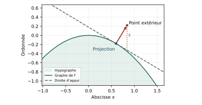
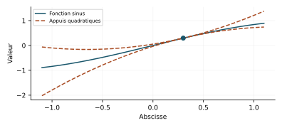

# X-ENS · PSI · Mathématiques 2020 · Corrigé brut

*Corrigé rédigé par IA, non officiel. Signalez toute erreur.*

**Rédaction** · GPT-6.2 Astra Ultra · vitesse non renseignée

**Révision (tour 1)** · GPT-6.2 Astra Ultra · vitesse non renseignée

On écrit $B=\|f\|_\infty$ lorsqu’une fonction $f$ est bornée. Pour une fonction minorée $h$, l’opérateur étudié est $T_\varepsilon h(x)=\inf_y(h(y)+\|y-x\|^\alpha/\varepsilon)$, avec $\varepsilon>0$ et $\alpha\ge1$.

Le sujet relie approximation lipschitzienne, hyperplans d’appui des fonctions concaves et régularité du gradient sous deux conditions de courbure. [Sujet officiel](https://ens-paris-saclay.fr/sites/default/files/CONCOURS/ANNALES_1C/1C_PSI/2020/2020_Sujet_1A_PSI_Maths.pdf) · [Rapport du jury](https://ens-paris-saclay.fr/sites/default/files/CONCOURS/ANNALES_1C/1C_PSI/2020/2020_Rapport_Ecrit_PSI_Maths.pdf)

## I. Régularisation par infimum

### Question 1

Si $h\ge m$, alors $h(y)+\|y-x\|^\alpha/\varepsilon\ge m$ pour tout $y$. L’ensemble des valeurs est non vide et l’une de ses valeurs, obtenue pour $y=x$, est $h(x)$. Son infimum réel satisfait donc $m\le T_\varepsilon h(x)\le h(x)$.

### Question 2

Le minimum $H$ est minoré par le minimum des deux minorants. Comme $H\le h_i$, on a $T_\varepsilon H\le\min_iT_\varepsilon h_i$. Pour tout $y$ et $c=\|y-x\|^\alpha/\varepsilon$, chacun des $h_i(y)+c$ majore $T_\varepsilon h_i(x)$. Leur minimum majore donc $\min_iT_\varepsilon h_i(x)$. En prenant l’infimum en $y$ on obtient l’inégalité inverse.

### Question 3

On a
$$\|y\|^2+\frac{\|y-x\|^2}{\varepsilon}=\frac{1+\varepsilon}{\varepsilon}\left\|y-\frac{x}{1+\varepsilon}\right\|^2+\frac{\|x\|^2}{1+\varepsilon}.$$
Le premier terme atteint zéro en $y=x/(1+\varepsilon)$, d’où $T_\varepsilon g(x)=\|x\|^2/(1+\varepsilon)$, y compris pour $x=0$.

### Question 4a

Pour $\alpha=1$, tout $y$ vérifie $h(y)+\|y-x\|/\varepsilon\le h(y)+\|y-z\|/\varepsilon+\|x-z\|/\varepsilon$. L’infimum donne $T_\varepsilon h(x)-T_\varepsilon h(z)\le\|x-z\|/\varepsilon$. L’échange de $x,z$ donne la borne en valeur absolue.

Ce passage à l’infimum reste valable si le coût ne possède aucun minimiseur. En effet, pour tout $\eta>0$ on choisit $y_\eta$ dont le coût en $z$ est inférieur à $T_\varepsilon h(z)+\eta$. La majoration du coût en $x$ donne $T_\varepsilon h(x)\le T_\varepsilon h(z)+\eta+\|x-z\|/\varepsilon$. On fait tendre $\eta$ vers zéro avant d’intervertir $x$ et $z$.

### Question 4b

Si $T_\varepsilon h=h$, 4a donne le caractère $1/\varepsilon$-lipschitzien. Inversement, si $h$ a cette propriété, $h(y)+\|y-x\|/\varepsilon\ge h(x)$ pour tout $y$. Par 1 l’infimum est alors égal à $h(x)$.

### Question 4c

Pour $k=\min(1,1/\varepsilon)$, $\|y\|+\|y-x\|/\varepsilon\ge k(\|y\|+\|y-x\|)\ge k\|x\|$. Les essais $y=x$ et $y=0$ donnent respectivement $\|x\|$ et $\|x\|/\varepsilon$. L’infimum vaut donc $k\|x\|$.

### Question 4d

La constante 1 est inchangée par $T_\varepsilon$ d’après 4b. D’après 2 et 4c, $T_\varepsilon\ell(x)=\min(1,\min(1,1/\varepsilon)\|x\|)$.

### Question 5

Écrivons $B=\|f\|_\infty$. Toute valeur du coût est au moins $-B$, tandis que $T_\varepsilon f(x)\le f(x)\le B$. Ainsi $\|T_\varepsilon f\|_\infty\le B$.

### Question 6

Le point $x$ appartient à $A(x)$. Pour $y\in A(x)$, $\|y-x\|^\alpha/\varepsilon\le f(x)-f(y)\le2B$, ce qui donne le rayon demandé. Hors de $A(x)$, le coût est strictement supérieur à $f(x)$, alors que le point $x\in A(x)$ donne exactement $f(x)$. Restreindre l’infimum à $A(x)$ conserve donc sa valeur.

### Question 7

Pour $f$ continue, $A(x)$ est le sous-niveau fermé d’une fonction continue de $y$, borné par 6 et non vide. Il est compact en dimension finie. Le coût continu y atteint son minimum en $y_x$, qui réalise l’infimum global d’après 6.

### Question 8

On a $T_\varepsilon f(x)\le f(y)+\|y-x\|^\alpha/\varepsilon$. En écrivant $f(x)-f(y)=f(x)-T_\varepsilon f(x)+T_\varepsilon f(x)-f(y)$, on obtient la majoration demandée dans un sens. Intervertir $x$ et $y$ donne la valeur absolue.

### Question 9a

La diagonale rend $B_0(r)$ non vide pour $r\ge0$ et les écarts sont bornés par $2B$. Le supremum est donc fini. En 8, pour ces couples, la pénalité est au plus $r^\alpha/\varepsilon$, donc $\omega_f(r)\le\|T_\varepsilon f-f\|_\infty+r^\alpha/\varepsilon$.

### Question 9b

Si $0\le r\le s$, l’inclusion $B_0(r)\subset B_0(s)$ implique $\omega_f(r)\le\omega_f(s)$.

### Question 10

Pour $y\in A(x)$, $f(y)\ge f(x)-\omega_f(r_\varepsilon)$ car $\|y-x\|\le r_\varepsilon=(2\varepsilon B)^{1/\alpha}$. En ajoutant la pénalité positive et en prenant l’infimum, $T_\varepsilon f(x)\ge f(x)-\omega_f(r_\varepsilon)$. La borne contraire $T_\varepsilon f\le f$ vient de 1. Le supremum donne le résultat.

### Question 11

Si $\omega_f(t)\to0$ en zéro, 10 donne la convergence uniforme car $r_{1/n}\to0$ (si $B=0$, $f=0$ et tout est immédiat). Réciproquement, pour une tolérance $\delta>0$, fixons $n$ tel que $\|T_{1/n}f-f\|_\infty<\delta/2$. Par 9a, $\omega_f(t)<\delta/2+nt^\alpha$, inférieur à $\delta$ pour $t$ assez petit. Ainsi la limite est nulle.

Dans le sens (i) vers (ii), le rayon $t_0=(\delta/(2n))^{1/\alpha}$ convient pour tout $0<t<t_0$. L’ordre des choix importe puisque l’indice $n$ doit contrôler l’erreur uniforme pour tous les couples de points. Le majorant $nt^\alpha$ devient alors petit avec $t$.

## II. Fonctions concaves et hyperplans d’appui

### Question 12

Additionner les deux inégalités de concavité donne celle de $f+f_0$. Si $m=\min(f,f_0)$, chacune des deux fonctions en $\lambda x+(1-\lambda)y$ est au moins $\lambda m(x)+(1-\lambda)m(y)$. Leur minimum satisfait donc la même borne.

### Question 13

Pour deux points, c’est la définition de la concavité. Par récurrence, si $\lambda_n<1$, formons $z=\sum_{i<n}\lambda_ix_i/(1-\lambda_n)$. La concavité entre $z$ et $x_n$, puis l’hypothèse de récurrence sur $z$, donnent $f(\sum_i\lambda_ix_i)\ge\sum_i\lambda_i f(x_i)$. Si $\lambda_n=1$, les autres poids sont nuls et l’égalité est immédiate.

### Question 14

L’unique inégalité $f(y)\ge\lambda f(x)+(1-\lambda)f(z)$ équivaut à $f(z)-f(y)\le\lambda(f(z)-f(x))$ et à $f(y)-f(x)\ge(1-\lambda)(f(z)-f(x))$. Les divisions par les nombres strictement positifs $\lambda$ et $1-\lambda$ donnent les deux bornes.

### Question 15a

Pour le sommet $X_\sigma=(M\sigma_1,\ldots,M\sigma_d)$ indexé par $\sigma_j\in\{-1,1\}$, posons $\lambda_\sigma=\prod_j\tfrac{1+\sigma_j x_j/M}{2}$, le produit portant sur les facteurs $(1+\sigma_jx_j/M)/2$. Ils sont positifs ou nuls. La sommation indépendante sur chaque signe donne $\sum_\sigma\lambda_\sigma=1$, et pour la coordonnée $j$, $\sum_\sigma M\sigma_j\lambda_\sigma=x_j$. D’où la décomposition voulue.

Pour vérifier explicitement le barycentre, fixons $k$. Les signes autres que $\sigma_k$ donnent chacun le facteur $\sum_{\sigma=\pm1}(1+\sigma x_j/M)/2=1$. Le facteur qui subsiste est $M\sum_{\sigma=\pm1}\sigma(1+\sigma x_k/M)/2=x_k$. La formule conserve aussi les points du bord, où certaines pondérations s’annulent.

### Question 15b

Par 13 et 15a, $f(x)\ge\sum_i\lambda_i f(X_i)\ge\min_i f(X_i)$. On pose $D=\min_i f(X_i)-f(0)$, qui est $\le0$ grâce à la même inégalité en zéro. Alors $f(x)-f(0)\ge D$ sur le cube.

### Question 15c

La concavité donne $2f(0)\ge f(x)+f(-x)$. Par 15b, $f(-x)\ge f(0)+D$, donc $f(x)-f(0)\le-D$. Avec la minoration, $|f(x)-f(0)|\le|D|$.

### Question 15d

Pour $x\ne y$ dans le petit cube, posons $r=\|y-x\|$ et $z=y+(M/(2r))(y-x)$. Chaque coordonnée de $z-y$ est de module au plus $M/2$, donc $z$ est dans le grand cube. La pente de la corde $xy$ est au moins celle de $yz$ par 14 : $f(y)-f(x)\ge(2r/M)(f(z)-f(y))\ge-4|D|r/M$ par 15c. Échangeons $x,y$ pour l’inégalité opposée. Le cas $x=y$ est immédiat.

### Question 15e

Chaque point et un voisinage de celui-ci sont contenus dans un petit cube $[-M/2,M/2]^d$ pour $M$ assez grand. Par 15d, $f$ est lipschitzienne sur ce cube, donc continue au point considéré.

La constante $4|D|/M$ dépend du cube choisi. Par exemple la fonction concave $x\mapsto-x^2$ est lipschitzienne sur chaque intervalle borné. Sur la droite entière, les quotients $|f(n+1)-f(n)|=2n+1$ sont arbitrairement grands. La continuité établie ici est donc bien une conclusion locale en chaque point.

### Question 16a

Choisissons $Z\in C$. L’intersection $C\cap\overline B(Y,\|Y-Z\|)$ est fermée, bornée, non vide et donc compacte. La distance à $Y$ y atteint son minimum, et tout point exclu est plus éloigné que $Z$. Le minimum global est donc atteint en un $Y_0$ de cette intersection.

### Question 16b

Pour $X\in C$, les points $Y_0+t(X-Y_0)$ avec $0\le t\le1$ restent dans $C$. Le carré de leur distance à $Y$ est minimal en zéro, donc sa dérivée à droite $-2\langle Y-Y_0,X-Y_0\rangle$ est positive ou nulle. C’est la caractérisation demandée.

### Question 16c

Pour $X\in C$, $\|Y-X\|^2=\|Y-Y_0\|^2+\|X-Y_0\|^2-2\langle Y-Y_0,X-Y_0\rangle\ge\|Y-Y_0\|^2+\|X-Y_0\|^2$. Un deuxième minimiseur aurait donc $\|X-Y_0\|^2=0$.

### Question 17a

L’hypographe $E_f$ est non vide et fermé car $f$ est continue par 15e. Si $s\le f(x)$ et $t\le f(y)$, la concavité donne $\lambda s+(1-\lambda)t\le f(\lambda x+(1-\lambda)y)$, donc $E_f$ est convexe. Par 16a et 16c, le point $Y=(x_*,f(x_*)+\varepsilon)$ admet un unique projeté $X_\varepsilon$ sur $E_f$.

### Question 17b

Si $y_\varepsilon<f(x_\varepsilon)$, la continuité de $f$ place $X_\varepsilon$ à l’intérieur de $E_f$. Comme $Y\notin E_f$, un petit déplacement de $X_\varepsilon$ en direction de $Y$ resterait alors dans $E_f$ et réduirait strictement la distance à $Y$. Ainsi $y_\varepsilon=f(x_\varepsilon)$.

### Question 17c

En 16b, prenons $Y_0=(x_\varepsilon,f(x_\varepsilon))$ et $X=(x,f(x))$. On obtient $\langle x_*-x_\varepsilon,x-x_\varepsilon\rangle+a(\varepsilon)(f(x)-f(x_\varepsilon))\le0$. En écrivant $x-x_\varepsilon=(x-x_*)+(x_*-x_\varepsilon)$, apparaît le carré de norme demandé.

### Question 17d

Avec $a=a(\varepsilon)$ et $x=x_*$, 17c donne $\|x_*-x_\varepsilon\|^2\le a(\varepsilon-a)$. Ainsi $0\le a\le\varepsilon$ et le membre droit est au plus $\varepsilon^2/4$. Si $a=0$, la norme est nulle, donc $a=f(x_*)-f(x_*)+\varepsilon=\varepsilon>0$, contradiction. On a bien $0<a\le\varepsilon$ et $\|x_*-x_\varepsilon\|\le\varepsilon/2$.

### Question 17e

Si $x_*\ne x_\varepsilon$, posons $v=(x_*-x_\varepsilon)/\|x_*-x_\varepsilon\|$. La forme non développée de 17c appliquée en $x=x_\varepsilon+v$ donne
$$\frac{\|x_*-x_\varepsilon\|}{a(\varepsilon)}\le f(x_\varepsilon)-f(x_\varepsilon+v).$$
Pour $\varepsilon\le1$, les deux points se trouvent dans la boule fermée de centre $x_*$ et de rayon $3/2$ par 17d. L’oscillation $K_0$ de la fonction continue $f$ sur ce compact les majore uniformément. Si les deux abscisses coïncident, le quotient est déjà nul.

### Question 18a

Les $a_n$ croissent et les $b_n$ décroissent, les intervalles restant emboîtés. La longueur est divisée par deux à chaque étape, donc $b_n-a_n=2K_0/2^n\to0$. Les deux suites sont ainsi adjacentes, de même limite $\ell$.

### Question 18b

Au départ tous les $u_k$ sont dans $[-K_0,K_0]$. Si l’intervalle au rang $n$ contient une infinité d’indices et si sa moitié gauche en contient une infinité, on la conserve. Sinon sa moitié droite en contient nécessairement une infinité. La propriété est donc héréditaire.

### Question 18c

Par 18b, choisissons $\varphi(0)$ dans le premier ensemble d’indices puis $\varphi(n+1)>\varphi(n)$ tel que $u_{\varphi(n+1)}\in[a_{n+1},b_{n+1}]$. Comme $a_n\le u_{\varphi(n)}\le b_n$ et les bornes tendent vers $\ell$, cette extraite converge vers $\ell$.

La possibilité de choisir un indice strictement plus grand à chaque étape vient de ce qu’un sous-ensemble infini de $\mathbb N$ est non borné. On utilise ici la limite commune des intervalles emboîtés. Cette construction établit l’extraction recherchée à partir des suites adjacentes.

### Question 19

Les $p_n=(x_{1/n}-x_*)/a(1/n)$ sont bornés par 17e. Appliquer 18c successivement aux $d$ coordonnées fournit une même sous-suite convergeant vers $p_*$. Par 17d, $x_{1/n}\to x_*$, donc $f(x_{1/n})\to f(x_*)$. En divisant 17c par $a(1/n)>0$ et en supprimant le terme de carré positif, on obtient $f(x)-f(x_{1/n})\le\langle p_n,x-x_*\rangle$. La sous-suite est indépendante de $x$ ; passer à la limite donne l’hyperplan d’appui pour tout $x$.

### Question 20

Les fonctions affines sont à la fois convexes et concaves. Réciproquement, pour une telle $g$ l’égalité barycentrique vaut pour tout segment. Posons $u=g-g(0)$. En particulier $u(z/2)=u(z)/2$ et $u((x+y)/2)=(u(x)+u(y))/2$, donc $u$ est additive. L’égalité sur $[0,x]$ donne $u(tx)=tu(x)$ pour $0\le t\le1$, puis pour $t>1$ en appliquant la formule à $1/t$ et $tx$. L’additivité donne $u(-x)=-u(x)$, donc l’homogénéité pour tout réel. Ainsi $u$ est linéaire, et $g$ affine.

## III. Semi-concavité et régularité du gradient

### Question 21

On a $T_\varepsilon f(x)-\|x\|^2/\varepsilon=\inf_y[f(y)+\|y\|^2/\varepsilon-2\langle x,y\rangle/\varepsilon]$. Pour chaque $y$, la fonction de $x$ entre crochets est affine. L’infimum est fini d’après 1 et l’infimum de fonctions affines est concave : la combinaison de deux valeurs de chacune majore la combinaison des deux infimums. Donc $T_\varepsilon f$ est $1/\varepsilon$-semi-concave.

### Question 22

La fonction $F(y)=f(y)-K\|y\|^2$ est concave. La question 19 en $x$ donne $F(y)-F(x)\le\langle s_x,y-x\rangle$. En développant $\|y\|^2-\|x\|^2=2\langle x,y-x\rangle+\|y-x\|^2$, on trouve l’inégalité demandée avec $p_x=s_x+2Kx$.

### Question 23a

La fonction $f(y)-K\|y-x\|^2$ est la somme de $f(y)-K\|y\|^2$, concave, et de $2K\langle x,y\rangle-K\|x\|^2$, affine en $y$. Elle est donc concave.

### Question 23b

Notons $B=\|f\|_\infty$. Si $p_x\ne0$, appliquons 22 en $y=x-p_x/\|p_x\|$. On obtient $-2B\le f(y)-f(x)\le-\|p_x\|+K$, donc $\|p_x\|\le2B+K$ pour tout $x$, y compris si $p_x=0$. Pour $r=\|y-x\|\le1$, 22 donne alors $f(y)-f(x)\le(2B+K)r+Kr^2\le(2B+2K)r$. Échanger $x,y$ donne la valeur absolue, avec $K'=2B+2K$.

### Question 23c

Prenons un entier $m\ge\max(1,\|y-x\|)$ et les points $x_j=x+(j/m)(y-x)$. Les distances successives sont $\|y-x\|/m\le1$. Par 23b et l’inégalité triangulaire, $|f(y)-f(x)|\le\sum_{j=1}^mK'\|y-x\|/m=K'\|y-x\|$.

### Question 24a

La semi-concavité de $f$ donne la majoration de 22 avec $p_x$. Celle de $-f$ donne $-f(y)+f(x)\le\langle s_x,y-x\rangle+K\|y-x\|^2$. En changeant les signes et en posant $q_x=-s_x$, on obtient la minoration voulue.

### Question 24b

Les deux inégalités impliquent $\langle q_x-p_x,h\rangle\le2K\|h\|^2$ pour tout $h$. En prenant $h=t(q_x-p_x)$, $t>0$, et en divisant par $t$, on obtient $\|q_x-p_x\|^2\le2Kt\|q_x-p_x\|^2$. Faire tendre $t$ vers zéro donne $q_x=p_x$.

### Question 24c

Il reste $|f(x+h)-f(x)-\langle p_x,h\rangle|\le K\|h\|^2$. Pour $h=te_i$ et $t\ne0$, le quotient de différence diffère de $(p_x)_i$ d’au plus $K|t|$, d’où $\partial_i f(x)=(p_x)_i$. Ainsi $\nabla f(x)=p_x$. La même borne donne la différentiabilité en toute direction et au sens de Fréchet.

### Question 24d

Posons $R_u(v)=f(v)-f(u)-\langle\nabla f(u),v-u\rangle$. La question 24c donne $|R_u(v)|\le K\|v-u\|^2$, ce qui justifie l’indication en prenant $u=x,v=y+h$. Pour le résultat, développons
$$R_x(x+h)-R_y(x+h)+R_y(x)=\langle\nabla f(y)-\nabla f(x),h\rangle.$$
Sommer les trois majorations donne la borne $K(\|h\|^2+\|x+h-y\|^2+\|x-y\|^2)$.

Les développements utilisent trois centres et extrémités précis. Dans la combinaison affichée, les trois valeurs de $f$ en $x$, $y$ et $x+h$ se compensent. Les seuls termes linéaires restants sont $-\langle\nabla f(x),h\rangle+\langle\nabla f(y),h\rangle$. L’inégalité triangulaire explique ensuite le signe positif devant chacun des trois carrés.

### Question 24e

Si $r=\|x-y\|>0$ et $v=\nabla f(y)-\nabla f(x)\ne0$, prenons $h=rv/\|v\|$. Alors $|\langle v,h\rangle|=r\|v\|$, $\|h\|=r$ et $\|x+h-y\|\le2r$. Par 24d, $r\|v\|\le K(r^2+4r^2+r^2)=6Kr^2$. Cela donne $\|v\|\le6Kr$, aussi vraie lorsque $r=0$ ou $v=0$. Le gradient est lipschitzien donc continu, et 24c entraîne $f\in C^1(\mathbb R^d)$.

