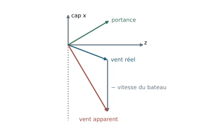
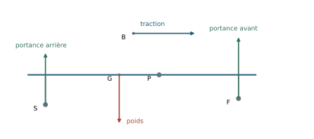
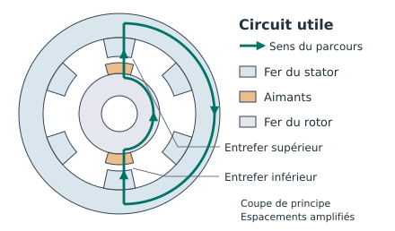
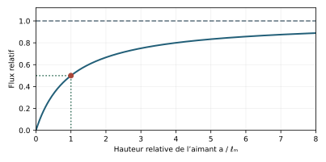
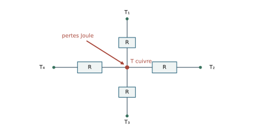
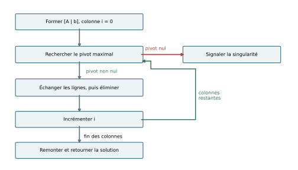

# X-ENS PSI · Modélisation 2020 · Corrigé brut

*Corrigé rédigé par IA, non officiel. Signalez toute erreur.*

**Rédaction** · GPT-6.2 Astra Ultra · vitesse non renseignée · 24 novembre 2026

**Révision** · GPT-6.2 Astra Ultra · vitesse non renseignée · 26 novembre 2026

L’erratum inséré dans le sujet remplace les questions 11 et 12. Les deux questions que le sujet numérote 33 sont repérées ici par 33a pour le flux et 33b pour la conduction.

## A.1 · Efforts sur le foil

### Question 1 · Pression sur l’extrados

La conservation du débit volumique donne $Q=S_0u_0=S_1u_1$. La section utile se resserre au-dessus du profil, donc $S_1<S_0$ et $u_1>u_0$. Pour l’écoulement permanent, parfait, incompressible et à altitude constante, Bernoulli le long d’une ligne de courant donne

$$
p_1-p_0=\tfrac12\rho(u_0^2-u_1^2)<0.
$$


### Question 2 · Régime du foil

À $u=25\ \mathrm{m\,s^{-1}}$, $\mathrm{Re}=uL_c/\nu_e=25\times0{,}3/10^{-6}=7{,}5\times10^6$. À cette échelle la couche limite peut transiter puis devenir turbulente sur une partie importante de la corde. Un modèle laminaire sur l’ensemble du profil serait injustifié. La position de la transition dépend entre autres de la rugosité.

### Question 3 · Comparer les charges

Sur le foil, $\rho_eu^2/2=3{,}13\times10^5\ \mathrm{Pa}$. Sur une aile d’avion, $\rho_aV^2/2=3{,}46\times10^4\ \mathrm{Pa}$ avec les données imposées. Le rapport est voisin de 9. À surface et coefficient comparables, les efforts sont ainsi dans un facteur dix. La densité beaucoup plus élevée de l’eau compense la vitesse moindre.

### Question 4 · Centre de poussée

Par unité d’envergure, $d\vec F=p(x)\,dx\,\vec e_y$, où $p=p_{\rm intra}-p_{\rm extra}$. Le moment autour de $I$ vaut $\int_0^L(x-d)p(x)\,dx\,\vec e_z$. Si la résultante est non nulle, son annulation donne

$$
d=\frac{\int_0^L x p(x)\,dx}{\int_0^L p(x)\,dx}.
$$

Une pression différentielle constante donne $L/2$. Changer globalement son signe inverse la force et conserve son point d’application. Le signe choisi ici est celui de la définition de la figure 4 et de l’exemple numérique du fichier.

### Question 5 · Lire le fichier de pression

```python
def Extraire(nom):
    valeurs = []
    with open(nom, encoding="utf-8") as mesures:
        for ligne in mesures:
            if ligne.strip():
                x, pext, pint = map(float, ligne.split(";"))
                valeurs.append((x, pext, pint))
    return valeurs
```
La ligne d’exemple fournit $(0{,}2,98700,103000)$, donc une différence de $4300\ \mathrm{Pa}$.

### Question 6 · Intégrer par trapèzes

```python
def CDP(Valeurs):
    if len(Valeurs) < 2:
        raise ValueError("deux abscisses au minimum")
    charge = moment = 0.0
    for gauche, droite in zip(Valeurs, Valeurs[1:]):
        x0, e0, i0 = gauche
        x1, e1, i1 = droite
        dx = x1 - x0
        if dx <= 0:
            raise ValueError("abscisses non croissantes")
        p0, p1 = i0 - e0, i1 - e1
        charge += dx * (p0 + p1) / 2
        moment += dx * (x0*p0 + x1*p1) / 2
    if charge == 0:
        raise ValueError("résultante nulle")
    return moment / charge
```
Le résultat est en mètres lorsque les abscisses sont en mètres. On le divise par la corde pour exprimer la position en fraction de corde.

## A.2 · Choix du profil

### Question 7 · Sélectionner les profils

```sql
SELECT DISTINCT g.Nom
FROM "Géométrie" AS g
JOIN Polaire AS p ON p.Nom = g.Nom
WHERE g.Sym = 'O' AND g.Emax = 11
  AND p.Re = 7000000 AND p.Inc < 10
  AND p.Cx > 0 AND p.Cz > 70 * p.Cx;
```
L’épaisseur est enregistrée en pour cent. Le test de finesse évite la division. La corde C4 ne figure pas parmi les critères demandés.

### Question 8 · Lire la finesse

À $8°$, on lit $C_z\simeq0{,}93$ et $C_x\simeq0{,}012$. La finesse vaut environ $78>70$ à une incidence inférieure à $10°$. Cela suffit pour C1. L’appellation NACA0009 désigne usuellement une épaisseur de 9 % et ne confirme donc pas, à elle seule, la contrainte C3 de 11 %.

## A.3 · Équilibre et vitesse

### Question 9 · Vent apparent

Dans la base $(\vec e_z,\vec e_x)$ de la vue de dessus, le vent réel se projette en $(V\sin\theta,-V\cos\theta)$. Ainsi

$$
\vec V_{\rm app}=V\sin\theta\,\vec e_z-(u+V\cos\theta)\vec e_x,\qquad W=\|\vec V_{\rm app}\|=\sqrt{u^2+V^2+2uV\cos\theta}.
$$

Vent debout, $W=u+V$. Au vent arrière, $W=|u-V|$.



### Question 10 · Projeter sur la normale de voile

Posons $r=u/V$, $b=\psi-\mu_a$. La normale orientée de la figure vaut $\vec n=\cos b\,\vec e_z+\sin b\,\vec e_x$. Par définition de l’incidence, $\vec V_{\rm app}\cdot\vec n=W\sin\mu_a$. La projection de Q9 donne donc

$$
f=\sin\theta\cos b-(r+\cos\theta)\sin b-\sqrt{1+r^2+2r\cos\theta}\sin\mu_a=0.
$$

Pour sélectionner l’orientation physique sans ambiguïté de sinus, on peut directement projeter sur la normale au **vent apparent**. On obtient $g(\psi)=\sin\theta\cos\psi-(r+\cos\theta)\sin\psi=0$ avec $\sin\psi=V\sin\theta/W$ et $\cos\psi=(u+V\cos\theta)/W$. L’allure du vent apparent est géométrique. L’incidence de la voile intervient ensuite par $C_z(\mu_a)$.

### Question 11 · Dichotomie de l’erratum

Il suffit que $f$ soit continue, strictement monotone sur l’intervalle et que les valeurs aux bornes soient de signes opposés ou que l’une soit nulle. La continuité assure l’existence et la stricte monotonie l’unicité. Une autre preuve d’unicité permet d’appliquer la même dichotomie.
```python
def dicho(f, psi_i, psi_f, eps):
    if eps <= 0 or psi_i > psi_f:
        raise ValueError("précision ou intervalle invalide")
    a, b = psi_i, psi_f
    fa, fb = f(a), f(b)
    if fa == 0:
        return a
    if fb == 0:
        return b
    if (fa > 0) == (fb > 0):
        raise ValueError("zéro non encadré")
    while True:
        m = a/2 + b/2 if a < 0 < b else a + (b-a)/2
        fm = f(m)
        if fm == 0 or max(m-a, b-m) <= eps:
            return m
        if m == a or m == b:
            raise ArithmeticError("précision inaccessible entre ces bornes")
        if (fm > 0) == (fa > 0):
            a, fa = m, fm
        else:
            b = m
```
La solution reste dans l’intervalle. Le programme contrôle la distance du milieu calculé à chacune des bornes. Si deux flottants adjacents empêchent d’atteindre la précision requise, il le signale. L’erratum place bien la recherche sur $\psi$, à $\theta$ fixé.

### Question 12 · Traction suivant le cap

Le coefficient de portance à incidence fixée est $C_z(\mu_a)$. Comme $\vec n_a\cdot\vec e_x=\sin\psi$, la composante motrice est

$$
T_x=\tfrac12\rho_{\rm air}S_vC_z(\mu_a)\,W^2\sin\psi .
$$

L’erratum demande $\psi$. Pour un vent apparent parallèle au cap, la portance pure ne fournit aucune traction longitudinale.

### Question 13 · Trouver l’allure de traction maximale

À $u,V,\mu_a$ fixés et pour $C_z(\mu_a)>0$, $T_x$ est proportionnelle à $WV\sin\theta$. Pour $c=\cos\theta$, le carré réduit à maximiser est $(1+r^2+2rc)(1-c^2)$. Sa dérivée s’annule lorsque $3rc^2+(1+r^2)c-r=0$. Le maximum intérieur correspond à la racine positive, les deux extrémités donnant une traction nulle. Pour $r=0$, le maximum a $c=0$. La fonction retourne un angle en radians.
```python
from math import acos, cos, hypot, sin, sqrt

def Fi(u, V, mu_a):
    if V <= 0 or u < 0:
        raise ValueError("vitesses hors domaine")
    echelle = max(u, V)
    bateau, vent = u/echelle, V/echelle
    q = min(bateau, vent)
    h = 1 + q*q
    c = 2*q / (h + hypot(h, sqrt(12)*q))
    theta = acos(c)
    if u == 0:
        return theta
    def g(psi):
        if psi == theta:
            return -bateau * sin(theta)
        return vent*sin(theta)*cos(psi) - (bateau+vent*c)*sin(psi)
    return dicho(g, 0, theta, 1e-10)
```
Pour $r>0$, diviser l’équation du maximum par $r$ donne $3c^2+(r+1/r)c-1=0$. Elle est inchangée en remplaçant $r$ par $1/r$, ce qui permet de calculer $c$ avec $q=\min(r,1/r)\le1$. À la borne $\psi=\theta$, les deux termes en $V\sin\theta\cos\theta$ s’annulent exactement. Le code y utilise directement le terme restant. Pour $r=3$, on trouve $\theta\simeq75{,}8°$, $\psi\simeq16{,}6°$, en accord avec l’ordre de grandeur de la figure 11. Une incidence imposée change le facteur de portance, commun à toutes les allures.

### Question 14 · Équilibre des résultantes

Posons $P=S_p/2$, $S=S_{sa}$ et $\rho=\rho_{\rm eau}$. L’équilibre horizontal donne $\rho u^2(P k_{x1}\alpha+S k_{x2}\beta)=3a_0+a_1$, l’équilibre vertical $\rho u^2(P k_{z1}\alpha+S k_{z2}\beta)=mg$. Ainsi

$$
A_1=9\rho\begin{pmatrix}P k_{x1}&S k_{x2}\\ P k_{z1}&S k_{z2}\end{pmatrix},\qquad A_1\binom\alpha\beta=V^{-2}\binom{3a_0+a_1}{mg}.
$$

Les coefficients du sujet sont définis par degré.

### Question 15 · Indépendance des deux réglages

Le déterminant de $A_1$ est proportionnel à $k_{x1}k_{z2}-k_{x2}k_{z1}$. Il faut des rapports de finesse distincts pour disposer de deux réglages indépendants de portance et de traînée. Avec des profils identiques, les deux équations imposent une condition de compatibilité $mg/(3a_0+a_1)=k_z/k_x$. Si elle échoue, aucun choix des deux angles ne convient. Si elle est exactement vérifiée, la seule singularité de la matrice n’exclut pas un équilibre particulier. C’est la réserve nécessaire à l’affirmation de l’énoncé.

### Question 16 · Valeurs numériques des incidences

La première ligne donne $\alpha=60-10\beta$. Dans la seconde, $2400-370\beta=380$, donc $\beta=202/37\simeq5{,}46°$ et $\alpha=200/37\simeq5{,}41°$. Les deux angles appartiennent à $[0°,9°]$, ce qui vérifie H1 pour ce système numérique.

## A.4 · Dynamique et stabilité

### Question 17 · Incidence apparente du safran

La direction du foil est $\vec e_f=\cos(\beta+\varphi)\vec e_x+\sin(\beta+\varphi)\vec e_y$. L’angle apparent est compté de $\vec V_S$ vers $\vec e_f$. Il vient

$$
\sin\beta_a=\frac{(\vec V_S\times\vec e_f)\cdot\vec e_z}{\|\vec V_S\|}\simeq\frac{(\vec V_S\cdot\vec e_x)\sin(\beta+\varphi)-(\vec V_S\cdot\vec e_y)\cos(\beta+\varphi)}u.
$$

En translation horizontale, on retrouve $\beta_a=\beta+\varphi$ pour les petits angles étudiés. Une vitesse verticale ascendante diminue l’incidence apparente.

### Question 18 · Torseur dynamique au point P

Comme $\overrightarrow{PG}=-x_G\vec e_{xb}$ et $\vec a_P=\ddot y\vec e_y$, on a

$$
\vec a_G=\ddot y\vec e_y-x_G\ddot\varphi\vec e_{yb}+x_G\dot\varphi^2\vec e_{xb}.
$$

La résultante vaut $m\vec a_G$. Le moment dynamique en $P$ est $I_G\ddot\varphi\vec e_z+\overrightarrow{PG}\times m\vec a_G=(I_P\ddot\varphi-mx_G\cos\varphi\,\ddot y)\vec e_z$, où $I_P=I_G+mx_G^2$. Au premier ordre près de l’horizontale, la résultante verticale vaut $m(\ddot y-x_G\ddot\varphi)$.

### Question 19 · Équations de vol

Notons $T$ la composante horizontale **algébrique** de l’effort de voile, $\rho=\rho_{\rm eau}$, $a=(S_p/2)k_{z1}$ et $b=S_{sa}k_{z2}$. Les deux portances valent $\rho u^2 a\alpha_a$ et $\rho u^2 b\beta_a$. En gelant les bras de levier à l’assiette horizontale, en négligeant les traînées devant les portances dans les moments et les termes en $\dot\varphi^2$, les deux équations sont

$$
\begin{aligned}
m\ddot y-mx_G\ddot\varphi&=\rho u^2(a\alpha_a+b\beta_a)-mg,\\
-mx_G\ddot y+I_P\ddot\varphi&=\rho u^2(c\alpha_a+d\beta_a)+x_G mg-y_BT,\\
c&=x_Fa,\qquad d=-x_S b.
\end{aligned}
$$

La page 15 imprime $T=-\rho_{\rm air}S_vC_z(\mu_a)W^2/2$, tandis que Q12 donne la projection motrice positive pour l’amure de sa figure. Conserver $T$ signé permet d’appliquer l’un ou l’autre modèle sans inverser arbitrairement le moment. Si l’on conserve les faibles traînées dans les moments, remplacer $c$ par $c-y_F(S_p/2)k_{x1}$ et $d$ par $d-y_S S_{sa}k_{x2}$. La variation des bras se calcule aussi. À l’horizontale, notons $L_{F0}=\rho u^2a\alpha_{a0}$ et $L_{S0}=\rho u^2b\beta_{a0}$ les portances d’équilibre. Après une rotation $\delta$, les abscisses des points $F$ et $S$ deviennent $x_F\cos\delta+y_F\sin\delta$ et $-x_S\cos\delta+y_S\sin\delta$. Au premier ordre, les bras des portances ajoutent donc $(y_FL_{F0}+y_SL_{S0})\delta$ au moment. Le bras vertical de la traction vaut $-x_B\sin\delta+y_B\cos\delta$, d’où la contribution supplémentaire $x_BT\delta$. Le poids a pour bras $x_G\cos\delta$, de dérivée nulle à l’horizontale.



### Question 20 · Construire la matrice d’équilibre

Posons $D=x_Gmg-y_BT$. À l’équilibre, $\rho u^2(a\alpha_{a0}+b\beta_{a0})=mg$ et $\rho u^2(c\alpha_{a0}+d\beta_{a0})=-D$. Divisons la première ligne par $mg$ et ajoutons à la seconde $D/(mg)$ fois l’équation verticale. Une matrice ayant le second membre demandé est ainsi

$$
A_2=\rho\begin{pmatrix}a/(mg)&b/(mg)\\ c+Da/(mg)&d+Db/(mg)\end{pmatrix},\qquad A_2\binom{\alpha_{a0}}{\beta_{a0}}=u^{-2}\binom10 .
$$

Toute multiplication de la seconde ligne par une constante non nulle garde la même forme. Si la force de voile est recalculée quand $u$ varie, $D$ doit être réévalué lui aussi.

### Question 21 · Vitesse minimale

À l’équilibre $mg=\rho u^2(a\alpha_{a0}+b\beta_{a0})<\rho u^2(a+b)\alpha_{\lim}$ pour $a,b>0$ et $\alpha_{\lim}=9°$ dans les unités des pentes du sujet. Il faut donc $u>\sqrt{mg/[\rho(a+b)\alpha_{\lim}]}$. Cette condition nécessaire suffit à exclure les très faibles vitesses. Si $A_2$ est fixé, l’identité $u^2(\alpha_{a0},\beta_{a0})^t=A_2^{-1}(1,0)^t$ conduit au même constat puisque le vecteur de droite est non nul.

### Question 22 · Matrices du mouvement perturbé

Utilisons une unité angulaire cohérente. Dans les équations dynamiques, $\delta$ et $\varphi$ sont en radians. Les pentes données par degré doivent ici être multipliées par $180/\pi$ avant de former $a,b,c,d$ et les angles d’équilibre doivent être convertis en radians. Avec $X=(y,\delta)^t$ et les notations de Q19,

$$
M=\begin{pmatrix}m&-mx_G\\-mx_G&I_P\end{pmatrix},\quad K=-\rho u^2\begin{pmatrix}0&R_1\\0&R_2\end{pmatrix},\quad R_1=a+b,\quad R_2=c+d .
$$

Ainsi $M\ddot X+KX=F_0+X_0$, avec

$$
F_0=\binom{-mg}{D},\qquad X_0=\rho u^2\binom{a\alpha_{a0}+b\beta_{a0}}{c\alpha_{a0}+d\beta_{a0}}.
$$

Ces $R_1,R_2$ correspondent aux bras gelés de Q19. Si l’on conserve leur rotation au premier ordre, toujours en négligeant les moments de traînée, $R_1$ reste $a+b$ et il faut remplacer $R_2$ par

$$
R_{2,\mathrm{rot}}=c+d+\frac{y_F L_{F0}+y_S L_{S0}+x_B T}{\rho u^2}.
$$

Les constantes $F_0$ et $X_0$ restent celles de l’assiette horizontale. Les termes ajoutés ne sont négligeables que si leur somme est petite devant la raideur de tangage retenue.

Le terme de tangage peut être négatif puisque la portance arrière exerce autour de $P$ un moment opposé à celui de la portance avant.

### Question 23 · Annuler les termes constants

Les deux composantes de $F_0+X_0$ sont les deux résidus d’équilibre de Q20. Chacune est nulle. On obtient donc $M\ddot X+KX=0$. Le modèle ne contient aucun terme directement proportionnel à la hauteur $y$.

### Question 24 · État du premier ordre

Avec $Y=(\dot X,X)^t$ écrit par blocs, $\dot Y=(\ddot X,\dot X)^t$ et $\ddot X=-M^{-1}KX$. Ainsi

$$
A=\begin{pmatrix}0_2&-M^{-1}K\\I_2&0_2\end{pmatrix}.
$$

L’inverse existe car $\det M=m(I_P-mx_G^2)=mI_G>0$.

### Question 25 · Équation caractéristique

Pour $v\ne0$, l’équation devient $(\lambda^2M+K)v=0$. Réciproquement tout vecteur non nul de ce noyau fournit le vecteur propre $(\lambda v,v)^t$ de $A$, y compris pour $\lambda=0$. Les valeurs propres sont donc exactement les zéros de $\det(\lambda^2 M+K)$.

### Question 26 · Condition de divergence du tangage

Avec $I_G=I_P-mx_G^2$,

$$
\det(\lambda^2M+K)=m\lambda^2\big[I_G\lambda^2-\rho u^2(R_2+x_G R_1)\big].
$$

Il existe une valeur propre réelle strictement positive, et donc une instabilité exponentielle, si $R_2+x_G R_1>0$. Pour la linéarisation avec rotation des bras, on applique le même critère à $R_{2,\mathrm{rot}}+x_G R_1$. Avec le signe opposé, les deux racines de tangage sont imaginaires pures. L’égalité est un cas dégénéré. Le critère spectral énoncé dans le sujet classe seulement l’apparition d’une partie réelle positive. Pour la stabilité au sens de bornitude, la racine nulle mérite aussi examen. Ici un mouvement $\delta=0$, $y=y_0+v_0t$ est solution et donne une dérive verticale si $v_0\ne0$.

## B.2 · Circuit magnétique du moteur

### Question 27 · Hypothèses magnétostatiques

On étudie un instant figé avec géométrie, aimantation et courants stationnaires. Les dérivées temporelles des champs sont nulles, en particulier le courant de déplacement. Ici les phases sont ouvertes ou imposées à courant nul. Les aimants permanents restent sources d’induction. Les lois locales utiles sont $\nabla\times\vec H=\vec j_{\rm libre}$ et $\nabla\cdot\vec B=0$.

### Question 28 · Théorème d’Ampère

Pour un contour fermé $\Gamma$ bordant $\Sigma$,

$$
\oint_\Gamma\vec H\cdot d\vec\ell=\iint_\Sigma\vec j_{\rm libre}\cdot\vec n\,dS=\sum_k\varepsilon_k N_k I_k .
$$

Le signe $\varepsilon_k$ dépend du sens d’enlacement. Le courant de phase étant nul, la circulation sur le contour de la question suivante est nulle, même lorsque le champ local est non nul.

### Question 29 · Choisir un contour principal

Partir de la dent supérieure, longer le stator jusqu’à la dent opposée, traverser l’entrefer et l’aimant inférieurs, revenir dans le fer du rotor, puis franchir l’aimant et l’entrefer supérieurs. L’orientation suit le flux utile. Avec $a$ la hauteur de chaque aimant et $H_a$ son champ algébrique sur ce parcours, la décomposition de l’intégrale à courant nul donne

$$
H_{fs}L_{cmfs}+H_{fr}L_{cmfr}+2eH_e+2aH_a=0.
$$



Les longueurs de fer sont déjà les longueurs parcourues dans chaque milieu. Les deux aimants magnétisés en sens géométriques opposés contribuent dans le même sens autour de la boucle.

### Question 30 · Conservation du flux

$\oiint\vec B\cdot\vec n\,dS=0$, puisque $\nabla\cdot\vec B=0$. Les parois latérales d’un tube de champ ne sont traversées par aucun flux. Sous l’approximation uniforme, $B_a S_a=B_e S_e=B_{fs} S_{fs}=B_{fr} S_{fr}$ le long du tube utile. Avec les sections de passage équivalentes égales imposées, ces inductions ont une valeur commune $B$. Aux séparations symétriques du circuit, les flux des demi-branches s’additionnent dans la dent.

### Question 31 · Lois de matériau

Dans les fers supposés linéaires et non saturés, $B_{fs}=\mu_0\mu_{rfs}H_{fs}$ et $B_{fr}=\mu_0\mu_{rfr}H_{fr}$. Dans l’entrefer, $B_e=\mu_0H_e$. Sur la droite de recul de l’aimant du sujet, $B_a=B_r+\mu_0H_a$ car $\mu_{ra}=1$. Un aimant peut donc avoir $B_a>0$ et $H_a<0$ sur la boucle choisie.

### Question 32 · Induction et flux de phase

La circulation multipliée par $\mu_0$ donne $B(L_{cmfs}/\mu_{rfs}+L_{cmfr}/\mu_{rfr}+2e)+2a(B-B_r)=0$. En posant $\ell_m=e+L_{cmfs}/(2\mu_{rfs})+L_{cmfr}/(2\mu_{rfr})$,

$$
B_e=B_r\frac{a}{a+\ell_m},\qquad \Phi_{\max}=N\,B_e\,l_{fs}L_a.
$$

La section $l_{fs}L_a$ est celle de la dent entière enlacée par les $N$ spires de phase A dans la position alignée. Pour des fers de très grande perméabilité, $\ell_m$ tend vers $e$.

### Question 33a · Flux et hauteur d’aimant

Avec $\Phi_\infty=Nl_{fs}L_aB_r$, $\Phi_{\max}/\Phi_\infty=a/(a+\ell_m)$. La courbe part de zéro avec pente $\Phi_\infty/\ell_m$ pour le flux dimensionné, atteint la moitié de son asymptote en $a=\ell_m$ et tend vers $\Phi_\infty$ par valeurs inférieures. Sa dérivée décroît comme $(a+\ell_m)^{-2}$. Au-delà de quelques $\ell_m$, chaque millimètre d’aimant supplémentaire rapporte de moins en moins de flux.



## B.3 · Transferts thermiques et calcul numérique

### Question 33b · Loi de Fourier

Dans la direction $x$, $j_{th}(x,t)=-K\,\partial T/\partial x$, avec $j_{th}$ en $\mathrm{W\,m^{-2}}$. En écriture vectorielle, $\vec j_{th}=-K\nabla T$. Le signe négatif traduit le transfert du chaud vers le froid.

### Question 34 · Échanges du barreau

Pendant $dt$, la face gauche laisse entrer $\delta Q_{\rm in}=S j_{th}(x,t)dt$ et la face droite laisse sortir $\delta Q_{\rm out}=S j_{th}(x+dx,t)dt$. Le bilan reçu est leur différence, soit $-S\partial_x j_{th}\,dx\,dt$ au premier ordre en $dx$.

### Question 35 · Énergie interne

La masse vaut $\rho_{th}S\,dx$. Pour une température suffisamment régulière, $dU=\rho_{th}CS\,dx\,\partial_tT\,dt$. Le résultat s’exprime en joules.

### Question 36 · Équation de diffusion

En l’absence de travail et de source volumique dans la tranche, $\rho_{th}C\partial_tT=-\partial_x j_{th}=\partial_x(K\partial_xT)$. À conductivité constante,

$$
\partial_{xx}T=\frac{\rho_{th}C}{K}\partial_tT .
$$

La diffusivité $K/(\rho_{th}C)$ a la dimension d’une surface par unité de temps.

### Question 37 · Résistance thermique d’une couche

Sur $s\in[x,x+dx]$, $T(s)=T_{in}+(T_{out}-T_{in})(s-x)/dx$. La puissance positive de l’entrée vers la sortie est $J_{th}=Sj_{th}=KS(T_{in}-T_{out})/dx$. D’où

$$
T_{in}-T_{out}=R_{th}J_{th},\qquad R_{th}=\frac{dx}{KS}\quad[\mathrm{K/W}].
$$

Pour une couche finie uniforme d’épaisseur $\ell$, on remplace $dx$ par $\ell$.

### Question 38 · Réseau de l’encoche

Injecter $J_{PJ}$ au nœud de température $T_c$. De ce nœud partent quatre branches vers les températures de bord imposées $T_1,T_2,T_3,T_4$. Chaque branche comporte en série la résistance du demi-cuivre, celle de l’isolant, puis celle de l’air, soit $R_{eq}=R_c+R_i+R_{air}$. Par exemple, dans une approximation plane à sections efficaces $A_c,A_i,A_{air}$, ces valeurs sont $L_{c,eq}/(2K_cA_c)$, $e_{i,eq}/(K_iA_i)$ et $e_{air,eq}/(K_{air}A_{air})$. Les aires de passage comprennent la longueur active $L_a$. La symétrie du carré permet d’utiliser le même $R_{eq}$ sur chaque côté.



### Question 39 · Système des cinq inconnues

Pour des flux $J_k$ sortants, $\sum_{k=1}^4J_k=J_{PJ}$ et $T_c-R_{eq}J_k=T_k$. En notant $\mathbf1=(1,1,1,1)^t$, $J=(J_1,\ldots,J_4)^t$, $T=(T_1,\ldots,T_4)^t$, on retrouve

$$
\begin{pmatrix}0&\mathbf1^t\\\mathbf1&-R_{eq}I_4\end{pmatrix}\binom{T_c}{J}=\binom{J_{PJ}}{T}.
$$

Un contrôle indépendant donne $T_c=(\sum T_k+R_{eq}J_{PJ})/4$, puis $J_k=(T_c-T_k)/R_{eq}$. Des bords à même température évacuent chacun un quart des pertes.

### Question 40 · Déterminant du système thermique

Pour $R=R_{eq}>0$, le bloc $-RI_4$ a pour déterminant $R^4$. Son complément dans la case supérieure gauche est $0-\mathbf1^t(-I_4/R)\mathbf1=4/R$. On obtient $\det=4R^3>0$. La température centrale et les quatre flux sont donc déterminés de façon unique.

### Question 41 · Algorigramme du pivot de Gauss

Construire la matrice augmentée, puis parcourir les colonnes de gauche à droite. À chaque colonne, chercher le terme de plus grande valeur absolue sous le pivot, pivot courant compris. Si ce terme est nul, le système carré n’a pas de solution unique. Sinon, déplacer le pivot sur la diagonale et annuler les termes au-dessous. Après la dernière colonne, remonter les lignes de la dernière à la première pour calculer les inconnues.



### Question 42 · Meilleur pivot

```python
import numpy as np

def cherche_pivot(MATRICE, i):
    return i + int(np.argmax(np.abs(MATRICE[i:, i])))
```
L’ajout de $i$ convertit l’indice relatif au morceau de colonne en un numéro de ligne de la matrice.

### Question 43 · Échanger deux lignes

```python
def echange_lignes(MATRICE, i, j):
    MATRICE[[i, j], :] = MATRICE[[j, i], :]
```
L’indexation avancée de NumPy évalue le membre droit sur une copie. L’opération agit aussi sur la colonne du second membre d’un système augmenté.

### Question 44 · Transvection

```python
def transvection(MATRICE, k, i, alpha):
    MATRICE[k, :] += alpha * MATRICE[i, :]
```
On réalise $L_k\leftarrow L_k+\alpha L_i$ sur une matrice flottante. Pour annuler l’entrée $a_{ki}$ on choisit $\alpha=-a_{ki}/a_{ii}$.

### Question 45 · Résoudre un système carré

```python
def gauss(A, b):
    A = np.asarray(A, dtype=float)
    b = np.asarray(b, dtype=float)
    if A.ndim != 2 or A.shape[0] != A.shape[1]:
        raise ValueError("matrice carrée attendue")
    n = A.shape[0]
    if b.shape != (n,):
        raise ValueError("second membre de taille incompatible")
    M = np.column_stack((A, b))
    for i in range(n):
        j = cherche_pivot(M, i)
        if M[j, i] == 0:
            raise ValueError("pivot nul, solution non unique ou inexistante")
        echange_lignes(M, i, j)
        for k in range(i + 1, n):
            transvection(M, k, i, -M[k, i] / M[i, i])
            M[k, i] = 0.0
    x = np.empty(n)
    for i in range(n - 1, -1, -1):
        reste = M[i, i+1:n] @ x[i+1:n]
        x[i] = (M[i, n] - reste) / M[i, i]
    return x
```
Le premier élément diagonal de la matrice thermique est nul, ce qui impose d’emblée un échange. L’algorithme effectue $O(n^3)$ opérations et utilise $O(n^2)$ cases. En calcul flottant, un pivot très petit relativement à l’échelle du problème invite aussi à évaluer le conditionnement et le résidu.

### Question 46 · Homogénéiser l’encoche

Sur la section réelle, mesurer les aires totales $A_{Cu}$ et $A_{iso}$ de cuivre et d’isolant, par exemple en sommant sur les $N$ conducteurs. À longueur active inchangée, la conservation des volumes donne

$$
L_{c,eq}=\sqrt{A_{Cu}},\quad e_{i,eq}=\frac{\sqrt{A_{Cu}+A_{iso}}-\sqrt{A_{Cu}}}{2},\quad e_{air,eq}=\frac{L_e-\sqrt{A_{Cu}+A_{iso}}}{2}.
$$

On conserve la puissance totale $J_{PJ}$ et on impose les mêmes températures de paroi. La réorganisation en couches modifie les chemins de conduction. Pour calibrer le transfert, mesurer ou simuler une encoche réelle avec les quatre parois à $T_b$ puis choisir $R_{eq}=4(T_c-T_b)/J_{PJ}$ pour reproduire cet essai. Un deuxième jeu de températures de paroi éprouve la répartition des flux.

## Conclusion

### Question 47 · Trois résultats de l’étude

1. À vitesse suffisante, les portances des foils peuvent porter le poids pendant que la voile compense la traînée. Le modèle numérique à $u/V=3$ conduit à deux incidences proches de $5{,}4°$.
2. Le vol exige une vitesse minimale. La relation $R_2+x_GR_1>0$ provoque une divergence de tangage dans le modèle linéarisé. Un pilotage de l’incidence prend alors toute son importance.
3. Le couple $C=\tfrac32 p_p\Phi_{\max}I_{\max}$ relie les deux dimensionnements de l’actionneur. Augmenter la hauteur d’aimant accroît le flux avec un rendement décroissant. L’échauffement par effet Joule et le chemin thermique de l’encoche limitent le courant admissible.
