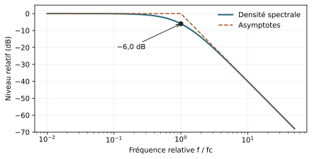

# X–ENS PSI 2020 — Physique (XCR) · Corrigé brut

*Corrigé rédigé par IA, non officiel. Signalez toute erreur.*

**Lecture du rapport du jury** · GPT-6.2 Astra Ultra · vitesse non renseignée

**Rédaction** · GPT-6.2 Astra Ultra · vitesse non renseignée

## Mesures de précision et métrologie

## I. Biais de la comparaison des étalons

### Question 1 — Surface minimale

L’inégalité isopérimétrique en trois dimensions désigne la sphère comme surface minimale à volume fixé. Elle limite les échanges superficiels, mais roule facilement et son contact ponctuel complique la manipulation et le stockage.

### Question 2 — Cylindre de moindre surface

Avec $V=\pi D^2h/4$, l’aire complète, bases incluses, est $S=\pi D^2/2+4V/D$. Sa dérivée s’annule pour $\pi D=4V/D^2$, soit $h=D$. La dérivée seconde $\pi+8V/D^3$ est positive.

### Question 3 — Dimensions du prototype

Le volume vaut $V=m/\rho=5{,}0\times10^{-5}\ \mathrm{m^3}=50\ \mathrm{cm^3}$. La hauteur et le diamètre valent $(4V/\pi)^{1/3}\simeq4{,}0\times10^{-2}\ \mathrm m$, soit environ quatre centimètres.

### Question 4 — Sensibilité dimensionnelle

La masse vaut $\rho\pi D^3/4$, donc $\Delta m/m\simeq3\Delta D/D=3\Delta h/h$. Dix microgrammes sur un kilogramme représentent $10^{-8}$, soit une variation relative de dimension de $3{,}3\times10^{-9}$, environ $0{,}13\ \mathrm{nm}$. Un calcul géométrique seul est alors insuffisant pour étalonner la masse. Si une seule dimension indépendante varie, $dm/m=2dD/D+dh/h$.

### Question 5 — Résultante des pressions

La résultante hydrostatique est la poussée d’Archimède $\mathbf F_A=-\rho_{\rm air}V\mathbf g$. Dirigée vers le haut, elle diminue la force d’appui et donc la masse apparente.

### Question 6 — Équivalent en masse

Le support porte $m_{\rm app}g_0=(m-\rho_{\rm air}V)g_0$. La valeur absolue de la correction est $\Delta m_2=\rho_{\rm air}V$.

### Question 7 — Air sec et variation de densité

(a) $\rho_{\rm air}=pM/(RT)\simeq1{,}2\ \mathrm{kg\,m^{-3}}$, donc $\Delta m_2\simeq6\times10^{-5}\ \mathrm{kg}=60\ \mathrm{mg}$, très supérieur à $10\ \mu\mathrm g$. (b) À volume constant, $|\delta\rho|/\rho=10\ \mu\mathrm g/(60\ \mathrm{mg})\simeq1{,}7\times10^{-4}$. Une variation modeste de l’air a ainsi un effet mesurable.

### Question 8 — Distribution près de la paroi

La loi de Boltzmann donne $p(z)/p(\infty)=\exp[-(W_{\rm ad}(z)-W_{\rm ad}(\infty))/(k_BT_0)]$. Ici $p(z)=p(\infty)\exp[K_{\rm ad}/(k_BT_0z^3)]$. Le potentiel attractif enrichit le gaz près de la surface.

### Question 9 — Limite de la description gazeuse

Le modèle du gaz parfait donne $p\to+\infty$ lorsque $z\to0^+$. Lorsque $p$ dépasse la pression de saturation, la phase vapeur n’est plus l’état d’équilibre stable et le modèle prévoit une condensation près de la paroi.

### Question 10 — Épaisseur de la couche

La limite $p(d_{\rm liq})=p_s(T_0)$ donne $d_{\rm liq}=[K_{\rm ad}/(k_BT_0\ln(p_s(T_0)/p(\infty)))]^{1/3}$. Cette solution finie suppose $0<p(\infty)<p_s(T_0)$.

### Question 11 — Ordres de grandeur moléculaires

(a) Pour un rapport de trois, $d_{\rm liq}\simeq4{,}0\times10^{-10}\ \mathrm m$, comparable à une dimension moléculaire. Le modèle continu ne donne ici qu’un ordre de grandeur. (b) $\Delta m_4\simeq\rho_{\rm liq}S_{\rm ext}d_{\rm liq}=10^3\times0{,}007\times4{,}0\times10^{-10}\ \mathrm{kg}=2{,}8\ \mu\mathrm g$.

### Question 12 — Comparaison des corrections

La poussée représente environ $60\ \mathrm{mg}$ et se calcule à partir de la densité de l’air et du volume. Des étalons de volumes voisins se compensent au premier ordre. L’adsorption ne représente que quelques microgrammes, mais sa variabilité selon l’état de surface et l’humidité est difficile à corriger à ce niveau. Une pesée comparative évite de déduire la masse des dimensions atomiquement sensibles calculées en question 4.

## II. Effet Hall et capteur de courant

### Question 13 — Conductivité sous champ

L’équation est $m^*\dot{\mathbf v}=-e(\mathbf E+\mathbf v\times\mathbf B)-m^*\mathbf v/\tau$. Au repos statistique avec $\mathbf j_S=-N_se\mathbf v$, $j_x+bj_y=\sigma_0E_x$ et $-bj_x+j_y=\sigma_0E_y$, où $b=\omega_c\tau$. L’inversion donne $\sigma_{xx}=\sigma_{yy}=\sigma_0/(1+b^2)$, $\sigma_{xy}=-b\sigma_{xx}$ et $\sigma_{yx}=b\sigma_{xx}$.

### Question 14 — Sens de la conductivité $\sigma_0$

À champ magnétique nul, $\mathbf j_S=\sigma_0\mathbf E$. C’est la conductivité surfacique continue du gaz bidimensionnel, en siemens. Elle est aussi l’inverse de la résistance d’un carré de ce matériau dans cette géométrie.

### Question 15 — Origine de la tension de Hall

Pour un courant vers $+x$ les électrons dérivent vers $-x$. Le champ $B_0\mathbf e_z$ les dévie vers $-y$, qui s’enrichit en charges négatives. La séparation de charges crée un champ électrique transverse vers $-y$. À l’équilibre la déviation transversale cesse et une tension demeure entre les bords.

### Question 16 — Impédance du voltmètre

L’impédance d’entrée est $Z_{\rm in}=\underline U/\underline I_{\rm entrée}$ à la fréquence concernée. Pour $|Z_{\rm in}|$ très supérieur à l’impédance de sortie de la sonde, le courant prélevé est négligeable. La mesure conserve donc la condition $j_y=0$.

### Question 17 — Champ transverse en circuit ouvert

Avec $j_y=0$, $E_y=-(\omega_c\tau/\sigma_0)j_{Sx}=-B_0j_{Sx}/(N_se)$. Le champ transverse est négatif pour $B_0>0$ et $j_{Sx}>0$ dans les axes de la figure.

### Question 18 — Résistance de Hall

Avec $V_H=V(y=L)-V(y=0)=-E_yL$ et $I=j_{Sx}L$, $R_H=V_H/I=B_0/(N_se)$. Inverser les deux fils du voltmètre inverse le signe affiché.

### Question 19 — Sensibilité de la sonde

Comme $V_H=B_0 j_SL/(N_se)$, la sensibilité vaut $s=\partial V_H/\partial B_0=j_SL/(N_se)$ en volts par tesla.

### Question 20 — Valeur de la sensibilité

Ici $j_SL=200\times5\times10^{-6}=10^{-3}\ \mathrm A$. On obtient $s=(10^{-3})/(8\times10^{15}\times1{,}60\times10^{-19})\simeq0{,}78\ \mathrm{V\,T^{-1}}$.

### Question 21 — Champ détectable

La limite associée à $1\ \mathrm{nV}$ vaut $\delta B=\delta V_H/s\simeq1{,}3\times10^{-9}\ \mathrm T$. Il s’agit de la limite instrumentale idéale, en l’absence d’autres bruits.

### Question 22 — Excitation magnétique

En unités SI $\mathbf H=\mathbf B/\mu_0-\mathbf M$, où $\mathbf M$ est l’aimantation. L’excitation s’exprime en $\mathrm{A\,m^{-1}}$ et intervient dans la loi d’Ampère portant sur les courants libres.

### Question 23 — Approximation magnétique des régimes quasi stationnaires

Lorsque la taille du circuit est petite devant $c/f$ et que le courant de déplacement est négligeable devant le courant de conduction, $\nabla\times\mathbf H\simeq\mathbf j_{\rm libre}$. Subsistent $\nabla\cdot\mathbf B=0$, $\nabla\times\mathbf E=-\partial_t\mathbf B$ et $\nabla\cdot\mathbf D=\rho_{\rm libre}$. L’induction reste présente.

### Question 24 — Matériau magnétique doux

Un ferromagnétique doux s’aimante et se désaimante avec un faible champ coercitif et un cycle étroit. Sa perméabilité relative à faible champ est élevée. Une ferrite douce courante peut présenter $\mu_r\sim10^3$, valeur dépendant du matériau et de la fréquence.

### Question 25 — Linéarisation

Dans une plage non saturée où l’hystérésis et la variation de pente sont négligées, on remplace le cycle par une droite passant par l’origine. Alors $\mathbf B_f=\mu_0\mu_r\mathbf H_f$, avec $\mu_r$ considérée constante.

### Question 26 — Champ d’entrefer presque uniforme

Il faut $\ell$ très petit devant les dimensions latérales des faces, par exemple $\ell\ll\sqrt{S_e}$ pour une section approximativement carrée. Les lignes restent alors à peu près parallèles loin des bords et l’épanouissement est restreint.

### Question 27 — Conservation du flux

La figure montre un flux principalement guidé par le fer, traversant l’entrefer. Lorsque les fuites sont négligeables, le flux se conserve dans le tube de champ et $B_fS_f\simeq B_eS_e$ avec des champs moyens normaux aux sections.

### Question 28 — Champ créé par le bobinage

Le théorème d’Ampère donne $H_fL+H_e\ell=Ni$. Avec $H_e=B_e/\mu_0$ et $B_f=B_eS_e/S_f$, on obtient $B_e=\alpha i$, où $\alpha=\mu_0N/[\ell+LS_e/(\mu_rS_f)]$. Si l’entrefer domine la réluctance, $B_e\simeq\mu_0Ni/\ell$.

### Question 29 — Transfert courant–tension

La sonde est parcourue par $I$ fixé, le bobinage par $i(t)$. En combinant $V_H=IB_e/(N_se)$ et $B_e=\alpha i(t)$, on obtient $V_H(t)=[I\mu_0N/(N_se(\ell+LS_e/(\mu_rS_f)))]i(t)$ dans la plage linéaire.

### Question 30 — Pertes dans le circuit

L’hystérésis dissipe à chaque cycle une énergie volumique égale à l’aire $\oint H\,dB$. Les variations de flux induisent en outre des courants de Foucault dans le matériau conducteur, dissipés par effet Joule. Le fil de la bobine présente lui aussi des pertes Joule $R\langle i^2\rangle$.

### Question 31 — Influence des ampères-tours et de la fréquence

L’amplitude de $B$ suit $N i_{\max}$. Une fréquence croissante multiplie les cycles d’hystérésis par seconde. Pour une sinusoïde, la tension induite et les courants de Foucault varient comme $f B_{\max}$, et leurs pertes comme $(f B_{\max})^2$. Réduire $Ni_{\max}f$ limite donc ces deux mécanismes à forme d’onde et géométrie comparables, sans constituer une loi universelle des pertes.

### Question 32 — Courant périodique déformé

Une harmonique d’ordre $n$ apparaît à $nf$, et son champ induit est proportionnel à $nfI_n$. Des fronts raides peuvent donc accroître les pertes et déformer la réponse même si le courant crête reste faible. La bande passante du capteur doit couvrir les harmoniques pertinentes.

### Question 33 — Courbe réelle de Hall

Le modèle classique donne une droite passant par l’origine, de pente $1/(N_se)$. L’expérience à $0{,}1\ \mathrm K$ croît globalement avec $B$ et part près de zéro, mais montre des paliers horizontaux de plus en plus visibles, séparés par des transitions. Cette structure quantifiée dépasse le modèle de Drude.

### Question 34 — Charge à partir du graphique

La figure donne autour de $2\ \mathrm T$ quelques kilohms (environ $2$ à $3\ \mathrm{k\Omega}$), soit une pente de l’ordre de $10^3\ \Omega\,\mathrm T^{-1}$. Avec $N_s=8\times10^{15}\ \mathrm{m^{-2}}$, $e\sim1/(N_s\,dR_H/dB)\sim10^{-19}\ \mathrm C$. La lecture de paliers ne fournit ici qu’un ordre de grandeur.

### Question 35 — Échelle quantique de résistance

L’action $h$ a l’unité $\mathrm{J\,s}$, et $1\ \Omega=1\ \mathrm{J\,s\,C^{-2}}$. Avec le facteur imposé, $R_u=h/e^2\simeq2{,}59\times10^4\ \Omega$. Pour l’effet Hall quantique entier, les paliers sont $R_u/\nu$ pour $\nu$ entier positif. Leurs écarts successifs ne sont donc pas constants, contrairement à la formulation de l’énoncé.

### Question 36 — Étalon électrique

Un palier quantifié fournit $h/(\nu e^2)$ et est peu sensible à une petite variation de champ tant que le palier est maintenu. Cette valeur reproductible, rattachée à des constantes fixées dans le SI, permet de réaliser et de comparer des résistances de référence.

## III. Agitation électronique et bruit thermique

### Question 37 — Équation de Langevin

Le modèle unidimensionnel donne $m^*\dot v=-m^*v/\tau_0+m^*b(t)$, donc $\dot v+v/\tau_0=b(t)$. Le bruit $b$ a les dimensions d’une accélération.

### Question 38 — Solution pour la vitesse initiale

On a $d(e^{t/\tau_0}v)/dt=e^{t/\tau_0}b(t)$. Après intégration de 0 à $t$ puis multiplication par $e^{-t/\tau_0}$, $v(t)=v_0e^{-t/\tau_0}+\int_0^t e^{-(t-u)/\tau_0}b(u)\,du$. La condition initiale est satisfaite.

### Question 39 — Mémoire de la condition initiale

Le terme $v_0e^{-t/\tau_0}$ est transitoire. Le temps caractéristique est $\tau_0$ et sa durée pratique quelques $\tau_0$ suivant la précision souhaitée. Après $5\tau_0$ il reste moins de 1 % de sa valeur initiale.

### Question 40 — Spectre d’une impulsion de corrélation

La transformée vaut $S_b(f)=\Gamma\int e^{-2i\pi f\tau}\delta(\tau)d\tau=\Gamma$. Toutes les fréquences ont la même densité spectrale bilatérale, ce qui caractérise le bruit blanc idéal.

### Question 41 — Largeurs conjuguées

Une corrélation temporelle très courte correspond à un spectre très étendu. Une impulsion idéale conduit à un spectre constant. En diffraction de Fraunhofer, réduire la largeur d’une fente élargit de manière analogue l’étendue angulaire de sa figure.

### Question 42 — Vitesse moyenne

La linéarité et $\langle b(u)\rangle=0$ donnent $\langle v(t)\rangle=v_0e^{-t/\tau_0}$. En régime stationnaire la moyenne est nulle, même si chaque réalisation fluctue.

### Question 43 — Variance filtrée

La contribution du bruit à $\langle v^2\rangle$ est $\Gamma\int_0^t e^{-2(t-u)/\tau_0}du=\Gamma\tau_0(1-e^{-2t/\tau_0})/2$. Le carré du terme initial vaut $v_0^2e^{-2t/\tau_0}$, et le terme croisé a une moyenne nulle. À longue durée $\langle v^2\rangle\simeq\Gamma\tau_0/2$.

### Question 44 — Intensité des fluctuations

Dans cette approximation $m^*\langle v^2\rangle/2=k_BT/2$. Avec la variance précédente, $\Gamma=2k_BT/(m^*\tau_0)$. Cette relation relie l’agitation aléatoire à la dissipation qui établit l’équilibre.

### Question 45 — Spectre de la vitesse

On prolonge la formule de l’énoncé en $C_v(\tau)=(k_BT/m^*)e^{-|\tau|/\tau_0}$. Dans sa transformée, le changement $u=\tau/\tau_0$ donne $S_v(f)=(2k_BT\tau_0/m^*)/[1+(2\pi f\tau_0)^2]$. Le produit $f\tau_0$ est sans dimension.

### Question 46 — Diagramme de Bode

Posons $S_0=2k_BT\tau_0/m^*$ et $f_c=1/(2\pi\tau_0)$. Le niveau relatif est $20\log_{10}(S_v/S_0)=-20\log_{10}[1+(f/f_c)^2]$. Il vaut zéro au plateau, $-6{,}02\ \mathrm{dB}$ à $f_c$ et décroît asymptotiquement de $40\ \mathrm{dB}$ par décade.

### Question 47 — Fréquence caractéristique

La coupure demi-puissance est $f_c=(2\pi\tau_0)^{-1}$. Pour $f\ll f_c$ le dénominateur tend vers un et $S_v(f)\simeq 2k_BT\tau_0/m^*$.

### Question 48 — Bande de mesure en TP

Pour $\tau_0<10\ \mathrm{ns}$, $f_c>1{,}6\times10^7\ \mathrm{Hz}$. Les TP à fréquences audio ou de quelques centaines de kilohertz se situent sur le plateau. L’hypothèse serait à revoir pour une mesure radiofréquence proche de cette échelle.

### Question 49 — Résistance carrée bidimensionnelle

Pour le carré, $I=j_SL=\sigma_s EL$ et $U=EL$. Donc $R_0=1/\sigma_s=m^*/(N_se^2\tau_0)$.

### Question 50 — Spectre d’un porteur

Comme $V_i=(R_0e/L)v_i$, on obtient $S_{V_i}(f)=(R_0e/L)^2S_v(f)$. Cette densité s’exprime en $\mathrm{V^2\,Hz^{-1}}$.

### Question 51 — Bruit de Johnson–Nyquist

Les contributions indépendantes s’additionnent spectralement. Dans la bande basse, $S_V=N_sL^2(R_0e/L)^2(2k_BT\tau_0/m^*)=2k_BTR_0$. Cette densité est bilatérale. L’expression unilatérale vaut $4k_BTR_0$. Un refroidissement à résistance fixée réduit la densité proportionnellement à $T$ et la tension efficace proportionnellement à $\sqrt T$.

### Question 52 — Tension efficace

Pour $T=300\ \mathrm K$, $R_0=300\ \Omega$ et $\tau_0=10\ \mathrm{ns}$, $S_V\simeq2{,}5\times10^{-18}\ \mathrm{V^2/Hz}$ et $f_c\simeq1{,}6\times10^7\ \mathrm{Hz}$. Dans l’estimation de l’énoncé, $\Delta f\sim f_c$ donne $U_{\rm eff,b}\sim6\ \mu\mathrm V$. Une bande rectangulaire bilatérale $[-f_c,f_c]$ donne environ $9\ \mu\mathrm V$ au plateau. L’ordre de grandeur, quelques microvolts, importe pour les mesures de très faibles tensions.
