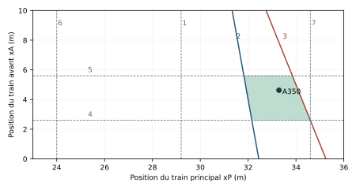
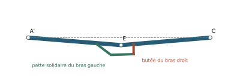
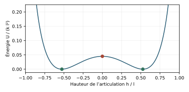
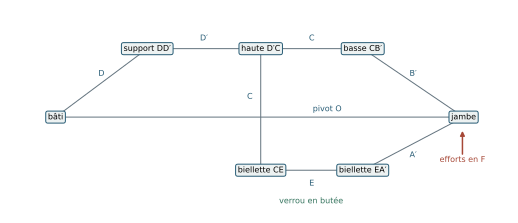
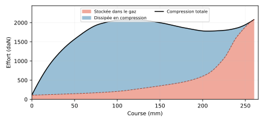
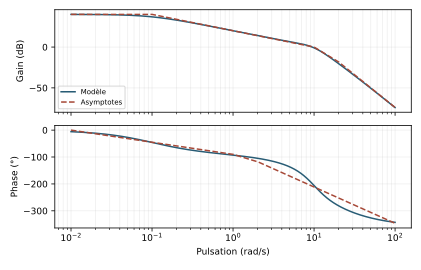
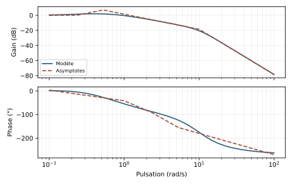

# X-ENS PSI · Sciences industrielles 2020 · Corrigé guidé

*Corrigé rédigé par IA, non officiel. Signalez toute erreur.*

**Rédaction** · GPT-6.2 Astra Ultra · vitesse non renseignée · 24 novembre 2026

## Repères

La partie 1 traite l’avion complet. Les forces de son train principal concernent deux atterrisseurs et huit roues. Aux essais de chute et de freinage, le spécimen peut être un seul atterrisseur ou une seule roue. Repérer cette échelle avant de partager une énergie. Pour les graphes de commande, distinguer la boucle ouverte de DR3 et la réponse en boucle fermée de DR4.

## Partie 1 · Dimensionnement global du train

### Question 1.1 · Architecture tricycle

**Indication.** Examiner l’assiette au sol et la position du centre de gravité par rapport au train porteur.

#### Solution

La roulette de nez permet une assiette proche de l’horizontale au roulage, donc une bonne visibilité vers l’avant. Le centre de gravité est en avant du train principal. Une déviation de cap au roulage tend ainsi à être corrigée par l’action latérale du train principal situé en arrière, ce qui facilite la stabilité directionnelle par rapport à une roue de queue.

### Question 1.2 · Plusieurs roues

**Indication.** Distinguer le chargement du sol et la disponibilité de l’atterrisseur.

#### Solution

Partager la charge entre plusieurs empreintes limite la charge par pneu et la pression moyenne sur la chaussée pour une surface de contact accrue. La multiplicité des roues apporte aussi de la redondance en cas d’endommagement d’un pneu.

### Question 1.3 · Dix contacts ponctuels

**Indication.** Compter les réactions normales indépendantes que l’équilibre permet de déterminer.

#### Solution

Les deux trains principaux portent quatre roues chacun et l’auxiliaire deux, soit dix réactions normales inconnues. Les dix normales sont parallèles à $z$. Seuls la résultante suivant $z$ et les moments autour de $x$ et $y$ fournissent trois équations indépendantes, les empreintes couvrant un domaine plan. Le degré d’hyperstatisme vaut $10-3=7$. La liaison équivalente conserve les deux translations horizontales et la rotation autour de $z$.

### Question 1.4 · Trois appuis équivalents

**Indication.** Pourquoi trois points non alignés définissent-ils un plan ?

#### Solution

Avec une normale à chacun des trois points $A,P_g,P_d$, les trois inconnues se déterminent par les mêmes trois équations. Les points étant non alignés, le déterminant de leurs bras de levier est proportionnel à l’aire du triangle d’appui et est non nul. Le modèle a donc $h=3-3=0$.

### Question 1.5 · Corde aérodynamique moyenne

**Indication.** Pour le trapèze rectangle, le bras de levier de la charge d’une bande vaut la moitié de sa corde.

#### Solution

L’égalité de surface donne $S=\int_0^E c(y)\,dy=d l_{MAC}$. À pression uniforme $p$, l’égalité des moments autour de $(B,\vec y)$ donne, en valeur absolue, $p\int_0^E c(y)^2\,dy/2=p d l_{MAC}^2/2$. En divisant par la première relation, on obtient $l_{MAC}=S^{-1}\int_0^E c(y)^2\,dy$.

### Question 1.6 · Équations des deux bords

**Indication.** L’origine locale est B et l’axe $x$ est orienté vers le nez. Interpoler linéairement entre emplanture et saumon.

#### Solution

À $y=0$, $c_1=C_e$ et $c_2=0$. À $y=E$, $c_1=C_e-F$ et $c_2=C_e-F-C_s$. Avec $E_{ff}=C_e/C_s$,

$$
c_1(y)=C_sE_{ff}-F\frac yE,\qquad c_2(y)=\big[C_s(E_{ff}-1)-F\big]\frac yE .
$$

La corde $c=c_1-c_2=C_s[E_{ff}+(1-E_{ff})y/E]$ ne dépend pas de la flèche $F$.

### Question 1.7 · Intégrer la corde au carré

**Indication.** Appliquer Q1.5 à la fonction affine obtenue en Q1.6.

#### Solution

L’aile a pour surface $S=E(C_e+C_s)/2$. Une intégration directe donne $\int_0^E c(y)^2dy=E(C_e^2+C_eC_s+C_s^2)/3$. Ainsi

$$
l_{MAC}=\frac{2C_s}{3}\frac{E_{ff}^2+E_{ff}+1}{E_{ff}+1}.
$$

Si la voilure est rectangulaire, $E_{ff}=1$ et on retrouve $C_s$.

### Question 1.8 · Répartition au repos

**Indication.** Équilibrer les forces verticales et les moments en G.

#### Solution

Posons $L=l_A+l_P=x_P-x_A$, $W=M_{TO}g$. L’équilibre donne $N_A+N_P=W$ et $l_A N_A=l_P N_P$, donc $N_A=Wl_P/L$ et $N_P=Wl_A/L$. Ici $N_P$ désigne la somme des réactions des deux atterrisseurs principaux.

### Question 1.9 · Contact unilatéral

**Indication.** Quel serait le signe de la réaction avant si le centre de gravité était derrière le train principal ?

#### Solution

La piste ne peut que pousser la roue. Avec $W,L>0$, $N_A\ge0$ exige $l_P\ge0$, soit $x_P\ge x_G$. Pour toute la plage de centrage, il faut $x_P\ge x_{AR}=29{,}2\ \mathrm m$. À la limite, le train avant est déchargé.

### Question 1.10 · Centrages les plus critiques

**Indication.** Écrire la fraction de poids portée par l’auxiliaire puis examiner sa variation avec $x_G$.

#### Solution

$N_A/W=(x_P-x_G)/(x_P-x_A)$ décroît avec $x_G$. La contrainte 2, fraction minimale $s_m=0{,}10$, est la plus sévère au centrage arrière. La contrainte 3, fraction maximale $s_M=1-0{,}80=0{,}20$, est la plus sévère au centrage avant. Les conditions sont

$$
x_P\ge\frac{x_{AR}-s_m x_A}{1-s_m},\qquad x_P\le\frac{x_{AV}-s_M x_A}{1-s_M}.
$$

### Question 1.11 · Identifier les sept limites sur DR1

**Indication.** Redresser le document pour avoir $x_P$ en abscisse et $x_A$ en ordonnée.

#### Solution

Les trois verticales de gauche à droite sont le longeron avant **6** ($x_P\simeq24$), la limite de basculement **1** ($29{,}2$), le longeron arrière **7** ($\simeq34{,}6\ \mathrm m$). Les deux horizontales, du bas vers le haut, sont **4** (environ $2{,}6$) et **5** (environ $5{,}6\ \mathrm m$). Des deux obliques, celle de gauche et de pente la plus forte est **2**, celle de droite est **3**. Leurs pentes $dx_A/dx_P$ valent respectivement $-9$ et $-4$.

### Question 1.12 · Zone admissible et choix de l’A350

**Indication.** Prendre l’intersection des bandes et tester directement le point de l’annexe A.

#### Solution

Pour $2{,}6\lesssim x_A\lesssim5{,}6$, conserver la zone entre les obliques de Q1.10, à droite de la verticale 1 et entre les deux longerons. L’annexe donne $x_A=4{,}63\ \mathrm m$ et l’empattement $L=28{,}66\ \mathrm m$, soit $x_P=33{,}29\ \mathrm m$. Pour cette ordonnée, les obliques autorisent environ $31{,}93\le x_P\le34{,}09\ \mathrm m$. La position retenue est admissible. La fraction avant varie de $4{,}09/28{,}66=14{,}3\%$ à $5{,}09/28{,}66=17{,}8\%$.

### Question 1.13 · Accélération et transfert de charge

**Indication.** Les moteurs poussent en avant, sous le centre de gravité. Écrire le moment en G sans accélération angulaire.

#### Solution

La résultante horizontale $2F_{mot}=M_{TO}\gamma_a$ donne $\gamma_a=760000/268000\simeq2{,}84\ \mathrm{m\,s^{-2}}$. La somme des normales reste $W$. La poussée appliquée à $h-h_{mot}=2\ \mathrm m$ sous G augmente la réaction principale. Avec $l_A=x_G-x_A$,

$$
N_P^{dyn}=\frac{Wl_A+2F_{mot}(h-h_{mot})}{L},\qquad \frac{N_P^{dyn}}{N_P^{stat}}=1+\frac{2F_{mot}(h-h_{mot})}{Wl_A}.
$$

### Question 1.14 · Surcharge au décollage

**Indication.** Comparer le facteur calculé sur la charge statique à la valeur forfaitaire.

#### Solution

Pour $l_A=29{,}2-4{,}63=24{,}57\ \mathrm m$ et $g=9{,}81\ \mathrm{m\,s^{-2}}$, le rapport vaut environ $1{,}024$. La surcharge due à l’accélération est voisine de 2,4 %, couverte par le facteur 1,5. L’impact à l’atterrissage et le freinage au sol sont deux autres phases dynamiques à considérer, avec des répartitions de charge différentes.

### Question 1.15 · Choix du pneumatique

**Indication.** Comparer séparément la charge statique, la charge de calcul dynamique et la vitesse.

#### Solution

Le train principal porte en masse équivalente $268000(24{,}57/28{,}66)\simeq229800\ \mathrm{kg}$. Par atterrisseur, cela donne environ $114900\ \mathrm{kg}$ en statique et $172300\ \mathrm{kg}$ avec $C=1{,}5$. Par roue, il faut environ $28720\ \mathrm{kg}$ en statique, $43080\ \mathrm{kg}$ en dynamique et une vitesse maximale d’au moins $380\ \mathrm{km/h}$. Dans l’annexe C, le **52 × 20.5-23** accepte $28890$ et $43320\ \mathrm{kg}$ à $380\ \mathrm{km/h}$. Le modèle 52 de jante 20 est limité à $360\ \mathrm{km/h}$ et $42520\ \mathrm{kg}$ dynamiques. Les modèles adéquats de diamètre 54 sont plus grands.

## Partie 2 · Cinématique du déploiement

### Question 2.1 · Rentrer ou sortir le train

**Indication.** Distinguer le vol de croisière des phases au sol.

#### Solution

Rentré en vol, le train réduit la traînée parasite et la consommation. Déployé et verrouillé, il porte l’avion pour le roulage, le décollage et l’atterrissage.

### Question 2.2 · Plan du mécanisme de barres

**Indication.** Les axes en D′, C et E sont parallèles. Une rotation supplémentaire de tout le plan doit être commune à ses deux attaches.

#### Solution

À chaque instant, les barres s’articulent dans le plan passant par $D',C,E,A',B'$ de normale $\vec n$. Ce plan peut basculer au cours du déploiement. Son mouvement relatif par rapport à la jambe laisse $A'$ et $B'$ fixes sur cette dernière. La rotation commune correspondante a donc pour axe $(A'B')$ et direction $\vec b$. Les rotules à doigt en $A'$ et $B'$ autorisent à la fois cette rotation et la rotation autour de $\vec n$.

### Question 2.3 · Déport de l’attache B′

**Indication.** La patte de longueur $b'$ est transversale à la jambe, dirigée par $\vec d_x$.

#### Solution

Dans le plan $(\vec d_y,\vec e_x)$, prenons $\gamma$ orienté de $\vec d_y$ vers $\vec e_x$ pour atteindre $\overrightarrow{BB'}$. Les composantes dans la base demandée sont $(0,b'\cos\gamma,b'\sin\gamma)$. Si $\gamma$ est seulement un angle non orienté, le signe de la dernière composante est celui de la projection sur $\vec e_x$ pour le demi-mécanisme étudié.

### Question 2.4 · Longueur qui fixe l’ouverture

**Indication.** Exprimer les deux points d’attache, puis utiliser la fermeture du mécanisme.

#### Solution

La jambe tourne autour de $(O,\vec e_x)$, donc $\overrightarrow{OB'}=b\vec d_x+\overrightarrow{BB'}$ est fixé dans son repère. $D'$ est porté par la charnière en $D$ et son orientation doit être compatible avec le plan commun de Q2.2. Écrire $\overrightarrow{D'B'}=\overrightarrow{OB'}-\overrightarrow{OD'}$, puis prendre le carré de la norme et éliminer l’orientation de la charnière par la fermeture plane. On obtient une relation scalaire entre $B'D'$ et $\theta$. Sur la branche de déploiement choisie, hors d’une singularité, donner cette longueur fixe l’angle. La formule de Q2.7 en donne la version aux attaches confondues.

### Question 2.5 · Alignement des biellettes de verrouillage

**Indication.** L’égalité dans l’inégalité triangulaire impose une configuration particulière.

#### Solution

$A'C\le A'E+EC=f+e$ et l’égalité impose $A',E,C$ alignés, avec E entre les deux autres points. La longueur $A'B'$ est fixe sur la jambe et $B'C=g$ est fixe. Le triangle $A'B'C$ est alors rigide et positionne C sur la branche retenue. La géométrie des contrefiches et de leurs attaches fixe à son tour l’ouverture du train. Un mouvement de repli supposerait de quitter cet alignement.

### Question 2.6 · Limiter le débattement angulaire

**Indication.** Prévoir un arrêt géométrique au-delà de l’alignement des deux bras.

#### Solution

Une patte solidaire de $A'E$ vient porter sur un épaulement solidaire de $EC$ à l’angle maximal permis. La butée peut être réglable. Placée légèrement après le point mort, elle arrête le verrouillage en extension. Le ressort plaque les deux surfaces contre la butée et le vérin peut dégager l’articulation pour la rentrée.

### Question 2.7 · Fermeture géométrique sans déports

**Indication.** Projeter d’abord B sur le plan horizontal, puis appliquer deux fois la loi des cosinus ou Pythagore.

#### Solution

Dans la figure 9, $OB=b$, $OD=d$, $BB_p=b\sin\theta$ et $OB_p=b\cos\theta$ pour l’ouverture représentée. Avec $\vec e_1\cdot\vec e_y=\sin\alpha$ dans le repère orienté, $DB_p^2=d^2+b^2\cos^2\theta-2db\cos\theta\sin\alpha$. Donc

$$
BD^2=DB_p^2+BB_p^2=b^2+d^2-2bd\sin\alpha\cos\theta .
$$

Si $bd\sin\alpha\ne0$, on isole $\cos\theta=(b^2+d^2-BD^2)/(2bd\sin\alpha)$ puis on retient l’angle dans la course physique.

### Question 2.8 · Mobilité libre et verrouillée

**Indication.** Réduire les mouvements possibles de la jambe par rapport à la structure porteuse.

#### Solution

Avec les biellettes libres, le mécanisme possède une mobilité utile de déploiement. Au point O, le torseur cinématique équivalent jambe/châssis a $\vec\Omega=\dot\theta\vec e_x$ au choix de signe de la convention et $\vec V_O=0$. Avec les biellettes bloquées, la mobilité utile tombe à zéro, les deux lignes du torseur sont nulles et l’équivalent est un encastrement.

### Question 2.9 · Temps d’ouverture par gravité

**Indication.** Décrire la hauteur et la longueur de ressort en fonction d’un unique angle, puis utiliser la conservation de l’énergie.

#### Solution

Soit $R$ la distance du centre de masse du bogie à l’axe de rotation, $M_t$ la masse et $z_G(\theta)$ son altitude, par exemple $z_O-R\sin\theta$ dans le schéma simplifié. Pour $n$ ressorts identiques de longueur libre $l_0$, poser $U(\theta)=M_tg z_G(\theta)+nk[l(\theta)-l_0]^2/2$. Lancé depuis le repos en $\theta_i$, le train vérifie $M_tR^2\dot\theta^2/2=U(\theta_i)-U(\theta)$. Le temps d’ouverture est donc

$$
t_{ouv}=\int_{\theta_i}^{\theta_f}\sqrt{\frac{M_tR^2}{2[U(\theta_i)-U(\theta)]}}\,|d\theta|.
$$

On utilise la branche parcourue, pour laquelle le radicande est positif, et on compare l’intégrale numérique à $15\ \mathrm s$. Un équilibre initial exact sans couple de démarrage nécessiterait un amorçage.

## Partie 3 · Verrouillage et transmission des efforts

### Question 3.1 · Énergie du ressort principal

**Indication.** Exprimer les projections horizontales de chacune des deux biellettes.

#### Solution

Soit $h_0$ la cote initiale de E mesurée depuis la droite AC et $h=h_0+u$. Sur la branche où le pied de E reste entre A et C,

$$
c(u)=\sqrt{a_0^2-h^2}+\sqrt{b_0^2-h^2},\qquad U_k(u)=\tfrac12k[c(u)-c_0]^2 .
$$

Pour les deux bras égaux $a_0=b_0=l$, $c=2\sqrt{l^2-(h_0+u)^2}$. Si l’origine des déplacements est prise à l’alignement, $h_0=0$. Si elle est prise à l’équilibre ressort libre, $|h_0|=\sqrt{l^2-c_0^2/4}$. La translation du repère change l’abscisse des extrema, pas leur nature.

### Question 3.2 · Deux positions stables

**Indication.** Tracer l’énergie en fonction de la cote de E de part et d’autre de l’alignement.

#### Solution

$U_k(h)$ est paire. Si $0<c_0<2l$, elle a deux minima de valeur nulle en $h=\pm\sqrt{l^2-c_0^2/4}$ et une barrière en $h=0$ de hauteur $k(2l-c_0)^2/2$. Il faut fournir du travail pour franchir le point mort. Les minima sont des équilibres localement stables au sens énergétique. Avec dissipation, une petite perturbation s’amortit autour du minimum.

### Question 3.3 · Rôle du ressort additionnel

**Indication.** Ajouter son énergie en tenant compte de sa position d’ancrage et de sa précharge.

#### Solution

Le ressort de verrouillage exerce un effort sur F et crée un couple sur la biellette. Sa longueur et sa précharge sont choisies pour favoriser la configuration verrouillée, entraîner le passage du point mort et maintenir l’appui en butée malgré les perturbations. Il modifie le profil d’énergie et le seuil à franchir lors du déverrouillage.

### Question 3.4 · Nature du blocage

**Indication.** L’arc-boutement nécessite le frottement. Le mécanisme conserverait-il ici sa barrière d’énergie avec des pivots parfaits ?

#### Solution

Oui, la barrière élastique et la butée subsistent avec des liaisons parfaites. Il s’agit d’un verrouillage géométrique par passage du point mort, renforcé par ressort puis éventuellement par goupille. Un auto-blocage par frottement, caractéristique de l’arc-boutement, ne décrit pas ce fonctionnement.

### Question 3.5 · Égalité des charges normales

**Indication.** Autoriser une rotation virtuelle du balancier autour de F. Quel mouvement induit-elle aux deux centres de roues ?

#### Solution

Les deux centres se trouvent de part et d’autre de F à la même distance $l$. À l’assiette considérée, une petite rotation virtuelle $dq$ du balancier donne des déplacements verticaux opposés $+l\,dq$ et $-l\,dq$ sans déplacement horizontal au premier ordre. Frein libre, choisir en plus une rotation virtuelle nulle des roues, les pivots libres ne transmettant pas de couple. Le travail des charges de contact vaut $l(N_1-N_2)dq$ et doit être nul. Frein serré, les parallélogrammes $F,C_i,R_i,F'$ gardent l’orientation des porte-disques par rapport à la jambe. Le mouvement virtuel des roues alors solidaires des porte-disques reste une translation verticale instantanée. Le couple de freinage est repris par les barres. On trouve encore $N_1=N_2$. La symétrie gauche-droite complète la répartition sur les quatre roues.

### Question 3.6 · Torseur au contact

**Indication.** Une force tangentielle appartient au disque de Coulomb en adhérence et s’oppose au glissement lorsqu’il existe.

#### Solution

Au point $I_i$, le moment est nul et la résultante vaut $\vec T_i+N_i\vec e_z$, avec $N_i\ge0$ et $\vec T_i\cdot\vec e_z=0$. En adhérence, $\|\vec T_i\|\le\mu_sN_i$. En glissement, $\vec T_i=-\mu_d N_i\vec v_{gl}/\|\vec v_{gl}\|$, où $\vec v_{gl}$ est la vitesse du point de roue par rapport à la piste.

### Question 3.7 · Graphe des liaisons

**Indication.** Partir du bâti vers la jambe, puis parcourir séparément les deux boucles avant et arrière.

#### Solution

Le bâti et la jambe sont reliés par le pivot $(O,\vec e_x)$. Sur chaque demi-système, la chaîne principale est **bâti — pivot D — support DD′ — pivot D′ — contrefiche haute D′C — pivot C — contrefiche basse CB′ — rotule à doigt B′ — jambe**. Le dispositif de verrouillage ferme une autre chaîne entre C et la jambe par les biellettes CE (pivot en C), EA′ (pivot en E), puis la rotule à doigt A′. Ajouter la butée ou le verrou en configuration déployée. La chaîne arrière reproduit la structure avec son propre axe $\vec e'_1$. Sur la jambe en F, placer la force $F_{Tx}\vec e_x+F_{Ty}\vec e_y+F_N\vec e_z$ et le moment $N\vec e_x$ imposés par le bogie.

### Question 3.8 · Indétermination des efforts

**Indication.** Les deux contrefiches et la jambe relient chacune le bâti à l’atterrisseur déployé.

#### Solution

La présence de chemins d’efforts parallèles crée des réactions internes que l’équilibre global ne sépare pas. Même après réduction des contrefiches à deux barres axiales, il reste cinq inconnues de réaction au pivot O et deux intensités axiales, soit sept inconnues pour six équations sur la jambe. Le modèle complet avec verrouillages n’apporte aucune justification à une répartition unique par la seule statique des solides indéformables.

### Question 3.9 · Alignement des contrefiches

**Indication.** Isoler chaque pièce supposée sans poids, puis écrire l’équilibre du pivot intermédiaire.

#### Solution

Dans le modèle plan, chaque pièce ne reçoit plus que deux forces aux extrémités. Elles doivent être opposées et portées par la même droite. En C, les actions échangées par les deux pièces s’opposent. Pour un effort transmis non nul, les lignes d’action $D'C$ et $CB'$ sont donc confondues. Une force significative du verrou en C modifierait ce raisonnement.

### Question 3.10 · Détermination des réactions

**Indication.** Le moment autour de l’axe libre du pivot élimine d’un coup les cinq inconnues de ce pivot.

#### Solution

Soient $T_i\vec u_i$ les forces axiales exercées par les deux contrefiches sur la jambe aux points $B'_i$, et $(\vec F,\vec M_F)$ le chargement connu en F. Isoler la jambe. À l’équilibre,

$$
\vec R_O=-\vec F-\sum_i T_i\vec u_i,\quad \vec M_O=-\vec M_F-\overrightarrow{OF}\times\vec F-\sum_i\overrightarrow{OB'_i}\times T_i\vec u_i .
$$

La composante $\vec M_O\cdot\vec e_x$ est nulle au pivot parfait. Sa projection donne une relation scalaire entre $T_1,T_2$. Pour une valeur de l’effort redondant, on détermine l’autre force, puis toutes les composantes transmissibles du pivot et les efforts opposés aux extrémités des barres. La statique seule détermine la combinaison projetée.

### Question 3.11 · Partager la charge

**Indication.** La symétrie doit porter sur le chargement aussi bien que sur les barres.

#### Solution

Une loi de compatibilité des déplacements et les raideurs des deux chemins hyperstatiques fournissent la relation manquante. Une hypothèse plus simple est $T_1=T_2$ en intensité pour des branches identiques et chargées symétriquement. Cette approximation se défend pour la part symétrique du chargement. Des composantes longitudinales, des efforts excentrés, des jeux, des raideurs différentes ou la dissymétrie avant-arrière réelle peuvent la mettre en défaut.

### Question 3.12 · Torsion de la jambe

**Indication.** Projeter le moment transporté du chargement du bogie sur l’axe vertical de la jambe.

#### Solution

Le moment appliqué en F est $N\vec e_x$. Son transport vers un point de l’axe vertical ajoute un produit vectoriel de bras parallèle à $\vec e_z$, de projection nulle sur cet axe. Le chargement imposé du bogie ne sollicite donc pas en torsion la partie de jambe qui le transmet jusqu’aux attaches. Il la sollicite en compression et en flexion. Le vérin d’orientation libre ne lui transmet pas de couple de direction dans le modèle.

## Partie 4 · Effets dynamiques à l’atterrissage

### Question 4.1 · Soutenir l’avion au repos

**Indication.** Que vaut la force d’un amortisseur visqueux lorsque la vitesse du piston est nulle ?

#### Solution

La force de laminage s’annule quand le mouvement cesse. Les pneus sont en série avec l’élément reliant le bogie à la cellule. Sans la fonction ressort dans cette liaison, la cellule s’affaisserait jusqu’en butée au lieu de conserver une assiette et une réserve de course sous charge statique. La compression du gaz fournit la force statique et rappelle la tige.

### Question 4.2 · Bilan d’énergie à l’impact

**Indication.** Distinguer les deux atterrisseurs principaux et les quatre pneus de chacun.

#### Solution

L’énergie cinétique verticale de l’avion vaut $M_{LD}v_v^2/2$. La portance compensant le poids, chaque atterrisseur reçoit la moitié de cette énergie. L’énergie théorique d’un pneu linéaire vaut $k_{pneu}\Delta_{pneu}^2/2$. Avec les efficacités définies comme réel sur théorique,

$$
\eta_{abs}E_{abs}+4\eta_{pneu}\frac{k_{pneu}\Delta_{pneu}^2}{2}=\frac{M_{LD}v_v^2}{4},\qquad E_{abs}=\frac{M_{LD}v_v^2/4-2\eta_{pneu}k_{pneu}\Delta_{pneu}^2}{\eta_{abs}}.
$$

### Question 4.3 · Guidage du chariot

**Indication.** Un pivot glissant autorise rotation et translation sur son axe. Peut-on tourner simultanément autour de deux axes parallèles distincts ?

#### Solution

La translation verticale est commune aux quatre guidages. Pour une rotation $\omega\vec z$, deux points de rails distincts auraient une différence de vitesse $\omega\vec z\times\overrightarrow{AB}$ horizontale non nulle, impossible dans les paliers. Donc $\omega=0$. La liaison équivalente est une glissière verticale à une mobilité. Chaque pivot glissant impose quatre contraintes, pour cinq contraintes indépendantes au total. Ainsi $h=4\times4-5=11$. L’écartement des rails et des paliers augmente la rigidité et répartit les efforts, au prix d’exigences d’alignement.

### Question 4.4 · Masse équivalente à l’impact

**Indication.** Relier l’accélération verticale au point de contact principal à celle de G et à l’accélération angulaire.

#### Solution

Notons $F$ la force verticale **totale** sur les deux trains principaux et $l$ la distance horizontale entre G et sa ligne d’action, soit $l\simeq l_P$ à faible assiette. La portance compense le poids. La résultante donne $a_{Gz}=F/M_{LD}$. Le moment en G a pour module $Fl$, d’où une accélération angulaire de module $Fl/I_y$. Au niveau de P, la contribution verticale de cette rotation a le même sens que $a_{Gz}$. En négligeant le terme en carré de la vitesse angulaire,

$$
a_{Pz}=F\left(\frac1{M_{LD}}+\frac{l^2}{I_y}\right),\qquad F=\frac{M_{LD}I_y}{I_y+M_{LD}l^2}a_{Pz}.
$$

Le coefficient est la masse réduite du train principal **complet**. Pour le banc portant **un seul** atterrisseur, la force symétrique vaut $F/2$ et $m_r=M_{LD}I_y/[2(I_y+M_{LD}l^2)]$. Ces conventions donnent la même accélération.

### Question 4.5 · Hauteur de lâcher

**Indication.** Identifier quelle fraction de l’énergie cinétique de l’avion doit recevoir le spécimen essayé.

#### Solution

Au lâcher sans vitesse, l’énergie acquise par le chariot juste avant contact est $m_rg h_{test}$. Pour un seul atterrisseur, la cible donnée par Q4.2 est $M_{LD}v_v^2/4$, donc $h_{test}=M_{LD}v_v^2/(4m_rg)$. Si l’on utilise la masse réduite du train principal complet, la cible est $M_{LD}v_v^2/2$ et la même hauteur s’écrit $M_{LD}v_v^2/(2m_{r,total}g)$. Il s’agit ici d’une équivalence en énergie.

### Question 4.6 · Aires sur DR2

**Indication.** Une énergie est une aire dans le plan effort-course. Distinguer la courbe totale de la courbe pointillée du gaz.

#### Solution

De la course nulle au point mort bas, vers $260\ \mathrm{mm}$, l’aire sous la branche de compression est $E_{tot}=\int F_{comp}\,ds$ (contour noir). Colorier sous la courbe pointillée du ressort en rouge pour $E_{stock}=\int F_{gaz}\,ds$. Entre la branche de compression et la pointillée, colorier en bleu $E_{diss}=\int(F_{comp}-F_{gaz})\,ds$. Les deux aires s’additionnent. Une unité $\mathrm{daN\,mm}$ représente $0{,}01\ \mathrm J$.

### Question 4.7 · Deux phases de compression

**Indication.** Comparer à chaque course la hauteur de la branche totale et celle du ressort seul.

#### Solution

Au début de l’enfoncement, la vitesse du piston est grande et le gaz est peu comprimé. Le laminage produit l’essentiel de la première montée d’effort. En fin de compression, la vitesse décroît jusqu’à zéro au point mort bas tandis que la pression du gaz augmente fortement lorsque son volume diminue. La courbe totale rejoint la courbe élastique et remonte sous l’effet du gaz.

### Question 4.8 · Limiter le facteur de charge

**Indication.** Distinguer un pic de laminage initial et un pic de compression tardif.

#### Solution

Il faut $F_{max}\le q_c F_{stat}$. La section de passage de l’huile règle la force de laminage, par exemple une ouverture plus large réduit le pic initial pour la même vitesse. Le volume initial et la pression de précharge du gaz peuvent agir sur l’effort en fin de course. Le réglage est à contrôler sur toute la course, talonnage compris.

### Question 4.9 · Détente

**Indication.** Le signe de la force dissipative change quand le piston repart en sens inverse.

#### Solution

À course élevée, le gaz restitue l’énergie stockée. L’amortisseur s’oppose cette fois à la détente, donc l’effort total de la branche de retour est inférieur à l’effort élastique à la même course. La branche part du point mort bas où la vitesse s’annule et décroît rapidement. L’aire orientée du cycle traduit une perte d’énergie. Le DR2 ne représente que le début de la détente.

### Question 4.10 · Inertie de la roue

**Indication.** Additionner les inerties par rapport au même axe passant par le moyeu.

#### Solution

Pour le pneu en anneau mince et la jante en disque plein, $I_r=m_{pneu}r_{pneu}^2+\tfrac12m_{jan}r_{jan}^2$. L’unité est le $\mathrm{kg\,m^2}$.

### Question 4.11 · Glissement avec recul de l’axe

**Indication.** La vitesse du moyeu est diminuée de la vitesse de recul.

#### Solution

On a $v_{axe}=v_{LD}-\dot\delta$ et $v_{pneu}=r_{pneu}\dot\theta$. Dans le dénominateur de $\kappa=(v_{axe}-v_{pneu})/v_{axe}$, l’hypothèse $|\dot\delta|\ll v_{LD}$ permet la substitution $v_{axe}\simeq v_{LD}$. Le résultat demandé est $\kappa\simeq(v_{LD}-\dot\delta-r_{pneu}\dot\theta)/v_{LD}$. Le vrai développement au premier ordre du quotient comporterait aussi la correction du dénominateur si l’on cherchait cette précision partout.

### Question 4.12 · Deux équations couplées

**Indication.** Le frottement entraîne la roue en rotation et déforme simultanément le support.

#### Solution

En choisissant le sens de rotation du roulement positif, $I_r\ddot\theta=r_{pneu}F_h=r_{pneu}\mu(\kappa)F_v$. En dérivant Q4.11 à vitesse d’avion constante,

$$
v_{LD}\dot\kappa=-\ddot\delta-\frac{r_{pneu}^2}{I_r}\mu(\kappa)F_v.
$$

Dans le sens du recul, une modélisation de la flexion donne $m_{eq}\ddot\delta+k_f\delta=\mu(\kappa)F_v$, avec un terme additionnel $c_f\dot\delta$ si l’on représente l’amortissement. En approximation quasi statique du support, $k_f\delta=\mu(\kappa)F_v$. L’effort de frottement est algébrique et change de sens si le glissement s’inverse.

### Question 4.13 · Mise en rotation initiale

**Indication.** Comparer effort vertical, effort horizontal et volume d’usure dans l’annexe E.

#### Solution

La réaction verticale est quasiment inchangée pour les deux simulations. À roue initialement arrêtée, l’effort horizontal atteint environ $180\ \mathrm{kN}$ et s’annule vers $0{,}07\ \mathrm s$. Avec prérotation il est beaucoup plus faible, et peut brièvement changer de signe. L’usure simulée est minimale autour de $129\ \mathrm{rad/s}$, vitesse de roulement nominale, et augmente pour la sous-vitesse comme pour la survitesse. Un dispositif possible est un petit moteur électrique de moyeu désaccouplable, commandé à partir d’une estimation de la vitesse sol et du rayon.

### Question 4.14 · Deux protocoles sur le banc de chute

**Indication.** Reproduire la vitesse relative au contact et mesurer les grandeurs qui discriminent les modèles.

#### Solution

Premier essai, laisser tomber une roue arrêtée sur une bande ou un tambour entraîné à la vitesse piste équivalente. Répéter avec différentes vitesses initiales de la roue, mesurer $F_h,F_v,\dot\theta$ et l’usure. Deuxième essai, déplacer un plateau horizontal à vitesse réglée sous le puits de chute, synchroniser le contact, puis faire varier le chargement vertical et la vitesse relative initiale. On peut aussi tester sur plateau fixe des roues prélancées pour étudier l’arrêt en glissement, en tenant compte de l’inversion de la cinématique. Les écarts peuvent provenir de la courbure du tambour, de la souplesse et de la température du pneu, de l’état de surface et des inerties ou raideurs du banc.

### Question 4.15 · Matrice de dynamique du bogie

**Indication.** Les deux masses de roue sont symétriques autour de H. Définir distinctement les inerties de roulement et de lacet.

#### Solution

Notons $M_b$ la masse en translation latérale et $J_H$ le moment d’inertie du bogie autour de $(H,\vec z)$. Pour un bras sans masse et deux roues de masse $m$, $M_b=2m$ et $J_H=2(me^2+J_{roue,z})$. Pour l’anneau et le disque plans de Q4.10, $J_{roue,z}=I_r/2$ par symétrie et théorème des axes perpendiculaires. Si l’on concentre chaque roue en son centre pour le lacet, $J_H\simeq2me^2$. Ajouter la masse et l’inertie du bras si elles sont retenues. La résultante en $y$ et le moment en $H$ suivant $z$ donnent $M_b\ddot y=-c_y\dot y-k_yy+$ efforts des pneus et $J_H\ddot\psi=-c_\psi\dot\psi-k_\psi\psi+$ moments des pneus. Dans l’ordre $(\dot y,\dot\psi,y,\psi)$,

$$
A=\begin{pmatrix}-c_y/M_b&0&-k_y/M_b&0\\0&-c_\psi/J_H&0&-k_\psi/J_H\\1&0&0&0\\0&1&0&0\end{pmatrix}.
$$

### Question 4.16 · Transferts de la boucle de shimmy

**Indication.** Lire l’entrée et la sortie de chaque sous-système dans les deux lignes de l’équation d’état.

#### Solution

À conditions initiales nulles, $(pI_4-A)X=BW$ et $(pI_2-D)W=CX$. Le bogie est donc l’application $G_b:W\mapsto X$, $G_b=(pI_4-A)^{-1}B$. Les pneumatiques donnent $G_t:X\mapsto W$, $G_t=(pI_2-D)^{-1}C$. Les étiquettes $X,W$ de la figure 20 apparaissent inversées par rapport aux définitions d’état. Le retour physique est positif, $W=G_tG_bW$. Sous la convention usuelle du retour négatif, le transfert de boucle pour une ouverture en W est $L=-G_tG_b$ et l’équation caractéristique de boucle est $\det(I_2+L)=0$. Une ouverture en X conduit à $-G_bG_t$ et aux mêmes zéros de boucle hors pôles de blocs.

### Question 4.17 · Lecture du Nyquist

**Indication.** Repérer la croix du point critique, et suivre la flèche des pulsations croissantes.

#### Solution

Pour les trois vitesses 100, 150 et 200 indiquées, la figure 21 laisse le point $(-1,0)$ à gauche dans le sens demandé et ne présente pas d’encerclement du point critique. Avec le critère fourni, le modèle du train principal est stable aux trois vitesses testées. Les courbes évoluent avec la vitesse et passent assez près du point critique sur une portion du tracé. L’observation ne permet pas de conclure pour tout pneu, tout réglage ou toute vitesse de roulage.

## Partie 5 · Freinage et commande anti-dérapage

### Question 5.1 · Couple de freinage sur le rotor

**Indication.** Intégrer le moment du frottement sur toute la couronne, puis compter les faces actives.

#### Solution

Sur une face, $dS=r\,dr\,d\vartheta$ et $dC=r f_d p_f\,dS$. L’intégration entre $R_i$ et $R_e$, puis sur un tour, donne $2\pi f_d p_f(R_e^3-R_i^3)/3$ pour une face. Un disque de rotor serré entre deux stators travaille sur ses deux faces. Le couple de freinage en valeur absolue par disque vaut donc $C_f=4\pi f_d p_f(R_e^3-R_i^3)/3$. Son sens est opposé au mouvement relatif.

### Question 5.2 · Pression nécessaire pour décélérer

**Indication.** Le train auxiliaire ne freine pas. Répartir la force totale entre les huit roues du train principal.

#### Solution

En négligeant les autres résistances, $8 F_f=M_{LD}|\gamma_f|$. Si l’inertie propre de la roue est négligée devant la masse de l’avion ramenée au contact, le moment d’effort de piste $F_f r_r$ équilibre $N_d C_f$. Ainsi

$$
N_d p_f=\frac{3M_{LD}|\gamma_f|r_r}{32\pi f_d(R_e^3-R_i^3)} .
$$

Un rayon de roulement plus petit réduit le couple nécessaire à force au sol donnée. Si l’on conserve l’inertie propre $I_r$ en roulement, le couple imposé par roue augmente de $I_r|\gamma_f|/r_r$.

### Question 5.3 · Nombre de disques du volant et vitesse

**Indication.** Imposer au banc la vitesse périphérique puis l’énergie de l’avion correspondant à une roue.

#### Solution

En supposant l’absence de patinage au contact du volant et en négligeant les pertes au lancement, $\omega_d=v_{LD}/r_d$. Le banc d’un frein doit stocker le huitième de l’énergie cinétique de translation de l’avion, soit $J_v\omega_d^2/2=M_{LD}v_{LD}^2/16$. D’où $J_v=M_{LD}r_d^2/8$. Un disque plein du banc a $J_d=\rho_d\pi h_d r_d^4/2$. En négligeant l’inertie de base, le nombre théorique est $n_d=M_{LD}/(4\rho_d\pi h_d r_d^2)$. En pratique, soustraire l’inertie du support, prendre un nombre entier et contrôler l’énergie effective du montage.

### Question 5.4 · Constante mécanique de l’entraînement

**Indication.** Éliminer le courant entre les équations électrique et mécanique et indiquer la convention de rapidité.

#### Solution

On a $u=Ri+L\dot i+k_e\omega$, $C_{mot}=k_ci$ et $J_{eq}\dot\omega=C_{mot}-C_r$. Ramener l’inertie du volant sur l’axe moteur par le carré du rapport de vitesses. À vide, $(LJ_{eq}p^2+RJ_{eq}p+k_ck_e)\Omega=k_cU$. Pour une constante électrique petite devant la constante mécanique, $\tau_m=RJ_{eq}/(k_ck_e)$. Avec la rapidité conventionnelle à 5 %, $t_{95}=-\tau_m\ln(0{,}05)\simeq3\tau_m\le14\ \mathrm s$, donc $\tau_m\lesssim4{,}67\ \mathrm s$. Le sujet ne spécifie pas de tolérance. Une vitesse finale atteinte exactement correspondrait à un temps infini dans ce modèle exponentiel. En boucle régulée, la contrainte porte sur le temps effectif de boucle fermée.

### Question 5.5 · Mesure de vitesse sol et freinage automatique

**Indication.** Chercher une roue qui ne subit pas le couple de freinage.

#### Solution

Munir une roue du train auxiliaire, libre de frein, d’un codeur ou d’une génératrice tachymétrique. Lorsque cette roue est en appui et roule sans glisser, $v_{avion}\simeq r_{r,avant}\omega_{avant}$. Pour la roue freinée, comparer la mesure à la consigne $(1-\kappa_0)v_{avion}$ et faire agir le régulateur sur la pression de frein. Une consigne de décélération peut être comparée à la dérivée filtrée de la vitesse et piloter l’effort demandé, que la boucle d’anti-dérapage limite. Avant le contact du train avant, une autre référence de vitesse est requise.

### Question 5.6 · Modèle de la roue

**Indication.** Appliquer Laplace à l’équation linéarisée avec perturbations initiales nulles.

#### Solution

$\kappa_1+\tau\dot\kappa_1=Kf_{f1}$ donne $H_2(p)=\kappa_1(p)/F_{f1}(p)=K/(1+\tau p)=0{,}05/(1+10p)$.

### Question 5.7 · Bode de la boucle non corrigée

**Indication.** La chaîne de mesure M fait partie de la boucle ouverte.

#### Solution

Pour $C=1$,

$$
L_0(p)=\frac{100}{(1+10p)(1+0{,}1p+0{,}01p^2)(1+0{,}05p)} .
$$

Le gain statique est $40\ \mathrm{dB}$. Les brisures du dénominateur sont le pôle à $0{,}1$, la paire de pôles de pulsation propre $10$ et d’amortissement $0{,}5$, et le pôle à $20\ \mathrm{rad/s}$. Les pentes successives sont $0,-20,-60,-80\ \mathrm{dB/décade}$. L’asymptote de phase par paliers est $0°,-90°,-270°,-360°$. Pour la construction polygonale graduelle on additionne les transitions entre un dixième et dix fois chaque pulsation de cassure. La phase exacte est $-\arctan(10\omega)-\operatorname{atan2}(0{,}1\omega,1-0{,}01\omega^2)-\arctan(0{,}05\omega)$.

### Question 5.8 · Phase à fournir à la coupure

**Indication.** Une marge de $60°$ impose que la phase de la boucle soit au moins $-120°$ au gain unitaire.

#### Solution

À $\omega_c=1\ \mathrm{rad/s}$, $\arg L_0\simeq-84{,}29°-5{,}77°-2{,}86°=-92{,}92°$. À la limite de la spécification, il faut $\arg C(j)=-120°+92{,}92°=-27{,}08°$. Un retard de phase de plus faible amplitude respecte aussi la contrainte de marge.

### Question 5.9 · Réglage du PI

**Indication.** La phase fixe d’abord la constante d’intégration. Le gain impose ensuite la coupure.

#### Solution

$C(j\omega)=K_r(1-j/(T_i\omega))$, donc $\arg C=-\arctan[1/(T_i\omega)]$. Il faut $T_i\ge1/[\omega_c\tan(27{,}08°)]\simeq1{,}96\ \mathrm s$. Au minimum,

$$
K_r=\frac1{|L_0(j\omega_c)|\sqrt{1+(T_i\omega_c)^{-2}}}\simeq0{,}0891 .
$$

À $1\ \mathrm{rad/s}$, le gain en module vaut alors 1 et la phase vaut $-120°$.

### Question 5.10 · Marge de gain

**Indication.** Chercher sur la boucle corrigée la pulsation où la phase atteint $-180°$.

#### Solution

Avec $L=C L_0$ de Q5.9, la résolution de $\arg L(j\omega_\pi)=-180°$ donne $\omega_\pi\simeq7{,}96\ \mathrm{rad/s}$. Le module y vaut environ $0{,}119$, d’où $M_G=-20\log_{10}0{,}119\simeq18{,}5\ \mathrm{dB}$. La boucle a une marge de gain positive et une marge de phase de $60°$, conforme à la limite demandée.

### Question 5.11 · Asymptotes de la réponse en boucle fermée

**Indication.** Le DR4 porte un titre « FTBO corrigée », mais sa courbe a un plateau de 0 dB à basse fréquence. Utiliser la boucle fermée F explicitement demandée.

#### Solution

Le zéro $1/\tau_1$, le pôle double $1/\tau_2$ et la paire de pôles $\omega_0$ donnent ici des pentes successives $0,+20,-20,-60\ \mathrm{dB/décade}$. L’ordre observé est $1/\tau_1<1/\tau_2<\omega_0$. Les phases asymptotiques par contributions sont $0°$ au départ, $+90°$ pour le zéro, $-180°$ pour le pôle double et $-180°$ pour la paire finale. La limite haute fréquence est donc $-270°$. Les premières brisures sont proches et leurs transitions de phase se superposent. Les plateaux intermédiaires de phase ne sont pas atteints par la courbe réelle.

### Question 5.12 · Identifier les paramètres du DR4

**Indication.** Le plateau impose $K_f$. Exploiter conjointement module et phase plutôt que de lire deux cassures très voisines de façon indépendante.

#### Solution

Une identification approchée compatible avec les courbes est

$$
K_f=1,\quad \tau_1\simeq4{,}3\ \mathrm s,\quad\tau_2\simeq1{,}9\ \mathrm s,\quad\omega_0\simeq10\ \mathrm{rad/s},\quad\xi\simeq0{,}63 .
$$

Le gain tend vers $0\ \mathrm{dB}$ aux basses fréquences. Le léger maximum vers $0{,}5\ \mathrm{rad/s}$, la phase d’environ $-60°$ à $1\ \mathrm{rad/s}$ et la décroissance finale près de $-60\ \mathrm{dB/décade}$ contraignent l’identification. Ces valeurs s’obtiennent en ajustant le module en dB et la phase aux courbes numérisées, avec $K_f=1$ imposé par la précision statique. La lecture graphique ne fixe pas des constantes exactes.

### Question 5.13 · Modèle réduit aux premiers pôles

**Indication.** Comparer la bande de la réponse lente à la fréquence du second ordre supplémentaire.

#### Solution

Pour $|p|\ll\omega_0$ sur la bande utile, $1+2\xi p/\omega_0+p^2/\omega_0^2\simeq1$. Les deux premières brisures sont vers $0{,}23$ et $0{,}53\ \mathrm{rad/s}$, bien en dessous de $10\ \mathrm{rad/s}$. On retient $F_r(p)=K_f(1+\tau_1p)/(1+\tau_2p)^2$ pour la dynamique lente et le premier maximum. Le modèle complet garde son utilité aux pulsations élevées.

### Question 5.14 · Réponse impulsionnelle

**Indication.** Choisir pour $y$ une fonction dont la transformée a un pôle double et vérifier $y(0)=0$.

#### Solution

Prenons $y(t)=t\exp(-t/\tau_2)H(t)$, donc $Y(p)=1/(p+1/\tau_2)^2$. La transformée de $\dot y$ est $pY$ puisque $y(0)=0$. D’où $f(t)=a y(t)+b\dot y(t)$, où $a=K_f/\tau_2^2$ et $b=K_f\tau_1/\tau_2^2$. Pour $t>0$,

$$
f(t)=\frac{K_f}{\tau_2^2}e^{-t/\tau_2}\left[\tau_1+t\left(1-\frac{\tau_1}{\tau_2}\right)\right].
$$

### Question 5.15 · Premier maximum et dépassement

**Indication.** La dérivée de la réponse à l’échelon est la réponse impulsionnelle.

#### Solution

Pour $\tau_1>\tau_2$, $f$ change de signe à $t_m=\tau_1\tau_2/(\tau_1-\tau_2)$. En intégrant $f$, la réponse indicielle normalisée est

$$
\frac{s(t)}{K_f}=1+\left[\left(\frac{\tau_1}{\tau_2}-1\right)\frac t{\tau_2}-1\right]e^{-t/\tau_2}.
$$

Le dépassement relatif vaut $D=(\tau_1/\tau_2-1)e^{-t_m/\tau_2}$. Avec les valeurs graphiques de Q5.12, $t_m\simeq3{,}40\ \mathrm s$ et $D\simeq21\%$. L’écart statique est nul et le premier maximum respecte ici $3{,}5\ \mathrm s$, mais le dépassement estimé excède la spécification de 18 %. En contrôle, la boucle complète de Q5.9, avec la sortie physique avant la chaîne de mesure, donne par calcul numérique environ $3{,}19\ \mathrm s$ et $18{,}7\%$. Le dépassement est la contrainte la plus sensible à la lecture et à la réduction de modèle.
