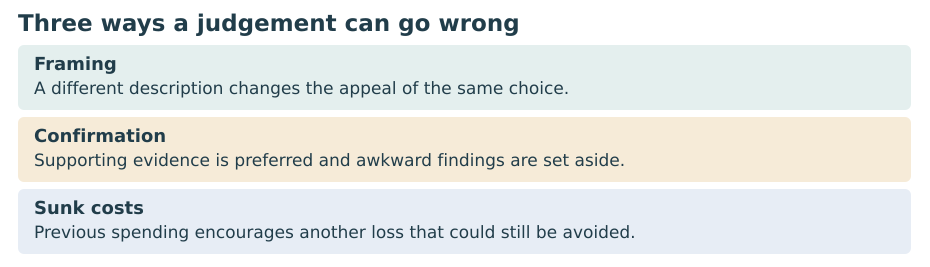
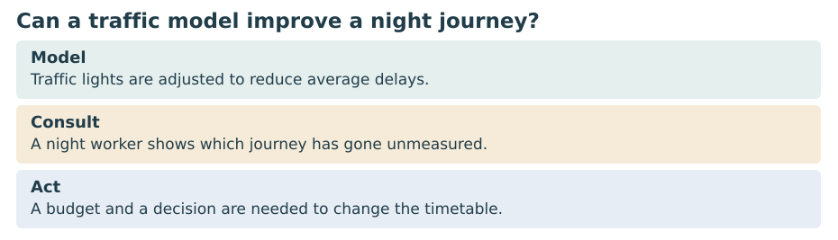

# École polytechnique FUI-FF, session 1 — Anglais 2020 · Corrigé guidé

*Corrigé rédigé par IA, non officiel.*

**Rédaction** · modèle exact non renseigné (famille GPT-6) · effort non renseigné · vitesse non renseignée

**Retouches** · modèle exact non renseigné (famille GPT-6) · effort non renseigné · vitesse non renseignée

**Autocontrôle** · modèle exact non renseigné (famille GPT-6) · effort non renseigné · vitesse non renseignée

**Révision** · modèle exact non renseigné (famille GPT-6) · effort non renseigné · vitesse non renseignée

**Révision** · GPT-6.2 Astra Ultra · vitesse non renseignée

**Révision** · GPT-6.2 Astra Ultra · vitesse non renseignée

**Révision (tour 4)** · GPT-6.2 Astra Ultra · vitesse non renseignée

L’épreuve dure deux heures. Le sujet demande au moins 50 mots par réponse de compréhension et un essai de 405 à 495 mots, avec une barre tous les 50 mots. Les renvois aux lignes identifient les idées reprises de l’article.

[Sujet officiel](https://www.polytechnique.edu/admission-cycle-ingenieur/sites/admission/files/content/2020%20FUI-FF%20SUJET%20D'ANGLAIS%20Session%201.pdf)

## Reading comprehension

### a) Cognitive biases and what they share

> [!INDICATION]
> Les deux étiquettes de l’aliment décrivent la même teneur en graisse. Concorde illustre l’effet d’une dépense passée sur un choix futur. Entre ces deux exemples, le biais de confirmation sélectionne l’information qui conforte une conviction. Retrouvez ces trois noms anglais à la lecture des lignes 58 à 68.

Three habits can defeat even a strong test taker. Framing bias means that identical food containing five per cent fat sounds more appealing when the label foregrounds its lean proportion. Confirmation bias makes us accept friendly evidence while discounting a genuine challenge to our beliefs. A sunk-cost error tempts us to continue an unpromising venture because of earlier spending, as with Concorde. Each error gives an irrelevant consideration undue influence over judgement. (Robson, lines 58–68).

### b) What an IQ score can predict

> [!INDICATION]
> Distinguer l’aptitude générale que le test cherche à estimer des résultats pratiques qu’il aide à prévoir.

Psychologists use IQ as an estimate of general mental aptitude because success at manipulating shapes, recognising sequences, handling numbers and using language tends to go together. The measure gained currency through practical applications. Developed for education, it offers some guidance about likely attainment and about the speed with which employees master unfamiliar tasks. Individual outcomes nevertheless depend on circumstances beyond that score. (Robson, lines 13–26).

### c) Essential skills beyond IQ

> [!INDICATION]
> Les lignes 79 à 87 décrivent deux enseignements. Dans l’histoire, l’étude des erreurs améliore à la fois le raisonnement mesuré et l’apprentissage des faits. Dans la discussion de théories du complot, les élèves apprennent à évaluer les preuves et paraissent ensuite plus sceptiques envers des informations trompeuses.

Robson wants learners to test the quality of evidence and recognise familiar errors before they guide a decision. High scores on abstract puzzles offer limited protection against a misleading story or a disastrous investment. History lessons that explored past errors improved both reasoning and recall of the material. Discussing conspiracy claims also gave students practice challenging unsupported assertions that they might encounter elsewhere. (Robson, lines 54–68 and 74–91).

### d) The Flynn effect

> [!INDICATION]
> Expliquer comment sont comparées les générations et ce que les courbes nordiques changent dans l’interprétation.

Flynn identified a historical gain in average results when successive generations were compared using equivalent IQ tasks. The increase averaged about three points each decade, adding up to roughly thirty over a century in certain countries. Its speed suggests changes in living or learning conditions, although researchers disagree about the precise explanation. For Finland, Denmark and Norway the trend apparently turned around the middle of the 1990s, then fell by about one fifth of a point annually. (Robson, lines 27–38).

Pour d), convertir 0,2 point par an en deux points de baisse sur dix ans. Le texte compare des moyennes obtenues par des générations différentes. Il ne suit pas le score d’une même personne au cours de sa vie.

## Essay

> [!INDICATION]
> L’exemple fictif des transports sépare réussite à une tâche, définition d’un objectif collectif et capacité institutionnelle à agir. Examiner aussi les limites de la comparaison entre générations.

A city can buy clever traffic lights and still leave its poorest district without a bus. An engineer may work out exactly how long vehicles should wait at a junction, yet the calculation will not tell the council whose journey deserves priority. That distinction makes Robert Sternberg’s challenge worth taking / seriously. A population that solves unfamiliar puzzles more readily has acquired a valuable resource. We should be careful about what we expect that resource to accomplish by itself.

Consider a transport authority asked to shorten journeys. To find the appropriate signal timing, its engineers must interpret measurements, build a model / and notice when the model fails. These activities reward intellectual flexibility. Suppose their intervention cuts the average delay across the network. A cleaner working a night shift might nevertheless wait forty minutes for a connection, because nobody counted her trip after the last scheduled service. The figures could be impeccable. / Somebody first had to decide which journeys to measure, which losses were tolerable and who should have a say.

There is a second difficulty. The people who understand a problem need not control the means of dealing with it. A city might know how to reduce air pollution, for example, / while nearby municipalities refuse to coordinate bus routes or share the expense. Calling their predicament a failure of intelligence overlooks a genuine dispute about costs. Better reasoning could make a proposed compromise clearer. It could scarcely oblige anyone to sign it. Elections, budgets and enforceable agreements give private insight a / chance to affect public life.

Yet I would hesitate to judge a century of intellectual change by the problems left standing at its close. A society that has discovered how to measure a previously invisible hazard can appear less successful precisely because its members now know what remains dangerous. Nor / does any single election provide a controlled comparison between generations. To assess progress we would need to ask which decisions improved, for whom, under what conditions, and by comparison with which realistic alternative.

My test for the transport authority would therefore involve an evening at the bus stop. Can its / staff explain their calculations to passengers, listen when a measurement leaves someone out, and change a timetable despite a politically inconvenient result? Intelligence can support every stage of that work. Public reasoning adds something that an individual test has little occasion to measure: a willingness to let other people alter / both the question and the definition of success. Thirty points might help the city design a better junction. The passenger will discover whether it has learned anything when she tries to get home.

*433 words.*

## Vérification des longueurs

Les quatre réponses de compréhension comptent respectivement 72, 62, 63 et 77 mots hors références. Dans l’essai, un groupe relié par un trait d’union compte pour un seul mot.
