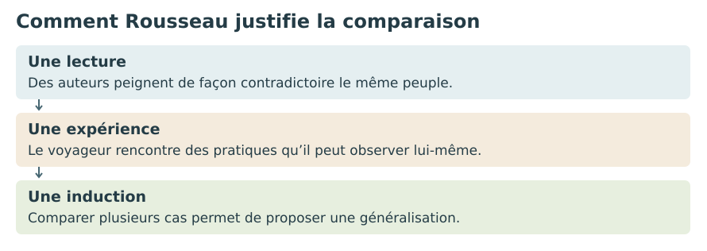

# École polytechnique FUI-FF, session 1 — Français 2020 · Corrigé brut

*Corrigé rédigé par IA, non officiel.*

**Rédaction** · modèle exact non renseigné (famille GPT-6) · effort non renseigné · vitesse non renseignée

**Autocontrôle** · modèle exact non renseigné (famille GPT-6) · effort non renseigné · vitesse non renseignée

**Révision** · modèle exact non renseigné (famille GPT-6) · effort non renseigné · vitesse non renseignée

**Révision** · GPT-6.2 Astra Ultra · vitesse non renseignée

**Révision (tour 3)** · GPT-6.2 Astra Ultra · vitesse non renseignée

Concours 2020, session d’automne. Le vendredi 13 septembre 2019, de 13 h 30 à 15 h 30 (deux heures). Les deux parties valent chacune 10 points. L’essai est bref, libre et sans limitation du nombre de mots. L’extrait est tiré de l’*Émile* de Rousseau (1762). [Sujet officiel](https://www.polytechnique.edu/admission-cycle-ingenieur/sites/admission/files/content/2020%20FUI-FF%20SUJET%20DE%20FRANCAIS%20Session%201.pdf)

## 1 a · La fonction éducative des voyages

Voyager sert à confronter ce que l’on croit savoir des autres peuples à des conduites que l’on peut observer. Une personne qui ne connaît que ses compatriotes risque de prendre les coutumes de son entourage pour celles de tous les hommes. Le voyage a donc une fonction éducative : la comparaison donne à une habitude familière sa juste place et permet d’interroger ce que les êtres humains ont en commun.

## 1 b · Les arguments de Rousseau

Rousseau commence par un paradoxe. Les nombreux livres de voyage imprimés en France ne garantissent pas que leurs lecteurs connaissent mieux les peuples étrangers. Il dit n’avoir jamais trouvé deux voyageurs qui lui donnent la même idée d’un peuple. La comparaison avec ses propres observations le conduit à délaisser ces récits. Il change ensuite la manière de poser le problème : celui qui veut connaître les hommes peut-il s’en tenir au seul groupe dans lequel il a grandi ? Enfin, la comparaison peut se faire sur plusieurs cas sans exiger de rencontrer tous les individus de chaque pays. L’auteur appelle induction ce passage des observations particulières à une proposition plus générale. La généralisation est particulièrement forte pour les Français. Rousseau en limite aussitôt la portée en faisant une réserve pour les Anglais. Le nombre dix illustre sa maxime sans établir un seuil statistique. Le dernier paragraphe emboîte en fait deux comparaisons : plusieurs individus sont censés faire connaître un peuple, puis plusieurs peuples faire connaître les hommes. Aller jusqu’au Japon pour étudier des Européens ajouterait de la distance au voyage sans diversifier les peuples observés. Rousseau conclut sur l’exemple de dix peuples comparés.

## 1 c, a · L’abus des livres

L’« abus » des livres désigne l’excès par lequel la lecture dispense, croit-on, de faire l’effort d’apprendre. Le lecteur qui a retenu la formule d’un auteur peut se sentir savant avant d’avoir vérifié ou compris la chose décrite. Sa certitude devient alors un obstacle à sa formation. La critique porte sur cet usage de la lecture, et prend d’autant plus de force que Rousseau lui-même nous la communique par écrit.

## 1 c, b · Le livre du monde

Le « livre du monde » est une métaphore de l’expérience directe. Quelqu’un qui possède dix descriptions de la même ville peut pourtant n’avoir jamais écouté ses habitants ni vu comment ils occupent ses rues. Les livres deviennent des écrans lorsque le temps et l’attention qui leur sont consacrés font perdre toute envie de regarder ce qu’ils prétendent nous faire connaître.

## 1 c, c · Voir et lire

La formule tire une règle pratique de l’expérience décevante des récits contradictoires. Lorsqu’il s’agit d’observer des usages, Rousseau réclame que l’on confronte les témoignages à des faits que l’on rencontre soi-même. Voir exige encore de comparer plusieurs situations : à elle seule, la première personne croisée lors d’un voyage ne peut représenter tous ses compatriotes.

## 2 · Le voyage et la découverte de l’étranger

Pour moi, rencontrer l’étranger commence quand une expérience m’oblige à revoir une explication que j’aurais jugée évidente chez moi. Imaginons que j’arrive dans une ville dont le marché occupe la place centrale à l’aube et qui semble ensuite se vider. Si j’en fais le tour à midi, je pourrais décrire une place peu fréquentée. Revenir le lendemain à six heures, aider un marchand à installer sa table et demander pourquoi il la replie si tôt changeraient ma description. Le déplacement dans l’espace n’aurait été instructif qu’à la faveur d’un second déplacement, dans le temps et dans ma façon d’interroger ce que je vois.

Je garderais pourtant un livre dans mon sac. Un plan ancien pourrait montrer que la forme de la place vient d’un port ou d’une gare qui a disparu. Aucun regard posé sur la pierre ne suffirait à établir ce fait. À son tour, le souvenir d’un habitant pourrait nuancer ce qu’un guide présente comme une coutume de toute la ville. Les trois sources m’aideraient à préciser l’étendue de ce que je peux affirmer. Parler du marchand que j’ai rencontré reste plus honnête que d’attribuer sa conduite à un pays entier.

Je partage ainsi l’exigence de comparaison de Rousseau tout en me méfiant du caractère uniforme qu’il prête parfois aux nations. Un voyage me semble réussi lorsque j’en reviens capable de raconter une rencontre avec précision et de nommer ce qui m’échappe encore. Ce geste peut d’ailleurs commencer près de chez soi, auprès de voisins dont on n’avait jamais pris au sérieux l’expérience.
