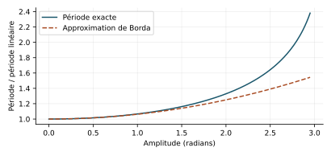

# École polytechnique · FUI francophone, session 1 · Mathématiques 2020 · Corrigé guidé

*Corrigé rédigé par IA, non officiel. Signalez toute erreur.*

**Rédaction** · GPT-6.2 Astra Ultra · vitesse non renseignée

Le sujet de la session d’automne porte sur la moyenne arithmético-géométrique, les intégrales elliptiques et la période du pendule. [Sujet officiel](https://www.polytechnique.edu/admission-cycle-ingenieur/sites/admission/files/content/2020%20FUI-FF%20SUJET%20DE%20MATHEMATIQUES%20Session%201.pdf)

## I. Moyenne arithmético-géométrique

### Question 1

> [!INDICATION]
> Comparer d’abord les deux moyennes, puis les situer entre leurs arguments.

#### Solution

Pour $x,y>0$, $(\sqrt x-\sqrt y)^2\ge0$ donne $(x+y)/2\ge\sqrt{xy}$. Ainsi $a_n\ge b_n>0$ dès $n=1$, quel que soit l’ordre initial. Pour ces indices,
$$b_n\le\sqrt{a_nb_n}=b_{n+1}\le a_{n+1}=\tfrac12(a_n+b_n)\le a_n.$$
Les deux sens de monotonie imprimés sont inversés. Par exemple, pour $a=4,b=1$, on passe de $a_1=5/2$ à $a_2=9/4$ et de $b_1=2$ à $b_2=\sqrt5$.

### Question 2

> [!INDICATION]
> Utiliser les bornes du premier intervalle emboîté et passer à la limite dans la moyenne arithmétique.

#### Solution

La suite $(a_n)_{n\ge1}$ décroît, minorée par $b_1$, et $(b_n)_{n\ge1}$ croît, majorée par $a_1$. Notons leurs limites $A,B$. L’identité $2a_{n+1}=a_n+b_n$ entraîne $2A=A+B$, donc $A=B=M(a,b)$. On a $0<b_1\le b_n\le M\le a_n$.

### Question 3a

> [!INDICATION]
> Factoriser la différence des carrés de deux manières.

#### Solution

Pour $n\ge0$,
$$2a_{n+2}\eta_{n+1}=(a_{n+1}+b_{n+1})(a_{n+1}-b_{n+1})=\frac{(a_n-b_n)^2}{4}.$$
D’où $\eta_{n+1}=\eta_n^2/(8a_{n+2})\le\eta_n^2/(8M)$, car $a_{n+2}\ge M>0$.

### Question 3b

> [!INDICATION]
> Normaliser l’écart pour faire apparaître une itération du carré.

#### Solution

Posons $u_n=\eta_n/(8M)$ dès $n=1$. Il est positif ou nul, tend vers zéro et $u_{n+1}\le u_n^2$. Pour $\eta>0$, choisissons $n_0\ge1$ tel que $u_{n_0}\le\eta$. Une récurrence donne $u_n\le\eta^{2^{n-n_0}}$ pour $n\ge n_0$. On peut prendre $K=8M$.

### Question 3c

> [!INDICATION]
> Fixer une base strictement entre zéro et un dans la borne précédente.

#### Solution

Les deux écarts à $M$ sont majorés par $\eta_n$. Prenons $\eta=1/2$ en 3b. Pour tout $\varepsilon>0$, $2^{-2^{n-n_0}}/\varepsilon^n$ tend vers zéro, puisque son logarithme est $-(\log2)2^{n-n_0}-n\log\varepsilon$. On en déduit les deux petits $o$.

## II. Intégrales elliptiques

### Question 4

> [!INDICATION]
> Contrôler les deux extrémités puis effectuer la substitution sur un intervalle tronqué.

#### Solution

L’intégrande de $\widetilde I$ est continue à zéro, de valeur $1/(ab)$, et équivaut à $u^{-2}$ à l’infini. Pour $u=b\tan t$, $0\le t<\pi/2$, on a $du=b\,dt/\cos^2t$ et
$$\sqrt{(a^2+u^2)(b^2+u^2)}=\frac{b}{\cos^2t}\sqrt{a^2\cos^2t+b^2\sin^2t}.$$
La substitution croissante jusqu’à une borne finie puis le passage à la limite donnent $\widetilde I(a,b)=I(a,b)$.

### Question 5a

> [!INDICATION]
> Calculer la dérivée et les limites aux deux extrémités.

#### Solution

Sur $]0,+\infty[$, la fonction $u(v)=(v-ab/v)/2$ est lisse, de dérivée $(1+ab/v^2)/2>0$. Ses limites sont $-\infty$ et $+\infty$. Elle est donc un difféomorphisme croissant sur $\mathbb R$. Le point $v=\sqrt{ab}$ correspond à $u=0$.

### Question 5b

> [!INDICATION]
> Doubler l’intégrale sur la demi-droite avant le changement de variable.

#### Solution

L’intégrande en $u$ est paire. Avec $a_1=(a+b)/2$, $b_1=\sqrt{ab}$, le calcul donne
$$a_1^2+u^2=\frac{(v^2+a^2)(v^2+b^2)}{4v^2},\qquad b_1^2+u^2=\frac{(v^2+ab)^2}{4v^2}.$$
Comme $du=(v^2+ab)dv/(2v^2)$, l’intégrale sur $u\in\mathbb R$ vaut $2\widetilde I(a,b)$ après substitution. Elle vaut aussi $2\widetilde I(a_1,b_1)$. Le passage aux bornes impropres est permis par convergence et positivité.

### Question 6

> [!INDICATION]
> Encadrer l’intégrande à chaque itération.

#### Solution

D’après 4 et 5, $I(a,b)=I(a_n,b_n)$ pour tout $n$. Dès $n=1$, le dénominateur est compris entre $b_n$ et $a_n$. Ainsi $\pi/(2a_n)\le I(a,b)\le\pi/(2b_n)$. Les deux bornes tendent vers $\pi/(2M)$, ce qui prouve la formule de Gauss.

### Question 7

> [!INDICATION]
> Retrancher deux fois le terme quadratique puis télescoper en multipliant par les puissances de deux.

#### Solution

Écrivons $I=I(a,b)$ et $H_n=J(a_n,b_n)-a_n^2 I$. La relation admise et l’égalité $a_nb_n-2a_{n+1}^2=-a_n^2+(a_n^2-b_n^2)/2$ donnent
$$2H_{n+1}=H_n+\tfrac12\delta_n I.$$
Le cas $n=0$ est la première identité demandée. Multiplions au rang $j$ par $2^j$ et sommons de $0$ à $n-1$. On obtient $2^n H_n=J(a,b)-a^2 I+I\sum_{j=0}^{n-1}2^{j-1}\delta_j$.

### Question 8a

> [!INDICATION]
> Encadrer la longueur élémentaire entre les deux demi-axes.

#### Solution

Dès $n=1$, l’intégrande de $J(a_n,b_n)$ appartient à $[b_n,a_n]$. Sa limite intégrée est donc $\ell=\pi M/2$, avec $|J(a_n,b_n)-\ell|\le(\pi/2)\eta_n$. La précision est ainsi meilleure que toute suite géométrique de raison positive.

### Question 8b

> [!INDICATION]
> Identifier la limite qui se simplifie puis estimer les deux erreurs.

#### Solution

Par 6, $M^2I=\pi M/2=\ell$. Pour $n\ge1$,
$$|H_n|\le(\pi/2)\eta_n+I(a_n+M)|a_n-M|\le(\pi/2+2Ia_1)\eta_n.$$
La question 3c appliquée avec $\varepsilon=1/2$ donne $2^n H_n\to0$.

### Question 8c

> [!INDICATION]
> Contrôler le terme général et passer à la limite dans la somme finie.

#### Solution

Pour $j\ge1$, $|\delta_j|=(a_j+b_j)\eta_j\le2a_1\eta_j$. La question 3c avec $\varepsilon=1/4$ entraîne la convergence absolue de $\sum_{j\ge0}2^{j-1}\delta_j$. Par 7 et 8b,
$$J(a,b)=I(a,b)\left(a^2-\sum_{j=0}^\infty2^{j-1}\delta_j\right)
=\frac{\pi}{2M}\left(a^2-\sum_{j=0}^\infty2^{j-1}\delta_j\right).$$

## III. Solutions du pendule

### Question 9

> [!INDICATION]
> Déterminer les coefficients du sinus et du cosinus.

#### Solution

Pour $\omega>0$, la solution générale est $A\cos(\omega t)+B\sin(\omega t)$. Les données initiales imposent $A=0$ et $B=\theta'_0/\omega$. Si l’on autorise $\omega=0$ dans cette seule question, la solution est $t\theta'_0$.

### Question 10

> [!INDICATION]
> Multiplier l’équation par la dérivée de l’angle.

#### Solution

La dérivée de $(\theta')^2/2-\omega^2\cos\theta$ s’annule, donc cette quantité vaut $(\theta'_0)^2/2-\omega^2$. Posons
$$\theta_0=\arccos\!\left(1-\frac{(\theta'_0)^2}{2\omega^2}\right)\in]0,\pi[.$$
La conservation de l’énergie donne $(\theta')^2=2\omega^2(\cos\theta-\cos\theta_0)$.

### Question 11a

> [!INDICATION]
> Utiliser des zéros distincts dans le taux d’accroissement de la vitesse.

#### Solution

Soit $t_j\ne t_0$ une suite de points de $Z$ tendant vers $t_0$. Par continuité $\theta'(t_0)=0$. Par dérivabilité de $\theta'$, $\theta''(t_0)=\lim_j(\theta'(t_j)-\theta'(t_0))/(t_j-t_0)=0$.

### Question 11b

> [!INDICATION]
> Étudier l’adhérence de l’ensemble où la vitesse est non nulle.

#### Solution

Soit $U=\{t\in I:\theta'(t)\ne0\}$. Il est non vide si $\theta$ est non constante. Sur $U$, la dérivation de (P’) suivie de la division par $2\theta'$ donne (P). Par continuité, (P) vaut aussi sur l’adhérence relative $F$ de $U$. Pour $t\in F\setminus U$, (P’) donne $\cos\theta(t)=\cos\theta_0$, donc $\sin\theta(t)\ne0$ puisque $0<\theta_0<\pi$. Dès lors $\theta''(t)=-\omega^2\sin\theta(t)\ne0$. La vitesse change strictement de façon monotone près de $t$, et ce zéro est isolé. Un voisinage de $t$ appartient ainsi à $F$. L’ensemble $F$ est ouvert et fermé dans l’intervalle $I$, donc $F=I$ et (P) y est vérifiée.

### Question 12

> [!INDICATION]
> Comparer près du point de retournement à une puissance intégrable.

#### Solution

Pour $0\le s<\theta_0$, $\cos s>\cos\theta_0$. À gauche de $\theta_0$, la différence équivaut à $\sin\theta_0(\theta_0-s)$, où $\sin\theta_0>0$. L’intégrande équivaut donc à une constante fois $(\theta_0-s)^{-1/2}$, intégrable. Ainsi $T_0=\int_0^{\theta_0}[2\omega^2(\cos s-\cos\theta_0)]^{-1/2}\,ds$ est fini et positif. L’intégrale partielle est continue jusqu’à sa borne, strictement croissante, et de classe $C^2$ sur $[0,\theta_0[$. Son image est $[0,T_0]$.

### Question 13

> [!INDICATION]
> Calculer la dérivée de la réciproque à l’intérieur et contrôler sa limite au bord.

#### Solution

Sur $[0,T_0[$, le théorème de la fonction réciproque donne $\psi'(t)=\sqrt{2\omega^2(\cos\psi(t)-\cos\theta_0)}$. Cette dérivée tend vers zéro à gauche de $T_0$, puisque $\psi(T_0)=\theta_0$. Le théorème des accroissements finis appliqué entre $t$ et $T_0$ montre que la dérivée à gauche en $T_0$ vaut zéro. La dérivée est donc continue sur le segment et (P’) y vaut également aux bornes.

### Question 14

> [!INDICATION]
> Raccorder au premier sommet, puis au passage par zéro avec le signe opposé.

#### Solution

Après réflexion en $T_0$, la dérivée à droite vaut $-\psi'(2T_0-t)$ et rejoint la valeur zéro à gauche. La fonction est donc $C^1$, et $C^2$ par l’indication admise. (P’) subsiste par réflexion et la question 11b donne (P) dans l’intérieur, puis aux extrémités par continuité. Sur $[2T_0,4T_0]$, posons $\psi(t)=-\psi(t-2T_0)$. Les valeurs aux raccords sont nulles, les dérivées coïncident puisque $\psi'(2T_0)=-\psi'(0)$, et les dérivées secondes y sont nulles par (P). Le prolongement par $4T_0$-périodicité est donc $C^2$ et satisfait (P). Il a pour vitesse initiale $|\theta'_0|$ ; le signe opposé donne la solution de vitesse initiale négative.

## IV. Période et amplitude

### Question 15

> [!INDICATION]
> Poser la demi-amplitude et utiliser la formule de duplication du cosinus.

#### Solution

Avec $s=2t$, $k=\sin(\theta_0/2)$ et $\cos s-\cos\theta_0=2(k^2-\sin^2t)$, la définition $T=4T_0$ devient
$$T=\frac4\omega\int_0^{\theta_0/2}\frac{dt}{\sqrt{k^2-\sin^2t}}.$$
Ainsi $c=4/\omega$.

### Question 16

> [!INDICATION]
> Faire le changement de variable sur une borne strictement inférieure, puis passer à la limite.

#### Solution

Puisque $0<k<1$, $t=\arcsin(k\sin u)$ envoie $[0,\pi/2]$ bijectivement sur $[0,\theta_0/2]$. Sur l’intérieur, $dt=k\cos u\,du/\sqrt{1-k^2\sin^2u}$ et $\sqrt{k^2-\sin^2t}=k\cos u$. Après simplification puis passage à la limite,
$$T=\frac4\omega\int_0^{\pi/2}\frac{du}{\sqrt{1-k^2\sin^2u}}=\frac4\omega I(1,\sqrt{1-k^2}).$$

### Question 17

> [!INDICATION]
> Contrôler uniformément le reste de Taylor avant d’intégrer.

#### Solution

Sur $0\le x\le1/2$, $(1-x)^{-1/2}=1+x/2+O(x^2)$ avec une constante uniforme, par borne sur la dérivée seconde. Pour $k$ petit, substituons $x=k^2\sin^2u$ puis intégrons sur $[0,\pi/2]$. Comme $\int_0^{\pi/2}\sin^2u\,du=\pi/4$, l’intégrale vaut $(\pi/2)(1+k^2/4+O(k^4))$. Enfin $k^2=\theta_0^2/4+O(\theta_0^4)$, d’où
$$T=\frac{2\pi}{\omega}\left(1+\frac{\theta_0^2}{16}+O(\theta_0^4)\right).$$

