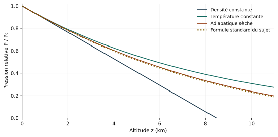
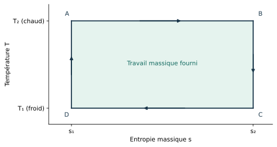

# École polytechnique · FUI-FF, session 1 · Physique 2020 · Corrigé guidé

*Corrigé rédigé par IA, non officiel. Signalez toute erreur.*

**Rédaction** · GPT-6.2 Astra Ultra · vitesse non renseignée · 24 novembre 2026

**Révision** · GPT-6.2 Astra Ultra · vitesse non renseignée · 26 novembre 2026

Session d’automne du concours 2020, épreuve passée le 14 septembre 2019.

## Présentation du sujet

La première partie part d’une mesure de pression et compare trois profils d’atmosphère. La seconde étudie la durée de vie des muons et la coupure radio de l’ionosphère. Pour la dernière partie, le signe de la chaleur reçue sur chaque branche donne le sens du cycle de Carnot.

## Partie A · Pression atmosphérique

### A.1 · Pression au repos

> [!INDICATION]
> Orientez la normale de la surface et distinguez les échelles moléculaire et macroscopique.

#### Solution

Considérons un élément d’aire $\mathrm dS$ contenant de très nombreuses molécules à son voisinage, mais petit devant l’échelle de variation des grandeurs du fluide. Si $\mathbf n$ est la normale sortant du volume étudié, la force exercée par le fluide extérieur sur cette face vaut $\mathrm d\mathbf F=-P\mathbf n\,\mathrm dS$. La pression est donc la force normale compressive par unité de surface. Au repos elle est indépendante de l’orientation de la face et s’exprime en pascals, $1\,\mathrm{Pa}=1\,\mathrm{N\,m^{-2}}$.

### A.2 · Gaz parfait et gaz de Van der Waals

> [!INDICATION]
> Le volume réellement accessible aux molécules est inférieur au volume du récipient. Les attractions entre molécules modifient aussi les chocs sur la paroi.

#### Solution

Pour $n$ moles, $PV=nRT$. Le modèle de Van der Waals s’écrit $(P+a n^2/V^2)(V-nb)=nRT$. Le covolume molaire $b>0$ réduit le volume disponible. À volume et température donnés, la correction attractive soustrait $a n^2/V^2$ à la pression que produirait le gaz avec le seul covolume. À faible densité, les deux corrections deviennent négligeables.

### A.3 · Équilibre hydrostatique

> [!INDICATION]
> Faites le bilan des forces volumiques de pression et de pesanteur.

#### Solution

Dans un volume élémentaire au repos, les forces de pression ont une résultante $-\nabla P\,\mathrm dV$ et le poids vaut $\mu\mathbf g\,\mathrm dV$. L’équilibre impose $\nabla P=\mu\mathbf g$. Avec $z$ croissant vers le haut et $\mathbf g=-g\mathbf e_z$, on a $\mathrm dP/\mathrm dz=-\mu g$.

### A.4.a · Résolution du capteur

> [!INDICATION]
> Comparez un millibar à la chute de pression sur quelques mètres d’air.

#### Solution

Au voisinage du sol, $\mu\simeq1,2\,\mathrm{kg\,m^{-3}}$. On perd donc environ $12\,\mathrm{Pa}$ par mètre de hauteur. Sur $3\,\mathrm m$, la différence vaut environ $35\,\mathrm{Pa}=0,35\,\mathrm{mbar}$. Une résolution de $1\,\mathrm{mbar}=100\,\mathrm{Pa}$ correspond à environ $8,5\,\mathrm m$ et ne suffit pas pour mesurer de façon fiable les écarts de hauteur usuels d’une salle. À hauteur égale, l’équilibre prédit la même pression.

### A.4.b · Équilibre du pont

> [!INDICATION]
> L’entrée de mesure est ouverte. Chaque côté du pont est donc un diviseur de tension indépendant.

#### Solution

Prenons $V_B=0$ et $V_A=U_0$. Les branches de la figure donnent $V_1=U_0R_4/(R_1+R_4)$ et $V_2=U_0R_3/(R_2+R_3)$. La tension indiquée est $u=V_1-V_2$. En annulant la différence puis en multipliant par les dénominateurs, on obtient **$R_2R_4=R_1R_3$**. Si les trois résistances fixes valent $R$, la résistance de la jauge à l’équilibre vaut $R$.

### A.4.c · Déformation de la jauge

> [!INDICATION]
> Identifiez les hypothèses mécaniques nécessaires sur le volume et sur les deux directions transversales.

#### Solution

Pour une jauge isotrope transversalement, $\Delta b/b=\Delta c/c$. Si l’on assimile le matériau à un milieu incompressible, $V=abc$ reste constant. Sa différentielle logarithmique donne $\Delta a/a+\Delta b/b+\Delta c/c\simeq0$. Les petites déformations vérifient donc $\Delta b/b=\Delta c/c=-\Delta a/(2a)$. Un simple allongement accompagné d’une contraction ne fixe pas le facteur $1/2$ à lui seul. Pour un matériau compressible il faut le coefficient de Poisson.

### A.4.d · Signal du pont et allongement

> [!INDICATION]
> Mettez $R_4=R(1+k\Delta P)$ dans la première branche et utilisez le logarithme de la résistance géométrique.

#### Solution

Initialement $R_4=R=500\,\Omega$. Pour $x=k\Delta P$, on a $R_4'=R(1+x)$ après variation. Le signal exact du pont s’écrit

$$u=U_0\left(\frac{1+x}{2+x}-\frac12\right)=\frac{U_0x}{2(2+x)}\simeq\frac{U_0k\Delta P}{4}.$$

Avec $\Delta P=10\,\mathrm{hPa}=10^3\,\mathrm{Pa}$, le produit $x=10^{-3}$ donne $\Delta R_4=0,50\,\Omega$ et **$u=+3,0\,\mathrm{mV}$** pour la flèche imprimée.

À résistivité $\rho_{\rm el}$ constante et courant longitudinal, $R_4=\rho_{\rm el}a/(bc)$. On en tire $\Delta R_4/R_4\simeq\Delta a/a-\Delta b/b-\Delta c/c=2\Delta a/a$. Ainsi la variation relative de longueur est $+5,0\times10^{-4}$, soit $0,050\,\%$. À volume et résistivité constants, $R_4=\rho_{\rm el}a^2/V$ donne aussi la relation exacte $\Delta a/a=\sqrt{1+x}-1$, soit $4{,}999\times10^{-4}$. Une variation de résistivité ajouterait son propre terme à la variation relative de résistance.

### A.5 · Amplification de la différence

> [!INDICATION]
> Lisez les potentiels des entrées inverseuses des deux premiers amplificateurs. Leurs courants d’entrée sont nuls.

#### Solution

En régime linéaire idéal les nœuds $C,D$ sont aux potentiels $V_1,V_2$. Le courant $u/R_6$ circule de $C$ vers $D$ et traverse également les résistances de contre-réaction $R_5$. D’où $V_3=V_1+(R_5/R_6)u$, $V_4=V_2-(R_5/R_6)u$, puis $V_3-V_4=(1+2R_5/R_6)u$.

Au dernier étage, $V_F=R_8V_4/(R_7+R_8)$ et $V_E=V_F$. La loi des nœuds en $E$ donne $V_5=(1+R_8/R_7)V_E-(R_8/R_7)V_3$, soit

$$V_5=-\frac{R_8}{R_7}\left(1+\frac{2R_5}{R_6}\right)u.$$

Le premier facteur d’amplification différentielle vaut $1+2\times4,5/1,0=10$. Pour $|V_5|=100\,\mathrm{mV}$, on choisit **$R_7=R_8\times10|u|/|V_5|\simeq30\,\mathrm{k\Omega}$**. Le signal de sortie a le signe opposé à la variation de tension du pont.

### A.6.a · Masse molaire de l’air

> [!INDICATION]
> Pondérez les masses molaires par les proportions molaires des gaz.

#### Solution

En assimilant l’air sec à $80\,\%$ de diazote et $20\,\%$ de dioxygène en quantité de matière, $M=x_{\mathrm{N_2}}M_{\mathrm{N_2}}+x_{\mathrm{O_2}}M_{\mathrm{O_2}}=0,80\times28+0,20\times32=28,8\,\mathrm{g\,mol^{-1}}$. Les calculs suivants utilisent $M=2,88\times10^{-2}\,\mathrm{kg\,mol^{-1}}$ et $g=9,81\,\mathrm{m\,s^{-2}}$.

### A.6.b · Pesanteur dans la troposphère

> [!INDICATION]
> Comparez la hauteur de la troposphère au rayon de la Terre.

#### Solution

En négligeant la rotation terrestre, $g(z)/g(0)=[R_{\mathrm T}/(R_{\mathrm T}+z)]^2\simeq1-2z/R_{\mathrm T}$. Avec $R_{\mathrm T}\simeq6\,370\,\mathrm{km}$ et $z\le11\,\mathrm{km}$, la baisse atteint au plus $0,35\,\%$. Elle est négligeable pour les ordres de grandeur demandés.

### A.6.c · Densité moléculaire constante

> [!INDICATION]
> Dans ce modèle la masse volumique est constante. Éliminez-la à l’aide de l’état au sol.

#### Solution

Avec $T_0=288\,\mathrm K$, posons $H=RT_0/(Mg)\simeq8,48\,\mathrm{km}$. La masse volumique constante vaut $\mu_0=MP_0/(RT_0)$, d’où $P=P_0-\mu_0gz=P_0(1-z/H)$. Puis $T=MP/(R\mu_0)=T_0(1-z/H)$. Le gradient constant vaut $-T_0/H=-Mg/R\simeq-34\,\mathrm{K\,km^{-1}}$. La pression vaut $P_0/2$ à **$z=H/2\simeq4,24\,\mathrm{km}$**. Le modèle conduirait à une température absolue négative pour $z>H$, ce qui en limite l’usage.

### A.6.d · Atmosphère isotherme

> [!INDICATION]
> L’équation hydrostatique est maintenant proportionnelle à la pression locale.

#### Solution

À $T=T_0$, $\mu=MP/(RT_0)$ et $\mathrm dP/P=-\mathrm dz/H$. En intégrant depuis le sol, $P(z)=P_0 e^{-z/H}$. La pression est divisée par deux à **$z=H\ln2\simeq5,87\,\mathrm{km}$**.

### A.6.e · Atmosphère adiabatique

> [!INDICATION]
> Combinez la loi de Laplace du gaz parfait et le bilan hydrostatique, en distinguant le gradient de température du gradient de pression.

#### Solution

Pour ce modèle réversible isentropique, $T/T_0=(P/P_0)^{(\gamma-1)/\gamma}$. Sa différentielle et $\mathrm dP/P=-Mg\,\mathrm dz/(RT)$ donnent

$$\frac{\mathrm dT}{\mathrm dz}=-\frac{\gamma-1}{\gamma}\frac{Mg}{R}\simeq-9,7\,\mathrm{K\,km^{-1}}.$$

Avec $Z=\gamma H/(\gamma-1)\simeq29,7\,\mathrm{km}$, on a $T=T_0(1-z/Z)$ et $P=P_0(1-z/Z)^{\gamma/(\gamma-1)}$. La demi-pression est atteinte à **$z=Z[1-2^{-(\gamma-1)/\gamma}]\simeq5,33\,\mathrm{km}$**.

### A.6.f · Formule standard du sujet

> [!INDICATION]
> Inversez la formule de l’énoncé. Comparez la puissance de $P/P_0$ et le coefficient devant le crochet.

#### Solution

La question donne $z=100T_0[1-(P/P_0)^{0,29}]$, en mètres pour $T_0$ en kelvins. Dans le modèle adiabatique de A.6.e, le même exposant vaut $(\gamma-1)/\gamma=0,286$ et le coefficient devant $T_0$ vaut $\gamma R/[(\gamma-1)Mg]\simeq103\,\mathrm{m\,K^{-1}}$. La formule proposée est donc une version arrondie de **ce modèle adiabatique**. Elle s’inverse en $P/P_0=[1-z/(100T_0)]^{1/0,29}$. Le graphe décroît en restant convexe dans la troposphère. Au sol il part de $P_0=1,0\,\mathrm{bar}$.

## Partie B · L’atmosphère comme milieu propagatif

### B.1.a · Parcours des muons

> [!INDICATION]
> Comparez les deux distances à celle qu’un muon parcourrait à la vitesse de la lumière pendant sa durée de vie propre.

#### Solution

Même à $c$, le parcours sur la durée propre $\tau_0=2,2\,\mu\mathrm s$ ne serait que $c\tau_0=0,66\,\mathrm{km}$. Les distances moyennes $6,87$ et $63\,\mathrm{km}$ reflètent la **dilatation relativiste des durées**. Dans le référentiel terrestre $\tau=\gamma\tau_0$ avec $\gamma=(1-v^2/c^2)^{-1/2}$. Le parcours moyen est $v\gamma\tau_0$ et croît fortement avec l’énergie même quand $v$ est déjà proche de $c$. Dans le référentiel du muon, la traversée s’explique par la contraction de l’épaisseur d’atmosphère.

### B.1.b · Loi de désintégration

> [!INDICATION]
> Sur un intervalle très court, chaque muon présent a la même probabilité par unité de temps de disparaître.

#### Solution

La population moyenne obéit à $\mathrm dN/\mathrm dt=-N/\tau$ dans le référentiel où la durée de vie moyenne vaut $\tau$. Avec $N(0)=N_0$, $N(t)=N_0 e^{-t/\tau}$. Après $\tau$, la fraction survivante est $1/\mathrm e$, et la demi-vie est $\tau\ln2$.

### B.1.c · Deux comptages en altitude

> [!INDICATION]
> Les comptages sur une heure mesurent deux flux. Leur rapport donne la fraction survivante sur la durée du trajet.

#### Solution

En supposant un flux initial stationnaire, des détecteurs de même acceptation et une population verticale de vitesse commune, $408/563=\exp(-6,4\,\mu\mathrm s/\tau)$. Ainsi **$\tau=6,4\,\mu\mathrm s/\ln(563/408)\simeq19,9\,\mu\mathrm s$**. Le rapport $\gamma=\tau/\tau_0\simeq9,0$ fournit $v=c\sqrt{1-\gamma^{-2}}\simeq0,994c\simeq2,98\times10^8\,\mathrm{m\,s^{-1}}$. Le contrôle cinématique $1,9\,\mathrm{km}/(6,4\,\mu\mathrm s)\simeq2,97\times10^8\,\mathrm{m\,s^{-1}}$ est compatible avec la précision des données. La durée de vol entre les appareils est plus courte que la durée de vie moyenne terrestre.

### B.2.a · Propagation dans le vide

> [!INDICATION]
> Appliquez les deux dérivées secondes à l’exponentielle de l’énoncé et fixez le sens de propagation.

#### Solution

Pour $\underline E_y=\underline E_0 e^{i(\omega t-kx)}$, l’équation de d’Alembert donne $(-k^2+\omega^2/c^2)\underline E_y=0$. Pour un champ non nul, $k=\pm\omega/c$. La racine **$k=\omega/c$** donne les fronts $x=(\omega/k)t+\mathrm{constante}$ se déplaçant vers $+x$.

### B.2.b · Dispersion de l’ionosphère

> [!INDICATION]
> Un milieu est dispersif lorsque les différentes composantes spectrales d’une onde ne partagent pas la même vitesse de phase.

#### Solution

Dans la bande propagative, $k=\sqrt{\omega^2-\omega_P^2}/c$ pour l’onde dirigée vers $+x$. La vitesse de phase $v_\phi=\omega/k=c/\sqrt{1-\omega_P^2/\omega^2}$ dépend de $\omega$. Le plasma est dispersif. La vitesse de groupe est $v_g=\mathrm d\omega/\mathrm dk=c^2k/\omega<c$. Le milieu interstellaire assimilé au vide dans le sujet a $v_\phi=v_g=c$ quelle que soit la pulsation.

### B.2.c · Nombre d’onde dans les deux régimes

> [!INDICATION]
> Étudiez le signe de $k^2$ et conservez la convention temporelle de l’énoncé pour choisir la racine décroissante.

#### Solution

Au-dessus de la coupure, $\omega>\omega_P$, on a $k=\pm\sqrt{\omega^2-\omega_P^2}/c$, réel. En dessous, $0<\omega<\omega_P$, posons $\alpha=\sqrt{\omega_P^2-\omega^2}/c>0$. Alors $k=\pm i\alpha$. Pour un plasma occupant $x>0$ et un champ décroissant vers son intérieur, $e^{-ikx}$ impose **$k=-i\alpha$**. Au seuil $\omega=\omega_P$, la relation donne $k=0$.

### B.2.d · Onde évanescente

> [!INDICATION]
> Écrivez l’amplitude complexe au bord sous forme polaire, puis prenez la partie réelle.

#### Solution

Avec $\underline E_0=|E_0|e^{i\phi}$, le champ complexe vaut $\underline{\mathbf E}=\underline E_0 e^{-\alpha x} e^{i\omega t}\mathbf e_y$. Le champ physique est $\mathbf E=|E_0|e^{-\alpha x}\cos(\omega t+\phi)\mathbf e_y$. Tous les points ont la même phase temporelle et l’amplitude décroît sur la longueur $1/\alpha$. Pour une couche beaucoup plus épaisse que cette longueur, aucun signal appréciable ne débouche à l’autre face. Dans le modèle de plasma semi-infini sans perte, ce champ évanescent ne transporte pas de puissance moyenne en profondeur. Pour une couche finie, le caractère négligeable de la transmission dépend de son épaisseur, notamment très près de la coupure.

## Partie C · Modèle thermodynamique d’un cyclone

### C.1 · Diagramme entropique

> [!INDICATION]
> Repérez les coordonnées qui restent fixes pendant chaque transformation. Sur l’isotherme chaude, l’entropie augmente.

#### Solution

En notant $s$ l’entropie massique, $A=(s_1,T_2)$, $B=(s_2,T_2)$, $C=(s_2,T_1)$ et $D=(s_1,T_1)$ avec $T_2>T_1$ et $s_2>s_1$. Les isothermes sont horizontales dans le plan $(s,T)$, et les adiabatiques réversibles sont des isentropes verticales. La forme rectangulaire est indépendante de l’équation d’état. L’aire $(T_2-T_1)(s_2-s_1)$ a pour unité le joule par kilogramme.

### C.2 · Sens et rendement du moteur

> [!INDICATION]
> Pour une transformation réversible, la chaleur massique reçue vaut $T\,\mathrm ds$. Additionnez-la sur les deux branches horizontales.

#### Solution

Le moteur parcourt $A\to B\to C\to D\to A$ dans le sens horaire. Sur un cycle, la chaleur nette reçue $\oint T\,\mathrm ds>0$ est égale au travail net fourni à l’extérieur. Avec $\Delta s=s_2-s_1>0$, les chaleurs massiques reçues de la source chaude et de la source froide sont $q_2=T_2\Delta s$ et $q_1=-T_1\Delta s$. Le rendement vaut

$$\eta=\frac{q_2+q_1}{q_2}=1-\frac{T_1}{T_2}=1-\frac{213,15}{301,15}\simeq0,292.$$

Le rendement maximal du modèle entre $-60\,{}^\circ\mathrm C$ et $+28\,{}^\circ\mathrm C$ est donc proche de **29 %**.

### C.3 · Application à une voiture

> [!INDICATION]
> Un moteur doit délivrer du travail par unité de temps. Que devient le flux de chaleur lorsque l’écart de température entre gaz et source tend vers zéro ?

#### Solution

Le cycle de Carnot exige des échanges isothermes réversibles. Avec une surface d’échange et une conductance thermique finies, atteindre la réversibilité impose une différence de température infinitésimale. La puissance thermique échangée tend alors vers zéro, et accomplir une isotherme de chaleur finie demande une durée qui diverge. Le moteur idéal ne peut donc délivrer la puissance nécessaire à une voiture de taille finie. La combustion rapide, les frottements et les transferts à écart de température fini d’un moteur réel introduisent des irréversibilités.

### C.4 · Cycle récepteur et pompe à chaleur

> [!INDICATION]
> La grandeur utile pour chauffer est la chaleur livrée à la source chaude. Identifiez le travail reçu par le fluide dans le cycle inverse.

#### Solution

Le récepteur suit le sens anti-horaire $A\to D\to C\to B\to A$. Le fluide reçoit $T_1\Delta s$ de la source froide et fournit $T_2\Delta s$ à la source chaude. Le travail massique reçu est $(T_2-T_1)\Delta s$. Le coefficient de performance en chauffage est donc **$\mathrm{COP}_{\rm chaud}=T_2/(T_2-T_1)=301,15/88\simeq3,42$**. Pour un joule de travail fourni, environ $2,42\,\mathrm J$ prélevés à la source froide s’ajoutent au joule de travail pour chauffer la source chaude.

## Source

Épreuve écrite de physique, filière universitaire internationale, formation francophone, session 1. [Sujet officiel de l’École polytechnique](https://www.polytechnique.edu/admission-cycle-ingenieur/sites/admission/files/content/2020%20FUI-FF%20SUJET%20DE%20PHYSIQUE%20Session%201.pdf)
