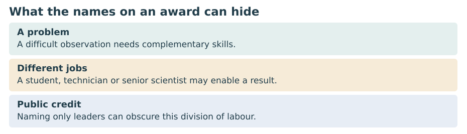
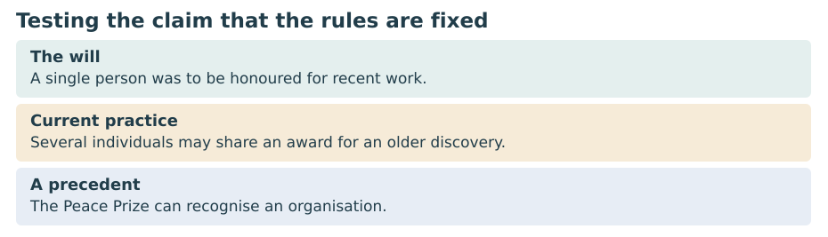
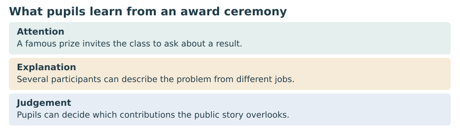

# École polytechnique FUI-FF, session 2 — Anglais 2020 · Corrigé guidé

*Corrigé rédigé par IA, non officiel.*

**Rédaction** · modèle exact non renseigné (famille GPT-6) · effort non renseigné · vitesse non renseignée

**Retouches** · modèle exact non renseigné (famille GPT-6) · effort non renseigné · vitesse non renseignée

**Autocontrôle** · modèle exact non renseigné (famille GPT-6) · effort non renseigné · vitesse non renseignée

**Révision** · modèle exact non renseigné (famille GPT-6) · effort non renseigné · vitesse non renseignée

**Révision** · GPT-6.2 Astra Ultra · vitesse non renseignée

**Révision** · GPT-6.2 Astra Ultra · vitesse non renseignée

**Révision (tour 4)** · GPT-6.2 Astra Ultra · vitesse non renseignée

L’épreuve dure deux heures. Le sujet demande au moins 50 mots par réponse de compréhension et un essai de 405 à 495 mots, avec une barre tous les 50 mots. Les renvois aux lignes identifient les idées reprises de l’article.

[Sujet officiel](https://www.polytechnique.edu/admission-cycle-ingenieur/sites/admission/files/content/2020%20FUI-FF%20S2%20SUJET%20ANGLAIS.pdf)

## Reading comprehension

### 1. A harmful story about discovery

> [!INDICATION]
> Confrontez la liste de signataires de LIGO, qui s’étend sur trois pages, aux trois noms du palmarès. Les lignes 74 à 82 permettent ensuite d’expliquer comment invitations et citations renforcent la visibilité des lauréats.

Yong disputes the picture of an exceptional individual creating knowledge alone. The gravitational-wave paper, for instance, needed three pages to list its authors, although only three leaders shared the award. When a collective result becomes a short list of famous people, later readers learn a misleading history. Junior staff lose recognition, while the winners attract speaking invitations and further scholarly attention. (Yong, lines 1–15, 48–55 and 74–82).

### 2. Reasons to recognise a larger team

> [!INDICATION]
> Comparer les dispositions du testament de Nobel, la pratique actuelle et le précédent du prix de la paix.

The limit hardly follows literally from Nobel’s instructions: his will described one recipient and envisaged very recent work, whereas current practice permits several recipients and much older discoveries. The peace award already demonstrates that an organisation can receive the distinction. Recognising a whole team would therefore extend an existing practice and would better fit the LIGO result: hundreds contributed, yet only three leaders received a share. (Yong, lines 7–11 and 41–47).

### 3. Three criticisms of the awards

> [!INDICATION]
> Distinguer trois objets de critique : le mode de travail, le récit du passé, la visibilité des personnes.

A prize for individuals first misdescribes collaborative research. It can also change the historical account: Waksman received credit for streptomycin although his student Schatz found it. Third, vital contributors may be excluded altogether. Franklin died before the DNA award, and Meitner never won despite forty-eight nominations. Yong then warns of another consequence: prestige from one discovery can lend credibility to a winner’s unrelated opinions. (Yong, lines 12–15, 23–26 and 56–84).

### 4. Why a celebration can help science

> [!INDICATION]
> Expliquer l’effet du rapprochement avec le cinéma et la télévision puis situer la concession dans l’argument.

Here Yong credits the awards with making people eager to hear scientific news. Audiences normally associate that feeling with film or television ceremonies; dismissing it when it draws them towards research would be mean-spirited. Public interest can also lead visitors to accounts on the organisers’ website that recover details normally absent from research articles. Recognising these benefits allows Yong to criticise how winners are selected without belittling the celebration. (Yong, lines 16–22).

Le texte énonce trois critiques dès les lignes 12 à 15. La collaboration de LIGO illustre la nature du travail, Schatz l’attribution historique, Franklin et Meitner les omissions. La notoriété qui crédibilise ensuite des déclarations sans rapport avec la découverte est une conséquence supplémentaire. Les 48 mentions de Meitner sont des propositions de candidature entre 1937 et 1965.

## Essay

> [!INDICATION]
> L’essai distingue une prédiction sur la durée d’une institution et un jugement sur le mérite de célébrer le travail scientifique. Il met à l’épreuve ces deux propositions dans une même classe fictive.

When a prize is announced, the headline has room for very few names. A teacher, however, can make that same headline the beginning of a lesson about hundreds of people. Benjamin Burke welcomes public celebrations of work that benefits society and predicts a long future for the Nobel awards. I / share his hope that achievement will be celebrated. Whether these particular ceremonies deserve to endure depends partly on what happens after the headline appears.

The prizes have acquired one advantage that a newly designed award would struggle to reproduce: people expect to hear about them. Even readers who could not / name a physics journal may stop, once a year, to ask what somebody has discovered. Imagine a class hearing that distant events can produce a disturbance detectable on Earth. A student who came for a story about the winners might stay to understand why a tiny measurement requires exceptionally sensitive / instruments. The famous name has bought a moment of curiosity. Treating that curiosity as vulgar would surrender an unusually effective invitation to learn.

An invitation, however, is only as good as the account offered to those who accept it. Suppose the class sees three portraits and hears that three people / detected the signal. What place is left for the colleague who investigated a faulty sensor or the technician who maintained the instrument through months of unremarkable readings? A pupil whose talents resemble theirs might leave with the impression that such work takes place outside science. Applause intended to encourage future / researchers would have made some of its intended audience feel invisible.

One response would be to use the attention differently. Announcers could introduce the result by describing an obstacle, then let several participants explain how different jobs helped overcome it. Schools and broadcasters could follow their accounts beyond the ceremony. / Meanwhile other institutions could publicly honour careful maintenance, shared tools or a decisive replication. Such recognition need not compete for a single evening of television. A local audience may care more about meeting someone who did the work than about watching a distinguished stranger accept a medal.

I suspect the / Nobels will remain familiar because institutions and audiences keep renewing the habit of paying attention. Familiarity offers no permanent guarantee: a prize that consistently misrepresents achievement can lose authority even while it attracts viewers. Burke is right that ridicule achieves little. The stronger defence is a demanding one. Keep celebrating, / ask what the celebration teaches, and make room for the people whose experience can change the story. If another institution eventually does that better, the public purpose Burke values will have survived a change of name.

*436 words.*

## Vérification des longueurs

Les quatre réponses de compréhension comptent respectivement 61, 66, 64 et 69 mots hors références. Dans l’essai, un groupe relié par un trait d’union compte pour un seul mot.
