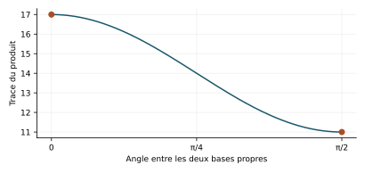

# École polytechnique · FUI francophone, session 2 · Mathématiques 2020 · Corrigé brut

*Corrigé rédigé par IA, non officiel. Signalez toute erreur.*

**Rédaction** · GPT-6.2 Astra Ultra · vitesse non renseignée · 24 novembre 2026

**Révision** · GPT-6.2 Astra Ultra · vitesse non renseignée · 26 novembre 2026

Le sujet de printemps établit l’inégalité de trace de von Neumann par optimisation sur une orbite orthogonale. [Sujet officiel](https://www.polytechnique.edu/admission-cycle-ingenieur/sites/admission/files/content/2020%20FUI-FF%20S2%20SUJET%20MATHEMATIQUES.pdf)

## I. Réarrangement et matrices orthogonales

### Question 1a

Pour la transposition, la différence entre la somme ordonnée et la somme permutée vaut $(a_2-a_1)(b_2-b_1)\ge0$. Pour l’identité les deux sommes coïncident. Ce sont les seules permutations.

### Question 1b

Si $j=\sigma^{-1}(n)$, échangeons les images de $j$ et de $n$. La nouvelle somme moins l’ancienne vaut $(a_n-a_j)(b_n-b_{\sigma(n)})\ge0$. Désormais le terme $a_nb_n$ est correctement apparié. L’hypothèse de récurrence sur les $n-1$ indices restants donne la majoration cherchée. Le départ $n=1$ est immédiat.

### Question 2a

Dans une norme matricielle sous-multiplicative, pour $|t|\le1$, la queue après $I+tA$ est majorée par $t^2\sum_{k\ge2}\|A\|^k/k!$. Ainsi $\exp(tA)=I+tA+O(t^2)$ et sa dérivée en zéro est $A$.

### Question 2b

La transposition commute aux sommes convergentes et aux puissances d’une même matrice. Si $M^\top=-M$, alors $(\exp M)^\top=\exp(-M)$. Comme $-M$ et $M$ commutent, $\exp(-M)\exp(M)=I$, donc $\exp M$ est orthogonale.

### Question 3a

Si $Ax=\lambda x$, alors $A(Bx)=B(Ax)=\lambda Bx$. Donc $B$ envoie $\ker(A-\lambda I)$ dans lui-même.

### Question 3b

Les espaces propres de $A$ forment une décomposition orthogonale de $\mathbb R^n$. La restriction de $B$ à chaque espace est un endomorphisme symétrique pour le produit scalaire induit. Le théorème spectral y fournit une base orthonormée de vecteurs propres de $B$. La réunion est une base orthonormée simultanée. En prenant ces vecteurs pour colonnes de $P^\top$, on obtient $A=P^\top D_AP$, $B=P^\top D_BP$.

### Question 4

Toute matrice $M$ est somme de $(M-M^\top)/2\in A_n$ et de $(M+M^\top)/2\in S_n$. L’intersection est nulle, car une matrice qui vérifie $M^\top=M=-M$ est nulle. La somme est donc directe.

### Question 5a

On a $\operatorname{tr}(A^\top B)=\sum_{i,j}a_{ij}b_{ij}$. C’est le produit scalaire euclidien des $n^2$ coordonnées, donc une forme bilinéaire symétrique et définie positive.

### Question 5b

Si $S^\top=S$ et $K^\top=-K$, alors $\operatorname{tr}(SK)=\operatorname{tr}((SK)^\top)=-\operatorname{tr}(KS)=-\operatorname{tr}(SK)$, donc $S_n\subset A_n^\perp$. Pour $M\perp A_n$, écrivons $M=S+K$ par 4. Alors $0=\langle M,K\rangle=\|K\|^2$, donc $M=S$. On obtient $S_n=A_n^\perp$.

### Question 6

Pour $1\le i\le n$, les vecteurs $(e_i,e_i)/\sqrt2$ et $(e_i,-e_i)/\sqrt2$ sont propres pour les valeurs $d_i$ et $-d_i$. Les $2n$ vecteurs forment une base orthonormée, y compris si certains $d_i$ sont nuls ou égaux. Les valeurs sont donc les $\pm d_i$ avec leurs multiplicités.

### Question 7

La fonction $P\mapsto P^\top P$ est continue, et $O_n(\mathbb R)$ est l’image réciproque du fermé $\{I\}$. Pour $P$ orthogonale, $\|P\|_F^2=\operatorname{tr}(P^\top P)=n$. Le groupe est fermé et borné, donc compact en dimension finie.

## II. Trace du produit de deux matrices symétriques

### Question 8

Une conjuguée orthogonale de $B$ est symétrique et a son spectre avec multiplicités. Inversement, le théorème spectral diagonalise $C\in\mathcal C$ et $B$ dans des bases orthonormées donnant la même diagonale ordonnée $D$. Si $C=Q^\top DQ$, $B=R^\top DR$, on a $C=P^\top BP$ avec $P=R^\top Q$ orthogonale.

### Question 9

L’ensemble $\mathcal C$ est l’image du compact non vide $O_n$ par l’application continue $P\mapsto P^\top BP$. La fonction continue $C\mapsto\operatorname{tr}(AC)$ y atteint donc son maximum en une matrice $C_0$.

### Question 10

À l’ordre un, $e^{tM}Ce^{-tM}=C+t(MC-CM)+O(t^2)$. La linéarité et la cyclicité de la trace donnent $\varphi'_M(0)=\operatorname{tr}(AMC-ACM)=\operatorname{tr}((CA-AC)M)$.

### Question 11

Pour $M$ antisymétrique, $e^{tM}$ est orthogonale et $e^{-tM}=(e^{tM})^\top$. Alors $e^{tM}C_0e^{-tM}\in\mathcal C$ pour tout $t$. La fonction différentiable $\varphi_M$ prend son maximum en zéro, donc $\varphi'_M(0)=0$.

### Question 12

Posons $K=C_0A-AC_0$. Comme $A$ et $C_0$ sont symétriques, $K^\top=-K$. Prenons $M=K^\top$, qui est encore antisymétrique. Par 10 et 11, $0=\operatorname{tr}(KK^\top)=\|K\|_F^2$. Donc $AC_0=C_0A$.

### Question 13

Par 3 et 12, dans une base propre commune à $A$ et $C_0$, leurs diagonales sont $(a_i)$ et $(b_{\sigma(i)})$. Par 1, $\operatorname{tr}(AB)\le\operatorname{tr}(AC_0)=\sum_i a_i b_{\sigma(i)}\le\sum_i a_i b_i$. On atteint la dernière somme en plaçant les $b_i$ dans une base propre ordonnée de $A$.

Si $B$ donne l’égalité, c’est lui-même un maximiseur, donc il commute avec $A$. Dans une base simultanée, une inversion $i<j$ avec $a_i<a_j$ et $b_{\sigma(i)}>b_{\sigma(j)}$ permettrait, en échangeant les deux valeurs de $B$, d’augmenter strictement la trace. Aucune n’est donc possible. En ordonnant les $b$ dans chaque espace propre de $A$, on obtient une base simultanée où les deux diagonales croissent. Réciproquement, une telle base donne immédiatement l’égalité.

Dans la figure, prenons $A=\operatorname{diag}(1,3)$ et faisons tourner une base propre de $B$ d’un angle $\theta$. On obtient $\operatorname{tr}(AB)=17\cos^2\theta+11\sin^2\theta$. Aux deux extrémités du tracé les matrices commutent. Seule $\theta=0$ donne le maximum sur $[0,\pi/2]$, car les valeurs propres sont alors appariées dans le même ordre.

### Question 14

Les valeurs propres de $-B$ dans l’ordre croissant sont $-b_n,\ldots,-b_1$. La question 13 donne donc
$$\operatorname{tr}(AB)\ge\sum_{i=1}^n a_i b_{n+1-i}.$$
L’indice imprimé $n-i$ donnerait $b_0$ au dernier terme. L’appariement opposé commence par la dernière valeur propre et finit par la première.

## III. Valeurs singulières

### Question 15a

La matrice $A^\top A$ est symétrique et $x^\top A^\top Ax=\|Ax\|^2>0$ si $x\ne0$, car $A$ est inversible. Ses valeurs propres $\lambda_i$ sont donc strictement positives. Si $A^\top A=Q^\top\operatorname{diag}(\lambda_i)Q$, alors $S=Q^\top\operatorname{diag}(\sqrt{\lambda_i})Q$ est symétrique définie positive et vérifie $S^2=A^\top A$.

### Question 15b

Posons $O=AS^{-1}$. On a $O^\top O=S^{-1}A^\top AS^{-1}=S^{-1}S^2S^{-1}=I$. Par conséquent $O$ est orthogonale et $A=OS$.

### Question 15c

Avec $S=Q^\top DQ$ en 15a, $A=(OQ^\top)DQ$. Les deux facteurs $U=OQ^\top$ et $V=Q$ sont orthogonaux, tandis que $D$ est diagonale à coefficients strictement positifs.

### Question 16

Diagonalisons $A^\top A$ dans une base orthonormée $(v_i)$, avec valeurs propres $s_i^2\ge0$. Pour $s_i>0$, posons $u_i=Av_i/s_i$. Ces vecteurs sont orthonormés, car $\langle Av_i,Av_j\rangle=s_j^2\delta_{ij}$. Pour $s_i=0$, $\|Av_i\|^2=0$ et donc $Av_i=0$. Complétons les $u_i$ déjà définis en une base orthonormée en attribuant les vecteurs supplémentaires aux indices de valeur nulle. Ainsi $Av_i=s_i u_i$ pour tout $i$. Si $U$ et $W$ ont pour colonnes les deux bases $(u_i)$ et $(v_i)$, alors $A=U\operatorname{diag}(s_i)W^\top$, comme voulu.

### Question 17

Écrivons $M=UDV$ avec $D=\operatorname{diag}(\sigma_i)$. Pour $P=\operatorname{diag}(U,V^\top)$, orthogonale, $P^\top AP$ a ses deux blocs diagonaux nuls et ses deux blocs hors diagonale égaux à $D$. La question 6 donne alors le spectre ordonné $-\sigma_n,\ldots,-\sigma_1,\sigma_1,\ldots,\sigma_n$, avec multiplicités.

### Question 18

La transposée de $N$ a les mêmes valeurs singulières que $N$ en transposant sa décomposition. Ainsi $B$ a de même pour spectre ordonné $-\tau_n,\ldots,-\tau_1,\tau_1,\ldots,\tau_n$. D’autre part, $AB$ est diagonale par blocs, de blocs $MN$ et $M^\top N^\top$. Sa trace est $2\operatorname{tr}(MN)$ par transposition et cyclicité. La question 13 en taille $2n$ donne $2\operatorname{tr}(MN)\le 2\sum_i\sigma_i\tau_i$. Appliquons encore cette borne à $M,-N$, dont les valeurs singulières sont inchangées. Les deux bornes donnent $|\operatorname{tr}(MN)|\le\sum_i\sigma_i\tau_i$.
