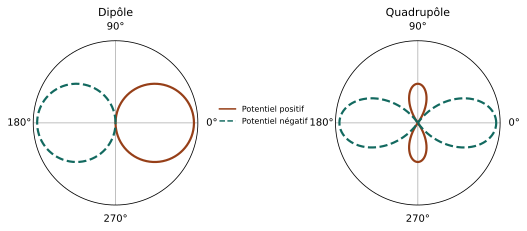
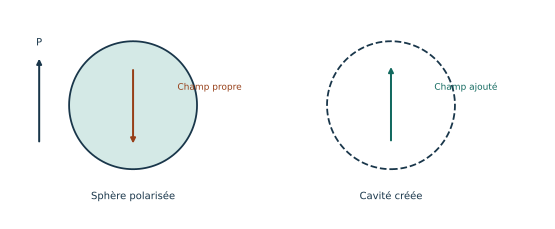

# École polytechnique · FUI-FF, session 2 · Physique 2020 · Corrigé guidé

*Corrigé rédigé par IA, non officiel. Signalez toute erreur.*

**Rédaction** · GPT-6.2 Astra Ultra · vitesse non renseignée

**Révision** · GPT-6.2 Astra Ultra · vitesse non renseignée · 26 novembre 2026

Session de printemps 2020. Les trois exercices sont indépendants.

## Présentation du sujet

Le premier exercice part des équations de Maxwell pour expliquer la liberté de jauge. La deuxième partie remonte du champ d’un dipôle à celui d’un matériau polarisé. La troisième demande de bien distinguer la direction de l’observateur au centre et celle du mouvement circulaire.

## Exercice 1 · Invariance de jauge

### 1 · Divergence d’un rotationnel

> [!INDICATION]
> Développez les trois composantes en coordonnées cartésiennes et regroupez les dérivées croisées.

#### Solution

Pour un champ deux fois continûment dérivable, la divergence du rotationnel est la somme $\partial_x\partial_y v_z-\partial_x\partial_z v_y+\partial_y\partial_z v_x-\partial_y\partial_x v_z+\partial_z\partial_x v_y-\partial_z\partial_y v_x$. Les dérivées mixtes commutent et chaque terme apparaît avec son opposé. Ainsi $\nabla\cdot(\nabla\times\mathbf v)=0$.

### 2 · Potentiel vecteur

> [!INDICATION]
> Quelle équation de Maxwell donne la condition nécessaire pour écrire le champ magnétique sous la forme d’un rotationnel ?

#### Solution

Maxwell-flux donne $\nabla\cdot\mathbf B=0$. Tout rotationnel satisfait cette identité. Réciproquement, le lemme de Poincaré permet localement, par exemple dans une boule, d’écrire un champ solénoïdal sous la forme **$\mathbf B=\nabla\times\mathbf A$**. Une construction globale demande que le domaine et les flux ne présentent pas d’obstruction topologique. On travaille ici dans l’espace usuel avec les champs admis par le problème.

### 3 · Potentiel scalaire

> [!INDICATION]
> Introduisez le potentiel vecteur dans Maxwell-Faraday, puis recherchez un champ de rotationnel nul.

#### Solution

$\nabla\times\mathbf E=-\partial_t\mathbf B=-\nabla\times\partial_t\mathbf A$. Ainsi $\mathbf E+\partial_t\mathbf A$ est irrotationnel. Localement, il dérive d’un potentiel scalaire $V$ avec la convention **$\mathbf E=-\nabla V-\partial_t\mathbf A$**.

### 4 · Cas statique et référence d’un circuit

> [!INDICATION]
> Pour des champs statiques, choisissez des potentiels indépendants du temps. Demandez-vous ce que mesure un voltmètre.

#### Solution

Dans une jauge stationnaire on retrouve $\mathbf E=-\nabla V$. Une constante ajoutée à $V$ laisse ce champ inchangé. On peut donc choisir le zéro de potentiel à un nœud du circuit, souvent appelé masse. La tension entre deux nœuds est la différence de leurs potentiels et est indépendante de ce choix.

### 5 · Transformation de jauge

> [!INDICATION]
> Calculez les champs transformés en tenant compte du signe de la dérivée temporelle de $f$.

#### Solution

Pour $\mathbf A'=\mathbf A+\nabla f$ et $V'=V-\partial_t f$, on a $\nabla\times\mathbf A'=\mathbf B$ parce que $\nabla\times\nabla f=0$. De même $-\nabla V'-\partial_t\mathbf A'=\mathbf E+\nabla\partial_t f-\partial_t\nabla f=\mathbf E$. Les deux termes supplémentaires s’annulent pour une fonction suffisamment régulière.

### 6.a · Champs et sources des potentiels donnés

> [!INDICATION]
> Un potentiel vecteur radial proportionnel à $\mathbf e_r/r^2$ est un gradient pour $r>0$. N’oubliez pas de tester le flux à travers une petite sphère.

#### Solution

Notons $K=1/(4\pi\varepsilon_0)$. Avec $V=0$ et $\mathbf A=-Kqt\mathbf e_r/r^2=Kqt\nabla(1/r)$, on obtient $\mathbf B=0$ et $\mathbf E=Kq\mathbf e_r/r^2$ pour $r>0$. Le flux à travers toute sphère centrée en $O$ est $4\pi Kq=q/\varepsilon_0$. Le champ est celui d’une charge ponctuelle immobile $q$ à l’origine, donc $\rho=q\delta^{(3)}(\mathbf r)$ et $\mathbf j=0$. La dépendance temporelle de $\mathbf A$ ne rend pas le champ variable.

### 6.b · Potentiels après transformation

> [!INDICATION]
> Dérivez la fonction de jauge par rapport au temps et à l’espace séparément.

#### Solution

Avec $f=-Kqt/r$, $\partial_t f=-Kq/r$ et $\nabla f=Kqt\mathbf e_r/r^2$. On trouve $V'=Kq/r$ et $\mathbf A'=0$. Il s’agit de la représentation électrostatique habituelle de la même charge. Les deux couples de potentiels sont singuliers à l’origine comme l’exige la source.

### 7 · Équations pour les potentiels

> [!INDICATION]
> Dans Maxwell-Ampère, développez le rotationnel d’un rotationnel. Dans Maxwell-Gauss, prenez la divergence de la formule du champ électrique.

#### Solution

Écrivons $\square=\Delta-c^{-2}\partial_t^2$ et $G=\nabla\cdot\mathbf A+c^{-2}\partial_tV$. De Maxwell-Ampère on tire $\nabla(\nabla\cdot\mathbf A)-\Delta\mathbf A=\mu_0\mathbf j-c^{-2}\partial_t\nabla V-c^{-2}\partial_t^2\mathbf A$. Maxwell-Gauss donne $-\Delta V-\partial_t\nabla\cdot\mathbf A=\rho/\varepsilon_0$. Le regroupement des dérivées fournit les deux expressions demandées,

$$\square\mathbf A=-\mu_0\mathbf j+\nabla G,\qquad \square V=-\rho/\varepsilon_0-\partial_t G.$$

### 8 · Jauge de Lorenz

> [!INDICATION]
> Remplacez la combinaison $G$ dans les deux équations précédentes.

#### Solution

La condition de Lorenz, orthographiée « Lorentz » sur le sujet, est $G=0$. Les potentiels satisfont alors des équations d’onde découplées avec sources, $\square\mathbf A=-\mu_0\mathbf j$ et $\square V=-\rho/\varepsilon_0$. Le couplage entre les potentiels subsiste dans la condition de jauge qui doit être respectée.

### 9 · Liberté résiduelle

> [!INDICATION]
> Transformez $G$ et distinguez l’entrée dans la jauge de la transformation entre deux couples qui la satisfont déjà.

#### Solution

En remplaçant $V,\mathbf A$ par les potentiels primés, on trouve $G'=G+\Delta f-c^{-2}\partial_t^2 f=G+\square f$. Pour garder la jauge de Lorenz à partir d’un couple qui la satisfait, $G=G'=0$ impose **$\square f=0$**. Partant de potentiels arbitraires, atteindre cette jauge impose d’abord l’équation avec source $\square f=-G$.

### 10 · Variables caractéristiques

> [!INDICATION]
> Exprimez $\partial_t$ et $\partial_x$ en fonction de $\partial_u,\partial_v$. Les dérivées croisées s’ajoutent après soustraction.

#### Solution

C’est l’équation d’onde homogène de d’Alembert. En une dimension, avec $u=x-ct$, $v=x+ct$, on a $\partial_x=\partial_u+\partial_v$ et $\partial_t=c(-\partial_u+\partial_v)$. Le développement donne $\partial_t^2-c^2\partial_x^2=-4c^2\partial_u\partial_v$. Ainsi l’équation devient $\partial_u\partial_v f=0$.

### 11 · Solution à une dimension

> [!INDICATION]
> Intégrez une première fois sur une caractéristique puis sur l’autre.

#### Solution

La dérivée $\partial_u f$ est indépendante de $v$, donc vaut $F'(u)$. Une deuxième intégration donne **$f(x,t)=F(x-ct)+H(x+ct)$**. Les fonctions $F,H$ sont arbitraires dans la classe de régularité considérée. Un point du profil $F$ se déplace vers $+x$ à la vitesse $c$, un point de $H$ vers $-x$ à la même célérité.

### 12 · Conservation de la charge

> [!INDICATION]
> Prenez la divergence de Maxwell-Ampère puis éliminez la divergence de $\mathbf E$.

#### Solution

Comme la divergence de $\nabla\times\mathbf B$ est nulle, $0=\mu_0\nabla\cdot\mathbf j+\mu_0\varepsilon_0\partial_t(\nabla\cdot\mathbf E)$. Maxwell-Gauss remplace la parenthèse par $\rho/\varepsilon_0$. On obtient $\partial_t\rho+\nabla\cdot\mathbf j=0$. Pour un volume fixe, la diminution de la charge contenue égale le flux du courant sortant.

## Exercice 2 · Champ local et relation de Clausius-Mossotti

### 1 · Approximation dipolaire

> [!INDICATION]
> Comparez la taille de la source à la distance entre son centre et l’observateur.

#### Solution

Avec $r=OM$ et $OA=OB=a$, on exige $a/r\ll1$, donnant $r_A\simeq r_B\simeq r$ dans les estimations d’ordre de grandeur. Pour deux charges opposées, les potentiels à l’ordre $1/r$ s’annulent. Il faut donc conserver les premiers écarts entre $r_A$ et $r_B$ afin d’obtenir le terme dipolaire.

### 2 · Potentiel du doublet

> [!INDICATION]
> Distinguez sur le schéma le côté de la charge positive. Développez les inverses des distances.

#### Solution

Prenons $K=1/(4\pi\varepsilon_0)$ et $V(\infty)=0$. Les charges sont $+q$ en $B$ et $-q$ en $A$. Au premier ordre, $1/r_B\simeq r^{-1}(1+a\cos\theta/r)$ et $1/r_A\simeq r^{-1}(1-a\cos\theta/r)$. Ainsi $V=Kq(1/r_B-1/r_A)\simeq2Kqa\cos\theta/r^2$. Le potentiel est positif du côté de la charge positive sur l’axe.

### 3 · Moment dipolaire et debye

> [!INDICATION]
> Le vecteur moment dipolaire pointe de la charge négative vers la charge positive.

#### Solution

$\mathbf p=q\overrightarrow{AB}=2qa\mathbf e_x$, en $\mathrm{C\,m}$. Le potentiel précédent devient $V=K\mathbf p\cdot\mathbf e_r/r^2$. Le produit d’une charge élémentaire par $0,1\,\mathrm{nm}$ vaut $1,6\times10^{-29}\,\mathrm{C\,m}\simeq4,8\,\mathrm D$. Des fractions de charge et des longueurs de liaison atomiques donnent naturellement des dipôles de l’ordre du debye.

### 4 · Distribution quelconque

> [!INDICATION]
> Sommez les moments des charges par rapport à une même origine.

#### Solution

Avec les positions $\mathbf r_i=\overrightarrow{OM_i}$, on définit $\mathbf p=\sum_i q_i\mathbf r_i$. Pour une densité continue, $\mathbf p=\int\rho(\mathbf r')\mathbf r'\,\mathrm d^3r'$. Changer l’origine d’un vecteur $\mathbf a$ change le résultat de $-\mathbf a\sum_iq_i$. Pour une distribution neutre, le moment est donc indépendant de l’origine.

### 5 · Champ du doublet

> [!INDICATION]
> Dérivez le potentiel dipolaire par rapport à $r$ et à $\theta$. La base angulaire introduit un facteur $1/r$.

#### Solution

De $V=Kp\cos\theta/r^2$ suivent $E_r=2Kp\cos\theta/r^3$, $E_\theta=Kp\sin\theta/r^3$ et $E_\varphi=0$. Puisque $\mathbf p=p(\cos\theta\mathbf e_r-\sin\theta\mathbf e_\theta)$, on peut les réunir sous la forme

$$\mathbf E=\frac{K}{r^3}\,[3(\mathbf p\cdot\mathbf e_r)\mathbf e_r-\mathbf p]=\frac{K}{r^5}\,[3(\mathbf p\cdot\mathbf r)\mathbf r-r^2\mathbf p].$$

### 6 · Potentiel de la distribution symétrique

> [!INDICATION]
> Écrivez le potentiel exact avant d’introduire le petit paramètre $a/r$. La symétrie échange les deux charges périphériques.

#### Solution

Ici $V=Kq(2/r-1/r_A-1/r_B)$. Dans les deux développements des inverses de distance, les termes linéaires en $a/r$ sont opposés, et les termes constants se compensent avec la charge centrale. À l’ordre deux,

$$\frac1{r_{B,A}}=\frac1r\left[1\mathbin{\pm}\frac{a}{r}\cos\theta+\frac{a^2}{2r^2}(3\cos^2\theta-1)+O((a/r)^3)\right].$$

Ainsi **$V\simeq Kqa^2(1-3\cos^2\theta)/r^3$**. La symétrie élimine aussi les termes impairs d’ordres supérieurs.

### 7 · Champ quadrupolaire

> [!INDICATION]
> Dérivez le potentiel d’ordre deux. Sur l’axe positif, le champ dominant pointe vers le centre.

#### Solution

À l’ordre dominant, $E_r=-\partial_r V=3Kqa^2(1-3\cos^2\theta)/r^4$, $E_\theta=-(1/r)\partial_\theta V=-6Kqa^2\sin\theta\cos\theta/r^4$ et $E_\varphi=0$. Sur l’axe positif, $E_r=-6Kqa^2/r^4$ et la composante polaire est nulle. Sur le plan médian, le champ est radial sortant.

### 8 · Nature du premier terme

> [!INDICATION]
> Évaluez la somme des trois charges et la somme de leurs moments par rapport au centre.

#### Solution

La charge totale vaut $2q-q-q=0$. Les contributions dipolaires des charges périphériques se compensent, car elles sont égales à des positions opposées, et la charge centrale n’a pas de moment autour de $O$. Le moment d’ordre deux subsiste, comme en témoigne le terme en $3\cos^2\theta-1$. Cette distribution est quadrupolaire malgré ses trois sites chargés.

### 9 · Ordres du développement multipolaire

> [!INDICATION]
> Comparez comment varient avec la distance le potentiel et sa dérivée pour chacun des trois cas.

#### Solution

Pour une source localisée de taille $a\ll r$, chaque puissance supplémentaire de $a/r$ fait apparaître un nouvel ordre. Le potentiel du monopôle varie en $1/r$, celui du dipôle en $1/r^2$, celui du quadrupôle en $1/r^3$. Le champ décroît respectivement en $1/r^2,1/r^3,1/r^4$. En général, le terme de rang $\ell$ a un potentiel en $r^{-(\ell+1)}$ multiplié par une fonction angulaire. À grande distance, le premier moment non nul gouverne le comportement dans les directions où son facteur angulaire subsiste.

### 10 · Potentiel d’une sphère uniformément polarisée

> [!INDICATION]
> Associez un dipôle élémentaire à chaque élément de volume et utilisez le caractère constant de la polarisation pour la sortir de l’intégrale.

#### Solution

Pour un point source $M'$ et un point d’observation $M$, posons $\mathbf r=\overrightarrow{M'M}$. L’élément $\mathrm d\tau'$ porte $\mathrm d\mathbf p=\mathbf P\,\mathrm d\tau'$. La superposition des potentiels dipolaires donne

$$V(M)=K\int_\Sigma\frac{\mathbf P\cdot\mathbf r}{r^3}\,\mathrm d\tau'=\mathbf P\cdot\mathbf I(M),\qquad \mathbf I=K\int_\Sigma\frac{\mathbf r}{r^3}\,\mathrm d\tau'.$$

La singularité en $M'=M$ à l’intérieur est localement intégrable dans ce calcul du potentiel.

### 11 · Interprétation de l’intégrale

> [!INDICATION]
> Comparez l’intégrande au champ de Coulomb d’un élément chargé.

#### Solution

Un élément portant $\mathrm dq=\rho_*\mathrm d\tau'$ crée $K\rho_*\mathbf r\,\mathrm d\tau'/r^3$. Pour une boule pleine uniformément chargée, le champ vaut donc $\rho_*\mathbf I$. Le choix d’une densité unitaire donne l’analogie du sujet. Plus précisément $\mathbf I$ a les dimensions d’un champ divisé par une densité de charge. La symétrie sphérique rend ce vecteur radial autour du centre $O$.

### 12 · Valeur intérieure

> [!INDICATION]
> Choisissez une surface de Gauss concentrique. Seule la fraction du volume située à l’intérieur de cette surface intervient.

#### Solution

Écrivons $s=OM$ et $\mathbf e_s=\overrightarrow{OM}/s$. Pour $s<R_0$, le théorème de Gauss donne $4\pi s^2\rho_* I_s=\rho_*4\pi s^3/(3\varepsilon_0)$. Ainsi $\mathbf I=\overrightarrow{OM}/(3\varepsilon_0)$, également valable en $O$ où le vecteur s’annule.

### 13 · Valeur extérieure

> [!INDICATION]
> Cette fois, toute la charge de la boule est située à l’intérieur de la sphère gaussienne.

#### Solution

Pour $s>R_0$, $4\pi s^2 I_s=4\pi R_0^3/(3\varepsilon_0)$, d’où $\mathbf I=R_0^3\mathbf e_s/(3\varepsilon_0s^2)$. Au bord, cette expression et celle de la question 12 donnent toutes deux $R_0\mathbf e_s/(3\varepsilon_0)$.

### 14 · Champ propre de la sphère polarisée

> [!INDICATION]
> À l’intérieur, le potentiel est une fonction linéaire des coordonnées du point d’observation.

#### Solution

On y a $V=\mathbf P\cdot\overrightarrow{OM}/(3\varepsilon_0)$. Le gradient d’un produit scalaire d’un vecteur constant avec le vecteur position est ce vecteur constant. Le champ de dépolarisation vaut donc **$\mathbf E_P=-\mathbf P/(3\varepsilon_0)$**, uniforme et opposé à la polarisation. Dans le modèle de cavité sphérique, enlever la sphère retire cette contribution et augmente le champ local de $\mathbf P/(3\varepsilon_0)$.

### 15 · Dimensions

> [!INDICATION]
> Comparez les dimensions de $\mathbf P$ et de $\varepsilon_0\mathbf E$, puis celles de $\mathbf p$ et de $\mathbf P$.

#### Solution

La polarisation a pour unité $\mathrm{C\,m^{-2}}$, comme $\varepsilon_0\mathbf E$. Dans $\mathbf P=\varepsilon_0\chi_e\mathbf E$, $\chi_e$ est **sans dimension**. Dans la convention $\mathbf p=\varepsilon_0\alpha_e\mathbf E_{\rm local}$, $\alpha_e$ a la dimension d’un **volume** et s’exprime en $\mathrm m^3$. Ainsi $N\alpha_e$ est sans dimension.

### 16 · Relation de Clausius-Mossotti

> [!INDICATION]
> Exprimez le champ local comme le champ macroscopique diminué du champ propre calculé à la question 14.

#### Solution

En combinant $\mathbf E_{\rm local}=\mathbf E+\mathbf P/(3\varepsilon_0)$ avec $\mathbf P=N\mathbf p=N\varepsilon_0\alpha_e\mathbf E_{\rm local}$, on trouve $(1-N\alpha_e/3)\mathbf P=N\varepsilon_0\alpha_e\mathbf E$. Par identification,

$$\chi_e=\frac{N\alpha_e}{1-N\alpha_e/3},\qquad \frac{\varepsilon_r-1}{\varepsilon_r+2}=\frac{N\alpha_e}{3},\quad \varepsilon_r=1+\chi_e.$$

Cette relation utilise le champ local du modèle de cavité sphérique et une réponse individuelle linéaire isotrope.

### 17 · Milieu dilué

> [!INDICATION]
> Le nombre de particules par mètre cube possède une unité. Quelle combinaison peut réellement être comparée à un ?

#### Solution

La densité $N$ est exprimée en $\mathrm{m^{-3}}$. La comparaison imprimée $N\ll1$ prend un sens physique une fois multipliée par le volume de polarisabilité. Le petit paramètre est **$N\alpha_e/3\ll1$**. On obtient $\chi_e=N\alpha_e+(N\alpha_e)^2/3+\cdots\simeq N\alpha_e$. Dans cette limite, le champ créé par les dipôles voisins est faible devant le champ imposé. Les contributions des atomes s’additionnent au premier ordre, ce qui est cohérent avec l’approximation d’atomes faiblement couplés.

## Exercice 3 · Champ d’une charge en mouvement

### 1 · Temps retardé

> [!INDICATION]
> Le signal part de la position occupée par la charge à l’émission et atteint l’observateur à la vitesse $c$.

#### Solution

Si la charge se trouve en $M(t_0)$ au départ et si l’observation en $P$ a lieu à $t$, alors $c(t-t_0)=R(t_0)=|\overrightarrow{M(t_0)P}|$. D’où $t_0=t-R(t_0)/c$. Cette équation est implicite puisque la distance dépend elle-même de l’instant d’émission.

### 2 · Dépendance en vitesse et en direction

> [!INDICATION]
> Examinez le facteur $1-\mathbf n\cdot\mathbf v/c$, sans perdre de vue le numérateur vectoriel.

#### Solution

Le dénominateur angulaire du champ est $(1-\mathbf n\cdot\mathbf v/c)^3$. Si $\psi$ est l’angle entre la vitesse et la direction émission-observation, son facteur de base vaut $1-(v/c)\cos\psi$. Il devient petit pour une charge relativiste et une direction proche de la tangente en avant. En posant $\gamma=(1-v^2/c^2)^{-1/2}$, pour $\gamma\gg1$ et $|\psi|\ll1$, il vaut environ $(\gamma^{-2}+\psi^2)/2$, ce qui explique la concentration angulaire du rayonnement autour du mouvement. L’accélération et sa direction comptent aussi. Une vitesse constante ne produit pas de champ rayonné en $1/R$. Pour une accélération parallèle au mouvement, la composante radiative s’annule sur l’axe exact.

### 3 · Termes dominants à grande distance

> [!INDICATION]
> Comparez les puissances de $R$ à état cinématique fixé.

#### Solution

Le champ de vitesse, premier terme entre crochets, varie en $R^{-2}$. Le champ d’accélération varie en $R^{-1}$ et domine à grande distance dans les directions où son coefficient est non nul. Sa puissance par unité de surface décroît en $R^{-2}$, ce qui permet un flux fini à travers une sphère d’aire $4\pi R^2$. Si l’accélération est nulle, le terme en $R^{-1}$ disparaît.

### 4 · Retard au centre de l’orbite

> [!INDICATION]
> Le point d’observation est le centre du cercle. La distance entre émission et observation dépend-elle de l’angle ?

#### Solution

Pour $P=O$, toutes les positions de la trajectoire sont à distance $R(t_0)=b$ du point d’observation. L’instant retardé est simplement $t_0=t-b/c$.

### 5 · Position, vitesse et accélération

> [!INDICATION]
> Partez de l’angle nul au point $(b,0)$, puis dérivez la position deux fois.

#### Solution

Pour un mouvement orienté suivant les angles croissants, soit $\phi=\omega t$. La position est $\mathbf s=b(\cos\phi\,\mathbf e_x+\sin\phi\,\mathbf e_y)=b\mathbf e_r$. La vitesse $\mathbf v=b\omega(-\sin\phi\,\mathbf e_x+\cos\phi\,\mathbf e_y)=b\omega\mathbf e_\theta$ est tangentielle et $\mathbf a=-b\omega^2\mathbf e_r$. Les quantités entrant dans les champs s’évaluent avec $\phi=\omega(t-b/c)$.

### 6 · Direction d’observation et vitesse

> [!INDICATION]
> Tracez le segment qui va de la charge au centre. La tangente au cercle lui est perpendiculaire.

#### Solution

En $O$, $\mathbf n=-\mathbf e_r(t_0)$ tandis que $\mathbf v=b\omega\mathbf e_\theta(t_0)$. Ainsi $\mathbf n\cdot\mathbf v=0$. L’accélération est dirigée vers le centre, $\mathbf a=b\omega^2\mathbf n$.

### 7 · Champ électrique en $O$

> [!INDICATION]
> Développez le double produit vectoriel avant de simplifier le terme de vitesse. Un terme proportionnel à $v^2/c^2$ doit disparaître.

#### Solution

Notons $\boldsymbol\beta=\mathbf v/c$. Avec $\mathbf n\cdot\boldsymbol\beta=0$, le dénominateur angulaire vaut un. Le double produit est $(\mathbf n-\boldsymbol\beta)(\mathbf n\cdot\mathbf a)-\mathbf a$, et $\mathbf n\cdot\mathbf a=b\omega^2=v^2/b$. Le terme $(\mathbf n-\boldsymbol\beta)v^2/(b^2c^2)$ ainsi produit compense la correction $-v^2/c^2$ du champ de vitesse. Il reste, avec $R=b$,

$$\mathbf E(O,t)=\frac{q}{4\pi\varepsilon_0}\left[\frac{\mathbf n-\mathbf v/c}{b^2}-\frac{\mathbf a}{bc^2}\right]_{t_0}.$$

### 8 · Champ magnétique au centre

> [!INDICATION]
> Dans $\mathbf n\times\mathbf E$, les termes selon la direction radiale disparaissent. Orientez le produit avec la base polaire.

#### Solution

Comme $\mathbf a$ est parallèle à $\mathbf n$, seul le terme en $-\mathbf v/c$ subsiste. Or $\mathbf n\times\mathbf v=-b\omega\mathbf e_z$. Il vient

$$\mathbf B(O,t)=\frac{\mathbf n\times\mathbf E(O,t)}{c}=\frac{q\omega}{4\pi\varepsilon_0bc^2}\mathbf e_z=\frac{\mu_0 q\omega}{4\pi b}\mathbf e_z.$$

### 9 · Symétries du résultat

> [!INDICATION]
> Distinguez la symétrie instantanée de la trajectoire entière et le caractère axial du champ magnétique.

#### Solution

Le plan de l’orbite est un plan de symétrie de la source et du mouvement. Le champ magnétique est un vecteur axial, donc il est normal à ce plan en son centre. Une rotation d’angle $\omega\Delta t$ accompagnée d’une translation temporelle $\Delta t$ reproduit la configuration. Le vecteur normal est invariant par cette rotation, ce qui explique la valeur constante en $O$ malgré le mouvement de la charge et le retard. Le signe s’inverse si l’on inverse la charge ou le sens de parcours. La constance en ce point ne rend pas le champ constant en tout point de l’espace.

### 10 · Comparaison avec une spire

> [!INDICATION]
> Le courant moyen est la charge franchissant une section en un tour divisée par la période. Utilisez ensuite Biot et Savart pour la spire stationnaire équivalente.

#### Solution

Pour l’orientation angulaire choisie, $I=q\omega/(2\pi)$. Pour une spire circulaire de rayon $b$, chaque élément crée au centre un champ de même direction axiale, et la loi de Biot et Savart donne $B=\mu_0 I(2\pi b)/(4\pi b^2)=\mu_0 I/(2b)$. En remplaçant $I$, on retrouve **$\mathbf B=\mu_0q\omega\mathbf e_z/(4\pi b)$**. La spire continue représente le courant moyen de la charge. Au centre, la valeur instantanée de la question 8 coïncide avec cette moyenne.

## Source

Épreuve écrite de physique, filière universitaire internationale, formation francophone, session 2. [Sujet officiel de l’École polytechnique](https://www.polytechnique.edu/admission-cycle-ingenieur/sites/admission/files/content/2020%20FUI-FF%20S2%20SUJET%20PHYSIQUE.pdf)
