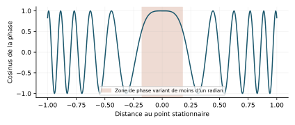

# École polytechnique · MP · Mathématiques B 2020 · Corrigé guidé

*Corrigé rédigé par IA, non officiel. Signalez toute erreur.*

**Rédaction** · GPT-6.2 Astra Ultra · vitesse non renseignée · 24 novembre 2026

**Révision** · GPT-6.2 Astra Ultra · vitesse non renseignée · 26 novembre 2026

Les trois parties étudient les grandes déviations des sommes de signes, la méthode de Laplace et la phase stationnaire. [Sujet officiel](https://www.polytechnique.edu/admission-cycle-ingenieur/sites/admission/files/content/2020%20MP%20SUJET%20ECRIT%20MATHEMATIQUES%20B%20%28X%29.pdf) · [Rapport du jury](https://www.polytechnique.edu/admission-cycle-ingenieur/sites/admission/files/content/2020%20MP%20RAPPORT%20ECRIT%20MATHEMATIQUES%20B%20%28X%29.pdf)

## I. Grandes déviations de la moyenne de signes

### Question 1

> [!INDICATION]
> Comparer ponctuellement une indicatrice à une exponentielle positive.

#### Solution

Pour $\lambda>0$, sur $\{Z\ge t\}$ on a $e^{\lambda(Z-t)}\ge1$, et ailleurs l’indicatrice est nulle. Ainsi $\mathbf1_{\{Z\ge t\}}\le e^{\lambda(Z-t)}$. En prenant les espérances, $P[Z\ge t]\le e^{-\lambda t}E[e^{\lambda Z}]$.

### Question 2

> [!INDICATION]
> Apparier chaque suite de signes avec la suite opposée.

#### Solution

L’indépendance et la symétrie donnent la même probabilité $2^{-n}$ à chaque suite de signes et à son opposée. Ainsi $P[S_n>0]=P[S_n<0]$, d’où $P[S_n\ge0]=(1+P[S_n=0])/2\ge1/2$.

### Question 3

> [!INDICATION]
> Calculer la transformée exponentielle de la somme des signes.

#### Solution

Par indépendance, $E[e^{n\lambda S_n}]=(E[e^{\lambda X_1}])^n=e^{n\psi(\lambda)}$. Appliquons 1 à $nS_n$ avec le seuil $nt$ et divisons le logarithme par $n$. On obtient $n^{-1}\log P[S_n\ge t]\le\psi(\lambda)-\lambda t$ pour $\lambda>0$ et aussi pour $\lambda=0$ car $P\le1$. L’infimum donne la borne, avec la convention $\log0=-\infty$.

### Question 4

> [!INDICATION]
> Calculer m et sa dérivée.

#### Solution

On a $m(\lambda)=(e^\lambda-e^{-\lambda})/(e^\lambda+e^{-\lambda})=\tanh\lambda=\psi'(\lambda)$, de dérivée $1/\cosh^2\lambda>0$. Sa valeur initiale est zéro et sa limite à l’infini est un. Son inverse sur $[0,1[$ est $\lambda_t=\tfrac12\log((1+t)/(1-t))$.

### Question 5a

> [!INDICATION]
> Factoriser le changement de loi en un produit de poids indépendants.

#### Solution

Écrivons $w(x)=e^{\lambda x-\psi(\lambda)}$. Alors $D_n=\prod_jw(X_j)$, $Ew(X_j)=1$ et $E[X_jw(X_j)]=m(\lambda)$. L’espérance demandée se factorise en deux facteurs $E[(X_j-m)w(X_j)]=0$ et $n-2$ facteurs égaux à un. Elle est donc nulle.

### Question 5b

> [!INDICATION]
> Développer le carré de la moyenne centrée et utiliser le même calcul pour chaque paire.

#### Solution

Tous les termes croisés sont nuls par 5a et échangeabilité. Chaque terme diagonal vaut $E[(X_j-m)^2w(X_j)]=1-m^2$, car $X_j^2=1$. Ainsi $E[(S_n-m)^2D_n]=(1-m^2)/n\le1/n\le4/n$, formule valable aussi pour $n=1$.

### Question 6

> [!INDICATION]
> Borner l’exposant sur l’événement de la fenêtre.

#### Solution

Si $I_n=1$, $S_n-m-\varepsilon\le0$ et donc $e^{\lambda n(S_n-m-\varepsilon)}\le1$. Si $I_n=0$, le produit concerné est nul. L’inégalité ponctuelle puis l’espérance donnent $P[|S_n-m|\le\varepsilon]\ge E[I_n e^{\lambda n(S_n-m-\varepsilon)}]$.

### Question 7

> [!INDICATION]
> Contrôler sous le poids D la probabilité du complément de la fenêtre.

#### Solution

On a $E[D_n]=1$. Sur $\{I_n=0\}$, $1\le(S_n-m)^2/\varepsilon^2$, et $D_n\ge0$. Il suit de 5b que $E[(1-I_n)D_n]\le4/(n\varepsilon^2)$, donc $E[I_nD_n]\ge1-4/(n\varepsilon^2)$.

### Question 8a

> [!INDICATION]
> Inclure la fenêtre dans la demi-droite puis extraire le facteur déterministe.

#### Solution

Comme $\{|S_n-m|\le\varepsilon\}\subset\{S_n\ge m-\varepsilon\}$, les questions 6 et 7 donnent
$$P[S_n\ge m-\varepsilon]\ge e^{n(\psi(\lambda)-\lambda m-\lambda\varepsilon)}\left(1-\frac4{n\varepsilon^2}\right).$$
Pour $n>4/\varepsilon^2$, prenons $u_n=n^{-1}\log(1-4/(n\varepsilon^2))$, qui tend vers zéro. Pour les premiers indices prenons $u_n=-\log2-\psi(\lambda)+\lambda m+\lambda\varepsilon$ : le résultat reste vrai puisque l’événement de tous les signes positifs, de probabilité $2^{-n}$, est inclus. Ainsi la suite demandée est définie à tout rang.

### Question 8b

> [!INDICATION]
> Pour le minorant, incliner à la moyenne légèrement au-dessus du seuil.

#### Solution

Pour $0<\varepsilon<1-t$, prenons $\lambda=\lambda_{t+\varepsilon}$ de 4. Alors $m(\lambda)-\varepsilon=t$. À $\varepsilon$ fixé, 8a donne pour la limite inférieure $\psi(\lambda)-\lambda(t+2\varepsilon)$. En faisant ensuite $\varepsilon\downarrow0$, la continuité de $\lambda_t$ donne le minorant $\psi(\lambda_t)-\lambda_t t$. La dérivée de $\psi(\lambda)-\lambda t$ est $\tanh\lambda-t$, négative puis positive autour de $\lambda_t$ (positive après zéro si $t=0$). Cette valeur est donc l’infimum de 3, qui majore la limite supérieure. La limite existe et vaut l’infimum annoncé.

La valeur de l’infimum peut se lire directement en fonction du seuil. Avec $m(\lambda_t)=t$ et $\cosh\lambda_t=(1-t^2)^{-1/2}$, le résultat devient
$$
\lim_{n\to\infty}\frac1n\log\mathbb P(S_n\ge t)
=-\frac{(1+t)\log(1+t)+(1-t)\log(1-t)}{2}.
$$
Cette expression vaut zéro pour $t=0$, conformément à Q2 ; sa limite pour $t\uparrow1$ est $-\log 2$.

### Question 8c

> [!INDICATION]
> Comparer la probabilité exacte et la limite de la borne exponentielle.

#### Solution

L’événement $S_n\ge1$ exige les $n$ signes positifs, donc $n^{-1}\log P[S_n\ge1]=-\log2$. Par ailleurs $\psi(\lambda)-\lambda=\log((1+e^{-2\lambda})/2)$ décroît vers $-\log2$. La formule reste valable, l’infimum étant approché à l’infini.

## II. Méthode de Laplace et formule de Stirling

### Question 9

> [!INDICATION]
> Exploiter le développement au second ordre au maximum intérieur.

#### Solution

On a $f'(x_0)=0$. Pour $h$ petit, $0\ge f(x_0+h)-f(x_0)=h^2(f''(x_0)/2+o(1))$. En divisant puis passant à la limite, $f''(x_0)\le0$. La non-nullité prévue par (H) donne l’inégalité stricte.

### Question 10

> [!INDICATION]
> Comparer le maximum hors du voisinage à un minimum sur un voisinage plus petit.

#### Solution

Sur le compact extérieur à $]x_0-\delta,x_0+\delta[$, le maximum $M_1$ est strictement inférieur à $M=f(x_0)$ par unicité. Pour un $0<\rho<\delta$ assez petit, $f(x)\ge(M+M_1)/2$ si $|x-x_0|\le\rho$. Le quotient de l’intégrale extérieure par l’intégrale intérieure est donc au plus $(b-a)e^{-t(M-M_1)/2}/(2\rho)$, qui tend vers zéro. Le quotient des intégrales demandées tend vers un.

### Question 11

> [!INDICATION]
> À l’échelle inverse de la racine du paramètre, justifier la domination gaussienne.

#### Solution

Posons $A=-f''(x_0)>0$. Pour $|h|<\delta$ assez petit, $f(x_0+h)-M=-Ah^2/2+o(h^2)\le-Ah^2/4$. Par 10, il suffit d’intégrer sur ce voisinage. Après $u=\sqrt t(x-x_0)$, l’intégrande normalisée par $e^{tM}$, prolongée par zéro au-delà de $|u|<\delta\sqrt t$, tend vers $e^{-Au^2/2}$ et est majorée par $e^{-Au^2/4}$. La convergence dominée donne $\int_a^be^{tf(x)}dx\sim e^{tM}\sqrt{2\pi/(tA)}$.

### Question 12a

> [!INDICATION]
> Intégrer par parties et initialiser en zéro.

#### Solution

Pour $n\ge1$, le produit $t^ne^{-t}$ tend vers zéro aux deux bords de $]0,\infty[$. L’intégrale converge par décroissance exponentielle à l’infini. Une intégration par parties donne $I_n=nI_{n-1}$, et $I_0=\int_0^\infty e^{-t}\,dt=1$. Ainsi $I_n=n!$.

### Question 12b

> [!INDICATION]
> Tronquer après le changement d’échelle en contrôlant séparément les deux queues.

#### Solution

En posant $t=nu$, on a $n!=n^{n+1}\int_0^\infty e^{nF(u)}du$ où $F(u)=\log u-u$. Son unique maximum est $F(1)=-1$, $F''(1)=-1$. La question 11 appliquée sur $[1/2,2]$ donne $e^{-n}\sqrt{2\pi/n}$. Sur $]0,1/2]$, $F$ est croissante et l’intégrale est au plus $e^{nF(1/2)}/2$. Sur $[2,\infty[$, $F'\le-1/2$, donc l’intégrale est au plus $2e^{nF(2)}/n$. Les deux queues sont négligeables devant l’intégrale centrale car $F(1/2),F(2)<-1$. Finalement $n!\sim\sqrt{2\pi n}(n/e)^n$.

## III. Intégrales de Fresnel et phase stationnaire

### Question 13

> [!INDICATION]
> Rendre les oscillations périodiques en changeant de variable.

#### Solution

Avec $u=x^2$ on obtient $\tfrac12\int_0^{a^2}|\sin u|u^{-1/2}du$. Sur $[k\pi,(k+1)\pi]$, $k\ge1$, cette contribution est au moins $\frac1{2\sqrt{(k+1)\pi}}\int_{k\pi}^{(k+1)\pi}|\sin u|du=1/\sqrt{(k+1)\pi}$. La somme diverge et l’intégrale d’une fonction positive croît avec $a$. Sa limite est $+\infty$.

### Question 14

> [!INDICATION]
> Intégrer la série sur un segment fixé et traiter son orientation.

#### Solution

La série $\sin(x^2)=\sum_{n\ge0}(-1)^n x^{4n+2}/(2n+1)!$ converge normalement sur $[-|a|,|a|]$. Son intégration terme à terme sur le segment orienté de zéro à $a$ donne $\sum_{n\ge0}(-1)^n a^{4n+3}/((2n+1)!(4n+3))$.

### Question 15

> [!INDICATION]
> Transformer la dérivée de la phase en facteur décroissant dans une intégration par parties.

#### Solution

Sur $1\le A<B$, $e^{ix^2}=(e^{ix^2})'/(2ix)$. Ainsi
$$\int_A^B e^{ix^2}dx=\left[\frac{e^{ix^2}}{2ix}\right]_A^B+\int_A^B\frac{e^{ix^2}}{2ix^2}\,dx.$$
Le terme au bord supérieur tend vers zéro et l’intégrale restante converge absolument. Les parties réelle et imaginaire ont donc des limites finies à l’infini.

### Question 16

> [!INDICATION]
> Intégrer la queue trois fois, en contrôlant la dernière intégrale par sa valeur absolue.

#### Solution

Posons $R(a)=\int_a^\infty\sin(x^2)dx$. Deux intégrations par parties donnent
$$R(a)=\frac{\cos(a^2)}{2a}-\frac12\int_a^\infty\frac{\cos(x^2)}{x^2}dx
=\frac{\cos(a^2)}{2a}+\frac{\sin(a^2)}{4a^3}-\frac34\int_a^\infty\frac{\sin(x^2)}{x^4}dx.$$
La dernière intégrale est $O(a^{-5})$ : écrire $\sin(x^2)=-(\cos(x^2))'/(2x)$ laisse un terme de bord en $a^{-5}$ et une intégrale majorée par $(5/2)\int_a^\infty x^{-6}dx$. En soustrayant $R(a)$ de la valeur de Fresnel admise, on obtient $c=-1/2$, $c'=-1/4$.

### Question 17

> [!INDICATION]
> Factoriser le zéro commun à l’amplitude et à la dérivée de la phase.

#### Solution

Dans l’interprétation utilisée pour la fin du problème, $f'$ ne s’annule pas en $1$ (cela découle également de l’inverse lisse admis après 18b, par la règle de chaîne au bord). Pour $x>x_0$, posons $A(x)=(g(x)-g(x_0))/f'(x)$. Au voisinage de $x_0$, le numérateur et le dénominateur sont $x-x_0$ fois des fonctions lisses, de valeurs respectives $g'(x_0)$ et $f''(x_0)\ne0$. Cela découle de la formule intégrale des accroissements finis. Ainsi $A$ se prolonge en $C^1$ sur le segment. En utilisant $f'\sin(tf)=-(\cos(tf))'/t$, l’intégrale de la différence vaut
$$-\frac1t[A\cos(tf)]_{x_0}^1+\frac1t\int_{x_0}^1 A'\cos(tf)dx=O(1/t).$$

La seule unicité imprimée sur $[0,1[$ laisse une possibilité supplémentaire. Le point terminal peut aussi être stationnaire. Prenons $x_0=0$, $f(x)=\sin^2(\pi x/2)$ et $g(x)=\sin(\pi x/2)$. L’intégrale avec $g$ devient, par $v=\cos(\pi x/2)$, $(2/\pi)\int_0^1\sin(t(1-v^2))dv$. Pour $t=2\pi n$, elle est équivalente à $-\sqrt{2\pi}/(2\pi\sqrt t)$ par la valeur de Fresnel admise. Comme $g(0)=0$, la conclusion serait fausse sous cette seule hypothèse.

Le rôle du bord apparaît dans le contre-exemple pour tout grand $t$. Avec le même changement de variable, puis $w=\sqrt t\,v$, l’intégrale vaut
$$
\frac{2}{\pi\sqrt t}\operatorname{Im}\!\left(e^{it}\int_0^{\sqrt t}e^{-iw^2}\,dw\right)
=\frac{\sin(t-\pi/4)}{\sqrt{\pi t}}+O(t^{-1}).
$$
La borne de queue de Q15 justifie le reste. Cette contribution d’ordre $t^{-1/2}$ vient du bord $x=1$, où $f'(1)=0$.

### Question 18a

> [!INDICATION]
> Déterminer le signe de la dérivée à droite de son zéro.

#### Solution

Par $f''(x_0)>0$, $f'(x)>0$ immédiatement à droite de $x_0$. Comme $f'$ est continue et ne s’annule pas dans $]x_0,1[$, elle y reste strictement positive. Ainsi $f$ croît strictement jusqu’à $1$ inclus. La fonction $h=\sqrt{f-f(x_0)}$ est continue, strictement croissante et a pour images extrêmes zéro et $h(1)>0$. Le théorème des valeurs intermédiaires donne la bijection.

### Question 18b

> [!INDICATION]
> Développer la phase à l’ordre deux et prendre la racine du côté positif.

#### Solution

Quand $s\downarrow0$, $f(x_0+s)-f(x_0)=s^2(f''(x_0)/2+o(1))$. Donc $h(x_0+s)/s\to\sqrt{f''(x_0)/2}$, qui est la dérivée à droite annoncée.

### Question 19

> [!INDICATION]
> Après la substitution par la racine de la phase, séparer l’amplitude constante de son reste.

#### Solution

Posons $u=h(x)$, $L=h(1)$, $H=h^{-1}$ et $a=f(x_0)$. Par l’hypothèse admise, $H'(u)=H'(0)+uB(u)$ avec $B$ et $B'$ bornées. Pour l’intégrale complexe correspondante, la partie avec $uB$ est $O(t^{-1})$ par intégration par parties contre $(e^{itu^2})'=2itu e^{itu^2}$. De plus $H'(0)=\sqrt{2/f''(x_0)}$. Par 15 et 16, ou directement par la borne de queue en 15,
$$\int_0^L e^{itu^2}du=\frac1{\sqrt t}\int_0^{L\sqrt t}e^{iv^2}dv
=\frac{\sqrt\pi}{2\sqrt t}e^{i\pi/4}+O(t^{-1}).$$
Multipliant par $e^{ita}H'(0)$ puis prenant la partie imaginaire, on trouve $\sin(ta+\pi/4)\sqrt{\pi/(2tf''(x_0))}+O(t^{-1})$.

### Question 20

> [!INDICATION]
> Réfléchir la branche gauche autour du point stationnaire et additionner les deux contributions.

#### Solution

L’intégrale sur $[x_0,1]$ est traitée par 17 et 19. Pour $[0,x_0]$, posons $s=x_0-x$. Au nouveau bord $s=0$, la phase $f(x_0-s)$ a la même valeur, la même dérivée seconde positive et une dérivée non nulle à droite de zéro jusqu’au bord $s=x_0$. L’amplitude vaut encore $g(x_0)$. Les mêmes changements de variable donnent donc exactement le même terme principal. En ajoutant les deux moitiés,
$$\int_0^1 g(x)\sin(tf(x))dx=g(x_0)\sin\!\left(tf(x_0)+\frac\pi4\right)\sqrt{\frac{2\pi}{tf''(x_0)}}+O(t^{-1}).$$
