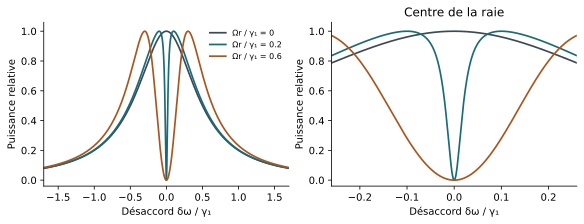

# École polytechnique et ESPCI PC 2020 — Physique A · Corrigé guidé

*Corrigé rédigé par IA, non officiel. Signalez toute erreur.*

**Lecture du rapport du jury** · GPT-6.2 Astra Ultra · vitesse non renseignée

**Rédaction** · GPT-6.2 Astra Ultra · vitesse non renseignée

## La lumière ralentie

## I. Préparation du gaz d’atomes froids

### Question 1 — Décalage de fréquence

**Indication.** Comparer la phase d’une onde plane en deux points successifs de la trajectoire de l’atome.

Si $\mathbf n$ est le sens de propagation, l’effet Doppler donne à l’ordre $v/c$ la fréquence $\nu'=\nu(1-\mathbf n\cdot\mathbf v/c)$ dans le référentiel de l’atome, la vitesse étant mesurée par rapport à la source. On peut le voir en dérivant la phase $2\pi\nu(t-\mathbf n\cdot\mathbf r(t)/c)$. Un atome qui rencontre la lumière de front perçoit une fréquence plus grande.

### Question 2 — Nombre de photons du ralentisseur

**Indication.** Un photon absorbé apporte une impulsion dirigée, tandis que l’émission spontanée a une impulsion de moyenne vectorielle nulle.

Pour un faisceau opposé à la vitesse atomique, la quantité de mouvement enlevée en moyenne par cycle est $h/\lambda$. Ainsi $N\simeq m_{\rm Na}(v_i-v_f)\lambda/h$, $m_{\rm Na}=M/N_A$. Avec $m_{\rm Na}\simeq3,3\times10^{-26}\,\mathrm{kg}$, $v_i-v_f\simeq680\,\mathrm{m\,s^{-1}}$ et $\lambda\sim590\,\mathrm{nm}$, on obtient $N\sim2\times10^4$.

### Question 3 — Évaporation sélective

**Indication.** Comparer l’énergie mécanique d’un atome à l’énergie minimale lui permettant de quitter le piège.

Un puits magnétique de profondeur finie ne retient que les atomes dont l’énergie est sous le seuil d’échappement. En abaissant progressivement ce seuil, on laisse sortir en priorité la partie la plus énergétique de la distribution. Des atomes très rapides au voisinage du fond peuvent atteindre le bord.

### Question 4 — Refroidissement des atomes restants

**Indication.** Suivre l’énergie moyenne par particule et la redistribution des vitesses après le départ des atomes les plus énergétiques.

Les atomes évaporés emportent une énergie par particule supérieure à la moyenne. Le gaz restant possède donc une énergie moyenne moindre. Les collisions élastiques rétablissent ensuite une distribution thermique à plus basse température, au prix d’une baisse de population.

### Question 5 — Vitesse après refroidissement

**Indication.** Utiliser la température finale de 500 nK et distinguer vitesse moyenne en norme et moyenne vectorielle.

Dans le modèle classique, la moyenne du module de la vitesse est $\overline v=\sqrt{8k_BT/(\pi m_{\rm Na})}$, du même ordre que la vitesse quadratique $\sqrt{3k_BT/m_{\rm Na}}$. Avec $T=5\times10^{-7}\,\mathrm K$, on trouve environ $2\times10^{-2}\,\mathrm{m\,s^{-1}}$. La moyenne vectorielle est nulle au repos.

### Question 6 — Rôle du vide

**Indication.** Un atome du gaz résiduel à température ambiante a une énergie très supérieure à celle des atomes du nuage.

Une pression très faible réduit les collisions avec le gaz résiduel. Cela limite le réchauffement, les pertes d’atomes et les perturbations de cohérence pendant la durée de l’expérience. L’article indique un fond de pression d’ordre $10^5/10^{14}\sim10^{-9}\,\mathrm{Pa}$.

### Question 7 — Énergie de transition

**Indication.** La fréquence ordinaire et la pulsation diffèrent d’un facteur $2\pi$.

L’énergie d’un photon résonnant vérifie $|E_j-E_i|=h\nu_{ij}=\hbar\omega_{ij}$. La transition émet un photon lors de la descente et en absorbe un lors de la montée.

## II. Deux oscillateurs couplés

### Question 8 — Quasi-dégénérescence

**Indication.** Rapporter la séparation des niveaux bas à l’énergie de la transition optique.

$\hbar\omega_1=E_3-E_1=2,1\,\mathrm{eV}$ et $\hbar\omega_2=E_3-E_2=2,1\,\mathrm{eV}-7,4\,\mathrm{\mu eV}$. L’écart relatif vaut environ $3,5\times10^{-6}$. L’analogie mécanique du sujet assimile les pulsations propres à une valeur commune $\omega_1$. Les lasers physiques demeurent réglés sur leurs transitions respectives.

### Question 9 — Équations couplées

**Indication.** Pour chaque masse, additionner le rappel du ressort extérieur et celui dû à l’allongement relatif du ressort central.

Les raideurs des ressorts extérieurs sont $k_i-K$ et celle du couplage $K=m\Omega^2$. Sur la première masse, $-(k_1-K)x_1-K(x_1-x_2)=-k_1x_1+Kx_2$. De même pour la seconde. Avec les deux amortissements,

$$
\ddot x_1+\gamma_1\dot x_1+\omega_1^2x_1-\Omega^2x_2=F(t)/m,\qquad
\ddot x_2+\gamma_2\dot x_2+\omega_1^2x_2-\Omega^2x_1=0.
$$

### Question 10 — Système harmonique

**Indication.** Fixer le signe de l’exponentielle temporelle car il détermine celui de la partie imaginaire de la réponse.

Prenons $e^{-i\omega t}$ et notons $X_1,X_2$ les amplitudes complexes. Avec $D_j=\omega_1^2-\omega^2-i\gamma_j\omega$, on obtient $D_1X_1-\Omega^2 X_2=F/m$ et $-\Omega^2 X_1+D_2X_2=0$.

### Question 11 — Séparation des modes propres

**Indication.** Annuler le déterminant du système libre conservatif. Le mode en phase et le mode en opposition donnent ses deux racines.

Sans amortissement, $(\omega_1^2-\omega^2)^2-\Omega^4=0$. Le mode en phase a $\omega_-^2=\omega_1^2-\Omega^2$, celui en opposition $\omega_+^2=\omega_1^2+\Omega^2$. Pour $\Omega\ll\omega_1$, $\Omega_r=\omega_+-\omega_-=2\Omega^2/(\omega_++\omega_-)\simeq\Omega^2/\omega_1$.

### Question 12 — Réécriture autour de la résonance

**Indication.** Garder le terme quadratique en désaccord avant l’approximation de la question suivante.

Posons $s=\delta\omega$, $D=-(2\omega_1s+s^2)$ et $H=\Omega^2$. Exactement, $\omega_++\omega_-=\sqrt{4\omega_1^2-\Omega_r^2}$, d’où $H=\Omega_r\sqrt{\omega_1^2-\Omega_r^2/4}$. Avec $\gamma_2=0$, le système est $[D-i\gamma_1(\omega_1+s)]X_1-HX_2=F/m$ et $-HX_1+DX_2=0$.

### Question 13 — Équations résonnantes

**Indication.** Remplacer les facteurs lents par leur valeur à la résonance et conserver le premier terme non nul du désaccord.

Pour $|s|,\gamma_1,\Omega_r\ll\omega_1$, $D\simeq-2\omega_1s$, $\gamma_1\omega\simeq\gamma_1\omega_1$ et $H\simeq\omega_1\Omega_r$. En divisant par $-\omega_1$,

$$
(2s+i\gamma_1)X_1+\Omega_rX_2=-\frac{F}{m\omega_1},\qquad \Omega_rX_1+2sX_2=0.
$$

### Question 14 — Puissance moyenne

**Indication.** Former la moyenne du produit de la force réelle et de la vitesse réelle.

$\langle F(t)\dot x_1(t)\rangle=\tfrac12\Re[F(-i\omega X_1)^*]=F\omega\Im X_1/2$ pour $F$ réel positif. Près de la résonance, on peut remplacer $\omega$ par $\omega_1$. Avec $e^{+i\omega t}$ le signe devant $\Im X_1$ changerait.

### Question 15 — Absorption sans couplage

**Indication.** Poser $\Omega_r=0$, puis chercher les deux pulsations où la puissance est la moitié du maximum.

$X_1=-F/[m\omega_1(2s+i\gamma_1)]$, d’où

$$
\langle P\rangle=\frac{F^2}{2m}\frac{\gamma_1}{4s^2+\gamma_1^2}.
$$

La lorentzienne, centrée en $s=0$, a pour maximum $P_{\max}=F^2/(2m\gamma_1)$. Les points à mi-hauteur sont $s=\pm\gamma_1/2$, d’où une largeur totale $\gamma_1$, en radians par seconde.

### Question 16 — Réponse au centre avec couplage

**Indication.** Commencer par l’équation de l’oscillateur sans frottement propre.

Pour $s=0$ et $\Omega_r\ne0$, la deuxième équation impose $X_1=0$ et la première donne $X_2=-F/(m\omega_1\Omega_r)$. La première masse est immobile, la seconde oscille en opposition de phase avec la force. Le couplage compense exactement la force sur la première masse, de sorte que celle-ci ne reçoit aucune puissance moyenne et que le frottement ne dissipe rien dans ce régime.

### Question 17 — Réponse en fonction du désaccord

**Indication.** Inverser le système à deux inconnues en conservant la solution au centre $s=0$.

Avec le système de 13,

$$
X_1(s)=\frac{F}{m\omega_1}\frac{2s}{\Omega_r^2-4s^2-2i\gamma_1s}.
$$

Cette forme garde visible l’annulation au centre pour un couplage non nul. Loin du centre, dans le domaine $|s|\ll\omega_1$, elle retrouve la réponse du premier oscillateur seul quand le terme de couplage devient négligeable.

### Question 18 — Forme du creux près du centre

**Indication.** Dans le dénominateur, négliger $4s^2$ devant $\Omega_r^2$ mais garder le terme en $\gamma_1s$.

On a $X_1\simeq [F/(m\omega_1)]2s/(\Omega_r^2-2i\gamma_1s)$. En particulier, au voisinage immédiat de zéro, $\Re X_1\simeq2Fs/(m\omega_1\Omega_r^2)$ et $\Im X_1\simeq4F\gamma_1s^2/(m\omega_1\Omega_r^4)$. La dispersion a une pente finie positive alors que l’absorption s’annule quadratiquement.

### Question 19 — Largeur et forme du doublet

**Indication.** Normaliser par le maximum de 15, puis comparer les deux termes du dénominateur au voisinage des pics et du creux.

La puissance normalisée se réduit à

$$
\frac{\langle P\rangle}{P_{\max}}=
\frac{4\gamma_1^2 s^2}{(\Omega_r^2-4s^2)^2+4\gamma_1^2s^2}.
$$

Elle est nulle en zéro, maximale en $s=\pm\Omega_r/2$, et décroît comme $\gamma_1^2/(4s^2)$ pour $|s|\gg\gamma_1,\Omega_r$ dans le domaine résonnant. Les deux points à mi-hauteur **intérieurs** satisfont $\Omega_r^2-4s^2=2\gamma_1|s|$. Leur séparation exacte dans ce modèle réduit est $[\sqrt{\gamma_1^2+4\Omega_r^2}-\gamma_1]/2$. En faible couplage, la largeur du creux est donc $\Delta\omega\simeq\Omega_r^2/\gamma_1$. Augmenter $\Omega_r$ écarte les deux pics et élargit le creux.

## III. Transparence induite

### Question 20 — Échelle de pulsation optique

**Indication.** Relier la longueur d’onde jaune à la pulsation en gardant $2\pi$.

Pour $\lambda\simeq590\,\mathrm{nm}$, $\omega_1=2\pi c/\lambda\simeq3\times10^{15}\,\mathrm{rad\,s^{-1}}$. La valeur de $2,1\,\mathrm{eV}/\hbar$ donne la même échelle.

### Question 21 — Hiérarchie des pulsations

**Indication.** Comparer les valeurs absolues, y compris pour le désaccord balayé dans le graphe.

$\gamma_1=6,3\times10^7\,\mathrm{rad\,s^{-1}}$ et $\Omega_r\simeq1,3\times10^7\,\mathrm{rad\,s^{-1}}$. Les désaccords de la figure 3 vont jusqu’à $3\times10^7\,\mathrm{rad\,s^{-1}}$ en module. Toutes ces pulsations sont inférieures à $\omega_1$ d’au moins sept ordres de grandeur. Les approximations de 13 conviennent.

### Question 22 — Action de l’intensité du couplage

**Indication.** Le texte précise quelle raideur mécanique augmente avec l’intensité. Distinguer $\Omega$ de $\Omega_r$.

Selon l’analogie du sujet, $K=m\Omega^2\propto I_{\rm coupl}$. Puisque $\Omega_r\simeq\Omega^2/\omega_1$, on a $\Omega_r\propto I_{\rm coupl}$ à pulsation atomique fixée.

### Question 23 — Dispersion optique

**Indication.** Revenir à la définition de l’indice pour une onde monochromatique.

Le nombre d’onde complexe est $k(\omega)=\omega n(\omega)/c$. Pour l’onde $e^{i(kz-\omega t)}$, la partie réelle de $k$ détermine la phase et sa partie imaginaire positive provoque une atténuation de l’amplitude.

### Question 24 — Interprétation de la fenêtre

**Indication.** Identifier dans la susceptibilité mécanique la composante qui détermine l’absorption.

Le modèle optique donne $n=1+CX_1/F$. Sans couplage, $\Im X_1$ possède un maximum résonnant. Avec le laser de couplage, $X_1=0$ en $s=0$, donc $n=1$ et l’atténuation liée à $\Im k$ disparaît au centre. Les deux réponses cohérentes se compensent sur la transition sondée. Aux désaccords voisins, le premier oscillateur répond à nouveau et l’indice complexe s’écarte de 1.

### Question 25 — Étendue de la bande transparente

**Indication.** Distinguer la largeur de la fenêtre en pulsation et la largeur en fréquences ordinaires. Lire l’axe du graphique dans son unité.

La largeur à mi-profondeur du creux d’absorption est $\Delta\omega\simeq \Omega_r^2/\gamma_1\simeq0,04\gamma_1\simeq2,5\times10^6\,\mathrm{rad\,s^{-1}}$. Le pic de transmission de la figure 3a a une largeur de l’ordre de $10^6$ à quelques $10^6\,\mathrm{rad\,s^{-1}}$ et est légèrement décalé vers $-0,6\times10^6\,\mathrm{rad\,s^{-1}}$ par l’effet Stark indiqué. Sa largeur de transmission ne coïncide pas exactement avec la largeur d’un creux d’absorption local, la transmission dépendant du trajet optique. À $\gamma_1$ fixé, $\Delta\omega\propto I_{\rm coupl}^2$ dans ce modèle et ce régime.

## IV. Vitesse de groupe

### Question 26 — Vitesse de phase au centre

**Indication.** Identifier la partie de l’indice qui régit l’évolution de la phase et sa valeur à résonance.

À $\omega=\omega_1$, $n_r=1$. La vitesse de phase $v_\phi=\omega/\Re k=c/n_r$ vaut donc $c$. Le ralentissement observé porte sur le déplacement de l’enveloppe de l’impulsion.

### Question 27 — Indice de groupe

**Indication.** Dériver la relation de dispersion réelle avant d’en prendre l’inverse.

$\Re k=\omega n_r/c$, d’où $d(\Re k)/d\omega=(n_r+\omega n'_r)/c$. Pour un paquet assez étroit sur une bande peu absorbante, $v_g=[d(\Re k)/d\omega]^{-1}=c/(n_r+\omega n'_r)$.

### Question 28 — Où est le ralentissement ?

**Indication.** Rechercher dans la figure 3b la plus forte pente positive, puis vérifier que la figure 3a permet effectivement le passage d’une impulsion.

$n_r$ restant proche de 1, le ralentissement marqué se situe là où $\omega n'_r\gg1$ et $n'_r>0$. La branche centrale croissante s’étend grossièrement de $-4\times10^6$ à $+4\times10^6\,\mathrm{rad\,s^{-1}}$ entre ses deux extrema locaux. Pour propager un paquet mesurable et peu déformé, on utilise sa portion centrale presque linéaire **dans la fenêtre transparente**, soit un désaccord de l’ordre de $10^6\,\mathrm{rad\,s^{-1}}$ autour du pic. Dans le modèle symétrique, le ralentissement transparent est maximal au centre.

### Question 29 — Pente de l’indice à résonance

**Indication.** Évaluer la dérivée de la partie réelle de $X_1$ en zéro, même si la réponse elle-même s’annule.

La dérivée obtenue en 18 donne $n'_r(\omega_1)=2C/(m\omega_1\Omega_r^2)$. Ainsi

$$
v_g(\omega_1)=\frac{c}{1+2C/(m\Omega_r^2)}.
$$

La constante $C$ contient la dépendance en densité atomique du modèle optique.

### Question 30 — Retard de vol

**Indication.** Mesurer le décalage entre les deux sommets. La mesure se fait relativement à une référence sans atomes.

Le décalage de la figure 4 est d’environ $7\,\mathrm{\mu s}$ et la longueur du nuage, donnée dans la légende de la figure 3, est $229\,\mathrm{\mu m}$. Comme $\Delta t=L/v_g-L/c$ et que $L/c\simeq8\times10^{-13}\,\mathrm s$, on a $v_g\simeq L/\Delta t\simeq33\,\mathrm{m\,s^{-1}}$, soit environ dix millions de fois moins que $c$.

### Question 31 — Loi de la vitesse de groupe

**Indication.** Utiliser le très grand rapport $c/v_g$ pour identifier le terme dominant du dénominateur.

Puisque $v_g/c\sim10^{-7}$, le terme $2C/(m\Omega_r^2)$ domine largement l’unité. Ainsi $v_g\simeq cm\Omega_r^2/(2C)\propto I_{\rm coupl}^2$ à densité atomique et pertes fixées dans l’analogie donnée.

### Question 32 — Compromis pour une impulsion

**Indication.** Examiner ensemble les dépendances obtenues en 25 et en 31. Une impulsion courte a besoin d’une bande spectrale suffisamment large.

Augmenter l’intensité de couplage élargit la fenêtre transparente, ce qui permet de transmettre des impulsions à spectre plus large. En contrepartie, $v_g$ augmente aussi et le retard $L/v_g$ diminue. Réduire l’intensité procure un retard supérieur mais impose une impulsion plus étroite en fréquence pour éviter l’absorption et la déformation. Ces sens de variation découlent des expressions de 25 et 31. La dernière phrase du rapport du jury inverse le sens de variation de la largeur tout en renvoyant à la formule de 25.
