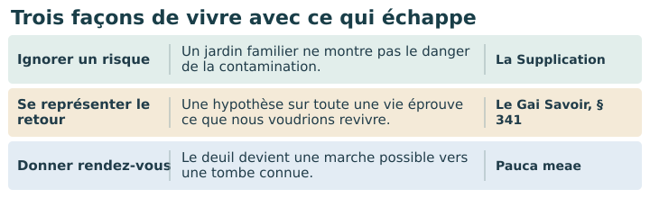

# Banque PT — Français A 2021 · Corrigé brut

*Corrigé rédigé par IA, non officiel. Signalez toute erreur.*

**Rédaction** · GPT-6.2 Astra Ultra · vitesse non renseignée

[Énoncé officiel](https://www.banquept.fr/documents/2021/fr_a_2021_pt.pdf) · [Rapport du jury](https://www.banquept.fr/documents/ecrit/rapport/2021/rapport_fra_a_ecrit_2021.pdf) · [Programme officiel](https://www.education.gouv.fr/bo/20/Hebdo32/ESRS2014851A.htm)

Épreuve de quatre heures sur « La force de vivre ». Hugo, Les Contemplations, livres IV et V · Nietzsche, Le Gai Savoir, préface à la seconde édition et livre IV (traduction Patrick Wotling) · Alexievitch, La Supplication (traduction Galia Ackerman et Pierre Lorrain).

Emil Cioran, Précis de décomposition (1949, édition citée de 1977), p. 2 du sujet.

## Dissertation

Les œuvres permettent-elles d’admettre avec Cioran que les déficiences de notre imagination et de notre mémoire sont indispensables à la vie ?

Quand il annonce qu’il partira à l’aube, le marcheur des *Contemplations* donne au lecteur toutes les raisons d’attendre un rendez-vous. Le dernier vers fait découvrir qu’il apporte des fleurs sur une tombe. Il a bien fallu au père se représenter une rencontre pour entreprendre le voyage. Et pourtant il fait ce trajet parce qu’il se souvient exactement du lieu où sa fille repose. Cioran soutient que seules les défaillances de l’imagination et de la mémoire rendent la vie possible. La formule a la force d’un paradoxe. Ce qui manque à nos facultés nous conserverait ce qu’un meilleur usage risquerait de nous ôter. Mais de quelle vie parle-t-on, et qu’est-ce au juste qu’une faculté qui défaille ?

Se souvenir et imaginer peuvent d’abord rendre le présent inhabitable. Au livre IV de Hugo, « Trois ans après » oppose l’exigence de parler à la tentation de demeurer auprès de la morte. Le passé a une telle présence que le père peut éprouver comme une infidélité la simple envie de s’occuper des vivants. Dans *La Supplication*, des habitants retournent vers leurs maisons après l’évacuation. Ils retrouvent des jardins, des chemins et des arbres dont les formes leur sont familières. L’invisibilité du danger radioactif laisse pour un temps au monde son aspect hospitalier. Se représenter avec une précision égale, dans chaque aliment et chaque geste, un avenir possiblement atteint rendrait difficile le repas même du jour. Une certaine discontinuité de l’attention permet donc de passer de la conscience du malheur à une tâche que l’on est encore capable d’accomplir.

Cette protection est toutefois équivoque. La limite qui préserve de la peur peut aussi exposer au péril. Chez Alexievitch, quand l’apparence d’un fruit ou la mémoire des récoltes passées suffisent à convaincre qu’on peut le manger, la fidélité du souvenir familier masque un changement réel. Il faut apprendre à imaginer un danger que les sens ne signalent pas. Réciproquement, le travail d’écoute de l’écrivaine permet à des témoins de nommer une expérience pour laquelle leurs anciennes comparaisons, notamment avec la guerre, ne suffisaient plus. L’attention au détail conservé dans une mémoire singulière agrandit cette fois la possibilité de vivre ensemble. L’oubli peut donc sauver une heure et compromettre l’avenir. La difficulté tient à ce qu’aucune lacune ne porte en elle le signe de ses effets.

Une troisième manière de vivre se dessine alors. Dans la préface du *Gai Savoir*, le philosophe qui revient sur la maladie ne propose pas au lecteur de supprimer l’expérience dont il revient. La convalescence lui fait entendre autrement des vérités acquises dans un autre état du corps. Au livre IV, le démon du paragraphe 341 propose même de se représenter le retour de la même existence jusque dans ses détails. Une imagination très exigeante devient ainsi l’instrument d’une question pratique. Pourrais-je vouloir cette vie ? Le lecteur n’est ni invité à prédire l’avenir ni tenu d’avoir déjà répondu oui. Il peut examiner ce qui, dans son présent, lui permettrait de soutenir une telle affirmation. La fiction produit une possibilité d’agir que la disparition d’un souvenir n’aurait pas donnée.

Hugo accomplit un geste comparable avec d’autres moyens. « Demain, dès l’aube… » n’efface rien de la mort de Léopoldine. En retardant pour le lecteur l’apparition de la tombe, le poème fait sentir comment un absent demeure un destinataire. Il transforme un fait irréversible en rendez-vous auquel le vivant peut encore se rendre. Ce travail de composition mérite d’être distingué d’un défaut de mémoire aussi bien que d’une illusion involontaire. Cioran éclaire la vie qui se maintient en détournant un moment les yeux. Les œuvres font aussi connaître une vie capable de reprendre ce qu’elle a vu et d’en faire une forme qu’un autre pourra habiter.
