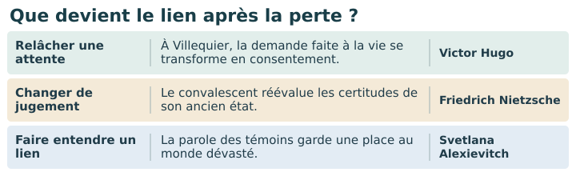

# Banque PT — Français B 2021 · Corrigé guidé

*Corrigé rédigé par IA, non officiel. Signalez toute erreur.*

**Rédaction** · GPT-6.2 Astra Ultra · vitesse non renseignée

[Énoncé officiel](https://www.banquept.fr/documents/2021/fr_b_2021_pt.pdf) · [Rapport du jury](https://www.banquept.fr/documents/ecrit/rapport/2021/rapport_fra_b_ecrit_2021.pdf) · [Programme officiel](https://www.education.gouv.fr/bo/20/Hebdo32/ESRS2014851A.htm) · [Notice de l’éditeur](https://www.hachette.fr/livre/le-ressort-invisible-vivre-lextreme-9782100707140/)

Épreuve de quatre heures sur « La force de vivre ». Hugo, Les Contemplations, livres IV et V · Nietzsche, Le Gai Savoir, préface à la seconde édition et livre IV (traduction Patrick Wotling) · Alexievitch, La Supplication (traduction Galia Ackerman et Pierre Lorrain).

Gustave-Nicolas Fischer, Le Ressort invisible (Dunod, 2014). Le sujet imprime « Fisher ». De « Les situations extrêmes éclairent l’humain » (p. 2) à « et peut-être la refaire » (p. 5). Une coupe est signalée p. 3. Les deux questions suivent p. 5.

Texte de 1552 mots selon le sujet. Résumé de 200 mots à 10 % près (180 à 220), 8 points. Dissertation, 12 points.

## Préparer le résumé

Répartir le texte selon ce qui change dans l’épreuve. La vie et l’identité n’ont plus la même valeur, la conscience de la fin transforme la perception du temps, puis la perte demande un travail intérieur. Conserver la différence entre continuer à vivre et la possibilité plus incertaine de refaire sa vie.

## Résumé

Une situation devient extrême lorsque la mort nous menace. La vie devient une valeur à défendre. Les habitudes qui assuraient notre sécurité cessent de nous protéger. Nous découvrons combien notre identité dépendait des attentes et des jugements de la société. La destruction de cette image révèle une énergie insoupçonnée. Dans la souffrance, chacun éprouve ses capacités de résistance et apprend à endurer ce qui paraissait insupportable. En décidant autrement de ce qui compte, nous pouvons devenir autres.

Notre rapport au temps change. Dans la vie ordinaire, les jours semblent se répéter sans terme. Le danger suspend cet avenir présumé disponible. Faute de pouvoir former des projets lointains, nous concentrons nos efforts sur la prochaine heure. La conscience que le temps restant ne reviendra jamais rend le présent plus précieux et intensifie notre désir de vivre.

Enfin, pareille épreuve nous sépare de quelque chose que nous tenions pour indispensable, une personne, la santé ou notre identité passée. Comprendre la perte ne suffit pas pour en prendre acte intérieurement. Le deuil nous demande de relâcher peu à peu notre attachement à ce qui a disparu. Consentir à cette seconde séparation permet de poursuivre notre existence et peut rendre possible un nouveau départ.

*200 mots.*

## Préparer la dissertation

La force de vivre suppose-t-elle de faire disparaître intérieurement ce que l’on a déjà perdu pour continuer son existence et, peut-être, la refaire ?

**Pourquoi le texte dit-il « à notre tour » ?**

Une première perte vient du dehors. Le raisonnement porte sur un second événement, psychique. Nommer ce qui se transforme dans ce second temps, l’attente d’un retour ou l’attachement à une forme de vie.

**Qu’est-ce que les témoins de La Supplication permettent d’objecter ?**

Un village déplacé reste fait de relations auxquelles on tient. Raconter ce qui a disparu peut rendre au témoin un interlocuteur et une place parmi les vivants. Il faut distinguer le besoin de parole et le désir de retrouver un monde inchangé.

**Comment prouver la différence entre effacer et transformer ?**

Dans « Demain, dès l’aube… », la destination réelle du voyage est une tombe. Le poète connaît l’irréversibilité de la perte. Porter des fleurs est une manière nouvelle de faire exister le lien, qui suppose justement ce savoir.

## Dissertation

Le père qui dépose du houx et de la bruyère sur une tombe a bien recommencé à marcher. Faut-il dire que la disparition de sa fille s’est alors produite une seconde fois, cette fois en lui ? Pour Gustave-Nicolas Fischer, la disparition extérieure ne suffit pas. Il faut que le vivant se détache à son tour de ce qu’il a perdu pour continuer à vivre et peut-être refaire sa vie. Le verbe désigne une action et le « peut-être » distingue deux résultats. Quel lien faut-il desserrer pour pouvoir avancer, et quel lien permet précisément de se remettre en marche ?

La perte peut fixer le présent à une attente qu’aucun événement ne comblera. Dans « À Villequier », le père reconnaît la distance entre son désir de rendre sa fille à la vie et ce qu’il lui est donné de comprendre. Le poème avance avec peine vers un consentement dont l’effort reste sensible. C’est l’exigence de restitution qui se défait. Chez Nietzsche, la préface à la seconde édition du *Gai Savoir* fait entendre la voix d’un convalescent. Revenir à la vie ne consiste pas à retrouver intactes les certitudes d’avant la maladie. Des convictions auxquelles on tenait comme à des biens nécessaires apparaissent désormais liées à un état du corps et cessent d’obliger. Dans les deux cas, une chose déjà perdue maintient son emprise aussi longtemps que l’on exige de l’avenir qu’il la restitue.

L’épreuve change cependant de sens selon ce que l’on appelle faire disparaître. Près de Tchernobyl, la disparition administrative d’un village ne fait pas disparaître les relations qui s’y étaient nouées. Les personnes revenues y vivre tiennent aux maisons, aux gestes de travail et aux tombes. Pour les agents chargés de l’évacuation, un déplacement peut être une mesure de protection. Pour celui qui part, il peut aussi rendre méconnaissable la vie que l’on voulait sauver. Les entretiens d’Alexievitch font apparaître ce désaccord jusque dans la signification du mot survivre. Plus profondément, celles et ceux qui ont perdu un proche trouvent parfois dans la possibilité de raconter son existence une raison de soutenir la leur. Leur demander de l’effacer ferait disparaître avec lui la personne à laquelle ils peuvent encore s’adresser et le monde auquel l’entretien donne accès.

Il faut donc distinguer l’identité de ce que l’on perd et la forme de l’attachement que l’on transforme. Au début de « Demain, dès l’aube… », Hugo donne à entendre la promesse d’une visite. La révélation finale de la tombe ne retire rien à cette adresse. Le père sait qu’il ne retrouvera pas une fille capable de lui répondre. Ce savoir lui permet de poser un acte présent, porter des fleurs, que le lecteur comprend désormais comme une fidélité. De même, la pensée du retour au paragraphe 341 du *Gai Savoir* oblige à se demander si l’on serait prêt à vouloir encore une vie avec tout ce qu’elle comporte. Le passé ne peut plus être corrigé. En revanche, celui qui en fait l’objet d’une telle question cesse de lui demander d’avoir été différent. Accepter l’irréversible peut alors intensifier la présence de ce qui a eu lieu.

Fischer décrit justement la nécessité de renoncer à une restitution impossible. Mais une vie peut continuer grâce à une parole, à une pensée ou à un rituel qui donne place à l’absent. Ce qui disparaît alors est une attente qui empêchait le présent d’exister. Ce qui demeure peut devenir la force même par laquelle ce présent sera vécu.
