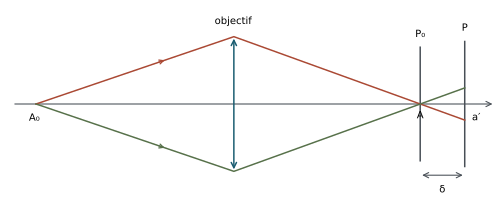
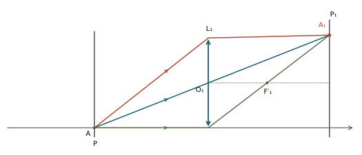
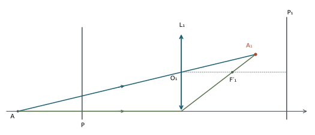
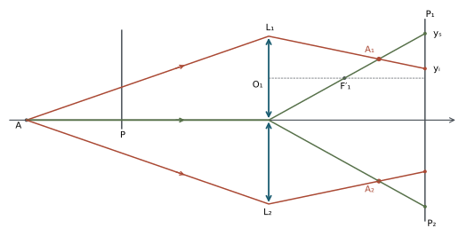
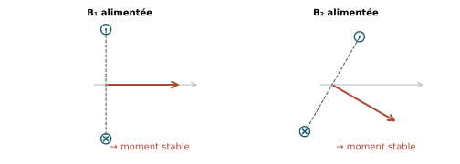
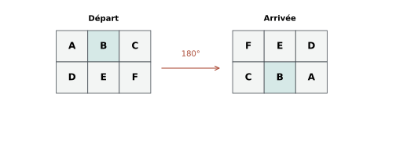
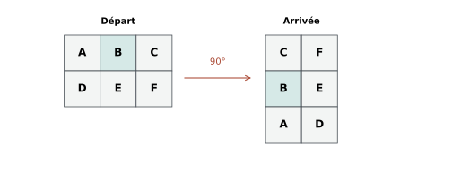

# Banque PT — Informatique et modélisation 2021 · Corrigé brut

*Corrigé rédigé par IA, non officiel. Signalez toute erreur.*

**Rédaction** · GPT-6.2 Astra Ultra · vitesse non renseignée · 26 novembre 2026

**Révision** · GPT-6.2 Astra Ultra · vitesse non renseignée · 26 novembre 2026

Épreuve de quatre heures consacrée à l’autofocus d’un appareil photographique. Le sujet réserve 1 h 30 à la modélisation et 2 h 30 à l’informatique. Le jury indique une pondération proportionnelle. Le document réponse des questions 8 et 9 figure à la page 19 du PDF officiel.

[Sujet officiel et document réponse](https://www.banquept.fr/documents/2021/info_mod_2021_pt.pdf) · [Rapport du jury](https://www.banquept.fr/documents/ecrit/rapport/2021/rapport_info_model_ecrit_2021.pdf)

## Mise au point de l’objectif

### Q1 — Position du capteur et taille de l'image

L'axe est dirigé vers la droite. Pour l'objet réel, $x_0=-2\,\mathrm m$ et la focale positive de l'objectif vaut $f'_0=0{,}10\,\mathrm m$. La relation de Descartes donne
$$
\frac1{d'}-\frac1{x_0}=\frac1{f'_0},\qquad d'=\frac{f'_0x_0}{x_0+f'_0}=0{,}10526\ldots\,\mathrm m .
$$
Le plan net se trouve donc à environ $0{,}1\,\mathrm m$ derrière l'objectif (valeur non arrondie gardée pour la suite). Le grandissement algébrique est $d'/x_0=-1/19$, donc $h'=(d'/x_0)h=-5{,}26\ldots\,\mathrm{mm}$. L'image renversée mesure $5\,\mathrm{mm}$ à un chiffre significatif.

### Q2 — Rayon du disque de flou

Le rayon issu du point objet et passant par le bord supérieur de la lentille arrive au point image A, puis sous l'axe sur $P$ placé derrière A. Celui qui passe par le bord inférieur atteint l'extrémité opposée. Les triangles du cône lumineux, de part et d'autre de A, donnent
$$
\frac{a'}{|\delta|}=\frac{a}{d'},\qquad a'=\frac{0{,}05\times0{,}005}{0{,}10526\ldots}\,\mathrm m
=2{,}375\,\mathrm{mm}\simeq2\,\mathrm{mm}.
$$



### Q3 — Taille d'un pixel et tolérance

La surface par pixel est $20\times30/(6\times10^6)=10^{-4}\,\mathrm{mm^2}$. Le côté du pixel carré vaut $s=\sqrt{10^{-4}}\,\mathrm{mm}=10\,\mu\mathrm m$. Prenons comme critère un diamètre de flou au plus égal au pas du capteur, $2a'\leq s$. Il vient
$$
a'\leq5\,\mu\mathrm m,\qquad |\delta|\leq\frac{s d'}{2a}=10{,}5\ldots\,\mu\mathrm m\simeq10\,\mu\mathrm m .
$$
Cette tolérance est la même de part et d'autre du plan de netteté. Il s'agit d'un critère de résolution pixelisée.

## Mesure optique de la différence de phase

### Q4 — Conjugaison des plans auxiliaires

Le plan $P$ est à l'abscisse algébrique $-d_0$ par rapport à chaque lentille auxiliaire et son image à $+d$. Alors $1/d+1/d_0=1/f'$, d'où
$$
d=\frac{d_0f'}{d_0-f'} .
$$
Un capteur conjugué réel derrière la lentille suppose $d_0>f'$.

### Q5 — Construction quand A appartient à P

Le centre $O_1$ de la lentille supérieure est à la hauteur $a$. Le rayon AO₁ n'est pas dévié. Le rayon issu de A parallèle à l'axe propre de la lentille passe par son bord inférieur, puis par son foyer image $F'_1$. Le foyer $F'_1$ est placé à la hauteur de $O_1$, à une distance $f'$ derrière la lentille. Ces deux droites se coupent en $A_1$ sur $P_1$. Le rayon par le bord supérieur doit également passer par $A_1$, puisque les deux plans sont conjugués.



### Q6 — Ordonnées des deux images nettes

Dans le repère de $O_1$, A est à l'ordonnée $-a$. Le grandissement vaut $-d/d_0$, donc son image est à $+ad/d_0$ au-dessus de l'axe de cette lentille. En ajoutant la hauteur $a$ de $O_1$ au-dessus de l'axe commun, on trouve $y_1=a(1+d/d_0)$. La symétrie par rapport à l'axe commun entraîne $y_2=-a(1+d/d_0)$.

### Q7 — Écart des images au point

Par différence des ordonnées mesurées depuis la même origine,
$$
\Delta\Phi_0=y_1-y_2=2a\left(1+\frac d{d_0}\right).
$$
Cette « phase » est une distance sur les capteurs, exprimée dans la même unité que $a$.

### Q8 — Construction de l'image hors du plan de référence

On retrouve $A_1$ à l'intersection du prolongement du rayon AO₁ et du rayon réfracté par $F'_1$ après incidence parallèle à l'axe de $L_1$. Le document réponse représente A **avant** $P$, soit $p=\overline{OA}<0$. Sa distance à $L_1$ vaut $d_0-p$. Depuis l'axe global, la droite AO₁ monte de $a$ sur cette distance, puis de $a x_1/(d_0-p)$ après le centre. Ainsi
$$
y_1=a\left(1+\frac{x_1}{d_0-p}\right).
$$
Sur le dessin, les distances entre le plan de référence, la lentille et le capteur reproduisent les proportions du document réponse. L’objet plus éloigné de $L_1$ a une image réelle plus proche de cette lentille. L’intersection calculée tombe bien avant $P_1$.



### Q9 — Rayons de bord sur le document réponse

Pour la lentille supérieure, tracer de A aux bords d'ordonnées 0 et $2a$, puis prolonger ces deux rayons après la lentille en les faisant passer par $A_1$. Les poursuivre jusqu'à $P_1$. Pour la lentille inférieure, faire la construction symétrique avec les bords d'ordonnées 0 et $-2a$, puis avec $A_2$, reflet de $A_1$. Sur ce dessin, le capteur est après le croisement des rayons. Le rayon passé par le bord inférieur de $L_1$ atteint donc le **haut** de la tache sur $P_1$.



### Q10 — Extrémités de la tache supérieure

Prenons une origine horizontale dans le plan de $L_1$. Le rayon passant au bord à l'ordonnée $b$ traverse ensuite $(x_1,y_1)$. Son ordonnée au capteur est $b+(y_1-b)d/x_1$. Pour le cas du dessin ($d>x_1$), le rayon issu de $b=0$ arrive en haut et celui issu de $b=2a$ en bas. Donc
$$
y_s=\frac{d y_1}{x_1},\qquad y_i=2a\left(1-\frac d{x_1}\right)+\frac{d y_1}{x_1}.
$$

### Q11 — Différence de phase mesurée

La réflexion dans l'axe $(Ox)$ échange les lentilles et les plans capteurs. Le bas de la tache supérieure est le reflet du haut de la tache inférieure, soit $y'_s=-y_i$. En utilisant Q10 puis Q8,
$$
\Delta\Phi=y_s+y_i=2a+\frac{2d}{x_1}(y_1-a)
=2a+\frac{2ad}{d_0-p}.
$$
Pour une défocalisation de signe opposé, les rayons de bord échangent leurs positions haute et basse, mais leur somme conserve cette expression.

### Q12 — Variation par rapport au réglage net

Soustraire l'écart de référence de Q7 donne
$$
D=\Delta^2\Phi=2ad\left(\frac{1}{d_0-p}-\frac1{d_0}\right)
=\frac{2adp}{d_0(d_0-p)} .
$$
Près du réglage net, $D$ a le signe de $p$ et s'annule pour $p=0$. La valeur algébrique lève l'ambiguïté de la taille seule du disque de flou.

### Q13 — Déplacement de mise au point

Isoler $p$ dans $Dd_0(d_0-p)=2adp$, d'où
$$
p=\frac{D d_0^2}{2ad+Dd_0}
=\frac{0{,}66\times20^2}{2\times3\times20+0{,}66\times20}\,\mathrm{cm}
\simeq +2\,\mathrm{cm}.
$$
Pour amener $P$ sur A en gardant l'objectif fixe, il faut donc déplacer $P$ de deux centimètres **vers la droite**, dans le sens de la lumière. La valeur mesurée correspond à A derrière $P$, ce qui explique que la direction soit opposée à celle qu'aurait exigée l'exemple dessiné en Q8.

## Moment magnétique et moteur

### Q14 — Champ et positions successives du rotor

Dans le plan d'une bobine plate, chaque contribution de Biot et Savart est normale à ce plan. Au voisinage du centre de B₁, le courant sort du dessin en haut et y entre en bas. Par la règle de la main droite, leurs champs s'ajoutent vers la droite, le long de $+\vec x_1$. Le sens indiqué concerne l'intérieur de la boucle, où se trouve le rotor.
 
Dans un champ uniforme, $\vec\Gamma=\vec m\times\vec B$ s'annule lorsque les deux vecteurs sont colinéaires. L'énergie $-\vec m\cdot\vec B$ est minimale quand ils ont même sens, maximale quand ils sont opposés. Le rotor stable s'aligne vers la droite avec B₁, puis vers la droite et le bas avec B₂, soit un déplacement angulaire d'environ $30^\circ$ dans le sens horaire du dessin.



### Q15 — Moment magnétique d'une spire et d'un aimant

Pour une spire plane parcourue par $i$, $\vec m=i\,ab\,\vec n$, où $\vec n$ est le vecteur unitaire normal orienté par la règle de la main droite suivant le courant. Son unité est $\mathrm{A\,m^2}$. Pour $N$ spires identiques, multiplier par $N$.
 
Les moments magnétiques microscopiques des atomes peuvent s'ordonner dans un aimant. À distance, le champ de l'aimant a un terme dipolaire, caractérisé par ce moment résultant. Pour un petit aimant permanent d'environ $1\,\mathrm{cm^3}$, une aimantation de l'ordre de $10^6\,\mathrm{A\,m^{-1}}$ donne $m\sim1\,\mathrm{A\,m^2}$. L'ordre dépend du matériau et du volume.

### Q16 — Moment axial des forces de Laplace

D'après la figure 5, $\vec n=\vec e_\theta$ et les deux côtés parallèles à $Oz$ ont longueur $a$, séparés de $b$. Au côté situé à $r=-b/2$, le courant va selon $+\vec e_z$ et la force vaut $ia(B_r\vec e_\theta-B_\theta\vec e_r)$. Au côté opposé, le courant et la force sont renversés. Seules leurs composantes tangentielles donnent un moment selon $Oz$. Chacun apporte $-iab B_r/2$. Les côtés transversaux subissent des forces axiales, sans moment selon $Oz$.
 
Ainsi $\Gamma_z=-iabB_r$ pour une spire et $\Gamma_z=-NiabB_r$ pour le cadre bobiné. Vérification vectorielle :
$$
(\vec m\times\vec B)\cdot\vec e_z
=Niab\,[\vec e_\theta\times(B_r\vec e_r+B_\theta\vec e_\theta)]\cdot\vec e_z
=-NiabB_r .
$$

### Q17 — Force électromotrice induite et alimentation

Pour $\omega=\dot\theta$ orientée selon $+Oz$, la puissance mécanique est $\mathcal P_{\rm Laplace}=\Gamma_z\omega=-NiabB_r\omega$. En orientant la f.é.m. induite $e$ dans le sens du courant, $\mathcal P_{\rm induite}=ei$. Leur somme nulle donne
$$
e=NabB_r\,\omega.
$$
Pour maintenir $i=i_0$ constant, la maille s'écrit $E_g+e=Ri_0$ (le terme propre $L\,\mathrm di/\mathrm dt$ est nul). D'où $E_g=Ri_0-NabB_r\omega$. Lorsque le mouvement s'inverse, la contribution induite change de signe.

## Mise au point par contraste

### Q18 — Mémoire nécessaire

Il y a 256 intensités possibles, soit $2^8$ états. Le codage minimal sur un nombre entier de bits demande donc 8 bits, un octet par composante. Un pixel RVB occupe 3 octets, soit 24 bits. Dans le modèle sans compression de l'énoncé, les 48 millions de pixels demandent $48\times10^6\times3=144\,000\,000$ octets, soit **144 Mo**, environ **137,3 Mio**, hors en-tête et structures de gestion. Le calcul utilise le capteur informatique de 48 Mpixels ; celui de Q3 en avait six millions.

### Q19 — Linéarisation d'une composante

Les seuils du transfert s'appliquent à une intensité non linéaire **normalisée** entre 0 et 1. La fonction suivante reçoit cette valeur $C$ ; lorsqu'on part d'un octet, il faut d'abord le diviser par 255. La branche linéaire inclut le seuil.

```python
def Clinear(val):
    if val <= 0.04045:
        return val / 12.92
    return ((val + 0.055) / 1.055) ** 2.4
```


### Q20 — Luminance d'un pixel

On reçoit trois entiers entre 0 et 255. Normaliser et linéariser les trois composantes, puis pondérer leurs intensités **linéaires**. Enfin, appliquer le transfert inverse. Cette fonction renvoie $Y$ dans l'intervalle normalisé $[0,1]$.

```python
def Y(pix):
    r, v, b = [Clinear(c / 255) for c in pix]
    ylin = 0.2126 * r + 0.7152 * v + 0.0722 * b
    if ylin <= 0.0031308:
        return 12.92 * ylin
    return 1.055 * ylin ** (1 / 2.4) - 0.055
```

Par exemple, pour un rouge pur, $Y_{\rm lin}=0{,}2126$ et $Y\simeq0{,}498$. Pondérer directement les trois octets ne reproduirait pas cette luminance codée.

### Q21 — Conversion de l'image entière

On adopte une représentation par listes de lignes. Pour chaque pixel, convertir sa luminance normalisée en un entier sur $[0,255]$. Chaque ligne garde son nombre de colonnes et chaque pixel couleur devient un scalaire. Le résultat possède donc les mêmes dimensions spatiales, y compris pour un capteur rectangulaire.

```python
def NiveauxGris(I):
    return [[round(255 * Y(pix)) for pix in ligne] for ligne in I]
```


### Q22 — Produit de deux matrices locales

Le sujet définit ici la « convolution » comme la somme des produits des neuf paires de coefficients placés au même endroit. On applique donc le masque dans l'orientation donnée, sans le retourner.

```python
def convolution(A, B):
    return sum(A[r][c] * B[r][c] for r in range(3) for c in range(3))
```


### Q23 — Contraste d'un pixel intérieur

Extraire les trois lignes et les trois colonnes centrées sur $(i,j)$. Appliquer séparément les filtres de Sobel horizontal et vertical, puis prendre la partie entière de la norme euclidienne. La fonction `hypot` est importée depuis `math`. Les entrées de l'image sont des niveaux de gris représentés par des entiers Python.

```python
Gx = ((-1, 0, 1), (-2, 0, 2), (-1, 0, 1))
Gy = ((-1, -2, -1), (0, 0, 0), (1, 2, 1))


def contraste_pixel(I, i, j):
    bloc = [I[r][j-1:j+2] for r in range(i-1, i+2)]
    return int(hypot(convolution(bloc, Gx), convolution(bloc, Gy)))
```


### Q24 — Contraste moyen

Une image $h\times l$ a $(h-2)(l-2)$ pixels intérieurs. Sommons seulement ceux-ci et divisons par leur nombre. Pour une dimension inférieure à 3, aucune telle moyenne n'existe.

```python
def contraste(I):
    h, l = len(I), len(I[0]) if len(I) else 0
    if h < 3 or l < 3:
        raise ValueError("Pas de pixel interieur")
    somme = sum(contraste_pixel(I, i, j)
                for i in range(1, h-1) for j in range(1, l-1))
    return somme / ((h-2) * (l-2))
```

Un niveau de gris uniforme donne zéro partout, tandis qu'un bord franc donne une réponse locale non nulle.

### Q25 — Régler l'objectif par recherche du maximum

La routine reçoit les deux fonctions instrumentales pour déplacer et mesurer. Elle prend un premier cliché au pas zéro. Ensuite, elle compare chaque mesure à la précédente. À la première diminution stricte, elle remet physiquement l'objectif au pas précédent et le renvoie. Si la courbe monte jusqu'en butée, le dernier pas mesuré est déjà en place.

```python
def reglage(position_objectif, prise):
    position_objectif(0)
    precedent = contraste(NiveauxGris(prise()))
    for pas in range(1, 1001):
        position_objectif(pas)
        actuel = contraste(NiveauxGris(prise()))
        if actuel < precedent:
            position_objectif(pas - 1)
            return pas - 1
        precedent = actuel
    return 1000
```

L'appel est `reglage(position_objectif, prise)`. Pour un plateau, cette convention garde son dernier point avant la descente. Comme l'énoncé, ce balayage suppose une courbe qui monte vers le maximum recherché avant de redescendre. Des maxima locaux multiples changeraient la portée de l'arrêt.

## Mise au point par détection de phase

### Q26 — Extraire deux fenêtres superposables

Avec la convention de la figure 6, pour $d>0$ on associe le pixel $i$ du premier capteur au pixel $i+d$ du second. Pour $d<0$, on retire $-d$ valeurs au début du premier et à la fin du second. La longueur commune est $n-|d|$ pour les deux signes. L'expression imprimée $n-d$ ne convient que pour $d\geq0$ ; à $d=-3$ le dessin présente sept valeurs communes sur dix. Les tranches créent de nouvelles listes et laissent les mesures d’origine intactes. À $d=0$, elles copient la totalité des deux séries.

```python
def extraction(L1, L2, dec):
    n = len(L1)
    if len(L2) != n or abs(dec) >= n:
        raise ValueError("Recouvrement non vide de capteurs egaux requis")
    if dec >= 0:
        return L1[:n-dec], L2[dec:]
    return L1[-dec:], L2[:n+dec]
```

Pour l'exemple alphabétique à $d=2$, les deux tranches contiennent « abcdefgh ». À $d=-3$, elles contiennent « defghij ».

### Q27 — Comparer deux listes à la main

Les tailles doivent d'abord coïncider. Au premier couple de valeurs distinctes, la fonction peut conclure immédiatement. Si la boucle se termine, toutes les positions concordent. Seuls des éléments sont comparés deux à deux.

```python
def comparaison(L1, L2):
    if len(L1) != len(L2):
        return False
    for x, y in zip(L1, L2):
        if x != y:
            return False
    return True
```


### Q28 — Rechercher un décalage exact

Essayer les décalages entiers $-80,-79,\ldots,80$, extrémités comprises, pour les capteurs de longueur 100. Renvoyer le premier dont les deux tranches coïncident. Si aucun ne réussit, renvoyer `None`. Réduire la borne pour des jeux plus courts évite les recouvrements vides.

```python
def recherche_decalage(L1, L2):
    borne = min(80, len(L1)-1)
    for dec in range(-borne, borne+1):
        a, b = extraction(L1, L2, dec)
        if comparaison(a, b):
            return dec
    return None
```

Des séquences périodiques ou constantes peuvent admettre plusieurs décalages. L'ordre de parcours fixe ici le choix.

### Q29 — Nombre de comparaisons

Posons $r=80$, $m=2r+1=161$ décalages et $n=100$ pixels. Pour $d$, le test d'égalité compare au plus $n-|d|$ couples. Un succès au premier décalage coûte exactement $n-r=20$ comparaisons. Avec un succès garanti, cette valeur est le meilleur cas de ce parcours. Si l'absence de solution est aussi autorisée, un premier échec sur chaque décalage peut coûter seulement $m$ comparaisons. Le minimum sur les deux possibilités est $\min(n-r,m)$.
 
Au pire, les deux fenêtres peuvent différer à leur toute dernière position pour chaque essai. On compte alors
$$
\sum_{d=-r}^{r}(n-|d|)=mn-r(r+1)=9\,620.
$$
Ce pire cas en $\Theta(mn)$ est atteint, par exemple, avec deux listes de zéros terminées l'une par 1 et l'autre par 2. Le décompte porte sur les comparaisons de pixels comme demandé. La création de tranches Python copie aussi des références, même lorsqu'un test échoue dès son premier élément.

### Q30 — Erreur quadratique moyenne

Soustraire les intensités en positions correspondantes, élever au carré, additionner puis diviser par le **nombre de valeurs recouvertes**. Cette normalisation permet de comparer les différents décalages. Les flottants évitent la soustraction non signée de deux octets.

```python
def erreur(L1, L2):
    n = len(L1)
    if n == 0 or n != len(L2):
        raise ValueError("Deux listes non vides de meme longueur requises")
    return sum((float(x)-float(y))**2 for x, y in zip(L1, L2)) / n
```


### Q31 — Décalage d'erreur minimale

Conserver le meilleur décalage et son score pendant le balayage. La valeur $+\infty$ permet au premier score calculé d'initialiser la recherche. En cas d'égalité entre minima, le premier décalage rencontré reste enregistré.

```python
def recherche_decalage_2(L1, L2):
    borne = min(80, len(L1)-1)
    if borne < 0 or len(L1) != len(L2):
        raise ValueError("Capteurs vides ou incompatibles")
    meilleur, minimum = None, float("inf")
    for dec in range(-borne, borne+1):
        a, b = extraction(L1, L2, dec)
        score = erreur(a, b)
        if score < minimum:
            meilleur, minimum = dec, score
    return meilleur
```

Cette règle peut fournir un décalage malgré du bruit sur les mesures, même en l'absence de deux fenêtres rigoureusement identiques.

### Q32 — Contraste ou phase

Le contraste se mesure sur l'image elle-même, mais impose plusieurs déplacements et prises de vue.  
La phase fournit directement le sens et l'amplitude du déplacement, au prix de deux mesures appariées et d'un étalonnage.  
Je choisis la phase pour un sujet mobile. Le contraste convient à un capteur simple.

## Pilotage du moteur pas à pas

### Q33 — Commander un seul demi-pas positif

Lire le changement d'état entre deux colonnes consécutives du chronogramme imprimé. La transition 0 vers 1 active IN3, puis 1 vers 2 désactive IN1. Une seule des quatre sorties change à chaque transition, y compris de 7 vers 0. Le reste modulo 8 sélectionne la phase électrique, tandis que la position mécanique retournée augmente de un sans reboucler. Les noms des quatre sorties et la primitive `modif_sortie` sont ceux du sujet.

```python
def faire_un_pas_positif(pas_actuel):
    # Pour la transition de la phase k a la phase k+1,
    # une seule sortie change (chronogramme).
    transitions = ((IN3, True), (IN1, False), (IN2, True),
                   (IN3, False), (IN4, True), (IN2, False),
                   (IN1, True), (IN4, False))
    sortie, etat = transitions[pas_actuel % 8]
    modif_sortie(sortie, etat)
    return pas_actuel + 1
```

Par exemple, depuis le pas 15, phase 7, on désactive IN4 et la nouvelle position vaut 16.

### Q34 — Atteindre une position absolue

Valider la consigne avant d'activer une sortie. Si la consigne dépasse la position courante, avancer jusqu'à l'égalité. Dans l'autre sens, utiliser la primitive de pas négatif fournie, qui retourne la position décrémentée. L'état global reste synchronisé après chaque demi-pas.

```python
def position_objectif(pas):
    global pas_courant
    if not isinstance(pas, int) or not 0 <= pas <= 1000:
        raise ValueError("Position demandee hors course")
    while pas_courant < pas:
        pas_courant = faire_un_pas_positif(pas_courant)
    while pas_courant > pas:
        pas_courant = faire_un_pas_negatif(pas_courant)
    return pas_courant
```

Si la position est déjà atteinte, le programme ne modifie aucune sortie. Les bornes 0 et 1000 sont admises.

## Base de données et orientation des clichés

### Q35 — Clé primaire

Une clé primaire est une colonne ou un ensemble de colonnes qui identifie chaque ligne de la table de manière unique. La base impose l'unicité et l'absence de valeur nulle pour cette clé. Ici deux photographes homonymes sont distingués par leur identifiant.

### Q36 — Photos du 11 novembre 2018

La colonne `date` contient du texte au format AAAAMMJJ. Il faut comparer à la chaîne de huit chiffres correspondante, puis sélectionner uniquement l'identifiant de la photographie.

```sql
SELECT id
FROM PHOTOS
WHERE date = '20181111';
```


### Q37 — Photographes ayant travaillé ce jour-là

Parcourir les photographes et retenir chacun pour lequel existe au moins une photographie à la date voulue. La liaison est `p.idp = g.id`. Un même photographe apparaît une fois quel que soit son nombre de clichés ce jour-là. Deux personnes homonymes demeurent deux personnes différentes.

```sql
SELECT g.nom, g.prenom
FROM PHOTOGRAPHES AS g
WHERE EXISTS (
    SELECT 1 FROM PHOTOS AS p
    WHERE p.idp = g.id AND p.date = '20181111'
);
```


### Q38 — Photographe et heure de chaque cliché

Cette fois on veut une ligne par photographie. La jointure associe chaque cliché à son auteur et la sélection conserve l'heure du cliché. Deux clichés pris par une même personne doivent produire deux lignes.

```sql
SELECT g.nom, g.prenom, p.heure
FROM PHOTOS AS p
JOIN PHOTOGRAPHES AS g ON g.id = p.idp
WHERE p.date = '20181111';
```


### Q39 — Rotation d'un demi-tour

On numérote les lignes de haut en bas, les colonnes de gauche à droite, à partir de zéro. La ligne du haut porte l’indice zéro. Dans une image $h\times l$, la case de départ $(i,j)$ se retrouve en $(h-1-i,l-1-j)$. Il suffit d'inverser l'ordre des lignes et, dans chaque ligne, celui des pixels. La copie profonde depuis le module `copy` préserve aussi l'indépendance des triplets RVB.

```python
def rotation_180(image):
    return [[deepcopy(pix) for pix in reversed(ligne)]
            for ligne in reversed(image)]
```




### Q40 — Quart de tour trigonométrique

La nouvelle image a $l$ lignes et $h$ colonnes. Un pixel $(i,j)$ de la source est envoyé sur $(l-1-j,i)$ à l'arrivée. Inversement, la case $(c,r)$ de l'arrivée reçoit la case $(r,l-1-c)$ de la source. La première ligne construite lit donc de haut en bas la dernière colonne de l'image de départ.

```python
def rotation_90(image):
    h = len(image)
    l = len(image[0]) if h else 0
    return [[deepcopy(image[r][l-1-c]) for r in range(h)]
            for c in range(l)]
```

Dans l'exemple de la figure, B est sur la première ligne, deuxième colonne de la source. Il apparaît ensuite sur la deuxième ligne, première colonne du résultat.


