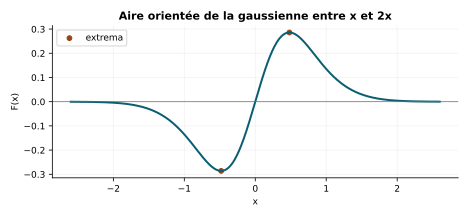
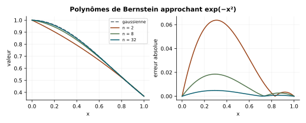

# Banque PT — Mathématiques C · Session 2021 · Corrigé guidé

*Corrigé rédigé par IA, non officiel. Signalez toute erreur.*

**Rédaction** · GPT-6.2 Astra Ultra · vitesse non renseignée

La gaussienne est étudiée à travers ses dérivées, ses moments et une intégrale à bornes mobiles. La dernière partie construit une suite de polynômes qui l’approchent sur le segment unité.

Écrit de quatre heures, sans calculatrice. La grille d’admissibilité donne le coefficient 6 pour l’École polytechnique et 3 pour chacune des ENS Paris-Saclay et Rennes. [Sujet](https://www.banquept.fr/documents/2021/math_c_2021_pt.pdf) · [Grille, p. 13](https://www.banquept.fr/documents/livret/2021/Livret_PT_2021.pdf#page=13)

Le rapport, pages 4–10, demande de justifier les changements de variable et les problèmes de convergence, puis de distinguer espérance, loi binomiale et convergence en probabilité. [Rapport du jury](https://www.banquept.fr/documents/ecrit/rapport/2021/rapport_math_c_ecrit_2021.pdf)

## Repères de lecture

- L’exponentielle gaussienne reste en facteur à chaque dérivation.
- Pour les intégrales sur la droite, vérifiez la convergence avant d’utiliser la parité.
- À la fin, séparez la faible probabilité d’une grande erreur et la petite erreur assurée par la continuité.

## Préambule. Dérivées de la gaussienne

### Question P.1

> [!INDICATION]
> Chercher un facteur dont la dérivée fera apparaître le membre de gauche.

#### Solution

Comme $(e^{x^2}y)'=e^{x^2}(y'+2xy)$, l’équation est équivalente à $e^{x^2}y=C$ sur l’intervalle $\mathbb R$. Toutes les solutions sont $y(x)=Ce^{-x^2}$, $C\in\mathbb R$. La condition $f(0)=1$ donne $f(x)=e^{-x^2}$.

### Question P.2

> [!INDICATION]
> Réemployer f′ à chaque dérivation.

#### Solution

De $f'=-2xf$, on tire $f''=-2f-2xf'=(4x^2-2)f$. Une nouvelle dérivation donne $f'''=8xf+(4x^2-2)f'=(12x-8x^3)f$.

### Question P.3

> [!INDICATION]
> Pour la dérivée, se ramener à un demi-axe et déterminer le point critique.

#### Solution

Sur le segment, $|f|$ et $|f'|$ possèdent un maximum par continuité. Comme $f(x)\le1=f(0)$, le premier vaut 1. Le module de la dérivée est pair et vaut $u(t)=2t e^{-t^2}$ pour $t\ge0$. Sa dérivée $u'(t)=2e^{-t^2}(1-2t^2)$ est positive jusqu’à $t=1/\sqrt2$, négative ensuite. La valeur en ce point, $M=\sqrt{2/e}$, est donc le maximum global atteint en $\pm1/\sqrt2$. Le point critique positif appartenant à $[0,1]$, le maximum sur ce segment vaut également $M$.

### Question P.4.a

> [!INDICATION]
> Distinguer segment fermé et intervalle ouvert.

#### Solution

Si $g$ est continue sur $[a,b]$ et dérivable sur $]a,b[$, avec $a<b$, il existe $c\in]a,b[$ tel que $g(b)-g(a)=g'(c)(b-a)$.

### Question P.4.b

> [!INDICATION]
> Utiliser le maximum de la dérivée pour proposer une valeur d’η.

#### Solution

Par P.4.a appliqué entre deux points distincts et par P.3, $|f(x)-f(y)|\le M|x-y|$ sur $[0,1]$. C’est aussi vrai si les points coïncident. Pour $\varepsilon>0$, $\eta=\varepsilon/M=\varepsilon\sqrt{e/2}$ convient.

### Question P.5

> [!INDICATION]
> La dérivation produit une nouvelle combinaison polynomiale.

#### Solution

Au rang zéro, $f=H_0f$ avec $H_0=1$. Si $f^{(n)}=H_nf$, alors $f^{(n+1)}=(H_n'-2XH_n)f$. Posons donc $H_{n+1}=H_n'-2XH_n$. Si $H_n$ est de degré $n$, le terme $-2XH_n$ de degré $n+1$ ne peut être compensé par $H_n'$. Si $H_n(-X)=(-1)^nH_n(X)$, chacun des deux nouveaux termes a la parité opposée (la dérivée du polynôme constant est nulle). Par récurrence $H_n$ est de degré $n$, pair pour $n$ pair et impair pour $n$ impair.

### Question P.6

> [!INDICATION]
> Repérer le seul terme contribuant au degré maximal.

#### Solution

La récurrence précédente fournit $a(H_{n+1})=-2a(H_n)$ car la dérivée a degré strictement inférieur. Comme $a(H_0)=1$, on obtient $a(H_n)=(-2)^n$.

## I. Moments et produit scalaire gaussiens

### Question I.1

> [!INDICATION]
> Revenir aux deux intégrales impropres qui définissent celle sur toute la droite.

#### Solution

Pour $A>0$, le changement $t=-u$ et la parité donnent $\int_{-A}^0g(t)dt=\int_0^A g(u)du$ dès que les intégrales existent localement. Ainsi les deux demi-intégrales convergent ensemble avec la même valeur. La convergence de l’intégrale sur la droite équivaut donc à celle sur la demi-droite positive, et la première vaut deux fois la seconde. Le même changement traite aussi d’éventuelles questions d’intégrabilité locale symétriques.

### Question I.2

> [!INDICATION]
> Majoriser d’abord le module de l’intégrande au loin.

#### Solution

Les fonctions $x^ne^{-x^2}$ sont continues. Pour $|x|\ge1$, $|x|^{n+2}e^{-x^2}$ est borné car il tend vers zéro à l’infini. Donc $|x^ne^{-x^2}|\le C_n/x^2$, intégrable aux deux extrémités. Les intégrales $I_n$ sur $[0,\infty[$ et $J_n$ sur $\mathbb R$ convergent absolument.

### Question I.3

> [!INDICATION]
> La puissance donne la parité, et la convergence est déjà établie.

#### Solution

Pour $n$ pair, I.1 donne $J_n=2I_n$. Pour $n$ impair, le changement $x=-t$ dans la demi-intégrale négative donne $-I_n$, donc $J_n=0$.

### Question I.4

> [!INDICATION]
> Identifier la dérivée de l’exponentielle.

#### Solution

On obtient $I_1=\int_0^\infty xe^{-x^2}dx=[-e^{-x^2}/2]_0^\infty=1/2$.

### Question I.5

> [!INDICATION]
> Conserver un facteur x avec l’exponentielle.

#### Solution

Sur $[0,A]$ intégrons $x^{n+1}(xe^{-x^2})$ par parties. Le terme de bord $-x^{n+1}e^{-x^2}/2$ s’annule en zéro et tend vers zéro en $+\infty$. L’intégrale restante donne $I_{n+2}=(n+1)I_n/2$ pour tout $n\ge0$.

### Question I.6

> [!INDICATION]
> Partir des valeurs initiales correspondant aux deux parités.

#### Solution

La donnée et I.3 fournissent $I_0=\sqrt\pi/2$. Ainsi $I_{2k}=((2k-1)(2k-3)\cdots1)I_0/2^k$. Le produit impair vaut $(2k)!/(2^k k!)$, d’où $I_{2k}=(2k)!\sqrt\pi/(2^{2k+1}k!)$. Pour les rangs impairs, $I_{2k+1}=k I_{2k-1}$ pour $k\ge1$, d’où $I_{2k+1}=k!/2$ par I.4.

### Question I.7.a

> [!INDICATION]
> Décomposer un polynôme en combinaison finie de monômes.

#### Solution

Si $P=\sum_{k=0}^m c_kX^k$, le module de $P(x)e^{-x^2}$ est au plus $\sum |c_k||x|^k e^{-x^2}$. Chaque terme est intégrable par I.2. L’intégrale demandée converge absolument.

### Question I.7.b

> [!INDICATION]
> Utiliser la positivité et la continuité du carré.

#### Solution

La fonction $q(x)=Q(x)^2 e^{-x^2}$ est continue et positive ou nulle. Si $Q(x_0)\ne0$, un intervalle de longueur positive autour de $x_0$ vérifie $q(x)\ge q(x_0)/2>0$, ce qui rend son intégrale strictement positive. L’hypothèse implique donc que $Q$ est identiquement nul.

### Question I.7.c

> [!INDICATION]
> Vérifier successivement l’existence de l’intégrale et les propriétés du produit scalaire.

#### Solution

Le produit $PQ$ étant un polynôme, $\langle P,Q\rangle=\pi^{-1/2}\int_{\mathbb R}P(x)Q(x)e^{-x^2}dx$ est défini par I.7.a. Il est bilinéaire par linéarité de l’intégrale et symétrique par commutativité du produit. On a $\langle Q,Q\rangle\ge0$, avec égalité seulement pour $Q=0$ par I.7.b. C’est un produit scalaire réel.

### Question I.7.d

> [!INDICATION]
> Identifier les deux premiers polynômes.

#### Solution

On a $H_0=1$, $H_1=-2X$. Leur produit multiplié par la gaussienne est impair et intégrable par I.7.a, donc son intégrale est nulle. Ainsi $\langle H_0,H_1\rangle=0$.

### Question I.7.e

> [!INDICATION]
> Calculer les moments normalisés de degrés zéro, deux et quatre.

#### Solution

Par I.3 et I.6, ces moments valent respectivement $1,1/2,3/4$. Comme $H_2=4X^2-2$, on a $\langle H_0,H_2\rangle=4/2-2=0$. Les produits avec $H_1$ sont impairs, donc nuls à l’intégration. Les normes au carré valent $1$, $4/2=2$ et $16(3/4)-16(1/2)+4=8$. Une base orthonormée de leur espace engendré est donc
$$
\left(1,\ -\sqrt2 X,\ \frac{4X^2-2}{2\sqrt2}\right).
$$

## II. Intégrale de la gaussienne entre deux bornes mobiles

### Question II.1

> [!INDICATION]
> Changer le signe de l’argument dans la définition originale.

#### Solution

Dans $F(x)=x\int_1^2e^{-x^2t^2}dt$, l’intégrale est paire en $x$. Le facteur extérieur change de signe, donc $F(-x)=-F(x)$.

### Question II.2

> [!INDICATION]
> Conserver l’orientation de l’intervalle pour x négatif.

#### Solution

Si $x\ne0$, poser $u=xt$ donne $du=xdt$, avec bornes $x$ et $2x$. Donc $F(x)=\int_x^{2x}e^{-u^2}du$, même pour $x<0$ grâce à l’intégrale orientée. En zéro les deux expressions valent zéro.

### Question II.3

> [!INDICATION]
> Différencier une différence de primitives.

#### Solution

La fonction $f$ étant continue sur $\mathbb R$, $A(v)=\int_0^v f(u)du$ est une primitive de $f$. II.2 donne $F(x)=A(2x)-A(x)$. Donc $F$ est de classe $C^1$, en particulier continue et dérivable partout.

### Question II.4

> [!INDICATION]
> Comparer à une queue d’intégrale convergente.

#### Solution

Pour $x>0$, $0\le F(x)\le\int_x^\infty e^{-u^2}du$. La dernière expression tend vers zéro par convergence de l’intégrale gaussienne. Donc $F(x)\to0$ quand $x\to+\infty$.

### Question II.5

> [!INDICATION]
> Remarquer que les intervalles successifs se touchent.

#### Solution

Pour $N\ge0$, $\sum_{n=0}^N F(2^n)=\sum_{n=0}^N\int_{2^n}^{2^{n+1}}f=\int_1^{2^{N+1}}f$. Cette somme de termes positifs converge vers $\int_1^\infty f$, finie par I.2. Commencer au rang 1 enlève seulement le premier terme.

### Question II.6.a

> [!INDICATION]
> Appliquer la règle de la chaîne aux deux bornes.

#### Solution

Par II.3, $F'(x)=2f(2x)-f(x)=2e^{-4x^2}-e^{-x^2}=e^{-4x^2}(2-e^{3x^2})$.

### Question II.6.b

> [!INDICATION]
> Prendre le logarithme d’une égalité entre réels positifs.

#### Solution

Le facteur exponentiel ne s’annule jamais. Ainsi $F'(x)=0$ équivaut à $e^{3x^2}=2$, donc à $x=\pm a$ avec $a=\sqrt{\log2/3}$.

### Question II.6.c

> [!INDICATION]
> Utiliser la parité pour relier les deux valeurs extrêmes.

#### Solution

Le signe de $F'$ est celui de $2-e^{3x^2}$, positif sur $]-a,a[$ et négatif à l’extérieur. Posons $M_F=\int_a^{2a}e^{-u^2}du>0$. Par imparité et II.4, les variations sont
$$
\begin{array}{c|ccccccc}x&-\infty&&-a&&a&&+\infty\\\hline
F'&&-&0&+&0&-&\\F&0&\searrow&-M_F&\nearrow&M_F&\searrow&0\end{array}.
$$

### Question II.7

> [!INDICATION]
> Comparer la gaussienne à ses valeurs aux bornes sur un segment positif.

#### Solution

Pour $x>0$ et $u\in[x,2x]$, la décroissance donne $e^{-4x^2}\le e^{-u^2}\le e^{-x^2}$. L’intégration sur ce segment de longueur $x$ donne $xe^{-4x^2}\le F(x)\le xe^{-x^2}$.

### Question II.8

> [!INDICATION]
> Placer le centre de symétrie et les deux tangentes horizontales.

#### Solution

La courbe est symétrique par rapport à l’origine, où sa pente est $F'(0)=1$. Elle atteint un minimum en $-a$ et un maximum en $a$, avec tangentes horizontales, et tend vers l’axe des abscisses à chaque extrémité. Le dessin présente directement les ordonnées de l’intégrale de II.2.

### Question II.9.a

> [!INDICATION]
> Utiliser la continuité et fixer la constante d’intégration.

#### Solution

La continuité de $F$ sur $\mathbb R$ assure l’existence des primitives. Celle qui s’annule en zéro est $G(x)=\int_0^xF(t)dt$ par le théorème fondamental, et elle est unique.

### Question II.9.b

> [!INDICATION]
> Examiner le signe de la dérivée de G sur le demi-axe.

#### Solution

Sur $[0,+\infty[$, $G'=F\ge0$ par II.2. La fonction $G$ est croissante, donc admet une limite $\ell_G$ dans $\mathbb R\cup\{+\infty\}$, positive ou nulle puisque $G(0)=0$.

### Question II.9.c

> [!INDICATION]
> Intégrer l’encadrement avant de passer à la limite.

#### Solution

Pour $c>0$, $\int_0^A t e^{-ct^2}dt=(1-e^{-cA^2})/(2c)$. En intégrant II.7 de zéro à $A$ et en laissant $A\to\infty$, on trouve $1/8\le\ell_G\le1/2$. La limite est donc finie.

### Question II.10.a

> [!INDICATION]
> Préciser la convergence de la série.

#### Solution

Pour tout réel ou complexe $z$, $e^z=\sum_{n=0}^\infty z^n/n!$. Le rapport de deux modules successifs vaut $|z|/(n+1)\to0$ pour $z\ne0$. Le rayon est infini.

### Question II.10.b

> [!INDICATION]
> Primitiver la série de la gaussienne puis remplacer les bornes.

#### Solution

La série $f(u)=\sum_{n\ge0}(-1)^nu^{2n}/n!$ converge uniformément sur tout compact. Sa primitive $A$ s’obtient donc par intégration terme à terme à partir de zéro. En revenant à $F(x)=A(2x)-A(x)$,
$$
F(x)=\sum_{n=0}^\infty\frac{(-1)^n(2^{2n+1}-1)}{(2n+1)n!}x^{2n+1}.
$$
Les séries primitives composées avec les deux dilatations ont toutes deux un rayon infini, donc leur différence également.

## III. Approximation par les polynômes de Bernstein

### Question III.1

> [!INDICATION]
> Sortir un facteur x avant de reconnaître le binôme au degré précédent.

#### Solution

Pour $n\ge1$, le terme d’indice zéro dans $\sum kR_{n,k}$ est nul. Pour $1\le k\le n$, les factorielles donnent $k\binom nk=n\binom{n-1}{k-1}$. Ainsi pour tout réel $x$,
$$
\sum_{k=0}^n kR_{n,k}(x)=nx\sum_{j=0}^{n-1}\binom{n-1}{j}x^j(1-x)^{n-1-j}=nx.
$$
Le résultat vaut aussi au rang zéro avec la convention polynomiale $R_{0,0}=1$.

### Question III.2

> [!INDICATION]
> Identifier le nombre de succès indépendants.

#### Solution

Chaque $X_j$ vaut 1 avec probabilité $p$ et 0 avec probabilité $1-p$. La somme compte les succès dans $n$ essais indépendants de même paramètre, donc suit la loi binomiale $\mathcal B(n,p)$. Pour $0\le k\le n$, $P(S_n=k)=\binom nk p^k(1-p)^{n-k}$. Par linéarité $E[S_n]=np$.

### Question III.3.a

> [!INDICATION]
> Appliquer la formule de transfert à une variable à support fini.

#### Solution

Par III.2 et le théorème de transfert,
$$
E[f(S_n/n)]=\sum_{k=0}^n f(k/n)P(S_n=k)=\sum_{k=0}^n f(k/n)R_{n,k}(p)=B_n(f)(p).
$$

### Question III.3.b

> [!INDICATION]
> Énoncer une convergence en probabilité avec ses quantificateurs.

#### Solution

Pour des variables indépendantes, de même loi et de variance finie, la moyenne empirique converge en probabilité vers l’espérance commune. Ici $E[X_j]=p$, $\operatorname{Var}X_j=p(1-p)$. Pour tout $\eta>0$, l’inégalité de Bienaymé–Tchebychev donne $P(|S_n/n-p|\ge\eta)\le p(1-p)/(n\eta^2)$. Ainsi pour chaque $\varepsilon>0$, tout $n\ge n_0=\max(1,\lceil p(1-p)/(\varepsilon\eta^2)\rceil)$ vérifie la borne demandée.

### Question III.3.c

> [!INDICATION]
> Examiner les deux comparaisons possibles pour chaque entier.

#### Solution

Pour tout $k\in\mathbb N$, $|k/n-p|$ est ou bien inférieur ou égal à $\eta$, ou bien strictement supérieur à $\eta$. Les ensembles indiqués sont disjoints et leur réunion est $\mathbb N$. Leur intersection respective avec $\{0,\ldots,n\}$ partage le support de $S_n$.

### Question III.3.d

> [!INDICATION]
> Scinder l’espérance suivant le critère précédent.

#### Solution

Fixons $\varepsilon>0$ et prenons $\eta$ de P.4.b. Sur l’événement $A=\{|S_n/n-p|\le\eta\}$, la différence des valeurs de $f$ a module au plus $\varepsilon$. Ailleurs son module est au plus $2\max_{[0,1]}|f|=2$. Par III.3.a et III.3.b on obtient, dès que $n\ge n_0$,
$$
|f(p)-B_n(f)(p)|\le E|f(p)-f(S_n/n)|\le\varepsilon+2P(A^{c})\le3\varepsilon .
$$
Comme $\varepsilon$ est arbitraire, $B_n(f)(p)\to f(p)$. Les deux extrémités sont exactes, $B_n(f)(0)=f(0)$ et $B_n(f)(1)=f(1)$. De plus $p(1-p)\le1/4$ permet de choisir $n_0$ indépendamment de $p$, donnant même la convergence uniforme sur le segment.

