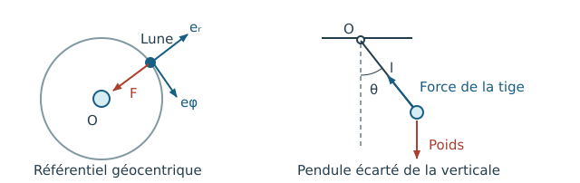
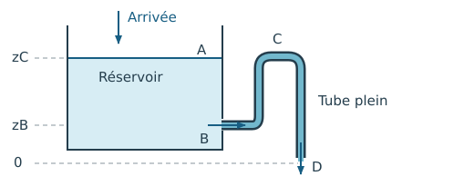
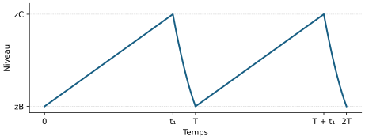
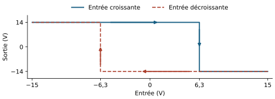
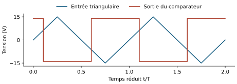
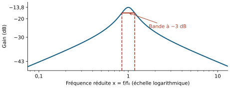
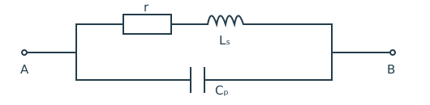

# Banque PT 2021 — Physique A · Corrigé guidé

*Corrigé rédigé par IA, non officiel. Signalez toute erreur.*

**Rédaction** · GPT-6.2 Astra Ultra · vitesse non renseignée · 26 novembre 2026

**Révision (tour 1)** · GPT-6.2 Astra Ultra · vitesse non renseignée · 26 novembre 2026

**Temps – Fréquence.** Épreuve écrite de quatre heures, sans calculatrice. Le calendrier lunaire et les pendules sont suivis de trois oscillateurs, hydraulique, électronique de relaxation et quasi sinusoïdal. Les lectures expérimentales de F8 sont effectuées sur l’oscillogramme du feuillet.

[Sujet officiel](https://www.banquept.fr/documents/2021/ph_a_2021_pt.pdf) · [Rapport du jury](https://www.banquept.fr/documents/ecrit/rapport/2021/rapport_phys_a_ecrit_2021.pdf)

## La Lune et les pendules

### Q1 · Champ gravitationnel extérieur

**Indication.** Commence par la direction et la dépendance du champ. Choisis ensuite une surface fermée dont tous les points sont à même distance du centre terrestre.

Soit $r=OM$ et $\vec e_r$ le vecteur dirigé du centre terrestre vers $M$. La distribution sphérique de masse est invariante par rotation. Les symétries par rapport aux plans contenant $OM$ imposent $\vec g=g_r(r)\vec e_r$. Sur une sphère concentrique de rayon $r$ extérieur à la Terre, le théorème de Gauss gravitationnel donne $4\pi r^2g_r=-4\pi GM_T$. Ainsi $\vec g(M)=-(GM_T/r^2)\vec e_r$. Le signe exprime l’attraction.

### Q2 · Force exercée sur la Lune

**Indication.** Distingue le champ créé par la Terre et la force subie par une masse placée dans ce champ. Vérifie le sens de la flèche.

La Lune est assimilée à son centre de masse $C_L$. En posant $D=D_{TL}=OC_L$, la force est $\vec F_{T\to L}=m_L\vec g(C_L)=-GM_Tm_L\vec e_r/D^2$, de norme voisine de $2{,}0\times10^{20}\,\mathrm N$.

### Q3 · Mouvement circulaire et période sidérale

**Indication.** Projette l’accélération du mouvement circulaire sur la tangente et sur la normale. La constance de la norme de la vitesse vient de la première projection.

On choisit le référentiel géocentrique d’origine $O$, aux axes dirigés vers des étoiles lointaines et supposé galiléen pour ce modèle. On néglige les perturbations et le mouvement du centre terrestre autour du barycentre Terre-Lune. Le principe fondamental s’écrit $m_L\vec a=\vec F_{T\to L}$. Dans la base polaire d’une orbite de rayon constant, $\vec a=-D\dot\varphi^2\vec e_r+D\ddot\varphi\vec e_\varphi$. La projection tangentielle donne $\ddot\varphi=0$, donc la valeur de la vitesse $D|\dot\varphi|$ est constante. La projection radiale donne $\dot\varphi^2=GM_T/D^3$. Une révolution dure $T_L=2\pi\sqrt{D^3/(GM_T)}$.

### Q4 · Troisième loi de Kepler

**Indication.** Élève la période au carré et regroupe les termes indépendants du rayon. Convertis les kilomètres en mètres avant de prendre la racine carrée.

On trouve $T_L^2/D^3=4\pi^2/(GM_T)$, constante commune aux orbites circulaires modélisées autour de la même Terre. Avec $D=3{,}844\times10^8\,\mathrm m$ et $GM_T\simeq3{,}99\times10^{14}\,\mathrm{m^3\,s^{-2}}$, $T_L\simeq2{,}37\times10^6\,\mathrm s\simeq27{,}4$ jours. Ce résultat est proche des 27,32 jours cités.

### Q5 · Géométrie d’une nouvelle lune

**Indication.** Dessine l’hémisphère éclairé de la Lune et place un observateur terrestre du côté qui en voit la face sombre.

À la nouvelle lune, la Lune est en conjonction avec le Soleil vu de la Terre. L’ordre approximatif est Soleil, Lune, Terre. L’hémisphère éclairé est principalement tourné à l’opposé de la Terre. L’inclinaison de l’orbite lunaire autorise un décalage hors de l’alignement exact, d’où l’absence d’éclipse solaire à la plupart des nouvelles lunes.

### Q6 · Dérive d’un calendrier lunaire

**Indication.** Compare douze mois synodiques à une année solaire. Le sens de l’écart fixe le sens du décalage des fêtes.

La Terre avance sur son orbite pendant une révolution lunaire. Pour retrouver sa direction relativement au Soleil, la Lune doit donc avancer davantage. Le mois synodique dure 29,53 jours. Douze lunaisons durent $354{,}36$ jours, environ 10,9 jours de moins qu’une année grégorienne moyenne. Le nouvel an d’un calendrier strictement lunaire se décale vers des dates grégoriennes plus précoces. Le calendrier musulman, ou hégirien, en fournit un exemple.

### Q7 · Équation du pendule simple

**Indication.** Dessine aussi la force exercée par la tige. Prendre son moment au pivot permet de l’éliminer sans la supposer nulle.

Sur la masse ponctuelle agissent le poids $m_p\vec g$ et la force de la tige suivant la direction radiale. Le pivot sans frottement permet d’éliminer cette dernière en prenant les moments en $O$. Pour $\theta$ compté depuis la verticale descendante, le moment du poids vaut $-m_p g l\sin\theta$ dans le sens positif choisi. Avec $J_O=m_pl^2$, on obtient
$$\ddot\theta+(g/l)\sin\theta=0.$$
La pesanteur ramène la masse vers la position verticale basse, comme le montre la direction du poids sur la figure mécanique.

### Q8 · Petites oscillations à partir du repos

**Indication.** Vérifie que la position verticale basse est stable, puis utilise la vitesse initiale pour fixer le coefficient du sinus.

Lorsque $|\theta|\ll1$ en radians, $\sin\theta\simeq\theta$. L’équation linéaire est $\ddot\theta+\omega_p^2\theta=0$, avec $\omega_p=\sqrt{g/l}$. Les conditions $\theta(0)=\theta_0$ et $\dot\theta(0)=0$ fixent $\theta(t)=\theta_0\cos(\omega_pt)$.

### Q9 · Battre la seconde

**Indication.** Une période contient deux alternances. Identifie d’abord la période complète à utiliser dans la formule.

La période vaut $2\pi\sqrt{l/g}$. Pour $T=2\,\mathrm s$, $l=g(T/2\pi)^2=9{,}81/\pi^2\simeq0{,}994\,\mathrm m$. Une alternance dure une seconde. L’échappement peut marquer un battement à chaque demi-oscillation.

### Q10 · Rendre visible la rotation terrestre

**Indication.** Cherche une expérience dont le plan d’oscillation dérive par rapport aux observateurs solidaires du sol.

Le pendule de Foucault présente une rotation apparente de son plan d’oscillation par rapport au sol. À la latitude $\lambda$, sa vitesse angulaire de précession en valeur absolue vaut approximativement $\Omega_T|\sin\lambda|$. L’effet est maximal aux pôles et nul à l’équateur.

### Q11 · Une horloge à balancier

**Indication.** Imagine que l’on transporte l’horloge en l’inclinant ou en accélérant son support.

Une horloge comtoise, par exemple, emploie un pendule de pesanteur. Son pivot doit rester stable et sa verticale est fixée par la pesanteur. Les inclinaisons, chocs et accélérations au cours d’un déplacement perturbent la marche. La longueur voisine d’un mètre constitue une contrainte supplémentaire pour une montre.

### Q12 · Balancier et ressort spiral

**Indication.** Le théorème du moment cinétique prend une forme simple sur l’axe de rotation fixe. Donne un nom au moment d’inertie.

Notons $J_z$ le moment d’inertie du balancier autour de son axe fixe. Le moment cinétique axial vaut $J_z\dot\theta$. La réaction de la liaison parfaite n’exerce aucun moment suivant l’axe et le ressort fournit le couple $-C\theta$. Ainsi $J_z\ddot\theta=-C\theta$. La géométrie détaillée du balancier serait nécessaire pour donner $J_z$ en fonction de sa masse.

### Q13 · Période du balancier

**Indication.** La constante de rappel s’exprime en couple par radian. Le rapport de l’inertie à cette constante a la dimension d’un temps au carré.

Avec $\omega_b=\sqrt{C/J_z}$ et les conditions initiales indiquées, on trouve $\theta(t)=\theta_0\cos(\omega_b t)$ et $T_b=2\pi\sqrt{J_z/C}$. Dans ce modèle à rappel linéaire, la période est indépendante de l’amplitude.

### Q14 · Rôle de l’échappement

**Indication.** Considère les deux sens d’échange entre la roue entraînée et l’oscillateur réel qui dissipe de l’énergie.

L’ancre bloque puis libère périodiquement une dent de la roue d’échappement, au rythme du balancier. Le rouage moteur transforme ainsi les oscillations en avances discrètes pour les aiguilles. À chaque libération, l’ancre transmet aussi une petite impulsion au balancier et compense les pertes.

## Un oscillateur hydraulique à siphon

### Q15 · Bilan de Bernoulli

**Indication.** Vérifie séparément les hypothèses sur le fluide, celles sur l’écoulement et le trajet sur lequel on compare deux points.

Pour un fluide incompressible et non visqueux en écoulement stationnaire, soumis à la pesanteur uniforme, $p+\rho v^2/2+\rho gz$ est constant le long d’une ligne de courant sans machine ni dissipation. La constante est commune aux lignes de courant si l’écoulement est irrotationnel. Lors de la vidange, on applique la relation de façon quasi stationnaire car la cote du grand réservoir varie lentement devant le temps d’ajustement du débit dans le tube.

### Q16 · Remplissage du dispositif

**Indication.** Avant l’amorçage, suis le front eau-air dans la branche ascendante. Compare le volume qu’elle contient au volume du réservoir.

Une fois l’entrée $B$ immergée, l’eau monte dans la branche ascendante du siphon jusqu’à un niveau voisin de celui du réservoir dans l’approximation hydrostatique. L’air de la branche encore ouverte peut s’échapper par $D$. Tant que le sommet n’est pas franchi, il n’y a pas d’écoulement continu vers la sortie. Comme $S_t\ll S_r$, le volume emmagasiné dans le tube est négligeable dans le bilan de remplissage.

### Q17 · Croissance du niveau

**Indication.** Écris directement le bilan des volumes sur un petit intervalle temporel. Le débit sortant est encore nul.

Pendant le remplissage, le seul débit significatif est $D_e$. La conservation du volume donne $S_r\dot z=D_e$. Avec l’origine des temps au passage de $z_B$, on obtient $z(t)=z_B+(D_e/S_r)t$.

### Q18 · Temps de remplissage

**Indication.** Calcule la hauteur gagnée pendant un temps donné puis fixe-la à la différence des deux cotes.

Le volume à accumuler est $S_r(z_C-z_B)$. Le débit étant constant, $t_1=S_r(z_C-z_B)/D_e$ pour $D_e>0$.

### Q19 · Amorcer le siphon

**Indication.** Le sommet du tube est franchi. Dessine une colonne continue jusqu’à la sortie et indique la direction du jet.

À $z=z_C$, l’eau franchit le sommet puis remplit la branche descendante et atteint la sortie $D$. La colonne continue permet au siphon de débiter même lorsque le niveau du réservoir redescend au-dessous du sommet. La figure représente le système amorcé. Les grandes surfaces d’eau et le jet en $D$ sont à la pression atmosphérique.

### Q20 · Vitesse du jet

**Indication.** Repère deux points à pression atmosphérique. Demande-toi pour lequel l’énergie cinétique est négligeable.

Sur une ligne de courant de la surface libre $A$ au jet libre $D$, $p_A=p_D=p_{\rm atm}$ et $z_D=0$. Dans le grand réservoir, la vitesse de la surface est négligeable devant celle du jet dans l’approximation retenue. Bernoulli donne $v_D^2/2+gz_D\simeq gz$, donc $v_D\simeq\sqrt{2gz}$.

### Q21 · Débit sortant

**Indication.** Le débit doit avoir la dimension d’un volume divisé par un temps. Utilise la section du jet.

Avec un profil de sortie supposé uniforme, $D_t=S_t v_D=S_t\sqrt{2gz}$ en $\mathrm{m^3\,s^{-1}}$. Le débit décroît avec la cote pendant la vidange.

### Q22 · Bilan avec le robinet ouvert

**Indication.** Un débit positif entrant élève le niveau, un débit positif sortant l’abaisse. Précise le signe de chaque terme avant de simplifier.

Pendant la phase amorcée, la variation du volume du réservoir est égale au débit entrant diminué du débit sortant. Ainsi $S_r\dot z=D_e-S_t\sqrt{2gz}$. Le niveau baisse lorsque le membre droit est négatif.

### Q23 · Condition pour vider jusqu’en bas

**Indication.** Cherche à quelle hauteur le débit de sortie est le plus petit pendant le trajet de vidange.

Le débit sortant est maximal au début, $S_t\sqrt{2gz_C}$, et minimal à la fin, $S_t\sqrt{2gz_B}$. Pour descendre strictement jusqu’à la cote de désamorçage en temps fini, on choisit $0<D_e<S_t\sqrt{2gz_B}$. L’égalité donnerait une vitesse de niveau tendant vers zéro à l’approche de $z_B$. Pour négliger complètement l’apport durant la vidange, on choisira $D_e$ très inférieur à cette borne.

### Q24 · Un équilibre intermédiaire

**Indication.** Étudie le signe de la dérivée de la cote de part et d’autre du niveau auquel les débits s’égalisent.

Un équilibre vérifie $D_t=D_e$, d’où $z_0=D_e^2/(2gS_t^2)$. Il est intérieur si $S_t\sqrt{2gz_B}<D_e<S_t\sqrt{2gz_C}$. Au-dessus de $z_0$, le débit de sortie l’emporte et le niveau baisse. Au-dessous, il remonte. L’état est donc stable. Partant de $z_C$, le modèle continu approche asymptotiquement $z_0$, le siphon reste amorcé et le jet persiste.

### Q25 · Vidange rapide devant le remplissage

**Indication.** La racine de la cote a une dérivée constante quand le robinet devient négligeable. Redéfinis l’origine du temps au sommet.

Négligeons $D_e$ devant le débit sortant même à $z_B$. En prenant $s=0$ à l’amorçage, $\dot z=-(S_t/S_r)\sqrt{2gz}$. On sépare les variables et l’on obtient
$$\sqrt{z(s)}=\sqrt{z_C}-\frac{S_t}{S_r}\sqrt{g/2}\,s,\qquad
z(s)=\left(\sqrt{z_C}-\frac{S_t}{S_r}\sqrt{g/2}\,s\right)^2.$$
On s’arrête à $z_B$, sans prolonger la parabole après le désamorçage. La durée vaut $t_2=(S_r/S_t)\sqrt{2/g}(\sqrt{z_C}-\sqrt{z_B})$.

### Q26 · Durée d’un cycle

**Indication.** Repars d’un même niveau dans le même sens de variation pour identifier une période complète.

Le remplissage entre $B$ et $C$ puis la vidange entre $C$ et $B$ se succèdent. Sous l’approximation précédente,
$$T=t_1+t_2=\frac{S_r(z_C-z_B)}{D_e}+\frac{S_r}{S_t}\sqrt{\frac2g}(\sqrt{z_C}-\sqrt{z_B}).$$

### Q27 · Deux périodes de hauteur d’eau

**Indication.** Regarde la pente au début et à la fin de la descente. Le débit sortant s’affaiblit quand la hauteur diminue.

La montée est linéaire. À l’amorçage la pente devient négative, décroissante en valeur absolue à mesure que $z$ baisse. La partie descendante est donc convexe. Au niveau $z_B$, le siphon se désamorce et le cycle recommence. Le tracé emploie des paramètres d’illustration, identiques pour les deux périodes.

## Un comparateur et un oscillateur de relaxation

### Q28 · Amplificateur linéaire intégré idéal et réel

**Indication.** Sépare les propriétés du composant, le branchement de rétroaction et les limites d’alimentation.

L’ALI idéal a un gain différentiel en boucle ouverte infini, une impédance d’entrée infinie, une impédance de sortie nulle et une réponse instantanée. Ses courants d’entrée sont nuls. En régime linéaire stable à rétroaction négative, la différence de potentiel entre entrées est alors nulle. En mode comparateur, la sortie atteint l’une des limites imposées par l’alimentation.

L’ALI réel présente un gain fini qui décroît en fréquence, souvent suivant un premier pôle dominant. Il comporte une tension de décalage et de faibles courants d’entrée. Son impédance de sortie est faible mais finie. L’excursion et le courant de sortie, la vitesse de balayage et la plage de mode commun sont limités.

### Q29 · Ordres de grandeur d’un ALI usuel

**Indication.** Associe à chaque nombre une grandeur et une unité. Le gain statique et la fréquence de transition ne décrivent pas la même propriété.

À titre indicatif, un ALI bipolaire classique de type 741 peut présenter un gain statique de l’ordre de $10^5$, une résistance d’entrée de quelques $\mathrm{M\Omega}$, une résistance de sortie en boucle ouverte de quelques dizaines d’ohms, des courants d’entrée de quelques dizaines de nA et un décalage de l’ordre du mV. Sa fréquence de transition est de l’ordre du MHz, son premier pôle de quelques hertz à quelques dizaines de hertz et sa vitesse de balayage de l’ordre de $0{,}5\,\mathrm{V/\mu s}$. Les valeurs diffèrent selon la technologie. Les $\pm15\,\mathrm V$ sont les alimentations fixées pour le montage du sujet.

### Q30 · Fonctionnement de U0

**Indication.** Identifie l’entrée reliée à la sortie et celle qui reçoit le signal. Une perturbation de sortie se renforce-t-elle ?

Le retour par $R_2$ se fait vers l’entrée positive. Une variation de sortie y renforce la variation différentielle qui l’a engendrée. L’équilibre linéaire intermédiaire est instable. Le circuit est un comparateur à réaction positive, saturé à $+14$ ou $-14\,\mathrm V$, recevant $V_e$ sur l’entrée inverseuse.

### Q31 · Tension de référence mobile

**Indication.** Lis le diviseur en partant de la masse. Une tension de sortie positive doit donner une tension de référence plus petite et positive.

Le courant d’entrée étant nul et $R_1$ reliant l’entrée positive à la masse, le diviseur donne $V_+=\beta V_s$ avec $\beta=R_1/(R_1+R_2)=1{,}8/4=0{,}45$. Le seuil en valeur absolue est $U=\beta V_{\rm sat}=6{,}3\,\mathrm V$ pour les valeurs nominales.

### Q32 · Entrée croissante

**Indication.** Pars de −15 V à l’entrée, fixe d’abord la saturation compatible, puis suis cet état jusqu’au premier changement de signe de la tension différentielle.

À $V_e=-15\,\mathrm V$, les deux références possibles sont supérieures à l’entrée. La sortie se fixe à $+14\,\mathrm V$ et la référence vaut $+6{,}3\,\mathrm V$. Tant que $V_e<+6{,}3\,\mathrm V$, cet état est stable. Dès que $V_e$ dépasse ce seuil, $V_+-V_e$ devient négatif, $V_s$ tombe à $-14\,\mathrm V$ et y reste jusqu’à $V_e=+15\,\mathrm V$. La branche bleue de la figure suit cette montée de l’entrée.

### Q33 · Entrée décroissante

**Indication.** Pars cette fois d’une entrée supérieure aux deux seuils. À quel moment l’état bas cesse-t-il d’être cohérent ?

À $V_e=+15\,\mathrm V$, la sortie est basse et $V_+=-6{,}3\,\mathrm V$. Quand $V_e$ descend en dessous de $-6{,}3\,\mathrm V$, la sortie monte à $+14\,\mathrm V$. Elle garde cette valeur jusqu’à $-15\,\mathrm V$. La branche rouge indique le trajet à entrée décroissante sur les mêmes axes.

### Q34 · Pourquoi une hystérésis

**Indication.** Compare les sorties possibles à entrée nulle selon le sens de la dernière excursion.

Les deux seuils de commutation diffèrent. Dans l’intervalle $]-6{,}3\,;\,+6{,}3[$ V, un même $V_e$ peut donner deux sorties selon le dernier seuil franchi. L’état dépend donc de l’histoire du signal. La largeur de l’hystérésis est $2U=12{,}6\,\mathrm V$.

### Q35 · Réponse au triangle

**Indication.** Fixe l’origine de phase du triangle comme sur F6. Sa pente vaut quatre amplitudes par période.

L’origine de F6 est un passage du triangle par zéro en montée. En régime établi, la sortie est alors haute, le seuil négatif ayant été franchi lors de la descente précédente. Avec $E=15\,\mathrm V$, le triangle monte de $0$ à $E$ en $T/4$. Le seuil $+U$ est franchi à $t/T=U/(4E)=0{,}105$ et le seuil $-U$ à $t/T=0{,}5+U/(4E)=0{,}605$. La sortie y bascule respectivement vers $-14$ et $+14\,\mathrm V$. Ces deux instants se répètent chaque période. En toute première mise sous tension à $V_e=0$, l’état initial dépend de l’histoire antérieure encore inconnue.

### Q36 · Charge initiale du condensateur

**Indication.** La sortie est momentanément une source constante. Écris le courant de la branche RC en orientant le courant vers le condensateur.

La sortie étant à $+V_{\rm sat}$, la loi d’Ohm et le courant du condensateur donnent $C\dot v_c=(V_{\rm sat}-v_c)/R$. Ainsi $\tau\dot v_c+v_c=V_{\rm sat}$ avec $\tau=RC$, jusqu’au prochain changement de sortie.

### Q37 · Fin de la première montée

**Indication.** Fixe la constante d’intégration avec le condensateur déchargé. Le premier seuil est inférieur à la tension finale de charge.

Pour $v_c(0)=0$, l’intégration donne $v_c(t)=V_{\rm sat}(1-e^{-t/\tau})$. Lorsque $v_c=+\beta V_{\rm sat}$, le comparateur bascule. On obtient $t_1=-\tau\ln(1-\beta)=\tau\ln[(R_1+R_2)/R_2]$. C’est une durée de démarrage depuis zéro.

### Q38 · Inversion du courant

**Indication.** La tension du condensateur est continue lors du saut de la sortie. Déduis-en le nouveau signe du courant.

Au basculement de la sortie vers $-V_{\rm sat}$, la tension du condensateur reste continue et positive à $+\beta V_{\rm sat}$. La tension $v_s-v_c$ aux bornes de $R$ devient négative. Le courant de charge change de sens, donc $\dot v_c<0$.

### Q39 · Équation de la descente

**Indication.** Garde le même sens pour le courant. Seul le terme source de la première équation change.

La même loi des nœuds donne $\tau\dot v_c+v_c=-V_{\rm sat}$. La nouvelle condition initiale est $v_c(t_1)=+\beta V_{\rm sat}$.

### Q40 · Fin de la descente

**Indication.** Utilise un temps local partant du premier basculement puis reviens à l’origine absolue si tu donnes le second instant.

En posant $s=t-t_1$, on obtient $v_c(t)=-V_{\rm sat}+(1+\beta)V_{\rm sat}e^{-s/\tau}$. Le seuil de retour $-\beta V_{\rm sat}$ donne
$$t_2-t_1=\tau\ln\frac{1+\beta}{1-\beta},\qquad
t_2=t_1+\tau\ln\frac{1+\beta}{1-\beta}.$$
La sortie repasse alors à $+V_{\rm sat}$.

### Q41 · Période en régime établi

**Indication.** La première montée part de zéro. Pour le régime établi, compte les trajets qui commencent et finissent sur les seuils.

Après la première descente, la montée commence au seuil négatif. Par symétrie, elle prend exactement le même temps que la descente. La période est
$$T=2(t_2-t_1)=2RC\ln\frac{1+\beta}{1-\beta}
=2RC\ln(1+2R_1/R_2).$$
Pour les valeurs nominales, le facteur logarithmique vaut $\ln(2{,}636)\simeq0{,}969$.

### Q42 · Mesures sur l’oscillogramme F8

**Indication.** Compte en divisions avant de multiplier par les calibres. Compare les fronts de même sens pour obtenir une période entière.

La grille porte $4\,\mathrm{\mu s/div}$ et $3\,\mathrm{V/div}$. La distance entre deux fronts de même sens vaut environ 6,1 divisions, soit $T\simeq24{,}5\,\mathrm{\mu s}$ et $f\simeq41\,\mathrm{kHz}$. Le créneau présente environ 9,1 divisions crête à crête, donc $V_{\rm sat}\simeq13{,}7\,\mathrm V$. La tension lisse atteint environ $+7$ et $-7\,\mathrm V$ près des basculements, un peu plus de deux divisions de chaque côté du zéro. Les pastilles de l’écran associent C1 au bleu et C2 au magenta, dans l’ordre inverse de la description au-dessus de F8. Les plateaux du tracé magenta identifient la sortie et la courbe bleue est la tension du condensateur.

Avec la lecture graphique $\beta\simeq7/13{,}7\simeq0{,}51$, on trouve $R_2/R_1=(1-\beta)/\beta\simeq1$, puis $RC=T/[2\ln((1+\beta)/(1-\beta))]\simeq11\,\mathrm{\mu s}$. En assimilant le logarithme à 1 comme le suggère le feuillet, on lirait environ $12\,\mathrm{\mu s}$. Le rapport nominal de F5 est $2{,}2/1{,}8\simeq1{,}22$. Les fronts finis et les extrema arrondis empêchent de mesurer sur ces seules traces un seuil statique de grande précision.

### Q43 · Limites de fréquence

**Indication.** Un front traverse deux tensions de saturation en un temps fini. Une période complète en contient deux.

Le gain en boucle ouverte décroît en fréquence. La bande passante et les délais de commutation, y compris la sortie de saturation, retardent le basculement. La vitesse de balayage $S$ impose à chaque front de $2V_{\rm sat}$ une durée d’au moins $2V_{\rm sat}/S$. Deux transitions occupent donc au moins $4V_{\rm sat}/S$ par période, d’où $f\le S/(4V_{\rm sat})$. Un créneau bien établi exige en pratique une fréquence nettement inférieure à ce plafond. Avec $S=0{,}5\,\mathrm{V/\mu s}$ et $V_{\rm sat}=14\,\mathrm V$, ce seul critère donnerait environ 9 kHz pour cet exemple d’ALI lent. Le composant de F8 commute plus vite. Le MHz de produit gain-bande est un ordre de grandeur usuel de petit signal.

### Q44 · Limites effectivement visibles

**Indication.** Observe d’abord les fronts du signal à plateaux. Une échelle en volts et une autre en microsecondes suffisent à estimer la pente.

Les fronts de F8 sont inclinés, avec une transition de l’ordre de 0,5 à 0,6 division horizontale, soit environ $2\,\mathrm{\mu s}$ pour une excursion voisine de 27 V. La pente est donc de l’ordre de $10$ à $20\,\mathrm{V/\mu s}$. Sur la portion centrale des fronts, une lecture de la grille donne environ $+12\,\mathrm{V/\mu s}$ en montée et $-15\,\mathrm{V/\mu s}$ en descente. Les retournements de $v_c$ sont également arrondis puisque la sortie ne change pas instantanément de signe. On peut observer cette vitesse finie sur l’enregistrement. Un seul régime temporel ne permet pas de mesurer séparément le produit gain-bande et le temps de récupération en saturation.

## Le filtre, l’amplificateur et le démarrage

### Q45 · Fonction de transfert du filtre

**Indication.** À la sortie du filtre, les trois branches partagent leur tension. Écris leur courant total pour isoler le rapport des tensions.

Les branches $L$, $R$ et $C$ partagent la tension $V_2$. Leur admittance est $Y=1/R+\mathrm j(\omega C-1/(\omega L))$. En sortie à vide, la loi des nœuds donne $(V_1-V_2)/R_0=YV_2$. En posant $R_p=R_0R/(R_0+R)$, on trouve
$$H_F=\frac1{1+R_0Y}=\frac{H_0}{1+\mathrm j Q_F(x-1/x)},\quad
H_0=\frac{R}{R_0+R},\quad Q_F=R_p\sqrt{C/L},\quad x=\omega/\omega_0.$$
L’annulation de la susceptance donne $\omega_0=1/\sqrt{LC}$ et $f_0=1/(2\pi\sqrt{LC})$. Les valeurs du feuillet donnent $H_0\simeq0{,}203$, $Q_F\simeq3{,}02$ et $f_0\simeq100{,}7\,\mathrm{kHz}$.

### Q46 · Bande passante à trois décibels

**Indication.** À chaque coupure, le carré du module est divisé par deux. Introduis les deux racines positives en fréquence réduite.

Aux deux coupures, $|H_F|=H_0/\sqrt2$, donc $Q_F|x-1/x|=1$. Les deux racines positives sont $x_\pm=\sqrt{1+1/(4Q_F^2)}\pm1/(2Q_F)$. Ainsi $f_+f_-=f_0^2$ et la bande passante est $\Delta f=f_+-f_-=f_0/Q_F$, soit environ 33 kHz.

### Q47 · Diagramme de gain

**Indication.** Vérifie le gain réel au sommet, puisque la référence du critère de bande passante est ce sommet.

Avec $x=f/f_0$, le gain en décibels vaut
$$G_{\rm dB}=20\log_{10}H_0-10\log_{10}[1+Q_F^2(x-1/x)^2].$$
Le sommet est proche de $-13{,}8\,\mathrm{dB}$ à $x=1$. Les coupures proches de $x_-=0{,}85$ et $x_+=1{,}18$ sont à $-16{,}8\,\mathrm{dB}$, soit environ 85 et 119 kHz. À $x=0{,}1$ ou 10, on trouve environ $-43\,\mathrm{dB}$. Les pentes asymptotiques sont $+20$ puis $-20\,\mathrm{dB}$ par décade. L’échelle horizontale logarithmique rend le graphe symétrique autour du sommet.

### Q48 · Deux amplificateurs

**Indication.** Repère la borne qui reçoit le signal avant d’utiliser l’égalité des entrées en régime linéaire.

Les ALI sont idéaux, la rétroaction négative assure un fonctionnement linéaire et les sorties sont supposées non saturées. Les courants d’entrée sont nuls et $V_-=V_+$. Pour F10, le nœud inverseur est à la masse virtuelle. Les courants dans les deux résistances donnent $V_e/R_1=-V_s/R_2$, d’où $A_1=-R_2/R_1$. Pour F11, $V_e=V_+=V_-=R_1V_s/(R_1+R_2)$, d’où $A_2=1+R_2/R_1$.

### Q49 · Impédances d’entrée

**Indication.** Suis le chemin du courant délivré par le filtre pour chaque structure, en revenant au sens du courant d’entrée indiqué sur la figure.

Pour F10, le générateur alimente $R_1$ reliée à la masse virtuelle. Ainsi $i_e=V_e/R_1$ et $Z_{e1}=R_1$. Pour F11, le générateur débite directement dans l’entrée positive idéale, donc $i_e=0$ et $Z_{e2}\to\infty$. La seconde structure laisse le filtre fonctionner à vide et fournit un gain positif, compatible avec la phase de la résonance.

### Q50 · Association en cascade

**Indication.** Vérifie l’absence de charge du filtre, puis multiplie les deux fonctions de transfert en cascade.

Le filtre débitant dans une entrée d’impédance infinie, sa fonction de transfert reste celle de Q45. On peut multiplier les gains,
$$H_{FA}=A_2H_F=\frac{H_1}{1+\mathrm jQ(x-1/x)},\qquad
H_1=(1+R_2/R_1)H_0,\quad Q=Q_F.$$

### Q51 · Équation de la boucle fermée

**Indication.** Remplace la fréquence complexe par la variable de Laplace pour obtenir un polynôme. Ferme ensuite la boucle sur la tension de sortie.

Avec $p$ variable de Laplace, multiplions le numérateur et le dénominateur de $H_{FA}$ par $p\omega_0/Q$. On obtient
$$H_{FA}(p)=\frac{H_1(\omega_0/Q)p}{p^2+(\omega_0/Q)p+\omega_0^2}.$$
Pendant la fermeture de boucle, $v_1=v_3$. Pour le mouvement libre qui suit, le polynôme caractéristique est donc $p^2+(1-H_1)(\omega_0/Q)p+\omega_0^2$. On en déduit $\ddot v_3+(1-H_1)(\omega_0/Q)\dot v_3+\omega_0^2v_3=0$. Avec toutes les énergies et perturbations strictement nulles, zéro reste une solution du modèle. Dans le montage réel, un transitoire ou le bruit amorce le démarrage.

### Q52 · Oscillations croissantes

**Indication.** Une enveloppe qui augmente et une réponse qui oscille correspondent à deux conditions distinctes sur les racines.

Il faut des racines complexes à partie réelle positive. La partie réelle vaut $\alpha=(H_1-1)\omega_0/(2Q)$, et le discriminant est négatif si $|H_1-1|<2Q$. Les deux conditions donnent $1<H_1<1+2Q$. À la borne inférieure l’amplitude est constante dans le modèle linéaire. À la borne supérieure la racine est double et réelle.

### Q53 · Fréquence au démarrage

**Indication.** La fréquence est portée par la partie imaginaire des racines. La partie réelle règle l’enveloppe.

Les racines sont $\alpha\pm\mathrm j\omega_d$ avec
$$\omega_d=\omega_0\sqrt{1-[(H_1-1)/(2Q)]^2}.$$
La réponse réelle associe une sinusoïde de fréquence $f_d=\omega_d/(2\pi)$ à l’enveloppe croissante $e^{\alpha t}$, tant que l’amplificateur reste dans sa plage linéaire.

### Q54 · Fréquence proche de la résonance

**Indication.** Cherche quel rapport sans dimension doit être petit sous la racine de la fréquence de démarrage.

Il faut $0<H_1-1\ll2Q$ tout en gardant le gain de démarrage supérieur à l’unité. Le développement donne $(f_0-f_d)/f_0\simeq(H_1-1)^2/(8Q^2)$. Un faible excès de gain ou une forte sélectivité rapproche la fréquence de démarrage de $f_0$.

### Q55 · Limiter le gain électronique

**Indication.** Examine séparément le déplacement de fréquence du modèle linéaire et la bande passante réelle de l’ALI à gain fermé.

Un excès de gain trop élevé décale la fréquence de démarrage et peut donner des racines réelles. Une fois l’amplitude grande, la saturation ou l’écrêtage crée des harmoniques. En outre, à produit gain-bande fixé, augmenter le gain fermé réduit la bande passante de l’amplificateur et accroît son déphasage à $f_0$. Il faut garantir à la fois une petite marge de démarrage et la bande passante nécessaire autour de $f_0$. La vitesse de balayage doit aussi suffire à l’amplitude retenue.

## Modèle réel de la bobine et stabilité

### Q56 · Différence entre les deux schémas

**Indication.** Observe quelle branche parallèle du filtre a disparu en passant aux composants réels.

Dans F12, le réseau résonant montre trois branches parallèles $L$, $R$, $C$. F13 ne comporte que deux composants réactifs réels $L_r$ et $C_r$ dans ce réseau. La résistance parallèle représentant les pertes n’apparaît plus comme composant distinct. La résistance série d’injection $R_0$ est toujours présente.

### Q57 · D’où vient la résistance de pertes

**Indication.** Une résistance série associée à une inductance peut se traduire par une conductance parallèle au voisinage d’une fréquence donnée.

Le fil de la bobine réelle a une résistance série $r$. Pour son modèle $r+\mathrm j\omega L_s$, l’admittance vaut $(r-\mathrm j\omega L_s)/(r^2+\omega^2L_s^2)$. À la fréquence de travail, la conductance est celle d’une résistance parallèle $R_{\rm pertes}=(r^2+\omega^2L_s^2)/r$. La susceptance correspond à une inductance parallèle $L_p=(r^2+\omega^2L_s^2)/(\omega^2 L_s)$. Cette équivalence locale explique le $R$ de F12. Des pertes diélectriques du condensateur peuvent s’y ajouter.

### Q58 · Résistance du fil de cuivre

**Indication.** Distingue l’aire traversée par le flux magnétique et la section métallique du fil parcourue par le courant.

La résistance continue est $r=\ell_{\rm fil}/(\sigma_{\rm Cu}S_{\rm Cu})$ avec $S_{\rm Cu}=\pi d_{\rm Cu}^2/4$. Pour des spires circulaires d’aire moyenne $S_B$, le rayon vaut $a=\sqrt{S_B/\pi}$. En négligeant le faible pas de l’hélice et les fils de raccordement, $\ell_{\rm fil}\simeq2\pi a N_{\rm sp}$. Il vient
$$r\simeq\frac{8N_{\rm sp}}{\sigma_{\rm Cu}d_{\rm Cu}^2}\sqrt{\frac{S_B}{\pi}}.$$
Le pas pour un enroulement jointif est voisin de $d_{\rm Cu}+2t_i$, donc $N_{\rm sp}\simeq l_B/(d_{\rm Cu}+2t_i)$ si l’on veut éliminer le nombre de tours. L’isolant intervient dans le pas, tandis que seule la section de cuivre conduit le courant.

### Q59 · Capacité entre deux spires

**Indication.** Cherche deux conducteurs de potentiels différents séparés par un diélectrique.

Deux portions conductrices de cuivre, séparées par leurs gaines isolantes, peuvent porter des charges opposées et se trouver à des potentiels différents le long de la bobine. Un champ électrique s’établit entre elles. Cette géométrie forme une capacité interspire $C_i$.

### Q60 · Capacité résultante

**Indication.** Compte les intervalles entre les spires. Entre trois spires, il existe deux intervalles successifs.

Entre les spires 1 et 3, la spire 2 joue le rôle de nœud commun à deux capacités successives. Dans le modèle capacitif simplifié demandé, elles sont en série et donnent $C_i/2$. Pour $N_{\rm sp}$ spires, il y a $N_{\rm sp}-1$ intervalles. La capacité bout à bout vaut $C_p=C_i/(N_{\rm sp}-1)$. Cette estimation néglige les couplages entre spires éloignées et avec la masse.

### Q61 · Schéma complet de la bobine

**Indication.** Place les deux bornes de la capacité équivalente aux extrémités de l’enroulement complet.

La capacité parasite $C_p$ relie les deux bornes extrêmes de l’enroulement. Elle s’ajoute donc en parallèle sur la branche constituée de $r$ et $L_s$ en série. Le courant aux bornes se partage entre les deux branches.

### Q62 · Conséquence sur la fréquence utile

**Indication.** Examine l’admittance de la bobine à haute fréquence et l’effet de sa capacité lorsque la bobine est branchée en parallèle avec le condensateur prévu.

L’admittance de la bobine modélisée vaut $1/(r+\mathrm j\omega L_s)+\mathrm j\omega C_p$. Pour de faibles pertes, elle présente une antirésonance proche de $1/(2\pi\sqrt{L_sC_p})$. Au-delà, le comportement devient capacitif. Dans le filtre, $C_p$ s’ajoute à la capacité externe placée aux mêmes bornes et abaisse la fréquence par rapport à la valeur calculée avec $C$ seul. Une fréquence de travail suffisamment inférieure à l’autorésonance rend le modèle simple plus fidèle.

### Q63 · Condition d’oscillation sinusoïdale

**Indication.** Fais un tour complet de boucle à partir d’une tension sinusoïdale supposée non nulle.

Au régime permanent, $\underline V_2=H_F\underline V_1$, $\underline V_3=A\underline V_2$ et $\underline V_1=\underline V_3$. Pour une oscillation non nulle on en tire $AH_F=1$. Il faut à la fois un module de boucle unitaire et une phase totale multiple de $2\pi$. Ce bilan concerne le gain effectif au régime établi.

### Q64 · Phase du filtre

**Indication.** Le gain de la structure choisie est réel et positif. Quelle phase reste-t-il à fournir par le filtre ?

Dans le modèle de l’amplificateur non inverseur, $A$ est réel positif. Sa phase est nulle. Il faut donc $\arg H_F=0\pmod{2\pi}$. Pour le filtre étudié, $\arg H_F=-\arctan[Q_F(x-1/x)]$, ce qui sélectionne $x=1$ à fréquence positive.

### Q65 · Fluctuation de phase de l’amplificateur

**Indication.** Additionne le petit déphasage de l’amplificateur et la phase du filtre à la fréquence effective.

Si $A'=A_0e^{\mathrm j\delta\psi}$ avec $A_0>0$, la condition devient $\arg H_F(\omega)=-\delta\psi\pmod{2\pi}$. Pour une petite fluctuation, on suit continûment la branche proche de zéro.

### Q66 · Sensibilité de la fréquence

**Indication.** Développe la fréquence réduite et son inverse au voisinage de l’unité. Traduis l’angle d’un degré en radians.

Écrivons $x=1+\delta\omega/\omega_0$. Au premier ordre, $x-1/x\simeq2\delta\omega/\omega_0$. La phase du filtre vaut alors $-2Q_F\delta\omega/\omega_0$. En l’identifiant à $-\delta\psi$, on obtient
$$\frac{\delta\omega}{\omega_0}\simeq\frac{\delta\psi}{2Q_F},\qquad \delta f\simeq\frac{f_0}{2Q_F}\delta\psi.$$
Une fluctuation positive de $1^\circ=\pi/180$ donne, autour de 100 kHz avec $Q_F\simeq3$, environ $+290\,\mathrm{Hz}$, soit $\delta\omega\simeq1{,}8\times10^3\,\mathrm{rad\,s^{-1}}$. Le signe positif correspond à un déphasage plus négatif du filtre au-dessus de sa résonance.

### Q67 · Aspect du spectre

**Indication.** Distingue une fluctuation périodique et une fluctuation aléatoire avant de décrire le spectre.

Dans la limite de petites variations assez lentes pour suivre l’équilibre de phase, la fréquence instantanée fluctue autour de $f_0$. Une modulation périodique engendre des raies latérales espacées de sa fréquence. Des fluctuations aléatoires produisent du bruit de phase autour de la porteuse, avec des jupes latérales et éventuellement un élargissement de la raie. La seule amplitude de fluctuation ne fixe pas une largeur spectrale unique.

### Q68 · Comment améliorer la stabilité

**Indication.** Relie la sensibilité à la pente de phase à la résonance, puis considère les causes de dérive lente de la fréquence centrale.

À fluctuation de phase imposée, augmenter $Q_F$ accentue la pente de phase du résonateur et diminue la variation relative de fréquence suivant Q66. Un résonateur peu dissipatif, éventuellement à quartz, et un amplificateur à faible bruit de phase améliorent la stabilité à court terme. À long terme, il faut aussi stabiliser les paramètres qui fixent $f_0$, notamment par le choix de composants stables et la maîtrise de la température et du vieillissement.
