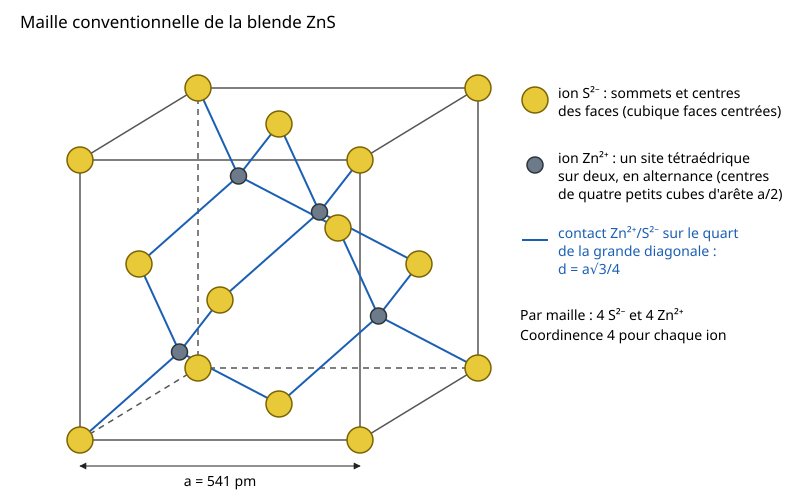
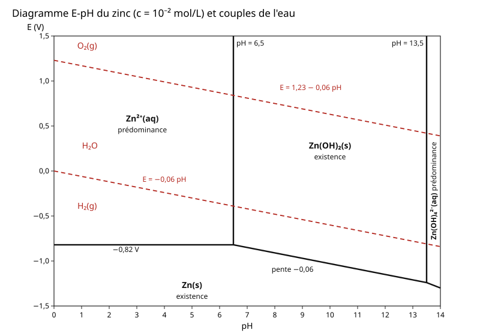
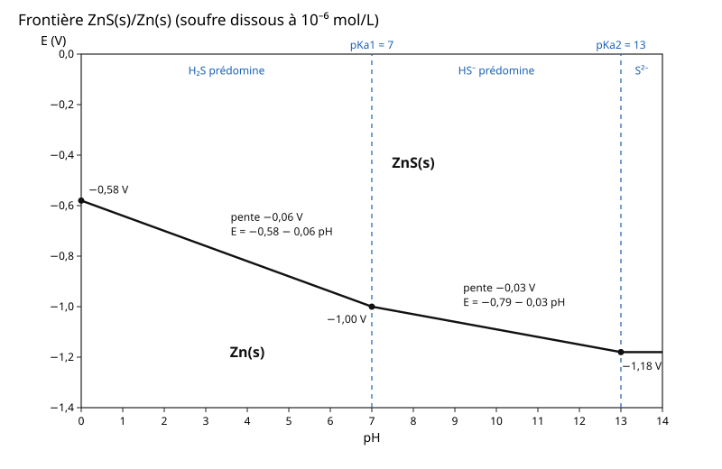

# Banque PT PT — Physique B - Chimie 2021 · Corrigé brut

*Corrigé rédigé par IA, non officiel. Signalez toute erreur.*

**Rédaction** · modèle exact non renseigné (famille Claude) · effort non renseigné · vitesse non renseignée

Épreuve de 2 heures, sans calculatrice, sur le zinc et le sulfure de zinc : 39 questions en quatre parties (cristallographie de la blende, diagrammes potentiel-pH, thermodynamique de la dissolution en milieu carbonate, cinétique de la précipitation homogène). Les 39 questions sont traitées. Les valeurs lues sur les trois figures du sujet sont signalées à l'endroit où elles servent ; deux incohérences entre données de l'énoncé sont relevées aux questions 28 et 35.

[Sujet officiel](https://www.banquept.fr/documents/2021/ph_b_ch_2021_pt.pdf) · [Rapport du jury](https://www.banquept.fr/documents/ecrit/rapport/2021/rapport_phys_b_ecrit_2021.pdf)

## Partie A — Propriétés atomistiques et cristallographiques du zinc

### Question 1 — Maille de la blende

Les ions $\mathrm{S^{2-}}$ forment un réseau cubique à faces centrées : un ion à chacun des huit sommets du cube d'arête $a$ et un ion au centre de chacune des six faces.

Les sites tétraédriques sont les centres des huit petits cubes d'arête $a/2$. Les ions $\mathrm{Zn^{2+}}$ en occupent quatre, de façon alternée (deux sites voisins ne sont jamais occupés tous les deux), par exemple en $(\tfrac14,\tfrac14,\tfrac14)$, $(\tfrac34,\tfrac34,\tfrac14)$, $(\tfrac34,\tfrac14,\tfrac34)$ et $(\tfrac14,\tfrac34,\tfrac34)$.



Population de la maille :

$$N(\mathrm{S^{2-}}) = 8\times\frac18 + 6\times\frac12 = 4$$

$$N(\mathrm{Zn^{2+}}) = 4\times 1 = 4$$

La maille contient **quatre motifs** $\mathrm{ZnS}$, ce qui respecte l'électroneutralité.

### Question 2 — Nombre de plus proches voisins

*Cation.* Un ion $\mathrm{Zn^{2+}}$ occupe le centre d'un petit cube d'arête $a/2$ dont quatre sommets (un sommet de la maille et trois centres de faces) portent un ion $\mathrm{S^{2-}}$. Il possède donc 4 plus proches voisins $\mathrm{S^{2-}}$, placés aux sommets d'un tétraèdre régulier.

*Anion.* Un ion $\mathrm{S^{2-}}$ est commun à huit petits cubes d'arête $a/2$, donc entouré de huit sites tétraédriques, dont un sur deux est occupé. Il possède donc 4 plus proches voisins $\mathrm{Zn^{2+}}$, eux aussi disposés en tétraèdre.

$$\boxed{\text{coordinence } 4 \text{ pour } \mathrm{Zn^{2+}} \text{ et } 4 \text{ pour } \mathrm{S^{2-}}}$$

Ce résultat est cohérent avec la stœchiométrie 1 : 1 du cristal, qui impose des coordinences égales.

### Question 3 — Condition de tangence, distance cation-anion, inégalité sur les rayons

**Tangence et distance cation-anion.** Dans le modèle des sphères dures, le cation et l'anion sont en contact. Le cation est au centre d'un petit cube d'arête $a/2$, l'anion à un sommet : leur distance est la demi-diagonale de ce petit cube, soit le quart de la grande diagonale de la maille.

$$d(\mathrm{Zn^{2+}}\text{–}\,\mathrm{S^{2-}}) = \frac12\times\frac{a}{2}\sqrt3$$

$$\boxed{R(\mathrm{Zn^{2+}}) + R(\mathrm{S^{2-}}) = d = \frac{a\sqrt3}{4}}$$

**Inégalité.** Les anions les plus proches sont alignés sur la diagonale d'une face (sommet, centre de la face), à la distance $a\sqrt2/2$. Ils ne peuvent pas s'interpénétrer (au mieux, ils se touchent) :

$$2\,R(\mathrm{S^{2-}}) \leqslant \frac{a\sqrt2}{2}$$

soit

$$a \geqslant 2\sqrt2\,R(\mathrm{S^{2-}})$$

En reportant dans la condition de tangence :

$$R(\mathrm{Zn^{2+}}) + R(\mathrm{S^{2-}}) = \frac{a\sqrt3}{4} \geqslant \frac{\sqrt3}{4}\times 2\sqrt2\,R(\mathrm{S^{2-}}) = \sqrt{\frac32}\,R(\mathrm{S^{2-}})$$

$$\boxed{\frac{R(\mathrm{Zn^{2+}})}{R(\mathrm{S^{2-}})} \geqslant \sqrt{\frac32} - 1 \approx 0{,}22}$$

### Question 4 — Rapport des rayons et commentaire

$$\frac{R(\mathrm{Zn^{2+}})}{R(\mathrm{S^{2-}})} = \frac{74{,}0}{184} = \frac{37}{92} \approx 0{,}40$$

$$\boxed{\frac{R(\mathrm{Zn^{2+}})}{R(\mathrm{S^{2-}})} \approx 0{,}40 \geqslant \sqrt{\frac32} - 1 \approx 0{,}22}$$

**Commentaire.** L'inégalité de la question 3 est vérifiée : le cation est assez gros pour écarter les anions, qui ne sont donc pas en contact, et l'occupation des sites tétraédriques est géométriquement possible. La valeur 0,40 reste inférieure à $\sqrt2 - 1 \approx 0{,}41$, seuil à partir duquel un cation tient dans un site octaédrique en touchant ses six voisins : la coordinence 4 est bien celle que l'on attend.

Le modèle des sphères dures n'est cependant qu'approché. Avec $\sqrt3/2 = \sqrt{3/2}/\sqrt2 \approx 0{,}87$, la tangence donnerait

$$\frac{a\sqrt3}{4} \approx \frac{541\times 0{,}87}{2} \approx 234\ \mathrm{pm}$$

alors que la somme des rayons ioniques vaut $184 + 74 = 258\ \mathrm{pm}$. L'écart, de l'ordre de 10 %, traduit le caractère partiellement covalent de la liaison zinc-soufre.

### Question 5 — Masse volumique

La maille, de volume $a^3$, contient 4 motifs $\mathrm{ZnS}$ de masse molaire $M(\mathrm{ZnS}) = M(\mathrm{Zn}) + M(\mathrm S) = 97{,}5\ \mathrm{g\cdot mol^{-1}}$ :

$$\boxed{\rho = \frac{4\,\bigl[M(\mathrm{Zn}) + M(\mathrm S)\bigr]}{\mathcal N_A\,a^3}}$$

Application numérique, en unités SI ($a = 5{,}41\cdot 10^{-10}\ \mathrm m$) :

$$a^3 \approx 5{,}4^3\cdot 10^{-30} \approx 1{,}6\cdot 10^{-28}\ \mathrm{m^3}$$

$$\mathcal N_A\,a^3 \approx 6{,}02\cdot 10^{23}\times 1{,}6\cdot 10^{-28} \approx 9{,}5\cdot 10^{-5}\ \mathrm{m^3\cdot mol^{-1}}$$

$$\rho \approx \frac{4\times 97{,}5\cdot 10^{-3}}{9{,}5\cdot 10^{-5}} = \frac{0{,}39}{9{,}5\cdot 10^{-5}}$$

$$\boxed{\rho \approx 4{,}1\cdot 10^{3}\ \mathrm{kg\cdot m^{-3}} = 4{,}1\ \mathrm{g\cdot cm^{-3}}}$$

L'ordre de grandeur est celui d'un solide minéral (quelques fois la masse volumique de l'eau).

## Partie B — Diagrammes du zinc en solution aqueuse et en solution de sulfure

### Question 6 — Dissolutions de l'hydroxyde et domaines du diagramme

Dissolution du précipité en ions $\mathrm{Zn^{2+}}$ :

$$\mathrm{Zn(OH)_2(s)} = \mathrm{Zn^{2+}(aq)} + 2\,\mathrm{HO^-(aq)} \qquad K_{s1} = 10^{-17}$$

(en milieu acide, le bilan s'écrit $\mathrm{Zn(OH)_2(s)} + 2\,\mathrm{H_3O^+} = \mathrm{Zn^{2+}} + 4\,\mathrm{H_2O}$).

Dissolution du précipité en ions $\mathrm{Zn(OH)_4^{2-}}$, en milieu basique :

$$\mathrm{Zn(OH)_2(s)} + 2\,\mathrm{HO^-(aq)} = \mathrm{Zn(OH)_4^{2-}(aq)}$$

**Attribution des domaines.** Le zinc est au nombre d'oxydation 0 dans $\mathrm{Zn(s)}$ et $+\mathrm{II}$ dans les trois autres espèces. Le métal occupe donc la partie basse du diagramme (potentiels les plus faibles). Les trois espèces du zinc(II) se succèdent de gauche à droite dans l'ordre des pH croissants, c'est-à-dire du nombre croissant d'ions hydroxyde fixés, séparées par les deux frontières verticales (aucun échange d'électron entre elles) :

| Zone | Espèce | Nature du domaine |
|---|---|---|
| en haut à gauche (pH inférieur à 6,5 environ) | $\mathrm{Zn^{2+}(aq)}$ | prédominance |
| en haut au centre | $\mathrm{Zn(OH)_2(s)}$ | existence |
| en haut à droite (pH supérieur à 13,5 environ) | $\mathrm{Zn(OH)_4^{2-}(aq)}$ | prédominance |
| en bas, sur toute la largeur | $\mathrm{Zn(s)}$ | existence |



La frontière du couple $\mathrm{Zn^{2+}/Zn}$ est horizontale, à $E = -0{,}76 + 0{,}03\log(10^{-2}) = -0{,}82\ \mathrm V$, ce qui correspond bien au palier lu sur la figure 1 du sujet.

### Question 7 — pH de précipitation de l'hydroxyde de zinc

Au début de la précipitation, le solide existe à l'état de trace et la concentration en ions $\mathrm{Zn^{2+}}$ vaut encore $c = 10^{-2}\ \mathrm{mol\cdot L^{-1}}$. L'équilibre de dissolution est établi (concentrations rapportées à $c^\circ = 1\ \mathrm{mol\cdot L^{-1}}$) :

$$K_{s1} = [\mathrm{Zn^{2+}}]\,[\mathrm{HO^-}]^2$$

$$[\mathrm{HO^-}] = \sqrt{\frac{K_{s1}}{c}} = \sqrt{\frac{10^{-17}}{10^{-2}}} = 10^{-7{,}5}\ \mathrm{mol\cdot L^{-1}}$$

$$\mathrm{pH} = \mathrm{p}K_e - \mathrm{pOH} = 14 - 7{,}5$$

$$\boxed{\mathrm{pH} = 6{,}5}$$

Cette valeur est celle de la première frontière verticale de la figure 1 du sujet, située entre les graduations 6 et 7.

### Question 8 — Formation du complexe à partir de l'hydroxyde

En milieu basique, l'hydroxyde solide fixe deux ions hydroxyde supplémentaires :

$$\boxed{\mathrm{Zn(OH)_2(s)} + 2\,\mathrm{HO^-(aq)} = \mathrm{Zn(OH)_4^{2-}(aq)}}$$

### Question 9 — Constante d'équilibre de la redissolution

Le solide a une activité égale à 1 :

$$K = \frac{[\mathrm{Zn(OH)_4^{2-}}]}{[\mathrm{HO^-}]^2}$$

La réaction de la question 8 est la somme de deux réactions de constantes connues :

$$\mathrm{Zn(OH)_2(s)} = \mathrm{Zn^{2+}} + 2\,\mathrm{HO^-} \qquad K_{s1} = 10^{-17}$$

$$\mathrm{Zn^{2+}} + 4\,\mathrm{HO^-} = \mathrm{Zn(OH)_4^{2-}} \qquad K_c = 10^{16}$$

En multipliant numérateur et dénominateur de $K$ par $[\mathrm{Zn^{2+}}]\,[\mathrm{HO^-}]^2$, on fait apparaître ces deux constantes :

$$K = K_{s1}\,K_c = 10^{-17}\times 10^{16}$$

$$\boxed{K = \frac{[\mathrm{Zn(OH)_4^{2-}}]}{[\mathrm{HO^-}]^2} = K_{s1}\,K_c = 10^{-1}}$$

### Question 10 — pH de la seconde frontière verticale

Sur la frontière entre $\mathrm{Zn(OH)_2(s)}$ et $\mathrm{Zn(OH)_4^{2-}}$, l'équilibre de la question 8 est établi et la concentration du complexe vaut la concentration de tracé $c = 10^{-2}\ \mathrm{mol\cdot L^{-1}}$ :

$$[\mathrm{HO^-}]^2 = \frac{c}{K} = \frac{10^{-2}}{10^{-1}} = 10^{-1}$$

$$[\mathrm{HO^-}] = 10^{-0{,}5}\ \mathrm{mol\cdot L^{-1}}$$

$$\mathrm{pH} = 14 - 0{,}5$$

$$\boxed{\mathrm{pH} = 13{,}5}$$

La figure 1 du sujet place bien cette frontière entre les graduations 13 et 14.

### Question 11 — Diagramme de l'eau

L'allure demandée est celle de la figure 2 ci-dessus : deux droites parallèles en tirets, de pente $-0{,}06\ \mathrm V$ par unité de pH, qui délimitent trois domaines.

*Couple* $\mathrm{O_2(g)/H_2O}$ (droite supérieure) :

$$\mathrm{O_2(g)} + 4\,\mathrm{H^+} + 4\,e^- = 2\,\mathrm{H_2O}$$

$$E = 1{,}23 - 0{,}06\,\mathrm{pH} \quad (\text{en V, pour } P_{\mathrm{O_2}} = 1\ \mathrm{bar})$$

*Couple* $\mathrm{H^+/H_2(g)}$, c'est-à-dire $\mathrm{H_2O/H_2}$ (droite inférieure) :

$$2\,\mathrm{H^+} + 2\,e^- = \mathrm{H_2(g)}$$

$$E = -0{,}06\,\mathrm{pH} \quad (\text{en V, pour } P_{\mathrm{H_2}} = 1\ \mathrm{bar})$$

Attribution : **le dioxygène** au-dessus de la droite supérieure (l'eau y est oxydée), **l'eau** entre les deux droites (domaine de stabilité thermodynamique de l'eau), **le dihydrogène** au-dessous de la droite inférieure (l'eau y est réduite). Contrôle sur la figure 1 du sujet : les droites en pointillé partent de 1,23 V et de 0 V à pH = 0 et arrivent vers 0,39 V et $-0{,}84$ V à pH = 14.

### Question 12 — Stabilité du zinc métallique dans l'eau

Quel que soit le pH, la frontière supérieure du domaine de $\mathrm{Zn(s)}$ est située sous la droite du couple $\mathrm{H_2O/H_2}$ : l'écart vaut 0,82 V à pH = 0, il se réduit à environ 0,43 V à pH = 6,5, reste constant jusqu'à pH = 13,5 (pentes égales), puis augmente à nouveau. Les domaines du zinc et de l'eau sont **disjoints à tout pH**.

$$\boxed{\text{Le zinc métallique est thermodynamiquement instable dans l'eau à tout pH}}$$

Il est oxydé par l'eau avec dégagement de dihydrogène, en un produit qui dépend du pH :

- pH inférieur à 6,5 : $\mathrm{Zn(s)} + 2\,\mathrm{H_3O^+} = \mathrm{Zn^{2+}} + \mathrm{H_2(g)} + 2\,\mathrm{H_2O}$ ;
- pH compris entre 6,5 et 13,5 : $\mathrm{Zn(s)} + 2\,\mathrm{H_2O} = \mathrm{Zn(OH)_2(s)} + \mathrm{H_2(g)}$ ;
- pH supérieur à 13,5 : $\mathrm{Zn(s)} + 2\,\mathrm{HO^-} + 2\,\mathrm{H_2O} = \mathrm{Zn(OH)_4^{2-}} + \mathrm{H_2(g)}$.

Le milieu acide est donc un domaine de corrosion (comme le milieu très basique), tandis qu'entre pH 6,5 et 13,5 la couche d'hydroxyde solide peut protéger le métal (passivation). Le diagramme ne renseigne que sur la thermodynamique : en pratique, la réduction de l'eau sur le zinc est lente, ce qui explique que l'attaque soit peu visible dans l'eau neutre.

### Question 13 — Nombre d'oxydation du zinc dans le sulfure de zinc

Le sulfure de zinc est constitué d'ions $\mathrm{Zn^{2+}}$ et $\mathrm{S^{2-}}$ (le soufre, plus électronégatif, est au nombre d'oxydation $-\mathrm{II}$) :

$$\boxed{\text{n.o.}(\mathrm{Zn}) = +\mathrm{II} \text{ dans } \mathrm{ZnS(s)}}$$

Le précipité se forme à partir de l'ion $\mathrm{Zn^{2+}(aq)}$ et de l'ion sulfure $\mathrm{S^{2-}(aq)}$ :

$$\mathrm{Zn^{2+}(aq)} + \mathrm{S^{2-}(aq)} = \mathrm{ZnS(s)} \qquad K = \frac{1}{K_{s2}} = 10^{20}$$

Selon le pH, le soufre dissous qui apporte l'ion sulfure est majoritairement sous forme $\mathrm{H_2S}$, $\mathrm{HS^-}$ ou $\mathrm{S^{2-}}$ (question 14).

### Question 14 — Diagramme de prédominance des espèces du soufre

$\mathrm{H_2S}$ est un diacide de constantes $\mathrm{p}K_{a1} = 7$ et $\mathrm{p}K_{a2} = 13$ (la seconde valeur, notée par erreur $\mathrm{p}K_{a1}$ dans les données, est celle du couple $\mathrm{HS^-/S^{2-}}$). Une forme acide prédomine sur sa base conjuguée lorsque $\mathrm{pH} < \mathrm{p}K_a$ :

```text
        H2S prédomine     |     HS- prédomine     |   S2- prédomine
  ------------------------+-----------------------+-----------------> pH
  0                       7                      13              14
                        pKa1                    pKa2
```

### Question 15 — Concentration en ions sulfure en fonction du pH

On note $h = [\mathrm{H_3O^+}] = 10^{-\mathrm{pH}}$ et $c = 10^{-6}\ \mathrm{mol\cdot L^{-1}}$ la concentration en soufre dissous. Les constantes d'acidité s'écrivent

$$K_{a1} = \frac{[\mathrm{HS^-}]\,h}{[\mathrm{H_2S}]}$$

$$K_{a2} = \frac{[\mathrm{S^{2-}}]\,h}{[\mathrm{HS^-}]}$$

La conservation du soufre dissous donne

$$c = [\mathrm{H_2S}] + [\mathrm{HS^-}] + [\mathrm{S^{2-}}] = [\mathrm{S^{2-}}]\left(1 + \frac{h}{K_{a2}} + \frac{h^2}{K_{a1}K_{a2}}\right)$$

$$\boxed{[\mathrm{S^{2-}}] = \frac{c}{1 + \dfrac{h}{K_{a2}} + \dfrac{h^2}{K_{a1}K_{a2}}}}$$

Dans chaque domaine de prédominance, un seul terme du dénominateur domine (c'est la convention de tracé de l'énoncé, qui attribue la concentration $c$ à l'espèce prédominante) :

| Domaine | Espèce à la concentration $c$ | $[\mathrm{S^{2-}}]$ | $\log[\mathrm{S^{2-}}]$ |
|---|---|---|---|
| pH < 7 | $\mathrm{H_2S}$ | $K_{a1}K_{a2}\,c/h^2$ | $2\,\mathrm{pH} - 26$ |
| 7 < pH < 13 | $\mathrm{HS^-}$ | $K_{a2}\,c/h$ | $\mathrm{pH} - 19$ |
| pH > 13 | $\mathrm{S^{2-}}$ | $c$ | $-6$ |

### Question 16 — Demi-équation du couple Zn(II)/Zn(0) en présence de sulfure de zinc

En présence du précipité, le zinc(II) est engagé dans $\mathrm{ZnS(s)}$ :

$$\boxed{\mathrm{ZnS(s)} + 2\,e^- = \mathrm{Zn(s)} + \mathrm{S^{2-}(aq)}}$$

Selon l'espèce du soufre qui prédomine, la même demi-équation s'écrit aussi

$$\mathrm{ZnS(s)} + \mathrm{H^+} + 2\,e^- = \mathrm{Zn(s)} + \mathrm{HS^-} \qquad (7 < \mathrm{pH} < 13)$$

$$\mathrm{ZnS(s)} + 2\,\mathrm{H^+} + 2\,e^- = \mathrm{Zn(s)} + \mathrm{H_2S} \qquad (\mathrm{pH} < 7)$$

### Question 17 — Ruptures de pente de la frontière

Sur la figure 2 du sujet, la pente change à pH = 7 et à pH = 13, c'est-à-dire aux deux $\mathrm{p}K_a$ du diacide $\mathrm{H_2S}$. À chacun de ces pH, l'espèce prédominante du soufre dissous change, donc la demi-équation à considérer aussi, et avec elle le nombre de protons échangés pour deux électrons :

- pH < 7 : le soufre libéré est sous forme $\mathrm{H_2S}$, deux protons sont consommés, le potentiel décroît fortement avec le pH ;
- 7 < pH < 13 : il est sous forme $\mathrm{HS^-}$, un seul proton intervient, la pente est deux fois plus faible ;
- pH > 13 : il est sous forme $\mathrm{S^{2-}}$, aucun proton n'intervient, la frontière est horizontale.

De façon équivalente, le potentiel dépend de $\log[\mathrm{S^{2-}}]$, dont la loi en fonction du pH change à chaque $\mathrm{p}K_a$ (question 15). La frontière est continue, seule sa pente est rompue.



### Question 18 — Potentiel de la frontière pour un pH supérieur à 13

En présence de $\mathrm{ZnS(s)}$, l'équilibre de précipitation impose $[\mathrm{Zn^{2+}}] = K_{s2}/[\mathrm{S^{2-}}]$. Le potentiel du couple $\mathrm{Zn^{2+}/Zn}$, égal à celui du couple $\mathrm{ZnS/Zn}$, s'écrit

$$E = E^\circ(\mathrm{Zn^{2+}/Zn}) + \frac{0{,}06}{2}\,\log[\mathrm{Zn^{2+}}]$$

$$E = E^\circ(\mathrm{Zn^{2+}/Zn}) + 0{,}03\,\log K_{s2} - 0{,}03\,\log[\mathrm{S^{2-}}]$$

Le potentiel standard du couple $\mathrm{ZnS/Zn}$ vaut donc

$$E^\circ(\mathrm{ZnS/Zn}) = -0{,}76 - 0{,}03\times 20 = -1{,}36\ \mathrm V$$

Pour pH > 13, l'ion sulfure prédomine et $[\mathrm{S^{2-}}] = 10^{-6}\ \mathrm{mol\cdot L^{-1}}$ :

$$E = -1{,}36 - 0{,}03\times(-6) = -1{,}36 + 0{,}18$$

$$\boxed{E = -1{,}18\ \mathrm V \quad (\mathrm{pH} > 13)}$$

C'est la valeur du palier lu sur la figure 2 du sujet, juste au-dessus de la graduation $-1{,}2$ V.

### Question 19 — Pente de la frontière entre pH 7 et pH 13

Entre pH 7 et pH 13, l'espèce $\mathrm{HS^-}$ prédomine et, d'après la question 15, $\log[\mathrm{S^{2-}}] = \mathrm{pH} - 19$. L'expression de la question 18 devient

$$E = -1{,}36 - 0{,}03\,(\mathrm{pH} - 19)$$

$$E = -0{,}79 - 0{,}03\,\mathrm{pH} \quad (\text{en V})$$

$$\boxed{\text{pente} = -0{,}03\ \mathrm{V\ par\ unité\ de\ pH}}$$

On retrouve ce résultat avec la demi-équation $\mathrm{ZnS(s)} + \mathrm{H^+} + 2\,e^- = \mathrm{Zn(s)} + \mathrm{HS^-}$ : un proton pour deux électrons, soit une pente de $-0{,}06\times\tfrac12$.

Contrôle sur la figure 2 du sujet : la frontière passe de $-1{,}00$ V à pH = 7 à $-1{,}18$ V à pH = 13, soit $-0{,}18$ V pour 6 unités de pH. Le même calcul pour pH < 7 donne $E = -0{,}58 - 0{,}06\,\mathrm{pH}$, en accord avec l'ordonnée à l'origine lue ($-0{,}58$ V).

### Question 20 — Oxydation du zinc par le dioxygène en sulfure de zinc à pH 8

À pH = 8, la frontière du couple $\mathrm{O_2/H_2O}$ est à

$$E = 1{,}23 - 0{,}06\times 8 = 0{,}75\ \mathrm V$$

et celle du couple $\mathrm{ZnS/Zn}$, lue sur la figure 2 du sujet ou calculée par la question 19, à

$$E = -0{,}79 - 0{,}03\times 8 = -1{,}03\ \mathrm V$$

Le domaine du dioxygène (au-dessus de 0,75 V) et celui du zinc (au-dessous de $-1{,}03$ V) sont disjoints, avec un écart de près de 1,8 V : en présence de soufre dissous, le dioxygène de l'air oxyde quantitativement le zinc en sulfure de zinc, espèce stable du zinc dans tout le domaine situé au-dessus de la frontière.

À pH = 8, le soufre dissous est sous forme $\mathrm{HS^-}$ (question 14). Les demi-équations sont

$$\mathrm{Zn(s)} + \mathrm{HS^-} = \mathrm{ZnS(s)} + \mathrm{H^+} + 2\,e^-$$

$$\mathrm{O_2(g)} + 4\,\mathrm{H^+} + 4\,e^- = 2\,\mathrm{H_2O}$$

La combinaison de deux fois la première et de la seconde donne $2\,\mathrm{Zn} + 2\,\mathrm{HS^-} + \mathrm{O_2} + 2\,\mathrm{H^+} = 2\,\mathrm{ZnS} + 2\,\mathrm{H_2O}$. Le milieu étant légèrement basique, on ajoute $2\,\mathrm{HO^-}$ de chaque côté pour ne pas faire figurer d'ions $\mathrm{H^+}$ :

$$\boxed{2\,\mathrm{Zn(s)} + \mathrm{O_2(g)} + 2\,\mathrm{HS^-(aq)} = 2\,\mathrm{ZnS(s)} + 2\,\mathrm{HO^-(aq)}}$$

(Conservation vérifiée : 2 Zn, 2 S, 2 O, 2 H et une charge $-2$ de chaque côté.)

## Partie C — Thermodynamique de la dissolution du sulfure de zinc en solution aqueuse

### Question 21 — Caractère acide ou basique de la solution de carbonate de sodium

Le carbonate de sodium se dissocie totalement en ions $\mathrm{Na^+}$, indifférents du point de vue acido-basique, et en ions carbonate $\mathrm{CO_3^{2-}}$. L'ion carbonate est la base du couple $\mathrm{HCO_3^-/CO_3^{2-}}$ ($\mathrm{p}K_{a4} = 10{,}3$) : selon Brönsted, il capte un proton de l'eau.

$$\mathrm{CO_3^{2-}(aq)} + \mathrm{H_2O} = \mathrm{HCO_3^-(aq)} + \mathrm{HO^-(aq)}$$

Cette réaction produit des ions hydroxyde, donc $[\mathrm{HO^-}] > [\mathrm{H_3O^+}]$ :

$$\boxed{\text{la solution est basique } (\mathrm{pH} > 7)}$$

C'est ce qui rend possible la réaction (1), qui consomme des ions hydroxyde.

### Question 22 — État standard de référence et réaction de formation

**État standard.** L'état standard d'un constituant physico-chimique, à une température $T$, est un état conventionnel défini à la pression standard $P^\circ = 1\ \mathrm{bar}$ :

- pour un gaz, le gaz parfait pur sous $P^\circ$ ;
- pour un solide ou un liquide, le corps pur dans le même état physique sous $P^\circ$ ;
- pour un soluté, le soluté à la concentration $c^\circ = 1\ \mathrm{mol\cdot L^{-1}}$ sous $P^\circ$, se comportant comme en solution infiniment diluée.

**État standard de référence.** L'état standard de référence d'un élément chimique, à la température $T$, est l'état standard du corps simple le plus stable de cet élément, dans son état physique le plus stable à cette température. À 298 K : $\mathrm{Zn(s)}$ pour le zinc, $\mathrm{S(s)}$ pour le soufre. L'enthalpie standard de formation d'un tel corps simple est nulle, ce qui explique les deux cases vides du tableau de données.

**Réaction de formation.** L'enthalpie standard de formation de $\mathrm{ZnS(s)}$ est l'enthalpie standard de la réaction qui forme une mole de $\mathrm{ZnS(s)}$ à partir de ses éléments pris dans leur état standard de référence :

$$\boxed{\mathrm{Zn(s)} + \mathrm{S(s)} = \mathrm{ZnS(s)} \qquad \Delta_f H^\circ(\mathrm{ZnS}) = -203\ \mathrm{kJ\cdot mol^{-1}}}$$

### Question 23 — Enthalpie et entropie standard de la réaction (1)

Pour la réaction (1), $\mathrm{ZnS(s)} + 3\,\mathrm{HO^-} + \mathrm{H_2O} = \mathrm{Zn(OH)_4^{2-}} + \mathrm{HS^-}$, la loi de Hess donne

$$\Delta_r H^\circ = \Delta_f H^\circ(\mathrm{Zn(OH)_4^{2-}}) + \Delta_f H^\circ(\mathrm{HS^-}) - \Delta_f H^\circ(\mathrm{ZnS}) - 3\,\Delta_f H^\circ(\mathrm{HO^-}) - \Delta_f H^\circ(\mathrm{H_2O})$$

$$\Delta_r H^\circ = -1500 - 18 + 203 + 3\times 230 + 285$$

$$\boxed{\Delta_r H^\circ = -340\ \mathrm{kJ\cdot mol^{-1}}}$$

De même, avec les entropies molaires standard :

$$\Delta_r S^\circ = S_m^\circ(\mathrm{Zn(OH)_4^{2-}}) + S_m^\circ(\mathrm{HS^-}) - S_m^\circ(\mathrm{ZnS}) - 3\,S_m^\circ(\mathrm{HO^-}) - S_m^\circ(\mathrm{H_2O})$$

$$\Delta_r S^\circ = -30 + 63 - 58 + 3\times 11 - 70$$

$$\boxed{\Delta_r S^\circ = -62\ \mathrm{J\cdot K^{-1}\cdot mol^{-1}}}$$

**Signe.** $\Delta_r H^\circ < 0$ : la réaction est **exothermique**. À température et pression constantes, elle cède de l'énergie thermique au milieu extérieur lorsqu'elle avance dans le sens direct.

L'entropie standard de réaction est négative : la réaction consomme quatre espèces mobiles en solution (trois ions hydroxyde et une molécule d'eau) pour n'en former que deux.

### Question 24 — Enthalpie libre standard à 298 K

Par définition, à la température $T$ :

$$\boxed{\Delta_r G^\circ(T) = \Delta_r H^\circ(T) - T\,\Delta_r S^\circ(T)}$$

À 298 K, avec $\Delta_r S^\circ = -62\cdot 10^{-3}\ \mathrm{kJ\cdot K^{-1}\cdot mol^{-1}}$ :

$$T\,\Delta_r S^\circ = 298\times(-0{,}062) \approx -18{,}5\ \mathrm{kJ\cdot mol^{-1}}$$

$$\Delta_r G^\circ = -340 + 18{,}5$$

$$\boxed{\Delta_r G^\circ(298\ \mathrm K) = -321{,}5\ \mathrm{kJ\cdot mol^{-1}}}$$

On retrouve la valeur indiquée par l'énoncé, ce qui valide les deux résultats de la question 23.

### Question 25 — Constante d'équilibre en fonction de l'enthalpie libre standard

La constante d'équilibre est définie par $\Delta_r G^\circ(T) + RT\ln K^\circ(T) = 0$ :

$$\boxed{K_1^\circ(T) = \exp\left(-\frac{\Delta_r G^\circ(T)}{RT}\right)}$$

avec $R$ la constante des gaz parfaits et $T$ la température en kelvins. Seule l'expression est demandée (la valeur de $R$ n'est pas fournie et la calculatrice est interdite). À titre indicatif, avec $R = 8{,}31\ \mathrm{J\cdot K^{-1}\cdot mol^{-1}}$, on obtient $\ln K_1^\circ \approx 130$ à 298 K, soit $K_1^\circ \approx 10^{56}$ : d'après ces données, la réaction (1) serait quantitative (voir la remarque de la question 28).

### Question 26 — Influence de la température

La loi de Van't Hoff relie la variation de la constante d'équilibre à l'enthalpie standard de réaction :

$$\frac{\mathrm d\ln K_1^\circ}{\mathrm dT} = \frac{\Delta_r H^\circ}{RT^2}$$

Ici $\Delta_r H^\circ = -340\ \mathrm{kJ\cdot mol^{-1}} < 0$ : $K_1^\circ$ est une fonction décroissante de la température.

$$\boxed{\text{Une élévation de température défavorise la réaction (1) du point de vue thermodynamique}}$$

À partir d'un état d'équilibre, une élévation de température à pression constante déplace l'équilibre dans le sens endothermique, c'est-à-dire dans le sens indirect. (Une température plus élevée accélère en revanche la réaction : l'argument cinétique va en sens opposé.)

### Question 27 — Réaction (2) du carbonate avec l'eau et concentration en ions hydroxyde

L'énoncé parle de « bicarbonate », mais la formule $\mathrm{Na_2CO_3}$ et l'ion $\mathrm{CO_3^{2-}}$ désignent le **carbonate** de sodium : c'est donc l'ion carbonate que l'on considère, à la concentration apportée $c = 10^{-1}\ \mathrm{mol\cdot L^{-1}}$.

**Réaction (2)** (première basicité seule) :

$$\boxed{\mathrm{CO_3^{2-}(aq)} + \mathrm{H_2O} = \mathrm{HCO_3^-(aq)} + \mathrm{HO^-(aq)} \qquad (2)}$$

Sa constante se déduit de $K_{a4}$ et du produit ionique de l'eau :

$$K_2 = \frac{[\mathrm{HCO_3^-}]\,[\mathrm{HO^-}]}{[\mathrm{CO_3^{2-}}]} = \frac{K_e}{K_{a4}} = 10^{-14+10{,}3} = 10^{-3{,}7}$$

**Concentration en ions hydroxyde.** On note $x = [\mathrm{HO^-}]$. En négligeant l'autoprotolyse de l'eau, la réaction (2) forme autant d'ions hydrogénocarbonate que d'ions hydroxyde :

| | $\mathrm{CO_3^{2-}}$ | $\mathrm{HCO_3^-}$ | $\mathrm{HO^-}$ |
|---|---|---|---|
| état initial | $c$ | 0 | 0 |
| équilibre | $c - x$ | $x$ | $x$ |

$$K_2 = \frac{x^2}{c - x}$$

La constante étant petite, on suppose la base peu transformée, $x \ll c$ :

$$x \approx \sqrt{K_2\,c} = \sqrt{10^{-3{,}7}\times 10^{-1}} = 10^{-2{,}35}\ \mathrm{mol\cdot L^{-1}}$$

$$\boxed{[\mathrm{HO^-}] \approx 10^{-2{,}35} \approx 4{,}5\cdot 10^{-3}\ \mathrm{mol\cdot L^{-1}}}$$

Vérifications : $x/c \approx 4{,}5\ \%$, l'hypothèse $x \ll c$ est acceptable ; $x \gg 10^{-7}\ \mathrm{mol\cdot L^{-1}}$, l'autoprotolyse est négligeable. Le pH vaut $14 - 2{,}35 \approx 11{,}6$ : la solution est nettement basique, conformément à la question 21, et l'ion hydrogénocarbonate ($\mathrm{p}K_{a3} = 6{,}3$) ne réagit pratiquement pas à son tour, ce qui justifie de ne retenir que la première basicité.

### Question 28 — Réaction (3) du carbonate sur le sulfure de zinc

**Équation (3).** La réaction (1) consomme trois ions hydroxyde, la réaction (2) en fournit un : la combinaison $(3) = (1) + 3\times(2)$ les élimine.

$$\boxed{\mathrm{ZnS(s)} + 3\,\mathrm{CO_3^{2-}} + 4\,\mathrm{H_2O} = \mathrm{Zn(OH)_4^{2-}} + \mathrm{HS^-} + 3\,\mathrm{HCO_3^-} \qquad (3)}$$

**Constante d'équilibre.** Les constantes se multiplient :

$$K_3 = K_1\,K_2^{\,3}$$

La réaction (1) est elle-même la somme de trois réactions dont les constantes figurent dans les données :

$$\mathrm{ZnS(s)} = \mathrm{Zn^{2+}} + \mathrm{S^{2-}} \qquad K_{s2} = 10^{-20}$$

$$\mathrm{Zn^{2+}} + 4\,\mathrm{HO^-} = \mathrm{Zn(OH)_4^{2-}} \qquad K_c = 10^{16}$$

$$\mathrm{S^{2-}} + \mathrm{H_2O} = \mathrm{HS^-} + \mathrm{HO^-} \qquad \frac{K_e}{K_{a2}} = 10^{-14+13} = 10^{-1}$$

$$K_1 = K_{s2}\,K_c\,\frac{K_e}{K_{a2}} = 10^{-20+16-1} = 10^{-5}$$

D'où, avec $K_2 = 10^{-3{,}7}$ :

$$K_3 = 10^{-5}\times\bigl(10^{-3{,}7}\bigr)^3 = 10^{-5-11{,}1}$$

$$\boxed{K_3 = 10^{-16{,}1} \approx 8\cdot 10^{-17}}$$

**Conclusion.** $K_3 \ll 1$ : la réaction (3) est très peu avancée, la solution de carbonate de sodium ne dissout pratiquement pas le sulfure de zinc. Ordre de grandeur de la solubilité $s$ : la réaction (1) forme autant de complexe que d'ions $\mathrm{HS^-}$, dans un milieu où $[\mathrm{HO^-}] \approx 4{,}5\cdot 10^{-3}\ \mathrm{mol\cdot L^{-1}}$ reste fixée par le carbonate, donc

$$s^2 = K_1\,[\mathrm{HO^-}]^3 \approx 10^{-5}\times 9\cdot 10^{-8} \approx 9\cdot 10^{-13}$$

$$s \approx 1\cdot 10^{-6}\ \mathrm{mol\cdot L^{-1}}$$

Dans les 100 mL de solution, seule une quantité de l'ordre de $10^{-7}$ mol de sulfure de zinc (environ $10\ \mathrm{\mu g}$) passe en solution : presque toute la masse introduite reste solide. Un milieu beaucoup plus basique serait nécessaire.

**Remarque sur les données.** Les deux jeux de données de l'énoncé ne sont pas cohérents. La valeur $\Delta_r G^\circ = -321{,}5\ \mathrm{kJ\cdot mol^{-1}}$ des questions 24 et 25 conduirait à $K_1 \approx 10^{56}$, puis à $K_3 \approx 10^{45}$, et donc à la conclusion inverse (dissolution totale). On retient ici les constantes d'équilibre en solution ($K_{s2}$, $K_c$, $K_{a2}$), qui sont les seules exploitables sans calculatrice ni valeur de $R$, et dont le résultat est conforme au caractère très peu soluble du sulfure de zinc.

## Partie D — Cinétique de la synthèse du sulfure de zinc

### Question 29 — Intérêt de la solution tampon

Une solution tampon maintient le pH, donc $[\mathrm{H_3O^+}]$, pratiquement constant au cours de la réaction. Deux conséquences :

- la loi de vitesse, d'ordre 1 par rapport à chacune des deux espèces, se réduit à une loi d'ordre apparent 1 par rapport au seul TAA (**dégénérescence de l'ordre**), de constante apparente $k_{\mathrm{app}} = k\,[\mathrm{H_3O^+}]$, ce qui simplifie l'intégration et l'exploitation des mesures ;
- les équilibres acido-basiques de $\mathrm{H_2S}$ sont figés : la concentration en ions sulfure reste proportionnelle à celle de $\mathrm{H_2S}$ (question 33), avec un facteur constant.

### Question 30 — Loi de vitesse

La vitesse volumique de la réaction (4) est d'ordre partiel 1 par rapport au TAA et par rapport à l'ion oxonium :

$$\boxed{v = -\frac{\mathrm d[\mathrm{TAA}]}{\mathrm dt} = k\,[\mathrm{TAA}]\,[\mathrm{H_3O^+}]}$$

L'ordre global est 2, et $k$ s'exprime en $\mathrm{L\cdot mol^{-1}\cdot s^{-1}}$ (ou $\mathrm{L\cdot mol^{-1}\cdot min^{-1}}$). L'ion oxonium, qui n'apparaît pas dans le bilan (4), joue le rôle de catalyseur.

### Question 31 — Concentration en TAA en fonction du temps

La concentration $[\mathrm{H_3O^+}]$ étant constante (tampon), la loi de vitesse est une équation différentielle linéaire du premier ordre à coefficient constant :

$$\frac{\mathrm d[\mathrm{TAA}]}{\mathrm dt} + k\,[\mathrm{H_3O^+}]\,[\mathrm{TAA}] = 0$$

Par séparation des variables, entre l'instant 0 et l'instant $t$ :

$$\ln\frac{[\mathrm{TAA}]}{[\mathrm{TAA}]_0} = -k\,[\mathrm{H_3O^+}]\,t$$

$$\boxed{[\mathrm{TAA}](t) = [\mathrm{TAA}]_0\,\exp\bigl(-k\,[\mathrm{H_3O^+}]\,t\bigr)}$$

La concentration décroît exponentiellement, avec le temps caractéristique $\tau = 1/(k\,[\mathrm{H_3O^+}])$.

### Question 32 — Concentration en sulfure de dihydrogène en fonction du temps

D'après le bilan (4), une mole de $\mathrm{H_2S}$ apparaît pour chaque mole de TAA consommée. À volume constant, en l'absence initiale de $\mathrm{H_2S}$ et tant que celui-ci reste en solution sous cette forme (à pH = 1, très inférieur à $\mathrm{p}K_{a1}$, sa dissociation est négligeable) :

$$[\mathrm{H_2S}](t) = [\mathrm{TAA}]_0 - [\mathrm{TAA}](t)$$

$$\boxed{[\mathrm{H_2S}](t) = [\mathrm{TAA}]_0\,\Bigl(1 - \exp\bigl(-k\,[\mathrm{H_3O^+}]\,t\bigr)\Bigr)}$$

Cette concentration croît de 0 vers la valeur limite $[\mathrm{TAA}]_0$.

### Question 33 — Concentration en ions sulfure en fonction de celle du sulfure de dihydrogène

Les deux équilibres acido-basiques, rapides devant la décomposition du TAA, sont établis à chaque instant :

$$K_{a1} = \frac{[\mathrm{HS^-}]\,[\mathrm{H_3O^+}]}{[\mathrm{H_2S}]}$$

$$K_{a2} = \frac{[\mathrm{S^{2-}}]\,[\mathrm{H_3O^+}]}{[\mathrm{HS^-}]}$$

Le produit des deux relations élimine $[\mathrm{HS^-}]$ :

$$K_{a1}\,K_{a2} = \frac{[\mathrm{S^{2-}}]\,[\mathrm{H_3O^+}]^2}{[\mathrm{H_2S}]}$$

$$\boxed{[\mathrm{S^{2-}}] = \frac{K_{a1}\,K_{a2}\,[\mathrm{H_2S}]}{[\mathrm{H_3O^+}]^2}}$$

### Question 34 — Concentration en ions sulfure en fonction du temps

En reportant l'expression de $[\mathrm{H_2S}](t)$ (question 32) dans la relation de la question 33 :

$$\boxed{[\mathrm{S^{2-}}](t) = K_{a1}\,K_{a2}\,\frac{[\mathrm{TAA}]_0}{[\mathrm{H_3O^+}]^2}\,\Bigl(1 - \exp\bigl(-k\,[\mathrm{H_3O^+}]\,t\bigr)\Bigr)}$$

C'est l'expression donnée par l'énoncé. La concentration croît de 0 vers la limite

$$[\mathrm{S^{2-}}]_\infty = K_{a1}\,K_{a2}\,\frac{[\mathrm{TAA}]_0}{[\mathrm{H_3O^+}]^2}$$

ce qui correspond à l'allure de la courbe de la figure 3 du sujet (croissance à concavité tournée vers le bas, tendant vers une asymptote).

### Question 35 — Constante de vitesse

D'après la question 34 :

$$\frac{[\mathrm{S^{2-}}](t_1)}{[\mathrm{S^{2-}}]_\infty} = 1 - \exp\bigl(-k\,[\mathrm{H_3O^+}]\,t_1\bigr)$$

Avec le point de la courbe indiqué par l'énoncé (figure 3 du sujet : ordonnée 6 à l'abscisse 11 min, l'axe étant gradué en $10^{-18}\ \mathrm{mol\cdot L^{-1}}$) :

$$\frac{6\cdot 10^{-18}}{1{,}5\cdot 10^{-17}} = 0{,}4$$

$$\exp\bigl(-k\,[\mathrm{H_3O^+}]\,t_1\bigr) = 1 - 0{,}4 = 0{,}6$$

$$k = -\frac{\ln(0{,}6)}{[\mathrm{H_3O^+}]\,t_1}$$

Application numérique avec $[\mathrm{H_3O^+}] = 10^{-1}\ \mathrm{mol\cdot L^{-1}}$ (pH = 1), $t_1 = 11\ \mathrm{min}$ et $\ln(0{,}6) \approx -0{,}5$ :

$$k \approx \frac{0{,}5}{0{,}1\times 11}$$

$$\boxed{k \approx 0{,}45\ \mathrm{L\cdot mol^{-1}\cdot min^{-1}} \approx 7{,}6\cdot 10^{-3}\ \mathrm{L\cdot mol^{-1}\cdot s^{-1}}}$$

La constante apparente vaut $k\,[\mathrm{H_3O^+}] \approx 4{,}5\cdot 10^{-2}\ \mathrm{min^{-1}}$, soit un temps caractéristique de 22 min. Contrôle sur la figure 3 du sujet : à $t = 30$ min, le modèle donne $15\,(1 - e^{-1{,}36}) \approx 11$, ce qui est bien l'ordonnée lue à l'extrémité de la courbe.

**Remarque sur les données.** Avec $\mathrm{p}K_{a1} + \mathrm{p}K_{a2} = 20$, $[\mathrm{TAA}]_0 = 0{,}2\ \mathrm{mol\cdot L^{-1}}$ et pH = 1, l'expression de la question 34 donnerait une limite de $2\cdot 10^{-19}\ \mathrm{mol\cdot L^{-1}}$, et non la valeur $1{,}5\cdot 10^{-17}\ \mathrm{mol\cdot L^{-1}}$ indiquée. Cet écart est sans effet sur $k$, qui ne dépend que du rapport des deux ordonnées ; on utilise dans la suite les valeurs de la courbe, comme le demande l'énoncé.

### Question 36 — Quotient de réaction juste avant la précipitation

On considère l'équilibre $\mathrm{ZnS(s)} = \mathrm{Zn^{2+}} + \mathrm{S^{2-}}$, de constante $K_{s2} = 10^{-20}$, et le quotient de réaction associé $Q = [\mathrm{Zn^{2+}}]\,[\mathrm{S^{2-}}]$.

Juste avant l'apparition du précipité, $[\mathrm{Zn^{2+}}] = 10^{-1}\ \mathrm{mol\cdot L^{-1}}$ (le nitrate de zinc est totalement dissocié). À $t_2 = 3$ min, la figure 3 du sujet donne une ordonnée voisine de 2 (la courbe passe par 1,3 environ à 2 min et 2,5 environ à 4 min). Le modèle le confirme, avec $1 - e^{-x} \approx x$ pour $x = k\,[\mathrm{H_3O^+}]\,t_2 \approx 0{,}14$ :

$$[\mathrm{S^{2-}}](t_2) \approx 1{,}5\cdot 10^{-17}\times 0{,}13 \approx 2\cdot 10^{-18}\ \mathrm{mol\cdot L^{-1}}$$

$$Q = [\mathrm{Zn^{2+}}]\,[\mathrm{S^{2-}}] \approx 10^{-1}\times 2\cdot 10^{-18}$$

$$\boxed{Q \approx 2\cdot 10^{-19} > K_{s2} = 10^{-20}}$$

Le quotient de réaction dépasse le produit de solubilité d'un facteur 20 environ : la solution n'est pas simplement saturée, elle est **sursaturée**. La condition thermodynamique de précipitation, $Q = K_{s2}$, soit $[\mathrm{S^{2-}}] = 10^{-19}\ \mathrm{mol\cdot L^{-1}}$, est atteinte dès les premières secondes (vers $t \approx 0{,}15$ min d'après le modèle). Le solide n'apparaît qu'ensuite, car la formation des premiers germes cristallins est lente : la solution reste dans un état métastable jusqu'à $t_2$.

### Question 37 — Réaction (5) du sulfure de dihydrogène avec l'eau

Le diacide $\mathrm{H_2S}$ cède deux protons à l'eau (somme des deux réactions d'acidité) :

$$\boxed{\mathrm{H_2S(aq)} + 2\,\mathrm{H_2O} = \mathrm{S^{2-}(aq)} + 2\,\mathrm{H_3O^+(aq)} \qquad (5)}$$

Sa constante vaut $K_5 = K_{a1}\,K_{a2} = 10^{-20}$ : la réaction est très peu avancée, surtout à pH = 1, mais elle fournit la très faible concentration en ions sulfure (de l'ordre de $10^{-18}\ \mathrm{mol\cdot L^{-1}}$) qui suffit à atteindre le produit de solubilité de $\mathrm{ZnS}$.

### Question 38 — Réaction des ions zinc avec le sulfure de dihydrogène

En milieu acide, l'espèce du soufre présente en quantité notable est $\mathrm{H_2S}$. La somme de la réaction (5) et de la précipitation $\mathrm{Zn^{2+}} + \mathrm{S^{2-}} = \mathrm{ZnS(s)}$ donne

$$\boxed{\mathrm{Zn^{2+}(aq)} + \mathrm{H_2S(aq)} + 2\,\mathrm{H_2O} = \mathrm{ZnS(s)} + 2\,\mathrm{H_3O^+(aq)}}$$

Sa constante d'équilibre vaut

$$K = \frac{K_{a1}\,K_{a2}}{K_{s2}} = \frac{10^{-20}}{10^{-20}} = 1$$

La réaction libère des ions oxonium : c'est le tampon qui maintient le pH constant pendant la précipitation.

### Question 39 — Durée nécessaire pour précipiter tout le zinc

D'après la question 38, la précipitation consomme une mole de $\mathrm{H_2S}$ par mole de $\mathrm{Zn^{2+}}$. En supposant cette précipitation rapide et totale, c'est la décomposition du TAA, étape lente, qui fixe la durée : il faut que la quantité de $\mathrm{H_2S}$ produite par litre atteigne la concentration initiale en zinc, $[\mathrm{Zn^{2+}}]_0 = 10^{-1}\ \mathrm{mol\cdot L^{-1}}$.

La production de $\mathrm{H_2S}$ suit la loi de la question 32 (la cinétique de décomposition du TAA ne dépend pas de ce que devient $\mathrm{H_2S}$) :

$$[\mathrm{TAA}]_0\,\Bigl(1 - \exp\bigl(-k\,[\mathrm{H_3O^+}]\,t\bigr)\Bigr) = [\mathrm{Zn^{2+}}]_0$$

$$\exp\bigl(-k\,[\mathrm{H_3O^+}]\,t\bigr) = 1 - \frac{0{,}1}{0{,}2} = \frac12$$

Le TAA étant en quantité double de celle du zinc, la durée cherchée est le temps de demi-réaction du TAA :

$$t = \frac{\ln 2}{k\,[\mathrm{H_3O^+}]}$$

Application numérique avec $\ln 2 \approx 0{,}69$ et $k\,[\mathrm{H_3O^+}] \approx 4{,}5\cdot 10^{-2}\ \mathrm{min^{-1}}$ :

$$\boxed{t \approx 15\ \mathrm{min}}$$

Il s'agit d'une estimation : elle suppose la précipitation quantitative et instantanée dès que $\mathrm{H_2S}$ est formé. La constante de la réaction de la question 38 valant 1, une faible fraction du zinc reste en réalité en solution à pH = 1, et la durée réelle est un peu supérieure.
