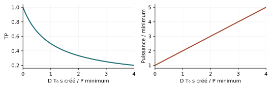
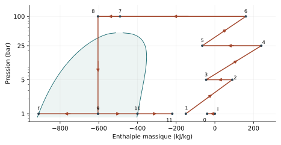
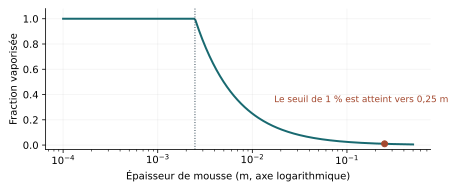
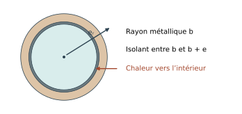

# Banque PT 2021 — Physique B · Thermodynamique · Corrigé guidé

*Corrigé rédigé par IA, non officiel. Signalez toute erreur.*

**Rédaction** · GPT-6.2 Astra Ultra · vitesse non renseignée

**Révision (tour 1)** · GPT-6.2 Astra Ultra · vitesse non renseignée

[Sujet et document réponse](https://www.banquept.fr/documents/2021/ph_b_th_2021_pt.pdf) · [Rapport du jury](https://www.banquept.fr/documents/ecrit/rapport/2021/rapport_phys_b_ecrit_2021.pdf) · [Coefficients de la session](https://www.banquept.fr/documents/livret/2021/Livret_PT_2021.pdf#page=13)

**Liquéfaction et transport du gaz naturel.** Les puissances et transferts sont orientés explicitement dans les bilans. Les valeurs relevées graphiquement sont arrondies à la précision des diagrammes du sujet.

## A · Travail minimal de liquéfaction

### Question 1 · Entropie du liquide saturé

**Piste de résolution**

À un bar, relier les deux extrémités du palier de vaporisation par l’enthalpie latente à la température absolue du palier.

Sur le diagramme $(h,P)$, les trois points ont pour ordonnées 1 bar et pour abscisses $h_i=0$, $h_f=-911$ et $h_{10}=-400$ kJ/kg. À l’équilibre sur le palier, $h_{10}-h_f=T_f(s_{10}-s_f)$. Ainsi $s_f=s_{10}-(h_{10}-h_f)/T_f$ avec $T_f\simeq111$ K, d’où $s_f\simeq-6{,}7$ kJ/(kg·K). Les valeurs négatives reflètent l’origine conventionnelle des fonctions d’état.

### Question 2 · Bilan de puissance de la liquéfaction

**Piste de résolution**

Entourer toute la machine par un volume de contrôle. Prendre les puissances positives lorsqu’elles sont reçues.

En régime permanent, l’entrée et la sortie ont le même débit $D$. Les variations d’énergie cinétique et potentielle étant négligeables, le premier principe industriel donne $D(h_f-h_i)=P_i+P_{\rm th}$. Le signe de $P_{\rm th}$ rend compte du rejet de chaleur vers l’extérieur.

### Question 3 · Entropie créée par kilogramme

**Piste de résolution**

Séparer le flux d’entropie échangé avec la source ambiante du terme de création interne.

Le bilan entropique s’écrit $D(s_f-s_i)=P_{\rm th}/T_0+D s_c$. L’entropie massique créée $s_c\geq0$ se mesure en J/(kg·K) et chaque terme du bilan en W/K. La température $T_0$ de la source extérieure est absolue.

### Question 4 · Puissance mécanique et irréversibilités

**Piste de résolution**

Éliminer la puissance thermique entre les deux bilans de l’installation.

La deuxième loi donne $P_{\rm th}=DT_0(s_f-s_i-s_c)$. En remplaçant dans le premier principe, $P_i=D[(h_f-h_i)-T_0(s_f-s_i)]+DT_0s_c$. À débit et états imposés, la pénalité mécanique due aux irréversibilités vaut donc $DT_0s_c$.

### Question 5 · Puissance minimale de liquéfaction

**Piste de résolution**

Le seul terme susceptible de varier possède un coefficient positif et une borne inférieure connue.

Comme $D>0$, $T_0>0$ et $s_c\geq0$, le minimum est obtenu pour une liquéfaction réversible, $s_c=0$. En unités massiques, chaque terme du crochet est en kJ/kg si les enthalpies sont en kJ/kg et les entropies en kJ/(kg·K). On obtient $P_{\min}=D[(h_f-h_i)-T_0(s_f-s_i)]$. C’est la variation de débit d’exergie entre les deux états. Le sujet donne **10,6 kW** pour la suite. Les entrées du tableau I, déjà arrondies, donnent environ 10,9 kW avec $s_f\simeq-6{,}70$ kJ/(kg·K).

### Question 6 · Taux de performance et domaine physique

**Piste de résolution**

N’utiliser que les abscisses positives ou nulles. Examiner les valeurs en zéro et les limites à grande création d’entropie.

Pour $s_c\geq0$, $P_i=P_{\min}+DT_0s_c$ est une demi-droite croissante d’ordonnée initiale $P_{\min}$. Le taux $TP=P_{\min}/(P_{\min}+DT_0s_c)$ part de 1, décroît et tend vers zéro. Une installation irréversible demande plus de puissance mécanique pour produire le même débit de liquide.

## B · Cycle de Linde et états du méthane

### Question 7 · Nature des transformations de l’installation de Linde

**Piste de résolution**

Traiter séparément la compression réversible, la détente sans arbre et les enceintes à plusieurs courants.

**a.** Les trois compresseurs sont adiabatiques et réversibles, donc isentropiques. Le travail reçu élève l’enthalpie et la température. **b.** La vanne est adiabatique et sans travail indiqué. À débit stationnaire et variations mécaniques négligeables, $h_8=h_9$ malgré la baisse de pression. Cette détente est irréversible. **c.** Sans pertes de charge, les branches de M et S fonctionnent à 1 bar. M mélange deux flux et conserve leur débit d’enthalpie total. S sépare liquide et vapeur à la même température de saturation, il est isobare et isotherme. Dans R chaque courant garde sa propre pression (100 ou 1 bar) et échange de la chaleur avec l’autre. L’enveloppe est adiabatique et sans arbre, le débit total d’enthalpie y est conservé. Aucune conservation individuelle d’enthalpie ne s’impose à chaque branche d’un échangeur.

### Question 8 · Enthalpie du mélange après la vanne

**Piste de résolution**

Former la moyenne massique des deux phases coexistantes.

Le titre $x_g$ est la proportion massique de vapeur. On obtient $h_9=(1-x_g)h_f+x_gh_{10}$. Pour $x_g=0{,}6$, $h_9=0{,}4(-911)+0{,}6(-400)=-604{,}4$ kJ/kg. Le résultat est compris entre les enthalpies des phases saturées.

### Question 9 · Tableau d’état et tracé sur le diagramme du méthane

**Piste de résolution**

Commencer par les états à pression et température connues. Monter à entropie constante dans les compresseurs puis lire l’intersection de la verticale de détente avec l’isobare supérieure.

Le tableau complète le document réponse. Les enthalpies sont rapportées à l’état $i$. Les valeurs lues sur les familles de courbes sont arrondies. Les transformations de compression suivent les isentropes, les refroidissements suivent les isobares et la détente est verticale. Le point 11 est déterminé à la question 16.

| Point | Pression (bar) | Température (°C) | Enthalpie (kJ/kg), env. | État |
|---|---:|---:|---:|---|
| i | 1 | 25 | 0 | Gaz |
| 0 | 1 | 7 | −40 | Gaz |
| 1 | 1 | −43 | −150 | Gaz |
| 2 | 5 | 65 | 90 | Gaz |
| 3 | 5 | 7 | −45 | Gaz |
| 4 | 25 | 130 | 240 | Gaz |
| 5 | 25 | 7 | −65 | Gaz |
| 6 | 100 | 120 | 160 | Monophasé supercritique |
| 7 | 100 | −63 | −490 | Monophasé supercritique |
| 8 | 100 | −84 | −604 | Fluide dense, liquide comprimé |
| 9 | 1 | −162 | −604 | Mélange liquide-vapeur |
| 10 | 1 | −162 | −400 | Vapeur saturée |
| f | 1 | −162 | −911 | Liquide saturé |

À 100 bar, le refroidissement traverse la région du point critique sans palier de condensation. À 1 bar, les points 9, 10 et f appartiennent au même palier. Les flèches 9 vers f et vers 10 représentent les deux sorties du séparateur et le point 1 résulte d’un mélange.

### Question 10 · Enthalpie de vaporisation

**Piste de résolution**

Comparer l’enthalpie de vapeur sèche à celle de liquide juste saturé à la même pression.

La vaporisation complète d’un kilogramme à 1 bar demande $L_v=h_{10}-h_f=-400-(-911)=511$ kJ/kg. Cette valeur positive explique l’écart de 511 kJ/kg entre les deux bords de la zone diphasée à cette pression.

## B · Bilans des débits et des puissances

### Question 11 · Débits dans le mélangeur et le séparateur

**Piste de résolution**

Suivre la matière qui entre dans le circuit, celle qui circule de nouveau et celle qui est soutirée.

Au mélangeur M, $D+D_2=D_1$. Au séparateur S, $D_1=D_2+D_L$. En régime permanent la comparaison donne **$D_L=D$**. Le débit de gaz recyclé traverse les deux volumes de contrôle et disparaît du bilan extérieur.

### Question 12 · Titre et fraction du débit recyclé

**Piste de résolution**

Écrire le premier principe pour S puis insérer l’enthalpie du mélange entrant.

Le séparateur isolé et sans pièces mobiles vérifie $D_1h_9=D_2h_{10}+D_Lh_f$. En écrivant $D_L=D_1-D_2$, on a $D_1(h_9-h_f)=D_2(h_{10}-h_f)$. Or $h_9-h_f=x_g(h_{10}-h_f)$, ce qui établit $x_g=D_2/D_1$.

### Question 13 · Valeurs des débits internes

**Piste de résolution**

Résoudre le système donné par le bilan massique et le titre en vapeur.

Avec $D_1=D+D_2$ et $D_2=x_gD_1$, il vient $D_1=D/(1-x_g)$ et $D_2=x_gD/(1-x_g)$. Pour 10 g/s de liquide et $x_g=0{,}6$, les compresseurs reçoivent **25 g/s**, dont **15 g/s** de gaz recyclé.

### Question 14 · Travail des trois compresseurs

**Piste de résolution**

Le débit qui traverse chacun des trois arbres de compression est le débit interne.

L’adiabaticité donne $w_{\rm comp}=h_{\rm sortie}-h_{\rm entrée}$ à chaque étage. La puissance mécanique fournie sur l’arbre commun est $P=D_1[(h_2-h_1)+(h_4-h_3)+(h_6-h_5)]$. Avec $D_1=0{,}025$ kg/s et les enthalpies en kJ/kg, on obtient une puissance de l’ordre de 19 kW. La valeur proposée pour les bilans suivants est **19,2 kW**.

### Question 15 · Enthalpie du gaz revenant vers le mélangeur

**Piste de résolution**

Écrire le bilan d’enthalpie de M, qui possède deux entrées et une sortie.

M est isolé et sans arbre. Le premier principe donne $Dh_0+D_2h_{11}=D_1h_1$. Avec $D/D_1=1-x_g$ et $D_2/D_1=x_g$, on trouve $h_{11}=[h_1-(1-x_g)h_0]/x_g$. Le courant 11 doit être plus froid que le mélange 1.

### Question 16 · Position du point de retour 11

**Piste de résolution**

Sur l’isobare de 1 bar, lire les deux enthalpies à 7 °C et à −43 °C puis placer le résultat entre les isothermes voisines.

On lit $h_0\simeq-40$ et $h_1\simeq-150$ kJ/kg. Le résultat est $h_{11}\simeq[-150-0{,}4(-40)]/0{,}6\simeq-223$ kJ/kg. Selon la finesse de lecture de $h_1$, on trouve environ −220 kJ/kg. Le tableau demandé est **1 bar, environ −80 °C, environ −220 kJ/kg, gaz sec**. Une lecture plus fine de $h_1$ vers −148 kJ/kg conduit à −220 kJ/kg et environ −77 °C pour le retour. Ce point se place sur l’isobare basse entre 10 et 1, du côté vapeur de la cloche.

## B · Réfrigérateurs auxiliaires

### Question 17 · Réfrigérateur des trois premiers échangeurs

**Piste de résolution**

Compter le débit frais dans E0 et le plus grand débit de circulation dans E1 et E2.

La puissance positive transmise à SF1 par le méthane est $P_{\rm th1}=D(h_i-h_0)+D_1[(h_2-h_3)+(h_4-h_5)]$. La machine frigorifique demande $P_{e1}=P_{\rm th1}/COP$. Avec $COP=5$, la valeur fournie $P_{e1}\simeq2{,}4$ kW correspond à environ 12 kW absorbés par SF1.

### Question 18 · Réfrigérateur de l’étage haute pression

**Piste de résolution**

E3 traite tout le débit de compression. Identifier le point de départ et le point d’arrivée de ce refroidissement.

On a $P_{\rm th2}=D_1(h_6-h_7)>0$ et $P_{e2}=P_{\rm th2}/COP$. Avec les valeurs du sujet, la puissance électrique est **3,3 kW**, soit une puissance retirée au méthane d’environ 16,5 kW.

### Question 19 · Performance globale de la liquéfaction

**Piste de résolution**

Additionner les puissances mécaniques et électriques consommées avant de former le taux.

Le coût total vaut $P_i=P+P_{e1}+P_{e2}=19{,}2+2{,}4+3{,}3=24{,}9$ kW pour 10 g/s de liquide. Avec le minimum de 10,6 kW retenu par l’énoncé, $TP(B)=10{,}6/24{,}9\simeq0{,}426$, soit **43 %**.

## C · Transport du gaz naturel liquéfié

### Question 20 · Taux d’évaporation et résistance de la paroi

**Piste de résolution**

Les résistances de la cuve et de la mousse sont en série. Relier l’énergie qui traverse la paroi à la masse vaporisée.

La puissance entrante est $\Phi=(T_a-T_0)/(R_c+R_i)$, positive car l’extérieur est plus chaud. L’apport $\Phi\Delta t=M_{\rm ev}L_v$ donne $x=\Delta t(T_a-T_0)/[M_0L_v(R_c+e/(4\pi\lambda_i b^2))]$. Ainsi $x=A/(1+Be)$ avec $A=\Delta t(T_a-T_0)/(M_0L_vR_c)$ sans dimension et $B=1/(4\pi\lambda_i b^2R_c)$ en mètre inverse. Ici $T_0$ désigne la température intérieure de la cuve.

### Question 21 · Domaine physique du taux d’évaporation

**Piste de résolution**

Un taux d’évaporation est une fraction de la masse initiale. Vérifier la loi pour les très petites épaisseurs.

Avec l’approximation numérique fournie, $x=100/(1+4\times10^4e)$ pour $e$ en mètres. L’épaisseur est positive et la fraction satisfait $0\leq x\leq1$. La branche exploitable pour une cuve contenant encore du liquide commence à $e\geq99/(4\times10^4)\simeq2{,}5$ mm et décroît vers zéro. Pour une épaisseur inférieure, la formule prolongée dépasse 1, ce qui signifie que toute la charge aurait déjà été vaporisée avant la fin du trajet. La fraction physique est alors plafonnée à 1.

### Question 22 · Épaisseur nécessaire pour un pour cent

**Piste de résolution**

Inverser la relation en utilisant le taux limite donné, sous forme d’une fraction.

Le critère $x\leq0{,}01$ donne $1+4\times10^4e\geq10^4$. L’épaisseur seuil vaut $e_0=(10^4-1)/(4\times10^4)=0{,}249975$ m, soit **environ 25 cm**. Si l’on exige une inégalité stricte, il faut choisir $e>e_0$. À la limite de 1 %, on évapore 18 tonnes sur les 1 800 tonnes embarquées. Le rapport $e_0/b\simeq0{,}025$ est compatible avec l’hypothèse de couche mince.

### Question 23 · Constante du profil sphérique

**Piste de résolution**

Soustraire les températures aux deux rayons et préciser l’approximation faite à la paroi métallique.

Dans l’approximation où la faible résistance du métal rend $T(b)\simeq T_0$, on a $T(b+e)=T_a$. Alors $T_a-T_0=K_2[1/(b+e)-1/b]$, donc $K_2=-(T_a-T_0)b(b+e)/e\simeq-(T_a-T_0)b^2/e$ pour $e\ll b$. Le signe négatif donne un gradient radial positif vers l’extérieur. En conservant la chute dans le métal, on remplace $T_0$ par $T(b)$.

### Question 24 · Loi de Fourier

**Piste de résolution**

Exprimer le flux de chaleur par unité de surface au moyen du gradient de température.

La densité de flux thermique est $\vec j_q=-\lambda_i\nabla T$, en W/m². Le coefficient $\lambda_i$ est positif, en W/(m·K). Le flux va du chaud vers le froid, donc ici de l’air extérieur vers le méthane liquide.

### Question 25 · Gradient radial et vecteur unitaire

**Piste de résolution**

Examiner les effets d’une rotation quelconque autour du centre de la cuve.

La géométrie, le matériau et les températures imposées sont invariants par rotation. Le champ de température dépend donc seulement de la distance $r$ au centre et $\nabla T=(\mathrm dT/\mathrm dr)\vec e_r$. Le vecteur unitaire $\vec e_r$ est porté par le rayon, orienté du centre vers le point d’observation. Le flux thermique possède ici le sens opposé.

### Question 26 · Résistance thermique de la mousse

**Piste de résolution**

Intégrer le flux sur une sphère en définissant positivement la puissance qui entre dans la cuve.

Avec $T=K_1+K_2/r$, le flux radial vaut $j_r=\lambda_iK_2/r^2<0$. La puissance entrante $\Phi=-4\pi r^2j_r=-4\pi\lambda_iK_2$ est indépendante de $r$. En utilisant la chute propre à la mousse, sa résistance exacte est $R_i=[T(b+e)-T(b)]/\Phi=(1/b-1/(b+e))/(4\pi\lambda_i)=e/[4\pi\lambda_i b(b+e)]$. À l’ordre dominant en $e/b$, $R_i\simeq e/(4\pi\lambda_i b^2)$, en K/W.
