# Banque PT — Sciences industrielles A 2021 · Corrigé brut

*Corrigé rédigé par IA, non officiel. Signalez toute erreur.*

**Rédaction** · GPT-6.2 Astra Ultra · vitesse non renseignée · 26 novembre 2026

**Révision** · GPT-6.2 Astra Ultra · vitesse non renseignée · 26 novembre 2026

L’épreuve de cinq heures étudie le bras gauche du robot collaboratif Baxter. Les 50 réponses renvoient aux feuillets numérotés de l’énoncé et au cahier de 24 pages. Les extraits graphiques de la Banque PT sont complétés pour montrer les repères, les courbes et les constructions demandées. Le rapport du jury souligne notamment la validation géométrique, l’oscillation de l’articulation et la construction de Fresnel.

[Sujet, annexes et cahier de réponse](https://www.banquept.fr/documents/2021/si_a_2021_pt.pdf) · [Rapport du jury](https://www.banquept.fr/documents/ecrit/rapport/2021/rapport_si_a_ecrit_2021.pdf)

## 1 — Cinématique du bras gauche

### Q1 — Les sept pivots du bras gauche

*Énoncé, feuillet 5 à 7 · cahier, page 1.*

Le bâti $C_0$ porte l’épaule. On rencontre $C_0$–S0–$C_1$–S1–$C_2$–E0–$C_3$–E1–$C_4$–W0–$C_5$–W1–$C_6$–W2–$C_7$, puis le TCP solidaire de $C_7$. En pose, S0 est vertical. S1, E1 et W1 ont des axes transverses. E0, W0 et W2 ont des axes longitudinaux. Chaque liaison laisse une rotation libre. La chaîne ouverte possède sept degrés de liberté.

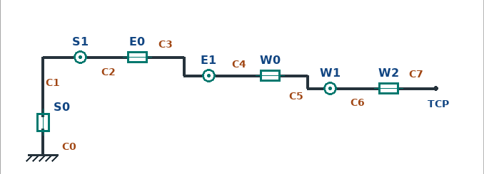

### Q2 — Rotation autour du troisième axe

*Énoncé, feuillet 8 · cahier, page 1.*

Posons $c_u=\cos u$ et $s_u=\sin u$. Le nouvel axe $x$ a pour projections $(c_\theta,s_\theta,0)$ et le nouvel axe $y$ a pour projections $(-s_\theta,c_\theta,0)$. L’axe $z$ est invariant. La matrice qui convertit les coordonnées de $R_1$ dans $R_0$ est
$$R_z(\theta)=\begin{pmatrix}c_\theta&-s_\theta&0\\s_\theta&c_\theta&0\\0&0&1\end{pmatrix}.$$

### Q3 — Rotation autour du premier axe

*Énoncé, feuillet 8 · cahier, page 2.*

L’axe $x$ est invariant. Dans les colonnes 2 et 3, on inscrit les projections de $y_1$ et $z_1$ sur les axes de $R_0$. On obtient
$$R_x(\alpha)=\begin{pmatrix}1&0&0\\0&c_\alpha&-s_\alpha\\0&s_\alpha&c_\alpha\end{pmatrix}.$$

### Q4 — Composition des rotations

*Énoncé, feuillet 8 à 10 · cahier, page 2.*

Pour la convention de la matrice d’attitude du feuillet 10, la conversion depuis le dernier repère passe d’abord par $R_x(\alpha)$, puis par $R_z(\theta)$. La multiplication ligne par colonne donne
$$R_{01}=R_z(\theta)R_x(\alpha)=\begin{pmatrix}c_\theta&-s_\theta c_\alpha&s_\theta s_\alpha\\s_\theta&c_\theta c_\alpha&-c_\theta s_\alpha\\0&s_\alpha&c_\alpha\end{pmatrix}.$$

### Q5 — Translation entre deux origines

*Énoncé, feuillet 8 et 9 · cahier, page 2.*

$\overrightarrow{O_0P}=\overrightarrow{O_0O_1}+\overrightarrow{O_1P}$. Le décalage est de $a$ selon $x_0$ et de $d$ selon $z_0$. Ainsi $T_{01}=(a,0,d)^T$ et $^0P=T_{01}+{}^1P$. Cette expression concerne les translations seules.

### Q6 — Repères de l’épaule

*Énoncé, feuillet 9 et 10 · cahier, page 3.*

Dans la vue de face en pose, $R_0$ a $x_0$ vers la droite, $y_0$ entrant dans la feuille et $z_0$ vers le haut. En S1, $R_1$ a $x_1$ vers la droite, $y_1$ vers le bas et $z_1$ entrant. $R_2$ a la même origine, $x_2$ vers le bas, $y_2$ entrant et $z_2$ vers la droite le long de E0. Les décalages de pose sont $\theta_{01}=0$ et $\theta_{02}=+\pi/2$. Les angles de vrillage valent $\alpha_1=-\pi/2$ et $\alpha_2=+\pi/2$.

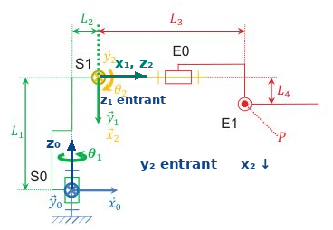

### Q7 — Attitude du premier corps

*Énoncé, feuillet 10 · cahier, page 3.*

Avec $c_i=\cos\theta_i$, $s_i=\sin\theta_i$, on lit $d_1=L_1$, $a_1=L_2$, $\alpha_1=-\pi/2$. Le déplacement horizontal $L_2$ tourne avec le pivot. La transformation homogène vaut
$$M_{01}=\begin{pmatrix}c_1&0&-s_1&L_2c_1\\s_1&0&c_1&L_2s_1\\0&-1&0&L_1\\0&0&0&1\end{pmatrix}.$$

### Q8 — Attitude du deuxième corps

*Énoncé, feuillet 10 · cahier, page 4.*

Avec $a_2=d_2=0$ et $\alpha_2=+\pi/2$, on trouve
$$M_{12}=\begin{pmatrix}c_2&0&s_2&0\\s_2&0&-c_2&0\\0&1&0&0\\0&0&0&1\end{pmatrix}.$$
$\theta_2$ comprend le décalage de pose de Q6.

### Q9 — Composition des deux attitudes

*Énoncé, feuillet 10 · cahier, page 4.*

Le produit ordonné est
$$M_{02}=M_{01}M_{12}=\begin{pmatrix}c_1c_2&-s_1&c_1s_2&L_2c_1\\s_1c_2&c_1&s_1s_2&L_2s_1\\-s_2&0&c_2&L_1\\0&0&0&1\end{pmatrix}.$$
La dernière colonne reste l’origine de $R_1$ car $O_2=O_1$.

### Q10 — Deux calculs de la position du coude

*Énoncé, feuillet 10 · cahier, page 5.*

$^2P=(L_4,0,L_3)^T$. On applique $M_{02}$ au vecteur complété par 1, avec $\theta_1=90°$ et $\theta_2=0°+90°$. Les coordonnées homogènes sont $(0,L_2+L_3,L_1-L_4,1)^T$. Géométriquement, avant la rotation S0, le centre de E1 est décalé de $L_2+L_3$ horizontalement et de $L_1-L_4$ verticalement. Un quart de tour autour de $z_0$ amène l’horizontale sur $y_0$ sans changer la hauteur. Les deux calculs donnent $(0,433{,}35,201{,}35)$ mm.

### Q11 — Butées et symétrie des bras

*Énoncé, feuillet 6 et 11 · cahier, page 6.*

S1 est en pose, donc $q_2=0°$ appartient à l’intervalle de $-123°$ à $+60°$. La ligne S0 est donnée pour le **bras droit**, de $-141°$ à $+51°$. Pour deux bras géométriquement symétriques, les angles d’azimut mesurés autour d’une même verticale orientée sont opposés. L’intervalle du bras gauche dans cette convention va de $-51°$ à $+141°$. Ses $+90°$ correspondent aux $-90°$ du bras droit. La configuration est accessible dans cette hypothèse de symétrie. Appliquer directement la borne droite de $+51°$ à l’angle gauche conduirait à l’autre réponse sans convertir le repère. Les autres articulations restent en pose.

### Q12 — Distance atteignable entre les deux outils

*Énoncé, feuillet 5 à 7 et 11 · cahier, page 6.*

Dans la pose symétrique du feuillet 7, les deux TCP ont la même hauteur. La projection horizontale depuis le plan médian vaut $L+L_2+L_3+L_5+L_7$. Les petits décalages $L_4,L_6$ sont verticaux dans cette pose. L’écartement atteint donc $2(278+69+364{,}35+374{,}29+229{,}525)=2630{,}33$ mm. Le maximum est au moins égal à cette valeur, soit 263,0 cm pour 260 cm exigés.

### Q13 — Interprétation d’une matrice numérique

*Énoncé, feuillet 11 · cahier, page 6.*

Le bloc de rotation est l’identité. L’axe longitudinal de l’outil, $z_7$, pointe donc suivant $+z_0$. La colonne de position donne $x=148=L_2+L_4+L_6$, $y=0$, $z=1238{,}515=L_1+L_3+L_5+L_7$ en millimètres. La somme des longueurs verticales et celle des déports transversaux sont compatibles avec un bras étendu vers le haut. Le déport de 148 mm explique que le TCP soit décalé de l’axe de S0.

### Q14 — Vitesse du centre d’outil

*Énoncé, feuillet 12 · cahier, page 7.*

Posons $u=\theta_4+\theta_6$. Comme $P=O_7$, la dernière colonne donne $x=L_7\sin u+L_6c_4+L_5s_4$, $y=-L_7\cos u+L_6s_4-L_5c_4$, $z=0$. En dérivant,
$$\dot x=L_7\cos u\,(\dot\theta_4+\dot\theta_6)+(-L_6s_4+L_5c_4)\dot\theta_4,$$
$$\dot y=L_7\sin u\,(\dot\theta_4+\dot\theta_6)+(L_6c_4+L_5s_4)\dot\theta_4,\qquad \dot z=0.$$
Pour remplir **la forme imprimée**, dont la première ligne utilise $\dot\theta_6-\dot\theta_4$, il faut $f_1=L_7\cos u$, $f_2=2L_7\cos u-L_6s_4+L_5c_4$, $f_3=L_7\sin u$, $f_4=L_6c_4+L_5s_4$. En développant ce regroupement, on retrouve la dérivée directe.

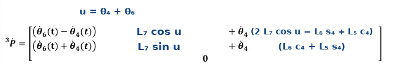

### Q15 — Action d’une matrice antisymétrique

*Énoncé, feuillet 12 · cahier, page 7.*

La multiplication donne $AS(\Omega)K=(\omega_y k_z-\omega_z k_y,\ \omega_z k_x-\omega_x k_z,\ \omega_x k_y-\omega_y k_x)^T$. C’est le produit vectoriel $^3\Omega\times K$, exprimé dans la même base que ses deux facteurs.

### Q16 — Vitesse angulaire de l’outil

*Énoncé, feuillet 12 · cahier, page 8.*

Les première et troisième colonnes de $R_{37}$ tournent dans le plan $(x_3,y_3)$ selon $u$, la deuxième est fixe. On obtient
$$\dot R_{37}R_{37}^T=\begin{pmatrix}0&-\dot u&0\\\dot u&0&0\\0&0&0\end{pmatrix},\qquad {}^3\Omega=(0,0,\dot\theta_4+\dot\theta_6)^T.$$
L’unité est le radian par seconde.

### Q17 — Trajectoire et limites du mouvement simulé

*Énoncé, feuillet 6, 13 et 14 · cahier, page 8.*

$x_3=0$ et $z_3=0$. Le TCP suit la droite $O_3y_3$. Sa coordonnée $y_3$ descend jusqu’à environ $-610$ mm vers 0,4 s, puis repart en sens inverse. Sa vitesse sur cet axe change de signe. Les courbes d’angle du feuillet 13 portent « rad », mais la variation de W1, voisine de 210 unités en 0,92 s à 4 rad/s, correspond à environ 210 **degrés**. On lit W1 d’environ $-90°$ à $+120°$, aux limites du tableau. E1 descend d’environ $+30°$ à $-40°$, sous sa butée de $-3°$. Les vitesses respectent leurs limites, $|\dot\theta_4|$ atteint environ 1,5 à 1,6 rad/s pour 2 permis et $\dot\theta_6=4$ rad/s pour 4 permis. La trajectoire complète est donc incompatible avec la butée du coude.

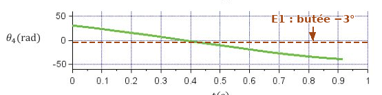

## 2 — Ressort et asservissement en couple

### Q18 — Dimensions minimales du voile de poignet

*Énoncé, feuillet 15 et 16 · cahier, page 9.*

En N et mm, $G=220000/[2(1+0{,}3)]=84615$ MPa et la contrainte admissible vaut $240/2=120$ MPa. Avec $t=1{,}5$ mm et $\theta_{\max}=0{,}06$ rad, $\tau=tG\theta/L$ donne $L\ge tG\theta_{\max}/120=63{,}46$ mm. La raideur du poignet est $k=C/\theta=250000$ N·mm/rad. Donc $h=3kL/(t^3G)$, croissant avec $L$. Au minimum $h=166{,}67$ mm et $L=63{,}46$ mm. On obtient bien $h/t\simeq111\ge20$ et $k\theta_{\max}=15$ N·m.

### Q19 — Profilé en croix

*Énoncé, feuillet 16 · cahier, page 10.*

On assimile la croix à deux voiles minces identiques en parallèle, en négligeant leur petite zone commune et les effets locaux de jonction. La contrainte maximale dans chacun obéit à la même loi en $t,G,\theta,L$ donc $L_{\rm cross,min}=L=63{,}46$ mm. La raideur totale est $2h_{\rm cross}t^3G/(3L)$, d’où $h_{\rm cross}=h/2=83{,}33$ mm et $h_{\rm cross}/t\simeq56$. Le couple de chaque voile est de 7,5 N·m à la torsion maximale. On divise par deux la largeur maximale de la section en conservant la longueur et la raideur. La nouvelle section occupe aussi de la place dans la seconde direction transverse.

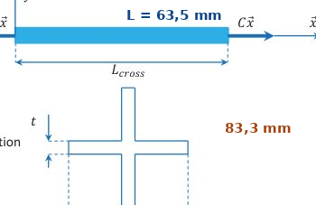

### Q20 — Bilan des moments sur l’inertie

*Énoncé, feuillet 16 et 17 · cahier, page 10.*

Autour de l’axe fixe, le théorème du moment dynamique appliqué à l’inertie équivalente $J_m$ donne $J_m\ddot\theta_m=C_m-k_s(\theta_m-\theta_l)$. Le modèle néglige frottement et amortissement. Le terme élastique ramène l’angle moteur vers celui de la charge.

### Q21 — Couple exercé sur la charge

*Énoncé, feuillet 17 · cahier, page 10.*

L’allongement angulaire du ressort vaut $\theta_m-\theta_l$ et sa raideur est $k_s$. Le couple exercé par le ressort sur la charge est $C_l=k_s(\theta_m-\theta_l)$. Il est positif pour un moteur en avance.

### Q22 — Transmittances du modèle élastique

*Énoncé, feuillet 17 · cahier, page 11.*

En Laplace, $(J_mp^2+k_s)\Theta_m=C_m+k_s\Theta_l$. En reportant dans $C_l$, il vient $C_l=H_m C_m-H_l\Theta_l$, avec
$$H_m=\frac{k_s}{J_mp^2+k_s}=\frac{1}{1+p^2/\omega_0^2},\qquad H_l=\frac{k_sJ_mp^2}{J_mp^2+k_s}=\frac{ap^2}{1+p^2/\omega_0^2}.$$
Ainsi $\omega_0=\sqrt{k_s/J_m}$ et $a=J_m$. Le bloc $H_l$ a un numérateur positif. L’entrée supérieure du sommateur porte le signe moins.

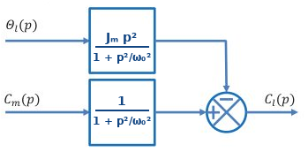

### Q23 — Réponse du ressort lorsque la sortie est bloquée

*Énoncé, feuillet 17 · cahier, page 11.*

Les pôles sont $p_{1,2}=\pm j\sqrt{k_s/J_m}$. Avec une charge bloquée et un départ à l’équilibre, la variation de couple pour un échelon moteur $c_{m0}$ vaut
$$\Delta C_l(t)=c_{m0}[1-\cos(\omega_0 t)]\,U(t).$$
En effet $H_m/p=1/p-p/(p^2+\omega_0^2)$. Le couple oscille sans amortissement autour de la nouvelle valeur moyenne, entre 0 et $2c_{m0}$ si le ressort était initialement détendu. Toute précharge initiale s’ajoute.

### Q24 — Critère d’impédance et résonance

*Énoncé, feuillet 17 · cahier, page 12.*

Avec le $Z=H_l$ affiché dans cette question, $Z(j\omega)=-a\omega^2/(1-\omega^2/\omega_0^2)$ est réel partout où il est défini. Sa partie imaginaire est nulle et aucun pôle n’a de partie réelle strictement positive. C’est le cas limite du critère proposé. À $\omega_0$, l’impédance a un pôle et le critère sur la valeur complexe ne peut être évalué. La réponse libre ne s’amortit pas et une excitation résonante peut croître. Le comportement de l’articulation est donc inacceptable pour un suivi amorti.

### Q25 — Écart permanent avec un correcteur PD

*Énoncé, feuillet 18 · cahier, page 12.*

À position de charge constante, $E/C_{lc}=1/(1+C H_m)$. Avec $C=K_p(1+K_dp)$ et $H_m(0)=1$, l’écart permanent pour un échelon $c_{lc0}$ vaut $c_{lc0}/(1+K_p)$ si la boucle converge. L’action dérivée disparaît en régime permanent. Avec un gain fini, l’exigence d’erreur nulle n’est donc pas satisfaite.

### Q26 — Impédance de la boucle PID

*Énoncé, feuillet 18 · cahier, page 12.*

Le schéma de boucle donne $(1+C H_m)C_l=-H_l\Theta_l$. Ici $Z=C_l/\Theta_l$ désigne le transfert **signé** du dessin. Avec $C=K_p(1+K_i/p+K_dp)$ et en multipliant par $p$,
$$Z=\frac{-ap^3}{p^3/\omega_0^2+K_pK_dp^2+(1+K_p)p+K_pK_i}
=\frac{bp^3}{cp^3+dp^2+ep+1}.$$
On identifie $b=-a/(K_pK_i)$, $c=1/(\omega_0^2 K_pK_i)$, $d=K_d/K_i$, $e=(1+K_p)/(K_pK_i)$. La distinction entre bloc $H_l$ et transfert signé explique le signe de $b$.

### Q27 — Signe de la partie imaginaire

*Énoncé, feuillet 18 · cahier, page 13.*

Pour $\omega>0$, le dénominateur est $D=1-d\omega^2+j(e\omega-c\omega^3)$. Ainsi $\Im Z=-b\omega^3(1-d\omega^2)/|D|^2$. Comme $b<0$, imposer $\Im Z\le0$ donne $d\omega^2\ge1$, soit
$$\frac{K_d}{K_i}\ge\frac{1}{\omega^2}.$$
Les conditions de pôles de l’énoncé restent à satisfaire en parallèle.

### Q28 — Limite aux basses fréquences

*Énoncé, feuillet 18 · cahier, page 13.*

Pour $K_i>0$ et $K_d$ finis, $K_d/K_i$ est une constante. Le membre $1/\omega^2$ croît sans borne lorsque $\omega\to0^+$. L’exigence sur tout le spectre est donc impossible avec ce PID. Un terme intégral à gain continu fini modifie le comportement à basse fréquence.

### Q29 — Choix de la constante du correcteur modifié

*Énoncé, feuillet 18 et 19 · cahier, page 14.*

Pour le réglage des pôles envisagé, $\Im Z=|Z|\sin(\arg Z)$. La phase de $\tau_i=0{,}08$ s reste sur ou sous 0° dans la plage représentée, conformément au critère de stabilité au contact. Pour $0{,}2$ s, elle dépasse 0°, par exemple vers 3 à 4 rad/s. L’impédance a alors une partie imaginaire positive. Ce réglage perd la garantie de stabilité en contact avec tout environnement. La courbe de phase complète le contrôle des pôles présupposé dans la question.

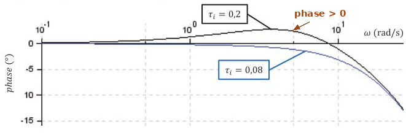

### Q30 — Anticipation de consigne de couple

*Énoncé, feuillet 19 · cahier, page 14.*

Avec $\Theta_l=0$, $C_l=H_m(CE+K_{ff}C_{lc})$, $E=C_{lc}-C_l$. Ainsi $E/C_{lc}=(1-K_{ff}H_m)/(1+C H_m)$. Le correcteur modifié a $C(0)=K_p(1+K_i\tau_i)$ et $H_m(0)=1$, d’où
$$\varepsilon_S=c_{lc0}\frac{1-K_{ff}}{1+K_p(1+K_i\tau_i)}.$$
Le réglage $K_{ff}=1$ annule l’écart en régime permanent dans ce modèle.

### Q31 — Performances de la commande en couple

*Énoncé, feuillet 18 et 20 · cahier, page 15.*

Le saut de 0 à 1 N·m a lieu à 0,050 s. Le premier maximum est d’environ 1,30 N·m, soit 30 % pour 40 % permis. La sortie entre durablement dans la bande 0,95 à 1,05 N·m vers 0,074 à 0,076 s, soit environ 25 ms après la demande pour 40 ms permis. Elle rejoint la consigne de 1 N·m. La perturbation à 0,100 s provoque un creux puis un retour à la même valeur. L’erreur statique lue est nulle et les trois exigences sont satisfaites.

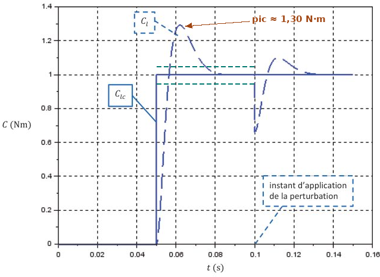

## 3 — Modèle électrique et asservissement de courant

### Q32 — Puissance instantanée triphasée

*Énoncé, feuillet 21 · cahier, page 16.*

Soient $u=\omega_s t$ et $\delta_k=0,-2\pi/3,+2\pi/3$. Chaque produit $v_ki_k$ vaut $VI[\cos\varphi+\cos(2u+2\delta_k-\varphi)]$. Les trois termes de pulsation double s’annulent, car leurs vecteurs sont espacés de 120° modulo un tour. Il reste $p_{\rm tri}=\sum v_ki_k=3VI\cos\varphi$, constant en régime équilibré. $V,I$ sont les valeurs efficaces simples.

### Q33 — Composantes sur deux axes fixes

*Énoncé, feuillet 21 et 22 · cahier, page 17.*

La première ligne donne le facteur $\cos u-\frac12[\cos(u-2\pi/3)+\cos(u+2\pi/3)]=\frac32\cos u$. La seconde donne $\frac{\sqrt3}{2}[\cos(u-2\pi/3)-\cos(u+2\pi/3)]=\frac32\sin u$. Le facteur global $\sqrt{2/3}\sqrt2$ convertit $3/2$ en $\sqrt3$. Ainsi $(v_\alpha,v_\beta)=\sqrt3 V(\cos u,\sin u)$ et $(i_\alpha,i_\beta)=\sqrt3 I(\cos(u-\varphi),\sin(u-\varphi))$. Dans les notations de la question, $K=\sqrt3 V$, $L=\sqrt3 I$, $f=u$, $g=u-\varphi$.

### Q34 — Conservation de la puissance

*Énoncé, feuillet 22 · cahier, page 17.*

$p_{\rm di}=v_\alpha i_\alpha+v_\beta i_\beta=3VI[\cos u\cos(u-\varphi)+\sin u\sin(u-\varphi)]=3VI\cos\varphi$. C’est la puissance instantanée triphasée de Q32, à chaque instant. La normalisation choisie conserve la puissance pour ce système équilibré.

### Q35 — Passage aux axes direct et en quadrature

*Énoncé, feuillet 22 · cahier, page 18.*

Le premier produit donne $\sqrt3 I[\cos\theta\cos g-\sin\theta\sin g]=\sqrt3 I\cos(g+\theta)$. Le second vaut $\sqrt3 I\sin(g+\theta)$. Par suite $(i_d,i_q)=M(\cos h,\sin h)$ avec $M=\sqrt3 I$ et $h=\omega_st-\varphi+\theta(t)$.

### Q36 — Choix d’un angle tournant

*Énoncé, feuillet 22 · cahier, page 18.*

Pour une pulsation constante, prendre $\theta(t)=-\omega_s t+\theta_*$ rend $h=\theta_*-\varphi$ constant. Par exemple $\theta_*=\varphi+\pi/2$ donne $i_d=0$ et $i_q=\sqrt3 I$. Le signe de la vitesse de rotation vient de la matrice imprimée en Q35.

### Q37 — Pulsations électrique et mécanique

*Énoncé, feuillet 22 et 23 · cahier, page 18.*

Pour $P$ paires de pôles, un tour du rotor correspond à $P$ périodes électriques. En dérivant l’angle électrique, on obtient $\omega_s(t)=P\Omega_m(t)$, en rad/s.

### Q38 — Équations des tensions statoriques

*Énoncé, feuillet 22 et 23 · cahier, page 19.*

Avec $\phi_d=Li_d+\phi_f$ et $\phi_q=Li_q$, on trouve
$$v_d=Ri_d+L\dot i_d-\omega_s L i_q,\qquad v_q=Ri_q+L\dot i_q+\omega_s(Li_d+\phi_f).$$
Les tensions comprennent les chutes résistives, les dérivées de flux et les termes liés à la rotation.

### Q39 — Blocs du modèle découplé

*Énoncé, feuillet 23 · cahier, page 19.*

On obtient $v_{d1}=Ri_d+L\dot i_d$ et $v_{q1}=Ri_q+L\dot i_q$. Aux conditions initiales nulles, les deux grands blocs ont le même contenu $I_d/V_{d1}=I_q/V_{q1}=1/(R+Lp)=(1/R)/(1+\tau p)$, avec $\tau=L/R$. Le troisième bloc, de $I_q$ à $C_m$, porte le gain $P\phi_f$, car $C_m=P\phi_f i_q$.

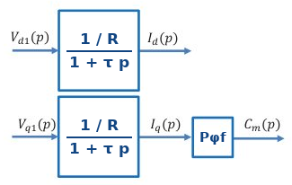

### Q40 — Effet du correcteur proportionnel de courant

*Énoncé, feuillet 23 · cahier, page 19.*

La boucle ouverte vaut $K_p/(R+Lp)$. Pour un échelon d’amplitude $i_{\rm ref,0}$, la rétroaction laisse $\varepsilon_\infty=i_{\rm ref,0}/(1+K_p/R)=Ri_{\rm ref,0}/(R+K_p)$. La boucle est de classe zéro, l’écart demeure non nul pour un gain fini.

### Q41 — Gain d’anticipation de courant

*Énoncé, feuillet 23 · cahier, page 20.*

En écrivant $(R+Lp)I_i=K_p(I_{i,\rm ref}-I_i)+K_{iff}I_{i,\rm ref}$, on obtient
$$\frac{I_i}{I_{i,\rm ref}}=\frac{K_p+K_{iff}}{R+K_p+Lp}=\frac{(K_p+K_{iff})/(R+K_p)}{1+[L/(R+K_p)]p}.$$
Un gain statique unité demande $K_{iff}=R$. Une évolution réelle de $R$ avec la température introduit une erreur si l’anticipation garde la valeur nominale.

### Q42 — Réglage proportionnel-intégral

*Énoncé, feuillet 24 · cahier, page 20.*

Avec $T_i=\tau=L/R$, la boucle ouverte est $K_p/(Lp)$ et la boucle fermée $1/(1+Lp/K_p)$. Son échelon est monotone et atteint la consigne. Comme $\exp(-K_p t_{r5}/L)=0{,}05$, on prend $K_p=L\ln(20)/(5\,{\rm ms})$ pour le temps nominal. Toute valeur donnant un temps entre 4 et 6 ms respecte la tolérance du modèle nominal.

### Q43 — Mesure des temps de réponse du courant

*Énoncé, feuillet 24 · cahier, page 20.*

Les deux courbes finissent à 1 A et restent sous cette valeur. Le premier dépassement est nul et aucun écart statique n’est visible. Le saut a lieu à 2 ms. À 0,95 A les intersections se lisent vers 6,5 à 6,7 ms pour la courbe bleue et 7,0 à 7,2 ms pour la courbe rouge. Les durées correspondantes sont donc environ 4,6 et 5,1 ms. Les deux appartiennent à l’intervalle exigé de 4 à 6 ms.

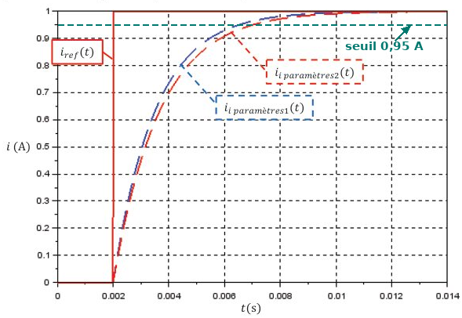

## 4 — Point de fonctionnement du coude

### Q44 — Couple résistant au coude

*Énoncé, feuillet 25 · cahier, page 21.*

On isole avant-bras, outil et pièce. Au point horizontal et à vitesse angulaire constante, le moment dynamique autour de E1 est nul. Le couple moteur compense les moments des poids. Avec $g=9{,}81$ m/s², il faut
$$C_{E1}=g[m_{ab}L_a+m_{op}(L_a+L_b+L_c)]=9{,}81(9\times0{,}35+2\times0{,}65)=43{,}65\ {\rm N\,m}.$$
La valeur approchée avec $g=10$ vaut 44,5 N·m. Le maximum de 50 N·m du motoréducteur couvre ce point, avec environ 6,35 N·m de marge à $g=9{,}81$.

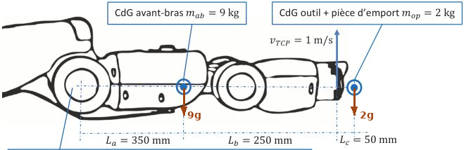

### Q45 — Pulsation au point de fonctionnement

*Énoncé, feuillet 25 et 26 · cahier, page 22.*

Le TCP est à $L_a+L_b=0{,}60$ m de l’axe E1. $\Omega_{E1}=v_{\rm TCP}/0{,}60=5/3$ rad/s. Avec $r=120$, $\Omega_m=r\Omega_{E1}=200$ rad/s, puis $\omega_s=P\Omega_m=800$ rad/s pour quatre paires de pôles. Le déport $L_c$ intervient pour le poids en Q44.

### Q46 — Équation complexe de tension

*Énoncé, feuillet 26 · cahier, page 22.*

En posant $\underline I=I_d+jI_q$, le produit donne $R I_d-\omega_sL I_q+j(R I_q+\omega_sL I_d)$. Le terme supplémentaire de $V_q$ est $\omega_s\phi_f$. On obtient donc $\underline V=(R+j\omega_sL)\underline I+\underline E$ avec $\underline E=j\omega_s\phi_f$.

### Q47 — Construction de Fresnel

*Énoncé, feuillet 26 · cahier, page 23.*

Pour $I_d=0$ et un couple moteur positif, $\underline I=jI_q$ pointe vers $+q$. Les vecteurs $\underline E$ et $R\underline I$ sont verticaux vers le haut. Le vecteur $j\omega_sL\underline I=-\omega_s L I_q$ pointe vers $-d$. En les reportant bout à bout, on obtient $\underline V$ dans le deuxième quadrant. Ses projections sont $-\omega_s L I_q$ et $\omega_s\phi_f+RI_q$.

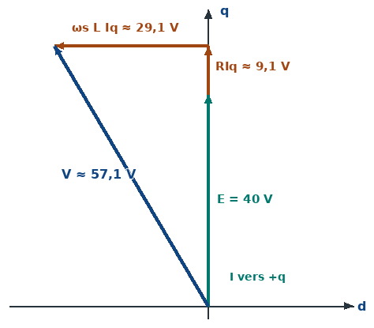

### Q48 — Courant en quadrature

*Énoncé, feuillet 25 et 26 · cahier, page 23.*

Pour un réducteur idéal, $C_m=C_{E1}/120=0{,}3638$ N·m. La constante $P\phi_f=4\times0{,}050=0{,}20$ N·m/A donne $I_q=C_m/(P\phi_f)=1{,}819$ A (environ 1,85 A avec $g=10$). La valeur efficace du courant de phase sera plus faible par le facteur $\sqrt3$ défini dans le texte.

### Q49 — Tension efficace d’une phase

*Énoncé, feuillet 26 · cahier, page 24.*

Avec $I_q=1{,}819$ A, $V_d=-800\times0{,}020\times1{,}819=-29{,}10$ V et $V_q=5\times1{,}819+800\times0{,}050=49{,}09$ V. La diagonale de Fresnel vaut $|\underline V|=\sqrt{29{,}10^2+49{,}09^2}=57{,}07$ V. La tension simple efficace vaut $V=|\underline V|/\sqrt3=32{,}95$ V, soit environ 33 V.

### Q50 — Compatibilité avec le variateur

*Énoncé, feuillet 25 et 26 · cahier, page 24.*

Il faut $f=\omega_s/(2\pi)=127{,}3$ Hz, compris entre 0 et 200 Hz. Le courant efficace de phase $I=I_q/\sqrt3=1{,}05$ A est inférieur à 2 A. Les 32,95 V simples correspondent à environ 57,1 V entre phases en triphasé équilibré, inférieur aux 120 V disponibles même en interprétant la tension de sortie comme composée. Le variateur peut donc alimenter le BLAC à ce point de fonctionnement. La valeur de 60 Hz concerne son entrée secteur.
