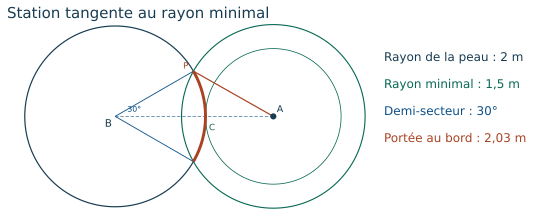
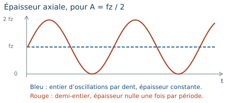
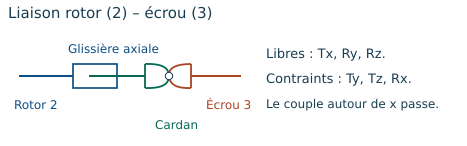
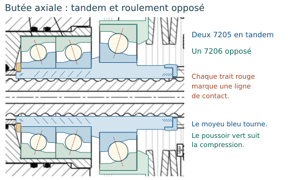
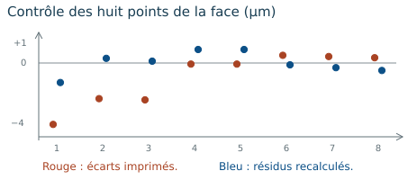

# Banque PT 2021 — Sciences industrielles C · Corrigé brut

*Corrigé rédigé par IA, non officiel. Signalez toute erreur.*

**Rédaction** · GPT-6.2 Astra Ultra · vitesse non renseignée · 26 novembre 2026

**Révision (tour 1)** · GPT-6.2 Astra Ultra · vitesse non renseignée · 26 novembre 2026

**Perçage à assistance vibratoire des structures aéronautiques civiles.** Épreuve de six heures. Les 49 questions portent sur la cellule mobile de perçage-rivetage, la fragmentation du copeau, les actionneurs et le contrôle du coulisseau. Le rapport affiche 20 %, 15 %, 45 % et 15 % pour les quatre parties, soit 95 % au total. La répartition des 5 % restants et les points individuels ne sont pas précisés.

[Sujet et planches](https://www.banquept.fr/documents/2021/si_c_2021_pt.zip) · [Rapport du jury](https://www.banquept.fr/documents/ecrit/rapport/2021/rapport_si_c_ecrit_2021.pdf)

## I. Déplacement de la cellule et contact entre les tôles

### Q1 · Placer le centre de la cellule

Notons B le centre du tronçon, A le centre de la base et C le point de la peau le plus proche de A. Le secteur accessible doit rester entier, depuis son milieu C jusqu’à ses bords. La distance AC doit donc atteindre au moins le rayon intérieur de l’espace de travail. En rapprochant A de la peau jusqu’à la tangence des deux cercles en C, on réduit simultanément les distances aux bords du secteur. On place donc A sur la normale extérieure en C, avec $AB=R_s+R_{min}=2+1,5=3,5$ m. Hachurer la portion de peau intérieure au cercle extérieur et extérieure au cercle intérieur.

### Q2 · Rayon extérieur et longueur du transfert

Les six stations se partagent des secteurs de $360°/6=60°$. Si P est un bord du secteur, l’angle ABP vaut 30°. La loi des cosinus donne $R_{max}=AP=\sqrt{AB^2+R_s^2-2ABR_s\cos30°}=2,031$ m, soit **2,0 m** au dixième. Les centres des bases appartiennent au cercle de rayon AB. Le déplacement rectiligne entre deux stations consécutives est la corde $L=2AB\sin30°=\mathbf{3,5}$ m.

### Q3 · Vitesse maximale

Le moteur peut tourner à 3 000 tr/min. Avec $i_b=1/10$ et $i_d=1/5$, les roues tournent à $N_r=i_bi_dN_M=60$ tr/min en ligne droite. Le rayon de roulement vaut 0,25 m. Sans glissement, $v_{max}=2\pi R N_r/60=1,571$ m/s, soit **1,6 m/s**. Il faut conserver la valeur avant arrondi pour calculer la durée du transfert.

### Q4 · Effort disponible aux roues

À la vitesse angulaire moteur $\omega_M$, la puissance totale transmise au sol vaut $\eta_b\eta_d C_M\omega_M=Fv$ et $v=Ri_bi_d\omega_M$. La force disponible vaut donc **$F=\eta_b\eta_d C_M/(Ri_bi_d)$**. Les deux différentiels sont sur des branches parallèles, si bien que chaque chemin traverse un seul différentiel. L’expression additionne déjà les actions des quatre roues. Avec 31 N·m, 0,87 et 0,92, on obtient environ 4,96 kN.

### Q5 · Accélération du véhicule

La masse totale vaut $M=1250+2440+300=3990$ kg. Les pneus présentent un coefficient de roulement de 8,1 kg/t, soit $c=0,0081$ en rapport de forces. Sur sol horizontal, $F_{RR}=cMg\simeq317$ N. En translation, $Ma_{max}=F-F_{RR}$, d’où **$a_{max}\simeq1,16$ m/s²** avec $g=9,81$ m/s². Les inerties de rotation sont négligées comme l’impose l’énoncé.

### Q6 · Temps et distance d’accélération

Le départ se fait au repos avec une accélération constante. On atteint $v_{max}$ en $t_1=v_{max}/a_{max}\simeq1,35$ s et l’on couvre $d_1=a_{max}t_1^2/2=v_{max}^2/(2a_{max})\simeq1,06$ m. Le freinage symétrique requiert la même distance.

### Q7 · Durée du transfert

Le déplacement restant à vitesse constante est $L-2d_1\simeq1,38$ m, valeur positive qui justifie le palier de vitesse représenté. Le temps total vaut $2t_1+(L-2d_1)/v_{max}=L/v_{max}+v_{max}/a_{max}$. On trouve 3,58 s, soit **3,6 s** au dixième. Ce temps couvre la translation de la base entre les stations.

### Q8 · Effort qui déclenche le basculement

La réaction horizontale de la structure sur le foret est dirigée vers le robot, selon $+x$. Les appuis avant, du côté de la structure, se déchargent. À la limite, calculer le moment autour de la ligne des deux plots opposés, en $x=+1,2$ m. Le bras de levier de la poussée est $2,2+0,2=2,4$ m depuis le sol en position de travail. Les trois bras de levier des poids valent 1,2, 1,8 et 2,4 m. Ainsi $2,4F_p=g(1250\times1,2+2440\times1,8+300\times2,4)$. L’effort limite est **27,0 kN** avec $g=9,81$ m/s², soit environ 27,6 kN si l’on prend 10 m/s². Un effort inférieur maintient les deux rangées de plots en appui dans ce modèle rigide.

### Q9 · Formation du défaut entre les tôles

Au débouché de la première tôle et pendant l’attaque de la seconde, la poussée fléchit la tôle inférieure loin de la supérieure. Le jeu ouvert à l’interface permet la formation d’une bavure de sortie ou l’insertion de copeaux. Une fois les efforts relâchés, ces reliefs empêchent un placage correct des peaux pour le rivetage. Un nez presseur qui accoste d’abord les tôles puis maintient la position pendant le perçage peut conserver un effort de contact positif à l’interface.

### Q10 · Déformation d’accostage

Avant l’entrée du foret, les tôles restent jointives et leurs ressorts subissent le même déplacement local $\Delta L$. L’équilibre de l’ensemble donne $F_{acc}=k_1\Delta L+k_2\Delta L$, donc **$\Delta L=F_{acc}/(k_1+k_2)$**. Les ressorts de flexion modélisent deux liaisons distinctes à la structure.

### Q11 · Action de la deuxième tôle sur la première

Isoler la tôle 2 pendant l’accostage. Son ressort exerce une force $k_2\Delta L$ vers la première tôle et le contact de 1 sur 2 s’y oppose. Par action réciproque, la force de 2 sur 1, dirigée vers le nez, a pour norme **$F_{2\to1}=k_2 F_{acc}/(k_1+k_2)$**. Avec les raideurs proposées, la fraction vaut 0,6.

### Q12 · Force d’accostage minimale

Pendant le perçage de 2, le nez est immobilisé et, tant que le contact subsiste, $\Delta L$ garde sa valeur. L’équilibre de la tôle 2 donne $F_{1\to2}=k_2\Delta L-F_{p2}\geq0$ en norme algébrique dans le sens de poussée. À la limite, $F_{acc,min}=(1+k_1/k_2)F_{p2}=5F_{p2}/3$. La courbe supérieure de VI et sa loi $513D^{0,84} f^{0,77}$, avec D en mm et f en mm/tr, donnent environ **2,25 kN** pour le titane, D = 25,4 et f = 0,2. La précharge limite est donc **3,75 kN**, à dépasser pour conserver un contact strictement comprimé.

## II. Cinématique de la fragmentation du copeau

### Q13 · Avance et épaisseur en coupe classique

Avec N en tr/min et f en mm/tr, la vitesse axiale vaut $v_a=Nf/60$ en mm/s. À une même position angulaire, deux dents successives passent à un intervalle $r=60/(zN)$ secondes. L’épaisseur axiale enlevée vaut $h=v_ar=f/z=f_z$. Il s’agit de la définition géométrique d’épaisseur adoptée par la ressource IX.

### Q14 · Épaisseur pendant une oscillation

L’arête précédente a laissé une surface à la position $x(t-r)$. La différence de positions vaut $h_g(t)=x(t)-x(t-r)=v_ar+A[\sin(\omega t)-\sin(\omega(t-r))]$, où $\omega=\omega_{osc}$. Dès que cette épaisseur géométrique devient négative, l’outil sort de la matière et l’épaisseur physique enlevée est nulle dans cet intervalle.

### Q15 · Introduire les oscillations par passage de dent

Avec $f_{rot}=N/60$ et $\eta=f_{osc}/(zf_{rot})$, on a $\omega r=2\pi\eta$. Appliquer la formule de différence des sinus à Q14. Il vient **$h_g(t)=f_z+2A\sin(\pi\eta)\cos(\omega t-\pi\eta)$**. L’oscillation d’épaisseur dépend autant du déphasage entre les deux passages que de l’amplitude du déplacement.

### Q16 · Condition de fragmentation

La valeur minimale sur une période vaut $f_z-2A|\sin(\pi\eta)|$. Elle atteint zéro ou passe en dessous exactement lorsque **$(2A/f_z)|\sin(\pi\eta)|\geq1$**. À l’égalité l’épaisseur s’annule à un instant. Au-delà, il existe un intervalle de dégagement. Pour un entier d’oscillations par dent, les deux profils sont en phase et aucune amplitude finie ne fragmente le copeau dans ce modèle.

### Q17 · Amplitude minimale et fréquence correspondante

Puisque $|\sin(\pi\eta)|\leq1$, le plus petit déplacement crête capable de satisfaire Q16 est **$A_{min}=f_z/2$**. Il est atteint aux demi-entiers $\eta=k+1/2$, avec $k=0,1,2,\ldots$ pour une fréquence positive. Les positions de deux dents consécutives sont alors en opposition de phase. Avec deux dents, l’amplitude minimale correspond au quart de l’avance par tour.

## III. Mécanisme, actionneurs et butée tournante

### Q18 · Passer de la nomenclature aux classes du schéma

La classe **1** est le rotor de rotation E du moteur M1, son arbre et la douille de guidage M serrée dans l’arbre. **2** est le rotor d’avance C du moteur M2. **3** est l’écrou à billes J, entraîné en rotation par C au travers du flector B. **4** est la vis à billes K. **5** est l’axe de l’effecteur L avec le porte-outil F et le foret N. La vis et cet axe sont assemblés rigidement, comme l’indique le symbole de fixation entre 4 et 5. **6** est le coulisseau O de l’actionneur piézoélectrique. I désigne la liaison de butée entre O et J. Le bâti, les stators, le nez H et le tube G ne sont pas des classes mobiles dans ce modèle. B et l’élément piézoélectrique A se déforment.

### Q19 · Hyperstatisme du schéma initial

Regrouper 4 et 5 en un seul solide donne cinq classes mobiles. La boucle met en jeu deux pivots au bâti (1/0 et 2/0), trois glissières axiales (6/0, 3/2 et 5/1), une hélicoïdale (4/3), et une butée en appui plan de normale x (3/6). Les six liaisons à un degré de liberté transmettent chacune cinq inconnues et l’appui plan en transmet trois, soit 33 au total. Les trois mouvements indépendants sont les rotations des deux rotors et la translation du coulisseau. On obtient **$h=33-6\times5+3=6$**. Compter 4 et 5 séparément ajoute six équations et six contraintes d’encastrement.

### Q20 · Conséquences de l’hyperstatisme

Les liaisons redondantes permettent de répartir les efforts et d’accroître la rigidité et la tenue de l’axe sous les poussées de perçage. En contrepartie, des défauts de coaxialité ou les dilatations peuvent créer des charges avant mise en service, des frottements et de l’usure. La statique du solide rigide seule ne suffit plus à répartir les efforts. Il faut la compatibilité géométrique et les raideurs du montage.

### Q21 · Modéliser le flector

La ressource XIII impose 0,1 mm axialement et 10° autour d’un axe radial, avec des réactions très modestes (environ 3,8 N axialement et 1,1 N·m autour de l’axe radial essayé). La pièce mince comporte trois points de fixation répartis autour de l’axe, qui permettent d’admettre une souplesse de basculement suivant les deux directions radiales. Conserver la transmission du couple moteur autour de x et le centrage transversal, tout en autorisant $T_x,R_y,R_z$. Sur la liaison 2/3, un **cardan centré en série avec la glissière axiale** représente ces trois mobilités. Un simple joint de rotule laisserait aussi libre la rotation de commande autour de x.

### Q22 · Hyperstatisme après modification

La liaison initiale imposait cinq contraintes. Le flector idéalisé conserve les forces transversales et le couple autour de x, soit trois contraintes. Le guidage des pièces continues conserve les trois mouvements utiles et aucune mobilité interne supplémentaire n’est créée. Le degré devient **$h=6-(5-3)=4$**. Ce calcul traite les très petites raideurs de flexion comme des libertés cinématiques.

### Q23 · Autres moyens de réduire la redondance

L’appui plan 3/6 transmet un effort axial et deux couples de basculement. Une butée auto-alignante dont la résultante passe par l’axe peut être modélisée par une ponctuelle axiale, supprimant ces deux couples tout en transmettant la précharge. Autre possibilité, l’entraînement 1/5 doit surtout transmettre le couple. Un accouplement coulissant et tolérant le désalignement peut éviter de reguider les inclinaisons déjà imposées par la vis. Chaque liberté ajoutée doit rester compatible avec le centrage radial du foret et la transmission de la poussée. Le contrôle consiste à recompter les mobilités sur le schéma modifié.

### Q24 · Vitesse d’avance différentielle

Le schéma XII imprime $V_{4/3}=pN_{4/3}$ suivant $+x$. Avec le piézo bloqué, l’écrou 3 ne se translate pas. Il tourne à $N_2$ alors que 4, solidaire de 5, tourne à $N_1$. On obtient **$V_{5/0}=p(N_1-N_2)$** en mm/min, ou $p(N_1-N_2)/60$ en mm/s. Deux vitesses égales produisent une rotation de l’outil sans avance.

### Q25 · Consigne de vitesse de M2

Une avance f par tour impose $V_{5/0}=fN_1$ en mm/min. La vitesse du moteur d’avance doit donc être **$N_2=N_1(1-f/p)$**. Les deux moteurs tournent dans le même sens lorsque $0<f<p$, le rotor d’avance étant le plus lent selon la convention de la ressource XII.

### Q26 · Résolution des codeurs

Un tour relatif déplace la vis de 5 mm. Un incrément relatif de 0,01 mm correspond à $0,01/5=1/500$ tour, donc au moins **500 points comptés par tour sur chaque codeur**. Cette résolution se mesure en incréments exploités. Si l’électronique compte quatre fronts par période électrique, 125 périodes par tour fournissent 500 points.

### Q27 · Position sous modulation du moteur d’avance

Substituer $N_2^*=N_2+N_{osc}\cos(\omega t)$ dans Q24. En secondes, $\dot x=fN_1/60-(pN_{osc}/60)\cos(\omega t)$. Son intégrale vaut **$x(t)=x(0)+(fN_1/60)t-[pN_{osc}/(60\omega)]\sin(\omega t)$**. Le signe moins fixe la phase du déplacement par rapport à la modulation du moteur M2.

### Q28 · Consignes qui produisent la fragmentation minimale

La fréquence imposée est $f_{osc}=zN_1/120$, soit **$\omega_{osc}=\pi zN_1/60$** rad/s. Avec Q27, $A=pN_{osc}/(60\omega_{osc})$. Poser $A=f/(2z)$ donne **$N_{osc}=\pi f N_1/(2p)$** en tr/min. Pour deux dents la fréquence d’oscillation est la fréquence de rotation de l’outil.

### Q29 · Course d’un piézo préchargé

Mesurer la position depuis l’équilibre sous précharge à tension nulle. En régime lent, l’accroissement d’excitation $F_e=k_p n d_{33}U$ équilibre les forces élastiques supplémentaires $(k_p+k)x$. Entre 0 et la tension maximale, la course est donc **$\Delta x=[k_p/(k_p+k)]\Delta L_{libre}$**, avec $\Delta L_{libre}=nd_{33}U_{max}=130$ µm. La précharge initiale fixe un point de fonctionnement et disparaît de la variation de course.

### Q30 · Raideur des ressorts de précharge

Pour que le facteur $1/(1+k/k_p)$ reste proche de l’unité, il faut **$k\ll k_p$**, ici $k_p=150$ N/µm. Une grande force de précharge reste possible avec une faible raideur si le ressort dispose d’une déflexion initiale suffisante.

### Q31 · Maintien du contact pendant l’oscillation

Compter positif le mouvement qui éloigne la masse de l’actionneur. Avec une précharge presque constante P et en l’absence d’un effort extérieur qui accentuerait le décollement, la réaction de contact vaut $F_c=P+m\ddot x$. Son minimum est $P-mA\omega^2$. À la limite, **$P_{min}=mA(2\pi f_{osc})^2$**. Pour 4 kg, 40 µm et 300 Hz, on obtient 568,5 N, soit **570 N** à 10 N près. La valeur de montage de 8 kN utilisée dans l’étude de butée dépasse cette exigence dynamique simplifiée.

### Q32 · Fréquence propre et domaine utile

Pour $k\ll k_p$, la fréquence propre non amortie vaut $f_0=(1/2\pi)\sqrt{k_p/m}$. Avec $k_p=1,5\times10^8$ N/m et $m=4$ kg, on trouve **975 Hz** environ, d’où un tiers de la fréquence propre voisin de 325 Hz. La consigne de 300 Hz respecte cette limite. La course crête à crête demandée est 80 µm, inférieure à 130 µm de course libre, et Q31 donne la compression dynamique minimale. Ces deux vérifications permettent l’oscillation autour d’une position moyenne dans le modèle du sujet.

### Q33 · Identifier les convertisseurs B2 et B3

Dans la ressource XVII, **B2 est le demi-pont hacheur** relié au bus continu et à l’inductance de sortie. Les commandes PWM complémentaires des deux interrupteurs font varier la valeur moyenne de la tension appliquée au piézo et permettent la circulation du courant lors de sa charge et de sa décharge. **B3 est le pont de Graetz** à quatre diodes, à l’entrée de B1. Il redresse les deux alternances du secteur avant le filtrage et l’étage de conversion qui alimente le bus.

### Q34 · Inductance du filtre

La fréquence propre du filtre du second ordre est $f_F=1/(2\pi\sqrt{L_F C_p})$. Pour $C_p=3$ µF et $f_F=3000$ Hz, $L_F=1/[(2\pi f_F)^2C_p]=0,938$ mH, soit **0,9 mH** au dixième. Il s’agit de la pulsation propre convertie en hertz. Une faible valeur d’amortissement déplace le point de coupure à −3 dB.

### Q35 · Amortissement par la résistance série

Pour la tension aux bornes de la capacité, le dénominateur du filtre est $1+RC_ps+L_FC_ps^2$. Identifier $2\zeta/\omega_F=RC_p$ conduit à **$R=2\zeta\sqrt{L_F/C_p}=8,84$ Ω** pour $\zeta=0,25$. Cette valeur désigne la résistance série totale, y compris celle du bobinage.

### Q36 · Fréquence de découpage

Une atténuation de −40 dB vaut un rapport d’amplitudes de 0,01, soit environ 10 V par composante de 1 000 V avant filtrage. L’asymptote d’ordre deux décroît de 40 dB par décade et donne **environ 30 kHz**. Plus précisément, avec $r=f/f_F$, $|H|^{-2}=(1-r^2)^2+(2\zeta r)^2$. Poser cette quantité égale à $10^4$ donne $r\simeq10,04$, soit environ 30,1 kHz. Un découpage plus rapide accentue le rejet dans ce modèle.

### Q37 · Vérifier les trois roulements choisis

Le logement de O est un alésage Ø52 avec tolérance de 0 à +0,006 mm. Les deux **7205 CD/HCP4A** mesurent 25 × 52 × 15 mm et peuvent tourner à 38 000 tr/min. Leur limite publiée est 7 kN par roulement. Deux roulements appariés en tandem reçoivent idéalement environ 4 kN chacun pour 8 kN. En face, le **7206 AC/CBM**, 30 × 62 × 16 mm, est donné pour 27 kN et 15 000 tr/min. Il satisfait tout juste au régime maximal annoncé. Son logement Ø62 appartient à la pièce d’appui distincte du coulisseau Ø52. Les butées XVIII restent sous 4 800 tr/min, les rouleaux coniques XIX sous 13 000 tr/min. La seconde série de catalogues est en **XIX**. Le renvoi à XXI en Q37 mène en réalité au tableau de métrologie.

### Q38 · Compléter la butée entre O et J

Les deux rangées Ø25 prennent place côte à côte dans O, les faces appariées dans le même sens. Une pièce tournante tubulaire, solidaire de l’écrou J par un appui et une fixation démontable, traverse les trois bagues intérieures. Elle possède une portée Ø25 puis une portée Ø30, un épaulement intermédiaire et un arrêt axial démontable. Son passage central reste libre pour la vis K. Les bagues extérieures Ø52 transmettent la charge à l’épaule du coulisseau O. À droite, un poussoir annulaire non tournant, guidé axialement, reçoit la bague extérieure Ø62 du 7206 et l’appui des Belleville. La précharge ferme le chemin entre le bâti, les ressorts, le poussoir, le roulement opposé, le moyeu tournant et la paire portée par O. La planche complétée montre les appuis de faces, les dégagements et les orientations.

### Q39 · Orienter les lignes de poussée

Les deux 7205 travaillent **en tandem**. Leurs centres de poussée sont reportés du même côté de chaque rangée. Une charge de 8 kN dépasse les 7 kN admissibles par un seul 7205, d’où l’intérêt d’une reprise partagée. Un montage opposé de ces deux seuls roulements chargerait principalement une seule rangée dans ce sens. Le 7206 travaille **en opposition au tandem**. Sur la demi-coupe supérieure ses lignes de contact ont donc une inclinaison inverse. Les Belleville maintiennent ainsi les contacts fermés, tout en permettant la rotation de J par rapport à O.

### Q40 · Disposer les Belleville en série

Des rondelles opposées en série portent chacune le même effort et leurs déflexions s’ajoutent. Pour n rondelles identiques à raideur tangentielle individuelle $k_w$, la raideur locale est approximativement $k_w/n$. Le montage dispose ainsi d’une course compatible avec les oscillations et sa force varie peu autour des 8 kN préétablis. Un empilage emboîté en parallèle additionnerait les efforts pour une même flèche et donnerait approximativement $nk_w$, ce qui réduirait la course utile du piézo.

## IV. Fabrication et contrôle du coulisseau O

### Q41 · Remplir les trois grilles GPS

**Perpendicularité 0,02 à A.** L’élément tolérancé est la face annulaire extérieure désignée sur la coupe XX. La surface de référence extraite est le cylindre extérieur Ø56. Le cylindre idéal associé à cette portée extérieure, au contact de la matière, définit l’axe A. La zone est comprise entre deux plans parallèles espacés de 0,02 mm et perpendiculaires à A. Leur position suivant A reste libre. La totalité de la face extraite doit être à l’intérieur.

**Planéité 0,01.** La même face extraite doit être contenue entre deux plans parallèles espacés de 0,01 mm, libres en position et en orientation. Aucun élément de référence n’est utilisé.

**Battement circulaire axial 0,03 à A.** La face annulaire interne d’épaulement, au fond de l’alésage Ø52, est examinée rayon par rayon. À chaque rayon, la ligne circulaire extraite doit rester entre deux cercles coaxiaux d’axe A, de même rayon, décalés axialement de 0,03 mm. Sur un tour autour de A, la variation maximale indiquée par un comparateur axial doit rester au plus égale à 0,03 mm à **chaque** rayon. Rien n’impose une même position axiale à toutes les zones circulaires. Les trois grilles sont complétées sur les fonds des pages 23 et 24 du cahier réponse.

### Q42 · Cémentation et durcissement superficiel

La cémentation enrichit en carbone la couche extérieure d’un acier à cœur peu carburé. À température d’austénitisation, le carbone fourni par le milieu diffuse depuis la surface, puis une phase de diffusion ajuste le profil recherché. La trempe qui suit transforme l’austénite de cette couche en martensite dure. Le cœur, moins riche en carbone, conserve davantage de ténacité. Un revenu adapté réduit les contraintes de trempe. Un durcissement purement superficiel peut également résulter d’une austénitisation localisée suivie d’un refroidissement rapide, sans changer la composition. Il faut conserver suffisamment de couche fonctionnelle lors des finitions.

### Q43 · Sélectionner une gamme admissible

**Gamme 1, oui.** Ébaucher, cémenter et tremper avant la finition permet de corriger les déformations thermiques. Finir les portées extérieures et intérieures dans la même mise en position protège leur axe commun et le battement des faces. Prévoir une surépaisseur de finition compatible avec la profondeur durcie et un procédé apte à travailler l’acier trempé.

**Gamme 2, non telle que proposée.** La trempe suit la finition. Les dimensions, la rectitude des portées, la planéité et le battement peuvent varier sans reprise ultérieure. **Gamme 3, sous condition de reprise qualifiée.** La finition se fait après trempe mais la pièce est retournée entre extérieurs et intérieurs. Le défaut de reprise se cumule aux défauts d’usinage et menace le battement à 0,03 mm par rapport à A. La gamme, sans définition ni qualification de cette reprise, ne garantit pas le dessin. Une reprise de précision sur la portée A finie et une vérification du budget de défauts pourraient la rendre admissible. Sur le document réponse, retenir la première gamme sans condition de reprise supplémentaire.

### Q44 · Fermeture vectorielle au point de mesure

Soient $P_i$ le point du plan initial, $P'_i$ son image par le petit déplacement, et $M_i$ le point mesuré. Par Chasles, $\overrightarrow{P'_i M_i}=\overrightarrow{P_iM_i}-\overrightarrow{P_iP'_i}$. Si $\vec d_i=\overrightarrow{P_iP'_i}$ et n est la normale au plan associé, l’écart signé est **$e_i=(\xi_i\vec y-\vec d_i)\cdot\vec n$**. Au premier ordre on peut remplacer la normale par la normale initiale y dans ce produit des petits écarts.

### Q45 · Identifier les déplacements qui changent le plan

Une translation parallèle au plan initial xz ou une rotation autour de sa normale y ne modifie pas le plan géométrique. Les variables utiles sont sa translation v suivant y et, en général, ses basculements autour de x et z. Les hauteurs mesurées sont semblables de part et d’autre suivant z, avec des hauteurs égales dans chaque paire latérale proche de la même abscisse. Le modèle demandé néglige la pente suivant z, soit $\alpha=0$, et conserve seulement v et $\gamma$ autour de z. Les rotations sont petites et les produits de deux petits déplacements sont négligés. Une mesure quelconque de face pourrait nécessiter les deux pentes.

### Q46 · Résidu après déplacement

Transporter le torseur depuis O. La composante normale de $\vec d_i=v\vec y+\gamma\vec z\times(x_i\vec x+z_i\vec z)$ vaut $v+\gamma x_i$. D’où **$e_i=\xi_i-v-\gamma x_i$**. Utiliser la même unité pour $\xi_i$, v et $\gamma x_i$. Avec les x en millimètres et les mesures en micromètres, la pente calculée est d’abord en µm/mm.

### Q47 · Équations normales

Le minimum de $W=\sum_i (\xi_i-v-\gamma x_i)^2$ vérifie $\sum_i e_i=0$ et $\sum_i x_i e_i=0$. En ordonnant les inconnues par $\gamma,v$, le système est

$$\begin{pmatrix}\sum x_i^2&\sum x_i\\ \sum x_i&8\end{pmatrix}\begin{pmatrix}\gamma\\v\end{pmatrix}=\begin{pmatrix}\sum x_i\xi_i\\\sum\xi_i\end{pmatrix}.$$

La dispersion non nulle des abscisses rend la matrice inversible. Le premier membre utilise les sommes sur les huit points, y compris les deux points d’abscisse nulle.

### Q48 · Pente et translation à partir des huit relevés

Le premier tableau de XXI donne les abscisses −17, −16, −15, 0, 0, 15, 16 et 17 mm et les hauteurs −2, 0, 0, 4, 4, 6, 6 et 6 µm. On lit $\sum x_i=0$, $\sum x_i^2=1540$ mm², $\sum\xi_i=24$ µm et $\sum x_i\xi_i=322$ mm·µm. Les deux équations se découplent. **$v=3,00$ µm et $\gamma=322/1540=0,20909$ µm/mm**, soit $2,091\times10^{-4}$ rad. Le tableau intitulé « optimisé » sur la même feuille ne résulte pas de ce calcul. Aux points 4 et 5, où x vaut zéro, il annonce −0,08 µm tandis que les mesures brutes donnent $4-3=1$ µm. Ce constat peut se vérifier sans arrondir la pente.

### Q49 · Contrôle de planéité

Avec les résidus imprimés que la question demande d’exploiter, les extrêmes sont −4,55 et +0,57 µm. L’amplitude vaut **5,12 µm**, sous 0,01 mm soit 10 µm. En repartant des mesures brutes avec Q48, les résidus sont environ −1,45, +0,35, +0,14, +1,00, +1,00, −0,14, −0,35 et −0,55 µm. L’amplitude recalculée est **2,45 µm**. Les deux lectures permettent donc d’encadrer les huit points dans la zone imposée. Le minimum des moindres carrés et le minimum de largeur entre deux plans parallèles sont des critères distincts. Ici, exhiber un encadrement de largeur inférieure à la tolérance suffit pour les points contrôlés.

