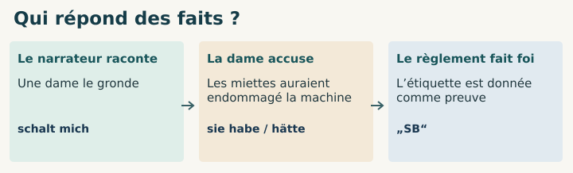

# BEL A/L — Allemand (thème Lyon) 2021 · Corrigé guidé

*Corrigé rédigé par IA, non officiel. Signalez toute erreur.*

**Rédaction** · GPT-6.2 Astra Ultra · vitesse non renseignée

[Feuillet officiel, p. 8](https://www.ens-lyon.fr/sites/default/files/2021-10/Epreuves-de-Specialite.pdf#page=8) · [Rapport du jury, p. 8–18](https://www.ens-lyon.fr/sites/default/files/2021-11/ALLEMAND_2021.pdf#page=8)

Maylis Besserie, Le Tiers Temps (2020). Thème de quatre heures, sans dictionnaire. Trois paragraphes, de « Hier, alors que » au pantalon étiqueté « SB ». La graphie de l’étiquette et celle de l’article sont vérifiées sur le feuillet.

Le narrateur se fait réprimander pour avoir laissé des biscottes dans son pantalon. À mesure que l’accusation se précise, la maison de retraite devient un tribunal dont la pièce à conviction tient en deux initiales.

## Préparer la traduction

**Que change le passage de « Hier » à « me dit-elle » ?**

Le narrateur atteste avoir été grondé. Il rapporte ensuite le récit des dégâts tel que la dame le lui présente. Le prétérit *schalt* ancre la scène, le Konjunktiv I (*sei*, *habe*) signale l’accusation. Au milieu, les mots cités du règlement gardent l’indicatif. La réflexion sur les deux prénoms interrompt le récit au présent.

**Quels dégâts ont eu lieu dans la version de la dame ?**

Elle tient pour acquise la présence de miettes sur les vêtements. La machine, elle, a failli être abîmée. *Hätte … beschädigt, wenn … nicht … gereinigt hätte* marque un irréel passé, distinct du Konjunktiv de discours rapporté. Dans l’incise sur le manque de temps, la dame s’adresse au résident au vouvoiement allemand, *stellen Sie sich einmal vor*.

**Comment faire entendre le procès jusqu’au bout ?**

Conserver la chaîne *Prozess – Staatsanwältin – Beweis – Vergehen*. Le personnel marque les vêtements, pratique dont la dame tire son argument final. Sur le feuillet, le premier caractère de « I2.2 » est un trait vertical à empattements, juste devant le 2. Le rapport imprime « I.2.2 » et ajoute des points aux initiales. Ici on conserve la ponctuation du feuillet et son étiquette « SB ».

## Proposition de thème

Gestern, als die ersehnte Stunde für den Spaziergang gekommen war und ich gerade in meine Jacke schlüpfen wollte, schalt mich – da war ich wieder ein Kind – eine gewisse „Jacqueline“ (es sei denn, es war Catherine, ich bringe die beiden Vornamen leicht durcheinander). Jedenfalls warf mir die Dame vor, und damit begann mein Prozess, ich hätte den Zwieback vom Frühstück in meine Hosentaschen gestopft. Eine abscheuliche Marotte. Ich äße zu wenig und trüge zu einer „skandalösen“ Verschwendung bei, sagte sie mir. Obendrein habe der Zwieback in meinen Taschen eine ganze Reihe von Unannehmlichkeiten verursacht, deren Folgen ich offenbar unterschätze und über die man mich im Einzelnen aufklären müsse.

Da die Hausordnung vorsehe, dass „die persönliche Wäsche im Haus gewaschen und gebügelt wird“, sei meine mit Zwieback vollgestopfte Hose mitten in der Wäsche der anderen gelandet, ohne dass man vorher die Taschen durchsucht habe (aus Zeitmangel, sagte sie, „stellen Sie sich einmal vor, wir müssten das bei allen tun“, und so weiter und so fort). So habe meine Hose die Lumpen meinesgleichen mit Brotkrümeln beschmutzt und hätte zweifellos die praktisch neue Waschmaschine des Tiers-Temps beschädigt – sie sei ja erst vor wenigen Monaten angeschafft worden –, wenn die Reinigungskraft nicht hinterher die Filter gründlich gereinigt hätte. Das sei unverzeihlich und dürfe sich nicht wiederholen.

Nachdem mir aufgegangen war, wie schwer die Verfehlung wog, deren ich mich unversehens schuldig gemacht hatte, und da ich keinen anderen Ausweg sah, war ich fest entschlossen, mich in aller Form zu entschuldigen. Leider kam ich nicht dazu. Die Staatsanwältin hatte sichtlich Freude am Streit und war jetzt in Fahrt. Sollte mich etwa die Lust ankommen, ihre Anschuldigungen anzuzweifeln, so gebe sie mir zu bedenken, dass ja die persönliche Wäsche sorgfältig mit den Namen der Heimbewohner gekennzeichnet sei (Artikel I2.2 der Hausordnung im Kapitel „Wäsche und sonstige Bedarfsartikel“). Mit der Hose, die das Etikett „SB“ trage, halte sie also den unwiderlegbaren Beweis für mein Vergehen in Händen.

Maylis Besserie, *Der dritte Lebensabschnitt* (2020).
