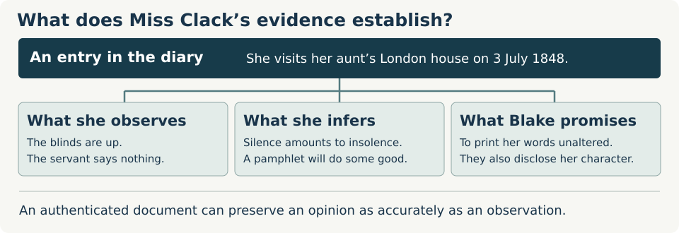

# BEL A/L — Anglais (commentaire et traduction) 2021 · Corrigé brut

*Corrigé rédigé par IA, non officiel. Signalez toute erreur.*

**Rédaction** · GPT-6.2 Astra Ultra · vitesse non renseignée

**Lecture du rapport du jury** · GPT-6.2 Astra Ultra · vitesse non renseignée

Wilkie Collins, *The Moonstone* (1868). Miss Clack contribue au recueil de témoignages réuni par Franklin Blake après le vol d’un diamant. Le commentaire se rédige en anglais sur tout l’extrait. La version porte sur les lignes 16 à 33, depuis « When we are isolated… » jusqu’à « …worthy of her hire. ».

[Sujet officiel, pages 4 et 5](https://www.ens-lyon.fr/sites/default/files/2021-10/Commentaire-et-traduction-en-LVE.pdf#page=4) · [Rapport du jury, pages 1 à 13](https://www.ens-lyon.fr/sites/default/files/2021-11/ANGLAIS_2021.pdf#page=1)

## Commentaire en anglais

### The witness who gives herself away

The headings promise a discovery of the truth and announce a first narrative by a named contributor. The first truth Miss Clack offers is that she has always folded her clothes. Readers of a detective story might reasonably wonder when the investigation will begin. Yet those clothes already bear on a question the investigation must answer. What habits make someone a reliable recorder of facts, and what other habits might make the same person an extraordinarily unreliable judge? In this opening to a new section of *The Moonstone*, Wilkie Collins makes the distinction both a source of comedy and a condition of reading the evidence.

The account of childhood advances with almost mechanical regularity. Clothes, diary and hymn form a sequence in which each item seems to guarantee the position of the next. The repeated “invariably” does something more than describe a routine. It makes the reader experience its rhythm and momentarily accept its logic. A record written every evening really would have an advantage over a distant recollection. But the hymn no longer ensures the promised sweet sleep. The half-stifled news of her father’s ruin also interrupts the orderly chain. What Miss Clack calls her humble interests include an actual need to earn money. Her attachment to an older routine marks a loss of security as well as an inflexible disposition. The poverty is no more imaginary than the diary.

In Brittany the proportions of the world alter according to the speaker. An English Protestant congregation becomes a faithful remnant on its own Patmos. The surrounding Catholic country swells into a threatening ocean. The inexpensive market is nevertheless an asset of scarcely lesser standing than the minister. Collins lets two scales of value coexist in one grammatically balanced description. The letter from Franklin Blake exposes another difficulty of maintaining the division between spirit and money. The passive constructions and repeated “I am to” make the commission sound increasingly like an imposition. At the climax the person who takes the cheque all but disappears from her own sentence. Christian humility wins the struggle and self-denial accepts the payment. The virtues would make most unusual signatories to a receipt. Her biblical description of the labourer entitled to wages has genuine force, given her position, but she also uses it to make resentment and self-interest sound impeccably charitable.

Franklin’s footnote changes who can be heard defending the evidence. Miss Clack imagines that her employer might suppress an inconvenient judgement. Instead he preserves this very accusation and lets the reader look at it. His promise to transmit even literary blemishes gives the manuscript a documentary status which elegant revision might destroy. Authentication has a limit, however. A witness may attest that the door was answered. He is hardly in a position to certify that the silence of the person answering it was insolent. Franklin makes this distinction especially pointed when he credits the narrator’s pen with the power to exhibit her character. His editorial courtesy has a sting of its own. The reader can examine both the contributor’s interest in attacking him and the editor’s interest in printing the attack.

The visit itself provides a small test case. An exact date and address reward the expectations raised by the diary. The raised blinds are available to anyone looking from the street. By contrast, “accidentally” supplies the narrator’s own explanation of why she happened to be passing. A reader has grounds for reserving judgement without having to invent a secret motive. The servant’s silence becomes proof of bad manners almost as soon as it is recorded. From there Miss Clack proceeds to censure the woman’s father and finally selects a religious tract on cap-ribbons. That wonderfully particular title makes her self-portrait complete. The woman who opened by remembering her meticulously tidy hair has found a way to turn somebody else’s dress into a moral offence. The journey from diary to pamphlet is the journey from recording conduct to prescribing it.

We learn little here about the whereabouts of the stone. We learn a great deal about how to use the testimonies upon which the solution must depend. Miss Clack may be most revealing when she is most confident that she is exposing another person. Franklin’s decision to preserve her words allows an impatient detective reader to become a more discriminating reader of documents.

## Version française

Quand on vit dans l’isolement et la pauvreté, il n’est pas rare qu’on vous oublie. Pour ménager ma bourse, j’habite aujourd’hui une petite ville de Bretagne où réside un cercle choisi d’amis anglais d’une grande piété et qui a le double et inestimable avantage d’abriter un pasteur protestant et d’offrir un marché aux prix modestes.

Dans cette retraite, véritable Patmos au milieu de l’océan mugissant de papisme qui nous entoure, une lettre d’Angleterre m’est enfin parvenue. Voilà que M. Franklin Blake se souvient tout à coup de mon insignifiante existence. Mon riche parent — ah ! si je pouvais le dire également riche en biens spirituels ! — m’écrit sans même chercher à dissimuler qu’il a besoin de mes services. Il lui a pris fantaisie de remuer à nouveau le déplorable scandale de la Pierre de lune. À moi de lui venir en aide en rédigeant le récit des événements auxquels j’ai assisté en personne alors que je séjournais chez ma tante Verinder, à Londres. On m’offre une rémunération en argent, avec ce manque de délicatesse qui est le propre des riches. À moi de rouvrir des plaies que le Temps a tout juste refermées, à moi de rappeler les souvenirs les plus cruellement douloureux. Et quand ce sera fait, il faudra que je m’estime dédommagée par une nouvelle blessure, sous la forme d’un chèque de M. Blake. Je suis d’un naturel faible. Il m’en a coûté une rude lutte avant que l’humilité chrétienne eût raison de mon orgueil coupable et que l’abnégation acceptât le chèque.

Sans mon journal, je doute — permettez-moi, de grâce, d’employer les termes les plus grossiers ! — que j’eusse pu gagner honnêtement mon argent. Avec mon journal, la pauvre ouvrière, qui pardonne à M. Blake de lui avoir fait cet affront, mérite son salaire.
