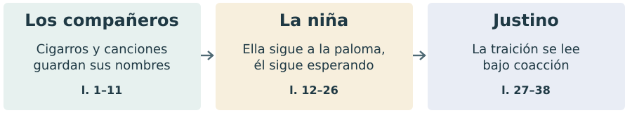

# BEL A/L — Espagnol, commentaire et traduction 2021 · Corrigé brut

*Corrigé rédigé par IA, non officiel. Signalez toute erreur.*

**Rédaction** · GPT-6.2 Astra Ultra · vitesse non renseignée

**Révision** · GPT-6.2 Astra Ultra · vitesse non renseignée

Alfons Cervera, *Maquis* (1997). Écrit commun de l’ENS de Lyon et de l’ENS (Paris), six heures avec dictionnaire unilingue autorisé.

Le commentaire couvre les lignes 1 à 38. La version va de « Y ahora estoy aquí… » à « …que alguna vez dejó en los montes la esperanza. » (lignes 12 à 26).

[Sujet officiel, p. 10–11](https://www.ens-lyon.fr/sites/default/files/2021-10/Commentaire-et-traduction-en-LVE.pdf#page=10) · [Rapport du jury, rubrique commune, p. 1–5](https://www.ens-lyon.fr/sites/default/files/2021-11/ESPAGNOL_2021.pdf#page=1)

## Commentaire en espagnol

En la secuencia 23 de *Maquis* (1997), Alfons Cervera cede la palabra a «Ojos Azules», guerrillero antifranquista que escribe la víspera de su fusilamiento. El texto no nos sitúa ante su muerte, sino ante el trabajo que realiza todavía: dejar unas palabras cuyo destinatario y cuya conservación están por decidir. El mismo hombre que anuncia la desaparición de sus huellas anota el nombre de sus compañeros y la mirada fugaz de una niña. ¿Qué puede transmitir esta despedida allí donde hasta hacer una pregunta se ha vuelto difícil?

El primer «Mañana» anticipa un trayecto que el preso hará con los soldados. El plural de ese desplazamiento forzado dura poco. En la frase siguiente, los que permanecen atrás son los recuerdos propios del grupo vencido. Sebas reaparece en la forma torcida de sus cigarrillos y Nicanor en la tristeza de sus canciones. Esos rasgos individuales dan espesor a los años recorridos en común. Cuando la tierra se dice dos veces «rota», el silencio que quedará de ella adquiere el carácter paradójico de un vestigio: se advertirá que algo falta, pero quizá no se sepa ya quiénes vivieron allí. De la primera persona pasa el narrador al impersonal «uno» y luego al «te». La muerte que espera a un solo hombre se convierte en una situación que el lector puede ocupar, sin que por ello se borre la singularidad de los montes que ha recorrido.

La frase que empieza con la vida consumida en los bosques demora el nombre de lo que se desea. Frente a la quietud que se impondrá al condenado, la enumeración de sabinas, barro y vientos conserva el trabajo del cuerpo en movimiento. Al fin se formula el deseo de una «muerte digna». Merecer ese nombre depende de quienes hereden la memoria, no de una hazaña individual. Ojos Azules rehúsa el destino vengativo que atribuye a los héroes. Anticipa así una cuestión difícil en la evocación posterior de Justino: cómo recordar una traición sin hacer de la memoria una nueva exigencia de venganza.

La conjunción que abre «Y ahora estoy aquí» nos lleva de la montaña a un rincón de la cuadra. Por primera vez se nombra el acto material de escribir. La paja y el estiércol impiden que las «palabras de despedida» se eleven por encima de las condiciones en que nacen. En una misma frase el olor conduce a la desesperación y la desesperación, al cementerio clandestino. Un enterramiento sin lugar reconocible hará imposible el gesto afectuoso de escarbar en el recuerdo. Al escribir, el preso hace ya algo semejante por sus compañeros. Sus palabras permiten localizar en la lengua a quienes no podrán ser buscados en la tierra.

Entonces una niña mira desde la calle. La narración la presenta en presente y, antes de que termine la frase, ya se ha marchado corriendo. Ojos Azules interpreta en su mirada curiosidad, sorpresa y acaso piedad. El «a lo mejor» impide atribuirle un pensamiento seguro. Ella sigue a una paloma y él sigue esperando. Un mismo verbo, primero de movimiento y luego de duración, mide la distancia entre ambos. Esa breve aparición abre una posibilidad de reconocimiento sin garantizar que exista un testigo capaz de transmitir lo visto. También se mira desde el escondite. La gente se convierte, por miedo, en una «presencia anónima» a la que le faltan ojos, voz y hasta aliento. Ni la niña habla ni el narrador puede preguntarle qué ha entendido.

Justino entra al final como una presencia conjetural. El futuro de «andará» expresa lo que el preso imagina que estará ocurriendo en otra parte. Al admitir que «hay traiciones y traiciones», difiere la condena que cabría esperar de un jefe traicionado. La oración sobre quienes le obligaron a delatar revela una presión ejercida por los vencedores. Estos convierten la muerte ajena en requisito para la paz y reservan a las palabras un solo sentido, el de señalar el escondite de los vencidos. El monólogo acaba devolviendo complejidad moral a lo que ese código reduce a una orden. No rescata al narrador del fusilamiento anunciado, pero sí transmite algo que escaparía a un inventario de vencedores y traidores: los gestos ordinarios de los ausentes y las dudas de quien aún puede dar testimonio de ellos.

## Version française

Et maintenant me voici dans ce coin misérable où dorment les chevaux fourbus des gardes et où j’écris ces mots d’adieu sur la paille humide et froide de l’écurie, pleine de crottin, pleine d’une odeur nauséabonde de je ne sais quoi qui ressemble au désespoir, à cette mort qui m’attend dès demain, les yeux bandés, debout devant les murs sombres du cimetière clandestin qui ne laissera à personne la possibilité de fouiller un jour avec amour dans le souvenir. Je vais mourir demain et voilà maintenant une petite fille qui regarde depuis la rue et ne dit rien, et puis elle est partie en courant avec un petit garçon à la poursuite d’une colombe. Dans les yeux de la fillette, il y avait la curiosité innocente de l’enfance, un frémissement de surprise, peut-être de la pitié pour l’inconnu qui dort là où dorment les chevaux. Je ne sais pas ce que peut bien se demander la petite fille, car ce temps est venu à bout des questions, lui aussi, et les gens n’osent regarder que du fond de l’obscurité, depuis l’observatoire secret qui fait d’eux une présence anonyme, sans yeux et sans voix, ayant à peine assez de souffle pour continuer à vivre. La petite fille a suivi la colombe et moi j’attends toujours la mort dans la solitude obscène d’une cellule de fortune qui sent les entrailles de cheval, et demain s’éloigneront d’ici les traces que l’espoir a jadis laissées dans les montagnes.
