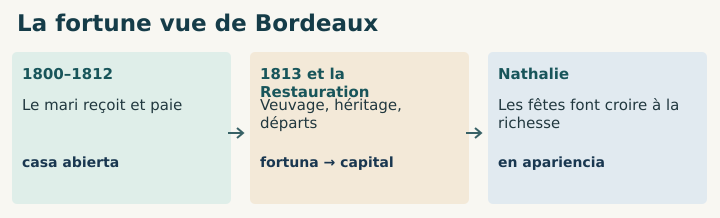

# BEL A/L — Espagnol (thème Lyon) 2021 · Corrigé guidé

*Corrigé rédigé par IA, non officiel. Signalez toute erreur.*

**Rédaction** · GPT-6.2 Astra Ultra · vitesse non renseignée

[Feuillet officiel, p. 11](https://www.ens-lyon.fr/sites/default/files/2021-10/Epreuves-de-Specialite.pdf#page=11) · [Rapport du jury, p. 5–8](https://www.ens-lyon.fr/sites/default/files/2021-11/ESPAGNOL_2021.pdf#page=5)

Honoré de Balzac, Le Contrat de mariage (1835). Thème de quatre heures, sans dictionnaire. Deux paragraphes, de « Vers le commencement du siècle » à « de la maison Évangelista ». Coupure imprimée après le départ de certaines familles bordelaises.

Le portrait des Évangelista porte sur l’argent que la famille possède, celui qu’elle dépense et celui que Bordeaux continue de lui attribuer. La dernière proposition donne la mesure du décalage.

## Préparer la traduction

**Quel rang les objets et les gestes signalent-ils ?**

Le nom de famille donne *apellidado Évangelista*. La demeure acquise à Bordeaux est un hôtel particulier, donc une *mansión*. *Tener casa abierta* et *agasajar* restituent la sociabilité mondaine. Le degré de faveur dont jouit l’Espagnol explique l’intérêt de l’allusion aux cercles de second rang.

**Quelles constructions permettent de suivre les deux portraits ?**

Le texte attribue les envies à la femme et leur satisfaction au mari. Une causale avec *pues* évite un gérondif dont le sujet serait incertain. Employer *a* devant le complément de *dejó a su mujer* et l’article devant *la señora Évangelista*. *Por mucha habilidad que tuviese* maintient la concession au début de la dernière période avant la coupure.

**Que vaut le mot « parti » à ses deux apparitions ?**

Le premier *parti* est politique et se traduit par *partido monárquico*. Dans le portrait de Nathalie, un *partido* est un beau mariage en perspective. Le même nom espagnol peut donc servir deux fois. L’incise *en apariencia* prépare le plus-que-parfait *había dilapidado*. La dernière phrase retrouve le regard mal informé du public bordelais.

## Proposition de thème

Hacia comienzos de siglo, un español acaudalado, apellidado Évangelista, vino a establecerse en Burdeos, donde tanto las recomendaciones que traía como su fortuna le habían abierto las puertas de los salones de la nobleza. Mucho hizo su mujer por que siguiera gozando de favor en aquella aristocracia, que quizá lo había acogido con tanta facilidad solo para zaherir a la sociedad de segundo rango. Criolla y semejante a las mujeres atendidas por esclavos, la señora Évangelista, que por lo demás pertenecía a los Casa-Réal, ilustre familia de la monarquía española, vivía como una gran dama, desconocía el valor del dinero y no se privaba de capricho alguno, por costoso que fuese, pues siempre se lo satisfacía un hombre enamorado que generosamente le ocultaba los resortes de las finanzas. Contento de verla tan a gusto en Burdeos, donde sus negocios lo obligaban a residir, el español adquirió allí una mansión, tuvo casa abierta, agasajó con magnificencia a sus invitados y dio en todo muestras del más exquisito gusto. Así, de 1800 a 1812, en Burdeos solo se habló del señor y la señora Évangelista. El español murió en 1813 y dejó a su mujer viuda a los treinta y dos años, con una inmensa fortuna y la hija más linda del mundo, una niña de once años que prometía ser un dechado de perfecciones y que llegó a serlo. Por mucha habilidad que tuviese la señora Évangelista, la Restauración alteró su posición. El partido monárquico se depuró y algunas familias se marcharon de Burdeos. […]

La señorita Nathalie Évangelista era de una belleza extraordinaria y, en apariencia, el partido más rico de Burdeos. Allí se ignoraba que iba menguando el capital de su madre, quien, por prolongar su reinado, había dilapidado sumas enormes. El brillo de las fiestas y la persistencia de aquel tren de vida regio mantenían al público en su creencia en las riquezas de la casa Évangelista.

Honoré de Balzac, *El contrato de matrimonio* (1835).
