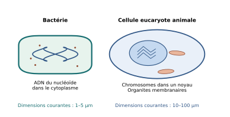
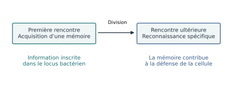
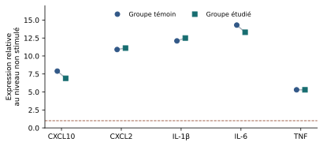

# ENS de Lyon — Second concours, Biologie-biochimie 2021 · Corrigé partiel brut

*Corrigé rédigé par IA, non officiel.*

**Rédaction** · GPT-6.2 Astra Ultra · vitesse non renseignée

**Couverture.** Les questions 1, 5, 16 à 18, 23 et 24 sont traitées intégralement. La question 19 est limitée à la différence entre moyenne et distribution de fluorescence. Les questions 2 à 4, 6 à 15 et 20 à 22, portant sur les caractérisations détaillées de systèmes de résistance, les manipulations de nucléases et la validation expérimentale de la modification après transfert viral, sont hors de cette édition.

## Synthèse de biologie cellulaire

### Question 1 — Organisation des cellules et de leur information génétique

**Introduction.** Une cellule bactérienne et une cellule eucaryote sont délimitées par une membrane plasmique. Toutes deux possèdent un cytoplasme, des ribosomes et un génome d’ADN. Elles utilisent les mêmes grandes étapes de circulation de l’information, de l’ADN aux ARN et des ARN messagers aux protéines. Comment leur organisation spatiale modifie-t-elle le fonctionnement de cet équipement commun ?

**Des cellules organisées à des échelles différentes.** Une bactérie mesure couramment environ $1$ à $5\ \mathrm{\mu m}$ dans sa plus grande dimension, une cellule eucaryote animale ou végétale souvent $10$ à $100\ \mathrm{\mu m}$. Ce sont des ordres de grandeur qui comportent des exceptions. La membrane bactérienne délimite un cytoplasme où se trouvent notamment les ribosomes et le nucléoïde. La plupart des bactéries possèdent une paroi contenant du peptidoglycane. La cellule eucaryote comprend des compartiments membranaires spécialisés, dont le noyau, le réticulum endoplasmique, l’appareil de Golgi et, en général, les mitochondries. Les cellules photosynthétiques des végétaux possèdent aussi des chloroplastes. Une cellule animale n’a pas de paroi. Une cellule végétale possède une paroi notamment cellulosique, différente de celle d’une bactérie.

**Stocker et transmettre l’information.** Chez la bactérie, le chromosome se trouve dans le nucléoïde, qui n’est pas entouré d’une enveloppe nucléaire. Il s’agit souvent d’une molécule circulaire d’ADN double brin, associée à des protéines qui contribuent à sa compaction. Des plasmides peuvent s’ajouter au chromosome. Les gènes sont généralement rapprochés et peuvent être regroupés en opérons. Dans le noyau eucaryote, plusieurs chromosomes linéaires sont associés à des histones et forment la chromatine. Les gènes nucléaires peuvent comporter des introns. Les mitochondries et les chloroplastes conservent également un petit génome propre. Après réplication de l’ADN, le partage du matériel génétique se fait généralement par scissiparité chez les bactéries. Chez les eucaryotes, un fuseau de division répartit les chromosomes lors de la mitose, ou de la méiose pour la formation de cellules haploïdes.

**Exprimer l’information.** Dans le cytoplasme bactérien, des ribosomes 70S peuvent traduire un ARN messager au cours même de sa transcription. Chez les eucaryotes, les ARN messagers nucléaires sont transcrits et maturés dans le noyau, puis exportés vers le cytoplasme et traduits par des ribosomes 80S libres ou associés au réticulum. Les coefficients de sédimentation 70S et 80S caractérisent les ribosomes entiers. **Conclusion.** La présence d’un noyau est le critère décisif de cette comparaison. Sa membrane impose un transport des ARN et sépare dans l’espace la transcription nucléaire de la traduction cytoplasmique.

## Première partie. Mémoire et immunité

### Question 5 — Mémoire des rencontres antérieures

Dans les données d’observation, la présence de nouveaux segments intercalés dans le locus est associée au phénotype de résistance. La correspondance avec un matériel génétique précédemment rencontré suggère que ces segments en gardent une **mémoire spécifique**. Cette mémoire pourrait contribuer à reconnaître le même matériel lors d’une rencontre ultérieure. Cette association seule ne prouve ni que le segment suffit à protéger la cellule, ni que tout segment nouvellement acquis a le même effet.

### Question 16 — Deux rencontres successives dans la nature

Lors d’une première rencontre, certaines bactéries survivantes acquièrent dans leur locus CRISPR un court fragment correspondant au matériel génétique rencontré. Cette acquisition peut être transmise lors de la division. À la rencontre ultérieure, l’information déjà conservée est exprimée en ARN. La complémentarité permet alors de reconnaître le matériel correspondant et le système de défense peut le neutraliser. La **deuxième réponse utilise une mémoire préexistante**. Elle ne demande pas l’ajout d’une nouvelle copie du même fragment à chaque rencontre.

### Question 17 — Comparer deux formes d’immunité

Le système bactérien et l’immunité adaptative humaine présentent une reconnaissance spécifique et une mémoire issue d’une rencontre antérieure. Une nouvelle rencontre peut ainsi donner une réponse mieux adaptée au même élément. Chez la bactérie, l’information est inscrite dans le locus chromosomique d’une cellule. Elle peut passer aux cellules filles. La reconnaissance repose sur une complémentarité d’acides nucléiques et fait intervenir des protéines de défense. Chez l’humain, l’antigène est reconnu par des récepteurs de lymphocytes B ou T. Des clones sont sélectionnés et prolifèrent. Des cellules mémoires persistent. Lors d’un rappel, elles contribuent à une réponse plus rapide et souvent plus forte. Cette mémoire **somatique** n’est généralement pas transmise aux enfants par les gamètes. Le passage temporaire d’anticorps maternels constitue une protection passive distincte. L’organisme humain dispose aussi d’une immunité innée et de réponses coordonnées entre de nombreux types cellulaires. L’analogie concerne donc la spécificité et la mémoire, à deux échelles d’organisation différentes.

## Deuxième partie. Mesures cellulaires et perspectives médicales

### Question 18 — Un marqueur fluorescent visible cellule par cellule

Ces souris expriment la protéine fluorescente verte. Leurs cellules présentent donc un signal de départ que l’on peut observer sans dépendre d’un changement de forme de la cellule. Une variation de la fluorescence peut ensuite être comparée à celle de cellules témoins de la même lignée, en tenant compte du bruit de fond. La GFP sert de **rapporteur**. Sa fluorescence renseigne sur la présence de protéine fonctionnelle, et ne donne pas directement la séquence du gène.

### Question 19 — Moyenne et distribution de fluorescence (lecture des représentations)

Le panneau de gauche condense les intensités en une moyenne par groupe. Le panneau de droite montre, pour chaque classe d’intensité, combien de cellules s’y trouvent. Une baisse de moyenne peut résulter d’un décalage de toutes les cellules ou d’un mélange de sous-populations dont les intensités sont différentes. Seule la distribution permet de distinguer ces configurations. L’autofluorescence définit un fond et une faible intensité n’équivaut pas à une absence totale de photons. Cette réponse traite la différence d’information entre les deux représentations.

### Question 23 — Lire la réponse physiologique des macrophages

Après stimulation, les valeurs sont supérieures au niveau de référence 1 pour les cinq marqueurs dans les deux groupes. On lit environ 7 à 8 fois ce niveau pour CXCL10, 11 fois pour CXCL2, 12 à 13 fois pour IL-1β, 13 à 14 fois pour IL-6 et 5 fois pour TNF. La comparaison doit se faire marqueur par marqueur. Pour IL-6, les moyennes sont par exemple proches de 14 et 13, et leurs dispersions se recouvrent. Les barres représentent des écarts-types pour quatre expériences indépendantes. Le document ne montre **pas de différence nette** entre groupes pour ces réponses. La capacité des macrophages à induire les cinq marqueurs étudiés est donc conservée dans les conditions présentées. Un chevauchement des écarts-types ne démontre pas une équivalence statistique stricte. Ces mesures n’évaluent pas toutes les fonctions des macrophages.

### Question 24 — Possibilités thérapeutiques et limites

Chez une personne atteinte de maladie monogénique, une correction somatique pourrait restaurer une fonction déficiente, ou modifier sa régulation pour réduire les symptômes. Dans la drépanocytose et certaines bêta-thalassémies, augmenter la production d’hémoglobine fœtale illustre la seconde stratégie. Au moment du concours de 2021, ces voies faisaient l’objet d’essais cliniques. Une maladie touchant de nombreux organes, ou résultant de nombreux facteurs génétiques et environnementaux, se prête moins facilement à une intervention ciblée unique.

Il faut atteindre les cellules participant effectivement à la maladie et obtenir un bénéfice durable sans altérer leur fonctionnement. Des modifications involontaires sur d’autres sites, des changements indésirables au site visé ou une réponse immunitaire peuvent compromettre le résultat. Les effets tardifs justifient un suivi prolongé. Le rapport bénéfice–risque dépend de la gravité de la maladie, des autres traitements disponibles et du consentement de la personne. Une intervention sur des cellules somatiques concerne la personne traitée. Une modification germinale pourrait être transmise à des descendants qui ne peuvent y consentir et soulève des questions éthiques et réglementaires distinctes.
