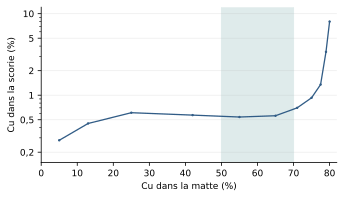
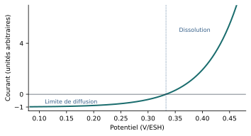
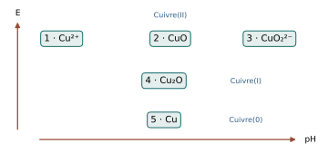
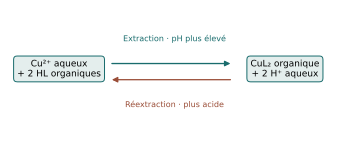
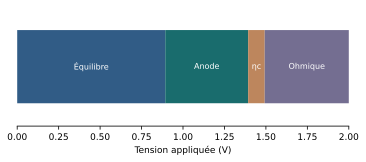
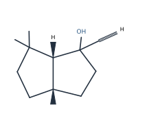
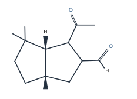
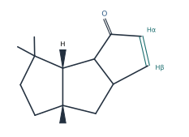
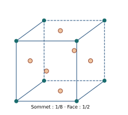

# ENS de Lyon — Second concours, Chimie 2021 · Corrigé partiel brut

*Corrigé rédigé par IA, non officiel.*

**Rédaction** · GPT-6.2 Astra Ultra · vitesse non renseignée

**Couverture.** Les questions 1 à 34, 41, 42 et 44 à 60 sont traitées, soit 53 questions sur 60. Les questions 34, 41 et 42 énoncent uniquement des règles générales de stéréochimie et de cinétique. Les questions 35 à 40 et 43 concernant un agent de guerre chimique sont hors de cette édition.

## A. L’élément cuivre

### Question 1 — Trois règles de remplissage

La règle empirique de Klechkowski classe les sous-couches par $n+\ell$ croissant, puis par $n$ croissant en cas d’égalité. Le principe d’exclusion de Pauli interdit deux électrons dans le même état quantique. Une orbitale spatiale contient au plus deux électrons de spins opposés. Dans une sous-couche d’orbitales dégénérées, la règle de Hund conduit à occuper d’abord les orbitales séparément avec des spins parallèles.

### Question 2 — Configuration prévue du cuivre

L’application stricte donne $1s^2\,2s^2\,2p^6\,3s^2\,3p^6\,4s^2\,3d^9$, soit $[\mathrm{Ar}]\,3d^9\,4s^2$ dans l’ordre d’écriture usuel. La somme des exposants vaut bien 29.

### Question 3 — Configuration expérimentale

La configuration fondamentale observée est **$[\mathrm{Ar}]\,3d^{10}\,4s^1$**. Les sous-couches $3d$ et $4s$ sont proches en énergie. L’énergie totale est plus faible pour la configuration à sous-couche $3d$ remplie et un électron $4s$. C’est une exception à l’ordre empirique de Klechkowski, compatible avec Pauli et Hund.

## B.I. Pyrométallurgie et raffinage

### Question 4 — Bilan d’oxydation d’un minerai

Pour une mole de sulfure, $\mathrm{Cu_2S}+\tfrac32\mathrm{O_2}\to\mathrm{Cu_2O}+\mathrm{SO_2}$. Les deux cuivres restent au degré +I. Le soufre passe de −II à +IV, en accord avec le nombre total d’électrons reçus par le dioxygène.

### Question 5 — Effet thermodynamique de la silice

La silice retient l’oxyde de fer dans un silicate et diminue l’activité de $\mathrm{FeO}$ libre dans la scorie. Pour l’équilibre écrit dans le sujet, $Q=a(\mathrm{FeS})a(\mathrm{Cu_2O})/[a(\mathrm{FeO})a(\mathrm{Cu_2S})]$. À composition instantanée inchangée pour les autres espèces, cette diminution fait augmenter $Q$. Le déplacement vers la gauche consomme $\mathrm{Cu_2O}$ et remet du cuivre dans la matte sous forme de sulfure. Il s’agit d’un argument d’équilibre.

### Question 6 — Lire les deux teneurs en cuivre

Sur la figure 1, un domaine indicatif de **50 à 70 % de cuivre dans la matte** concilie enrichissement et pertes modestes. L’ordonnée se situe encore autour de $0{,}5$ à $0{,}8\,\%$ de Cu dans la scorie. Près de 80 % dans la matte, la teneur de la scorie croît très vite et atteint plusieurs pour cent. Une matte à 10 % donnerait peu de perte mais resterait très pauvre en cuivre. L’intervalle est un compromis graphique, sans optimum économique unique en l’absence de prix et de débits.

### Question 7 — Potentiel d’équilibre du couple cuivre

En supposant le couple $\mathrm{Cu^{2+}/Cu}$ dominant, l’activité du solide égale à un et celle de l’ion approximée par $c/c^\circ$, $c=45/63{,}546=0{,}708\ \mathrm{mol\,L^{-1}}$. À 25 °C, $E=0{,}337+(0{,}0592/2)\log_{10}(0{,}708)=\mathbf{0{,}333\ V/ESH}$. Ce potentiel réversible est commun à l’électrode métallique et à la solution à leur interface. Les coefficients d’activité et la complexation dans un bain réel déplacent la valeur.

### Question 8 — Courbe intensité–potentiel

La courbe du couple rapide passe en pente marquée par $(0{,}333\ \mathrm V,0)$, avec une branche positive à droite et négative à gauche. Du côté cathodique, l’alimentation en ions cuivre peut imposer un palier de diffusion. Du côté anodique, l’électrode fournit le métal solide en excès. Aucun palier de transport d’un réactif dissous n’est attendu de la même manière pour cette dissolution.

### Question 9 — Branche anodique et branche cathodique

Pour le courant anodique positif, $\mathrm{Cu(s)\to Cu^{2+}(aq)+2e^-}$. Pour le courant cathodique négatif, $\mathrm{Cu^{2+}(aq)+2e^-\to Cu(s)}$.

### Question 10 — Allure en s’écartant de l’équilibre

À l’équilibre, dissolution et dépôt ont des courants partiels égaux en valeur absolue. Leur somme est nulle. Une petite surtension produit un courant net presque linéaire et important pour un couple rapide. Plus loin, l’une des branches de transfert électronique domine. À potentiel suffisamment négatif, l’arrivée de $\mathrm{Cu^{2+}}$ peut limiter la réduction, d’où le palier. Le tracé demandé concerne le couple du cuivre, avant intervention marquée d’autres réactions.

### Question 11 — Bilan du raffinage

Les ions $\mathrm{Cu^{2+}}$ produits à l’anode compensent ceux consommés à la cathode. Le bilan idéal est **$\mathrm{Cu(s,anode\ impure)\to Cu(s,cathode\ purifiée)}$**. La composition du bain peut toutefois évoluer à cause des impuretés.

### Question 12 — Tension minimale du raffinage

Dans le modèle du sujet, en négligeant l’effet de l’activité du cuivre dans l’anode impure, les deux électrodes sont gouvernées par le même couple dans un même bain. La différence réversible est **quasi nulle**. Il suffit théoriquement d’une tension positive infinitésimale dans le bon sens. Les $330\ \mathrm{mV}$ indiqués pour le fonctionnement réel servent notamment à vaincre les surtensions et les chutes ohmiques.

### Question 13 — Dépôts possibles à la cathode

À activité comparable, $E^\circ(\mathrm{Ag^+/Ag})=0{,}800\ \mathrm V$ excède le potentiel du cuivre. Des ions argent présents pourraient donc être réduits avec le cuivre. Les potentiels standards pour Fe, Ni et As sont inférieurs à celui du cuivre, de sorte qu’ils ne sont pas les dépôts préférentiels d’une cathode exploitée près du potentiel du cuivre. Dans le raffinage idéal l’argent de l’anode ne s’oxyde presque pas. Il y a donc très peu de $\mathrm{Ag^+}$ disponible. La concentration, l’acidité et le potentiel effectif de cathode comptent pour prédire des traces dans un bain réel.

### Question 14 — Devenir des impuretés anodiques

Le fer, le nickel et, dans les conditions acides représentées par le couple fourni, l’arsenic ont des potentiels standards de réduction inférieurs à celui du cuivre. Ils peuvent donc s’oxyder et **passer dans le bain** lorsque l’anode se dissout. L’argent métallique, plus noble, tend à rester à l’état métallique dans les boues anodiques.

### Question 15 — Conséquences pour le cuivre d’usage

Le dépôt visé est un cuivre très pur. Une trace d’argent éventuellement codéposée est elle-même conductrice et, aux très faibles teneurs indiquées, ne compromet en général pas l’usage courant du cuivre comme conducteur. Toute impureté peut augmenter la résistivité d’un métal très pur ou modifier son comportement pour une application exigeante. L’analyse quantitative du dépôt reste donc nécessaire pour une spécification précise.

## B.II. Hydrométallurgie et électro-extraction

### Question 16 — Degrés d’oxydation

Dans $\mathrm{CuO_2^{2-}}$, $x-4=-2$ donne Cu(+II). Cu est aussi à +II dans $\mathrm{CuO}$ et $\mathrm{Cu^{2+}}$, à +I dans $\mathrm{Cu_2O}$ et à 0 dans le métal $\mathrm{Cu}$.

### Question 17 — Attribuer les domaines du diagramme

Le domaine **1** correspond à $\mathrm{Cu^{2+}(aq)}$, favorisé en milieu acide pour le cuivre(II). **2** est le solide $\mathrm{CuO}$ et **3** l’ion soluble $\mathrm{CuO_2^{2-}}$ en milieu très basique. Les frontières verticales entre 1, 2 et 3 correspondent à des changements sans échange d’électrons. Le domaine intermédiaire **4** est $\mathrm{Cu_2O}$, cuivre(I), et le domaine bas **5** le cuivre métallique. Les domaines de sulfures dessinés sur la même figure en masquent une partie.

### Question 18 — Équilibrer la frontière a

La demi-équation est $2\mathrm{Cu^{2+}}+\mathrm{HSO_4^-}+7\mathrm H^++10e^-\rightleftharpoons\mathrm{Cu_2S(s)}+4\mathrm{H_2O}$. Les deux Cu(+II) deviennent deux Cu(+I) et le soufre(+VI) devient S(−II). Le total est bien dix électrons.

### Question 19 — Pente de la frontière

À activités des autres espèces fixées et activité du solide égale à un, Nernst donne $E=\text{constante}+(0{,}0592/10)\log_{10}(a_{\mathrm H^+}^7)$. D’où la pente **$\mathrm dE/\mathrm d pH=-7(0{,}0592)/10=-0{,}0414\ \mathrm V$ par unité de pH** à 25 °C. Le signe décroissant concorde avec la droite a.

### Question 20 — Acidité du phénol

Le groupe phénolique a un $pK_a$ de l’ordre de **10**, valeur de référence pour le phénol. Les substituants de l’aldoxime et la complexation peuvent la déplacer. Le calcul d’un $pK_a$ précis demanderait des données supplémentaires.

### Question 21 — Coordinence et géométries

Deux ligands bidentates coordonnent chacun le cuivre par un N et un O. La coordinence est donc **4**. Les deux géométries idéales usuelles sont tétraédrique et plan carré. Le dessin présente une disposition plane N,O,N,O autour du cuivre(II).

### Question 22 — Angles autour du métal

Un tétraèdre régulier possède des angles d’environ $109{,}5^\circ$. Un carré plan donne $90^\circ$ entre voisins et $180^\circ$ entre positions opposées. Les anneaux de chélation peuvent imposer des écarts par rapport à ces valeurs idéales.

### Question 23 — Modèle géométrique

La méthode de **Gillespie**, ou VSEPR, modèle la disposition des domaines électroniques par leurs répulsions. Pour les complexes de métaux de transition, la coordinence seule ne suffit pas à trancher entre un carré plan et un tétraèdre. L’environnement des ligands et la structure électronique du métal comptent également.

### Question 24 — Pourquoi les conformations dessinées sont-elles stables ?

Dans le ligand libre, l’OH phénolique peut former une liaison hydrogène intramoléculaire avec l’azote de l’oxime voisine en ortho. Cette pseudo-fermeture de cycle maintient une orientation favorable. Dans le complexe, le phénolate et l’azote chélatent Cu. L’OH de l’oxime peut établir une liaison hydrogène avec un oxygène phénolate du ligand voisin, à l’intérieur du **même complexe**. Les liaisons hydrogène et la chélation stabilisent alors la disposition d’ensemble de la figure 3.

### Question 25 — Faire entrer le cuivre dans la phase organique

Pour $\mathrm{Cu^{2+}_{aq}}+2\mathrm{HL_{org}}\rightleftharpoons\mathrm{CuL_{2,org}}+2\mathrm H^+_{aq}$, diminuer l’activité des protons favorise le complexe organique. On choisit pour l’extraction un **pH suffisamment élevé par rapport à celui de la réextraction**, tout en gardant le cuivre dissous dans le lixiviat. La valeur exacte dépend de la constante de partage et de l’extractant.

### Question 26 — Réextraire le cuivre vers la phase aqueuse

Une phase aqueuse plus acide, de **pH inférieur**, protonne le ligand et déplace l’équilibre vers $\mathrm{Cu^{2+}_{aq}}$ et le ligand organique libre. La charge en cuivre de la phase organique diminue et la solution aqueuse de réextraction s’enrichit en cuivre.

### Question 27 — Attribuer les courbes de partage

**B** décrit l’extraction du lixiviat vers l’organique. Pour environ $1{,}5\ \mathrm{g\,L^{-1}}$ dans l’eau, la phase organique atteint déjà près de $8\ \mathrm{g\,L^{-1}}$. **A** décrit la réextraction vers l’eau. La phase aqueuse atteint environ 45 à $55\ \mathrm{g\,L^{-1}}$ alors que l’organique est vers 3 à $4\ \mathrm{g\,L^{-1}}$. Ces lectures comparent des concentrations, sans supposer que les volumes de phases sont égaux.

### Question 28 — Réaction d’électro-extraction

La cathode réalise $\mathrm{Cu^{2+}}+2e^-\to\mathrm{Cu}$. À l’anode, $\mathrm{H_2O}\to\tfrac12\mathrm{O_2}+2\mathrm H^++2e^-$. Le bilan idéal est $\mathrm{Cu^{2+}+H_2O\to Cu+2H^+}+\tfrac12\mathrm{O_2}$. L’anode de cette étape ne fournit pas le métal déposé.

### Question 29 — Courant nécessaire pour une tonne par heure

Une tonne représente $10^6/63{,}546=1{,}574\times10^4\ \mathrm{mol}$. La charge minimale est $Q=2Fn=3{,}037\times10^9\ \mathrm C$. Pour $3600\ \mathrm s$, **$I_{\min}=Q/t=8{,}44\times10^5\ \mathrm A$**. La valeur est celle de l’ensemble de l’installation avec un rendement faradique de 1.

### Question 30 — Énergie réversible

En se plaçant aux conditions standards faute de toutes les activités du bain, $U_{\rm rev}\simeq1{,}23-0{,}337=0{,}893\ \mathrm V$. Le minimum de travail électrique vaut $QU_{\rm rev}=2{,}71\times10^9\ \mathrm J$, soit **environ $753\ \mathrm{kWh}$ par tonne**. La tension réversible évolue en pratique avec le pH et les activités.

### Question 31 — Tension résiduelle hors équilibres et surtensions

La tension résiduelle vaut $2{,}0-0{,}893-0{,}5-0{,}1=\mathbf{0{,}51\ \mathrm V}$ environ. Les deux surtensions données en valeur absolue accroissent toutes deux l’effort électrique à fournir.

### Question 32 — Origine de la chute de tension

L’essentiel du terme résiduel est une **chute ohmique $RI$**, notamment dans l’électrolyte, les connexions et les conducteurs. Elle est dissipée sous forme de chaleur. La géométrie du bain et sa conductivité interviennent.

### Question 33 — Rendement faradique industriel

À $2\ \mathrm V$ et pour $2000\ \mathrm{kWh}$ par tonne, la charge réellement fournie est $Q_{\rm réel}=2000\times3{,}6\times10^6/2=3{,}60\times10^9\ \mathrm C$. Le rendement faradique vaut donc $\eta_F=Q_{\rm Cu}/Q_{\rm réel}=3{,}037/3{,}60\simeq\mathbf{84\,\%}$. Le rapport $753/2000$ est le rendement énergétique global pris avec la référence réversible.

## C.I. Notions indépendantes de stéréochimie et de cinétique

### Question 34 — Règles générales de Cahn, Ingold et Prelog

Comparer les numéros atomiques des atomes directement liés au centre, le plus grand étant prioritaire. Pour des isotopes du même élément, le nombre de masse le plus élevé prime. En cas d’égalité, comparer couche après couche les listes de voisins triées par priorité décroissante jusqu’à la première différence. Traiter une liaison multiple avec les duplications formelles correspondantes. Orienter le substituant 4 vers l’arrière et suivre $1\to2\to3$. Le sens horaire est **R**, le sens antihoraire **S**. Si le 4 pointe vers l’observateur, inverser le résultat lu sur le dessin.

### Question 41 — Demi-vie d’un processus générique d’ordre un

Pour une cinétique du premier ordre, $C(t)=C_0e^{-kt}$. En posant $C(t_{1/2})=C_0/2$, on trouve **$t_{1/2}=\ln(2)/k$**. Avec une constante apparente du premier ordre $k_{\rm app}$, le même résultat s’écrit $\ln(2)/k_{\rm app}$. L’unité du temps est l’inverse de celle de la constante.

### Question 42 — Loi générale d’Arrhenius

La loi d’Arrhenius s’écrit **$k(T)=A\exp[-E_a/(RT)]$**. $T$ est la température absolue en kelvins, $R$ la constante molaire des gaz, $E_a$ l’énergie d’activation molaire et $A$ le facteur préexponentiel, de mêmes unités que $k$. Si $A$ et $E_a$ sont pratiquement constants sur l’intervalle, $\ln k$ est affine en $1/T$ avec une pente $-E_a/R$. Ce résultat de cours est donné sans application à un agent particulier.

## C.II. Cuivre et chimie organique du capnellène

### Question 44 — Rôle de l’énone

Le groupe carboné de l’organocuprate se comporte comme nucléophile. L’énone conjuguée **2 est électrophile**, à la fois au carbone carbonylé C2 et au carbone C4 en position β. Ces deux centres peuvent différer par leur charge partielle et par leur poids dans l’orbitale accepteur.

### Question 45 — Numéros de la HO et de la BV

Le composé 2 a pour formule $\mathrm{C_{10}H_{14}O}$. Il contient $10(6)+14(1)+8=82$ électrons. Dans le modèle à couches fermées du tableau 2, 41 orbitales sont doublement occupées. La **HO porte le numéro 41**, la **BV le numéro 42**. Le saut d’énergie entre les colonnes 41 et 42 est cohérent avec cette attribution.

### Question 46 — Comparaison des coefficients de la BV

L’interaction donneuse–accepteuse met en jeu la HO du nucléophile et la BV de l’énone. Dans la BV 42, $|c_{\rm C4}|=0{,}613$ dépasse $|c_{\rm C2}|=0{,}477$. Le site carboné favorisé sous contrôle orbitalaire est donc **C4, carbone β**, ce qui conduit à une addition conjuguée. Le signe négatif du coefficient en C4 désigne une phase.

### Question 47 — Quel modèle rend compte du produit ?

Le méthyle supplémentaire de 3 est en C4 et le carbonyle est conservé. L’expérience correspond à l’addition conjuguée prédite par la BV. Un raisonnement électrostatique isolé aurait privilégié C2, de charge $+0{,}18$, devant C4 à $+0{,}02$. Le **contrôle orbitalaire** rend donc mieux compte de la régiosélectivité observée.

### Question 48 — Alcool propargylique 4

L’éthynyle s’additionne sur le carbone du carbonyle de 3. Après protonation de l’alcoolate, le composé **4** conserve les deux cycles fusionnés de 3 et porte sur l’ancien carbone carbonylé un **OH et un éthynyle $-\mathrm{C\equiv CH}$**. C’est un alcool propargylique tertiaire. L’addition seule conduit d’abord à l’alcoolate de lithium, dont la protonation donne la forme neutre dessinée. Les jonctions de cycles héritées de 3 sont conservées. Le schéma ne requiert pas d’attribuer arbitrairement une face au nouveau centre.

### Question 49 — Intermédiaire entre 5 et 6

Le réactif de la figure 8 porte un groupe **vinyle** $\mathrm{CH_2{=}CH{-}}$. En présence de CuI, une espèce organocuivrée vinylique peut se former par transmétallation. Elle favorise une addition conjuguée sur le carbone β de l’énone 5. L’intermédiaire juste après l’addition est un **énolate**. Sur le squelette de 5, le carbone β porte maintenant le vinyle, l’ancienne liaison $\mathrm C_\alpha{=}\mathrm C_\beta$ est simple et la forme oxyanion de l’énolate porte $\mathrm{C(O^-){=}C_\alpha}$. La protonation restitue la méthylcétone 6. Le cuivre oriente ainsi la réactivité vers l’addition 1,4.

### Question 50 — Localiser les deux carbonyles de 7

La chaîne $-\mathrm{CH{=}CH_2}$ de 6 conduit à un substituant **$-\mathrm{CHO}$** sur le squelette et à du méthanal séparé. La méthylcétone voisine **$-\mathrm{COCH_3}$** reste en place. Le composé 7 porte donc un formyle et un acétyle sur deux carbones voisins du même cycle, avec le squelette bicyclique de 6. La formule $\mathrm{C_{14}H_{22}O_2}$ correspond à la perte du carbone terminal du vinyle.

### Question 51 — Fermeture du troisième cycle

Une base enlève un proton du méthyle de l’acétyle. Dans une forme de résonance nucléophile de l’énolate, le carbone de cet ancien méthyle attaque le carbone de l’aldéhyde voisin. Le doublet π de l’aldéhyde passe sur O. La nouvelle liaison C–C ferme un **cycle à cinq atomes** comprenant successivement l’ancien méthyle, le carbone carbonylé de la cétone, les deux carbones voisins du squelette et l’ancien carbone aldéhydique. L’alcoolate formé est protoné par l’eau, avec régénération de la base. On obtient un β-hydroxycarbonyle. Une nouvelle déprotonation en α de la cétone puis l’élimination du groupe hydroxyle créent par crotonisation la double liaison conjuguée du cycle. Le composé **8 est une cyclopenténone tricyclique**. Le bilan global, $\mathrm{C_{14}H_{22}O_2\to C_{14}H_{20}O+H_2O}$, vérifie la perte d’eau.

### Question 52 — Attribuer les signaux de 8

Les singulets à **0,88, 0,89 et 1,00 ppm**, 3 H chacun, correspondent aux trois méthyles fixés à des carbones quaternaires. Les seules données du tableau ne les ordonnent pas individuellement de façon certaine. Les deux H vinyliques appartiennent à la cyclopenténone. Le proton α du carbonyle résonne vers **5,98 ppm** (d, couplage de 6 Hz avec Hβ). Le Hβ à **7,77 ppm** (dd) ressent aussi le couplage avec le méthine de la jonction adjacente. Leur désécrantage est cohérent avec la conjugaison.

Le massif à **1,02–1,90 ppm, 7 H** rassemble les autres protons aliphatiques, principalement des méthylènes et un méthine du squelette. Les signaux à **2,57 ppm (d, 1 H)** et **3,37 ppm (m, 1 H)** relèvent de méthines de jonction. Les protons voisins du carbonyle et de la double liaison peuvent être davantage désécrantés que les méthylènes du squelette. Le doublet a un couplage dominant résolu, tandis que le multiplet en montre plusieurs. Sans les autres constantes de couplage ou une corrélation bidimensionnelle, une attribution individuelle de ces méthines reste incertaine. Le total $9+7+1+1+1+1=20$ est celui de 8.

### Question 53 — Bandes infrarouges au-dessus de 1500 cm⁻¹

La bande à **3047 cm⁻¹** correspond à l’élongation C–H vinylique, celle à **2920 cm⁻¹** aux C–H aliphatiques. La bande à **1712 cm⁻¹** est l’élongation du C=O de la cétone. L’indication donnée en question distingue ces trois valeurs mesurées. La liste des bandes relevées n’impose pas d’inventer une bande C=C supplémentaire.

### Question 54 — Passer de l’énone 8 à la cétone 9

Il s’agit d’une **hydrogénation catalytique** de la double liaison C=C. Le dihydrogène est activé sur le platine et les deux H s’ajoutent sur la liaison éthylénique. Le schéma de 9 garde le carbonyle. La face accessible du squelette détermine la stéréochimie du produit représenté.

### Question 55 — Transformer le carbonyle en méthylène exocyclique

Une **méthylénation de Wittig** avec l’ylure méthylènetriphénylphosphorane, $\mathrm{Ph_3P{=}CH_2}$, transforme le C=O de 9 en $\mathrm{C{=}CH_2}$ exocyclique. L’oxygène est transféré au phosphore, donnant $\mathrm{Ph_3P{=}O}$. Le squelette tricyclique reste celui du composé 9.

## C.III. Céramique de cuivre et d’étain

### Question 56 — Allotropie et polymorphisme

Au sens strict, les allotropes sont des formes structurales différentes d’un **même élément**, comme le diamant et le graphite pour le carbone. Pour le composé de formule $\mathrm{Cu_2SnS_3}$, le terme précis est **polymorphes**. Les formes cubique, monoclinique et quadratique peuvent avoir la même composition globale et des arrangements cristallins différents.

### Question 57 — Sous-réseau du soufre

La maille du soufre est **cubique à faces centrées**. Placer S aux huit sommets et aux centres des six faces du cube. Les huit sites tétraédriques distincts de la maille cubique conventionnelle se trouvent aux coordonnées dont chaque composante vaut $1/4$ ou $3/4$ du paramètre. Ils sont distincts des six centres de faces.

### Question 58 — Populations moyennes dans la maille

Le nombre de S est $8(1/8)+6(1/2)=4$. La moitié des huit sites tétraédriques est occupée, soit quatre cations en moyenne. La stœchiométrie $\mathrm{Cu_2SnS_3}$ donne **$8/3$ Cu et $4/3$ Sn** par maille en moyenne, conformément à la correction du jury sur la nature de l’élément. Ces fractions expriment des taux d’occupation moyens. Une maille matérielle individuelle ne contient pas de fraction d’atome.

### Question 59 — Densité de la phase cubique

$M(\mathrm{Cu_2SnS_3})=2(63{,}546)+118{,}71+3(32{,}06)=341{,}982\ \mathrm{g\,mol^{-1}}$. La masse moyenne d’une maille vaut $(4/3)M/N_A=7{,}57\times10^{-22}\ \mathrm g$. Avec $a=543\ \mathrm{pm}=5{,}43\times10^{-8}\ \mathrm{cm}$, on a **$\rho_{\rm cub}=m/a^3=4{,}73\ \mathrm{g\,cm^{-3}}$**.

### Question 60 — Densité de la phase quadratique

Pour la phase quadratique, $V_q=(541\ \mathrm{pm})^2(1082\ \mathrm{pm})=2(541\ \mathrm{pm})^3$ et la masse vaut $2m$. Le rapport des densités est donc $\rho_q/\rho_{\rm cub}=(543/541)^3=1{,}011$. La phase quadratique est **environ 1,1 % plus dense**, avec $\rho_q\simeq4{,}78\ \mathrm{g\,cm^{-3}}$.
