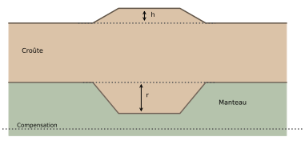
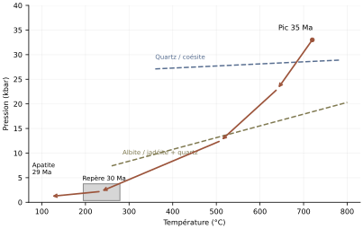
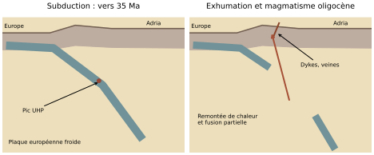

# ENS de Lyon, second concours 2021 — Géosciences · Corrigé brut

*Corrigé rédigé par IA, non officiel. Signalez toute erreur.*

**Rédaction** · GPT-6.2 Astra Ultra · vitesse non renseignée

## 1 — Géophysique des structures profondes

### Question 1 — Imager la lithosphère

Un séisme enregistré à plusieurs stations fournit des temps d’arrivée P et S. On relocalise les foyers et on calcule les temps dans un modèle de référence. Chaque résidu de temps contraint une intégrale de la lenteur $1/V$ le long d’un trajet. L’inversion de nombreux trajets qui se croisent ajuste une distribution de vitesses. Le panneau A donne des $V_P$ absolues, le panneau B des rapports $V_P/V_S$. La couverture des rais, le lissage et la profondeur affectent la résolution. Les contacts noirs de la figure sont une information indépendante issue des fonctions récepteur.
Dans un milieu élastique isotrope de module d’incompressibilité $K$, de cisaillement $\mu$ et de masse volumique $\rho$, $V_P^2=(K+4\mu/3)/\rho$ et $V_S^2=\mu/\rho$. Minéralogie, pression, température, orientation des minéraux et état des fissures changent ces paramètres. Une phase liquide ne supporte pas le cisaillement statique. Dans une roche fissurée, la saturation peut soutenir la compression alors que le squelette fracturé reste peu rigide en cisaillement. Un rapport élevé peut donc signaler la présence de fluides.

### Question 2 — Deux anomalies sous les Alpes internes et la plaine du Pô

Sous le flanc oriental de Dora Maira, « a » est une remontée de vitesses P élevées à faible profondeur, vers 15–25 km, avec un rapport voisin de 1,7. Ce contraste avec la croûte continentale voisine indique une écaille de roches mafiques ou mantelliques. L’interprétation du profil de Solarino et collaborateurs est celle de péridotites du coin mantellique en partie serpentinisées, rapprochées de la surface avec les unités internes. L’hydratation modérée aide à comprendre des vitesses plus faibles que dans une péridotite sèche profonde.
Vers l’abscisse 340 km, « g » est un objet distinct près du Moho adriatique, associé à des séismes et surtout à un fort maximum de $V_P/V_S$, autour de 1,8 ou davantage. Une croûte inférieure fracturée avec des fluides sous pression peut diminuer la rigidité effective et favoriser la rupture. Des variations de composition de la croûte profonde peuvent aussi intervenir. Les deux cartes seules ne déterminent ni la nature ni la quantité de fluide.

### Question 3 — Sismicité superficielle et profonde

Dans une enveloppe rhéologique, la contrainte de rupture fragile augmente avec la contrainte normale effective $\sigma_n-P_f$. En croûte supérieure froide, une faille atteint le seuil de frottement avant que le fluage ne puisse relaxer les contraintes. Cela explique les foyers à moins de 10 km. Plus bas, la hausse de température rend le fluage activé thermiquement plus efficace. Une croûte quartzo-feldspathique chaude devient habituellement ductile.
À plus de 20 km, le contact de deux lithosphères peut juxtaposer des niveaux de résistance et de température très différentes. Une portion froide de manteau ou de croûte mafique conserve une résistance assez élevée pour rompre. La concentration des contraintes sur une faille et une élévation de $P_f$, par exemple lors d’une déshydratation, abaissent en outre le seuil de rupture. La coïncidence de foyers et d’un fort rapport $V_P/V_S$ vers « g » rend cette dernière hypothèse testable.

## 2 — Isostasie alpine

### Question 4 — Racine d’Airy et Moho européen

Notons $d$ l’épaisseur de croûte normale et $z_c$ la profondeur commune de compensation, mesurées depuis le niveau de référence de l’avant-pays. Dans les deux colonnes, l’égalité des poids par unité de surface donne
$$\rho_c(d+h+r)+\rho_m(z_c-d-r)=\rho_c d+\rho_m(z_c-d).$$
Après simplification, $\rho_c h=(\rho_m-\rho_c)r$. Avec les valeurs imposées, $r=3\times2700/(3200-2700)=16{,}2$ km. Le Moho est à $d+r$ sous le niveau de référence et à $d+r+h$ sous le sommet. En prenant $d\simeq30$ à 35 km d’après l’avant-pays occidental de la figure 1, on attend environ 46 à 51 km sous le niveau de référence et 49 à 54 km sous le relief. Le profil montre un Moho européen qui s’approfondit effectivement vers l’est, atteint environ 50 km puis plonge au-delà de 60 km dans la zone interne. Le Moho adriatique y dessine une autre interface. L’isostasie locale rend compte de l’ordre de grandeur mais pas de cette superposition tectonique.

## 3 — Métamorphisme et géochronologie

### Question 5 — Composition, réactions et conditions d’une racine

La croûte supérieure contient des granitoïdes, leurs équivalents métamorphiques et une couverture sédimentaire. En moyenne la croûte inférieure contient davantage de roches mafiques, de gneiss et de granulites. Sous pression, les assemblages évoluent vers des phases de volume molaire plus faible. Dans les métabasites, le plagioclase peut disparaître au profit du grenat et du clinopyroxène sodique. Une réaction simple est albite $\rightarrow$ jadéite + quartz. Les réactions de déshydratation peuvent libérer un fluide. L’éclogitisation augmente la densité des métabasites, qui peut approcher celle du manteau.
À 45–55 km, le facteur donné de 35 km/GPa conduit à environ 1,3–1,6 GPa. La température dépend de l’histoire. Par exemple, un gradient moyen de 15 °C/km donne autour de 700–800 °C, alors que des roches récemment enfouies dans une plaque froide peuvent rester bien plus froides. Une racine d’épaississement seule n’atteint pas les pressions de stabilité de la coésite reconnue à Dora Maira.

### Question 6 — Roches et minéraux de Dora Maira

A est un micaschiste blanc magnésien à pyrope, souvent décrit comme un quartzite à pyrope ou whiteschist dans ce massif. Le minéral 1, $\mathrm{Mg_3Al_2Si_3O_{12}}$, est le grenat pyrope. Le minéral 2 est un mica blanc potassique de type phengite, à clivage basal. Le minéral 3 de la matrice est le quartz. La coésite, polymorphe de même formule $\mathrm{SiO_2}$ stable à plus haute pression, est préservée en inclusion dans le grenat de la figure 3C. La formule seule ne les discrimine pas.
B est une éclogite à glaucophane. Le minéral 4 est un grenat à fer, magnésium et calcium, le 5 un clinopyroxène sodico-calcique, l’omphacite, et le 6 une amphibole bleue sodique, le glaucophane. Le couple grenat–omphacite caractérise le faciès éclogite.

### Question 7 — Pic et rétromorphose

Au pic, jadéite et coésite, avec grenat pyrope et les inclusions de talc et de disthène, situent A dans le faciès éclogite d’ultrahaute pression. La courbe quartz–coésite donne un minimum voisin de 28–29 kbar à ces températures. Le voisinage de la réaction talc + disthène / pyrope + coésite permet une estimation de l’ordre de 31–36 kbar (3,1–3,6 GPa) pour 680–750 °C. Un point illustratif est 33 kbar et 720 °C. L’absence de diamant décrit est compatible avec ce choix et ne suffit pas à fixer une limite supérieure stricte.
À la remontée, le remplacement par albite et paragonite, avec chloritoïde dans les roches voisines, indique des pressions moindres, du côté de l’albite sous la réaction jadéite + quartz et du côté basse température de la limite chloritoïde–staurotide. Une rétromorphose vers des conditions de schistes bleus puis de schistes verts est plausible. La matrice seule ne permet pas d’isoler chaque stade. Le quartz autour de la coésite incluse témoigne de la décompression.

### Question 8 — Chemin pression–température–temps

Le cœur magmatique du zircon (environ 250 Ma) est hérité du protolithe. La bordure (35 Ma) date la croissance métamorphique près du pic de A. Un chemin admissible part de 33 kbar et 720 °C à 35 Ma, puis décompresse et refroidit à travers les domaines du quartz et de l’albite. Il passe vers quelques kbar et quelques centaines de degrés au repère gris 30 Ma. L’apatite indique ensuite le passage vers 120 °C à 29 Ma. Le tracé est une interpolation entre repères et ne fixe pas le détail de la remontée.
Avec 35 km/GPa, 3,3 GPa représentent environ 116 km. À 120 °C, un gradient superficiel de 20 à 30 °C/km situe la roche vers 4 à 6 km. Le déplacement vertical moyen vaut donc environ $(116-5)/(35-29)=18{,}5$ km/Ma, soit $18{,}5$ mm/an. Une fourchette de 15–21 mm/an suffit vu les incertitudes. C’est du même ordre que les vitesses de plaques, quelques centimètres par an. Cette moyenne sur 6 Ma ne donne pas la vitesse instantanée ni la surrection de la surface.

### Question 9 — Gradient thermique au pic

Au point illustratif, $720/(3{,}3\times35)\simeq6{,}2$ °C/km, à quelques dixièmes près selon la température de surface. Les bornes de Q7 donnent un ordre de grandeur de 6–7 °C/km, très inférieur aux 20–30 °C/km courants en haut d’une croûte continentale normale. Un matériel continental entraîné rapidement dans une zone de subduction se refroidit peu ou chauffe lentement en profondeur. Il atteint ainsi une forte pression à température modérée. Il s’agit d’un rapport température/profondeur au pic, sans extrapolation linéaire à toute la lithosphère.

## 4 — Sédimentologie

### Question 10 — Bassins périphériques et provenance

La charge des nappes fait fléchir les avant-pays et crée de l’espace pour les sédiments issus de l’érosion des reliefs. La figure 4 distingue les bassins occidentaux de Digne–Dévoluy et la plaine du Pô à l’est. La colonne C montre des poudingues continentaux anciens, puis les calcaires à nummulites et les marnes bleues lors de l’installation marine, les grès de Ville et, vers le Rupélien supérieur, les conglomérats de Clumanc ou de Saint-Lions. Plus haut, les séries rouges, saumon ou grises et les grès verts marquent un comblement continental. Le grossissement et la progradation traduisent des arrivées détritiques, parfois en milieu littoral ou deltaïque puis fluviatile. Des galets grossiers et arrondis nécessitent un transport énergique.
Sur la carte, les bassins M et B sont externes. Les radiolarites et basaltes renvoient aux restes d’un domaine océanique, notamment les unités piémontaises, Queyras et massif du Chenaillet au nord-est. Les galets éclogitiques peuvent venir des méta-ophiolites du Viso ou des unités de haute pression proches de Dora Maira. Leur présence relie les zones internes exhumées aux bassins périphériques par le réseau de drainage. Une lithologie compatible ne désigne pas à elle seule un affleurement source unique.

### Question 11 — Paléogéographie jurassique

Au Jurassique moyen, la divergence Europe–Adria ouvre l’océan liguro-piémontais, branche de la Téthys alpine, entre des marges continentales amincies. Le plancher océanique et ses basaltes portent localement une couverture pélagique siliceuse. Les radiolaires du Callovien–Oxfordien datent cette sédimentation, bien antérieure au remaniement oligocène des galets.

### Question 12 — Érosion des unités de haute pression

Au moment du dépôt, les unités qui ont fourni les galets éclogitiques étaient déjà exhumées jusqu’à un niveau accessible à l’érosion. Les conglomérats du Rupélien supérieur, vers 30 Ma, donnent donc un âge limite à cette arrivée en surface pour leurs sources. Le pic à 41 Ma de l’éclogite B, celui à 35 Ma de A et le refroidissement vers 29 Ma de l’apatite rendent cohérente une exhumation rapide, avec des unités dénudées à des dates légèrement différentes. Un galet d’un faciès analogue ne prouve pas qu’il provient exactement de A ou de B.

### Question 13 — Propagation des chevauchements

Le front pennique sépare les domaines internes des domaines externes. Le tracé du front de la nappe de Digne au contact des molasses montre que le bassin d’avant-pays a été atteint par les chevauchements. Les terrains effectivement recouverts ou déformés devaient déjà être déposés lors de ce mouvement. La sédimentation oligo-miocène est synorogénique à l’échelle de la chaîne et peut précéder la dernière phase de charriage au site considéré. Le front migre vers l’avant-pays occidental à mesure de la progression de la déformation.

## 5 — Magmatisme oligocène

### Question 14 — Dykes et veines aurifères

Le dyke coupe les gneiss, la serpentinite, la métabasite et leurs contacts. Il est donc postérieur à leur juxtaposition. La veine de quartz aurifère recoupe à son tour le dyke. La biotite du dyke date son refroidissement près de 300 °C à $32{,}7\pm1{,}4$ Ma. Le gneiss passe près de cette température à $32{,}2\pm0{,}7$ Ma. Les micas blancs des veines donnent $30{,}7\pm1{,}4$ et $33{,}3\pm1{,}4$ Ma à une température au plus égale à 300 °C. Les intervalles se recouvrent. Le recoupement fixe l’ordre local des événements plus finement que leur âge central.
Une teneur en silice voisine de 50 % et jusqu’à 1000 ppm de Cr et plus de 400 ppm de Ni suggèrent une composante mantellique peu différenciée. Plus de 5 % de $\mathrm{K_2O}$ implique une source potassique enrichie ou un faible taux de fusion d’un manteau métasomatisé. Une hydratation et un enrichissement antérieurs par les fluides ou liquides de la subduction sont cohérents avec les séries calco-alcalines à ultrapotassiques. Une décompression et une arrivée de chaleur lors d’un retrait ou d’une rupture du panneau plongeant peuvent ensuite déclencher la fusion. Les magmas gagnent les fractures des unités en exhumation et se solidifient en dykes. Le modèle de rupture proposé dans la coupe est une hypothèse, car la seule géochimie ne détermine pas la géométrie du panneau.
Pendant le refroidissement, des fluides hydrothermaux métamorphiques ou liés au magmatisme circulent dans des fractures plus tardives. Chute de pression, refroidissement ou réaction avec l’encaissant permettent la précipitation du quartz et de l’or. La séquence associe donc subduction froide et pic d’ultrahaute pression, remontée rapide, apport magmatique oligocène et circulation hydrothermale à faible profondeur. Une augmentation locale du flux de chaleur peut accompagner le magmatisme alors que les roches exhumées continuent de refroidir.

[Sujet officiel](https://banques-ecoles.fr/cms/wp-content/uploads/2021/07/2c2021_ST.pdf) · [Rapport du jury](https://banques-ecoles.fr/cms/wp-content/uploads/2021/08/21_2CC_rap_eST.pdf)
