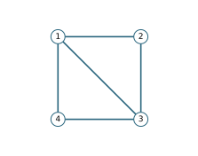
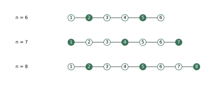
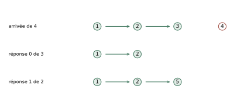

# ENS de Lyon · Second concours · Informatique 2021 · Corrigé guidé

*Corrigé rédigé par IA, non officiel. Signalez toute erreur.*

**Rédaction** · GPT-6.2 Astra Ultra · vitesse non renseignée · 24 novembre 2026

## Repères de résolution

Dans une puissance de matrice, distinguer longueur exacte et borne supérieure, et vérifier quelles opérations jouent le rôle d’addition et de multiplication. Dans le jeu de la lumière, compter modulo deux. Pour les ordinateurs, les machines défectueuses peuvent changer de réponse entre deux questions.

## Partie 1 · Puissances de matrices d’adjacence

### Question 1 · Dessiner le graphe

**Indication.** Lire le triangle strictement supérieur de la matrice, pour compter chaque arête une fois.

#### Solution

Les sommets sont $1,2,3,4$. Les arêtes sont $12,13,14,23,34$. On peut dessiner le cycle $1,2,3,4,1$ avec la diagonale $13$. Les sommets 2 et 4 ne sont pas voisins.



### Question 2 · Produit booléen

**Indication.** Pour former la ligne i du produit, réunir les lignes de B dont les indices sont les voisins de i.

#### Solution

La première ligne de $C$ est le « ou » des lignes 2, 3 et 4 de $B$, soit $(1,1,0,1)$. Les lignes 2 et 4 de $A$ sélectionnent toutes deux les lignes 1 et 3 de $B$, dont le « ou » vaut $(1,1,1,1)$. La ligne 3 sélectionne les lignes 1, 2 et 4 de $B$ et donne aussi quatre uns. Ainsi

$$
 C=\begin{pmatrix}1&1&0&1\\1&1&1&1\\1&1&1&1\\1&1&1&1\end{pmatrix}.
$$


### Question 3 · Reconnaître une matrice d’adjacence

**Indication.** Tester la forme, la diagonale et la symétrie. La condition est aussi suffisante.

#### Solution

Pour un graphe simple non orienté, la matrice doit être carrée, booléenne, symétrique et de diagonale nulle. Réciproquement, poser une arête pour chaque coefficient 1 au-dessus de la diagonale construit un graphe ayant exactement cette matrice.
```python
def est_adjacence(a):
    n = len(a)
    if any(len(ligne) != n for ligne in a):
        return False
    for i in range(n):
        if a[i][i] != 0:
            return False
        for j in range(i):
            if a[i][j] not in (0, 1) or a[i][j] != a[j][i]:
                return False
    return True
```
Au pire le test effectue $O(n^2)$ comparaisons et utilise $O(1)$ mémoire auxiliaire.

### Question 4 · Puissance et longueur exacte

**Indication.** Isoler le dernier pas d’un chemin. Un sommet peut être visité plusieurs fois dans la définition du sujet.

#### Solution

Pour $k=1$, l’assertion est la définition de l’adjacence. Si elle est vraie au rang $k$, $(A^{k+1})_{ij}=\bigvee_h((A^k)_{ih}\land A_{hj})$ vaut 1 si et seulement s’il existe un chemin de longueur $k$ de $i$ à $h$ suivi de l’arête $hj$. La concaténation, et réciproquement la suppression du dernier pas, établissent l’équivalence.

### Question 5 · Ajouter le droit d’attendre

**Indication.** Que représente un passage de i à i par un coefficient diagonal de B ?

#### Solution

Dans $B=I\lor A$, une étape est une arête ou une attente de coût nul en nombre d’arêtes réelles. Tout chemin de longueur $s\le k$ se complète avec $k-s$ attentes, et toute suite de $k$ étapes permises par $B$ devient, en supprimant les attentes, un chemin de longueur au plus $k$. L’argument de Q4 s’applique à ces étapes. En particulier $i$ est accessible depuis lui-même par zéro arête.

### Question 6 · Trois critères de connexité

**Indication.** Montrer qu’un plus court chemin ne répète aucun sommet, puis utiliser la réversibilité des arêtes.

#### Solution

Dans un graphe connexe de $n\ge1$ sommets, le plus court chemin entre deux sommets distincts est simple, donc de longueur au plus $n-1$. Puisque $k\ge n$, Q5 donne des uns partout. Cela donne en particulier des uns sur la première ligne. Réciproquement, si le sommet 1 atteint chacun des sommets, on va de $i$ à $j$ en inversant le chemin de 1 à $i$ puis en prenant celui de 1 à $j$. Cette concaténation prouve la connexité même si elle dépasse $k$. La borne $k\ge n-1$ suffirait.

### Question 7 · Connexité par élévations au carré

**Indication.** Partir de l’exposant 1 et le doubler, sans recalculer les puissances intermédiaires.

#### Solution

La fonction suivante reçoit comme second argument la multiplication booléenne rapide supposée par la question.
```python
def connexe_par_carres(a, produit_booleen):
    n = len(a)
    if n <= 1:
        return True
    b = [[bool(a[i][j]) or i == j for j in range(n)]
         for i in range(n)]
    exposant = 1
    while exposant < n:
        b = produit_booleen(b, b)
        exposant *= 2
    return all(b[0])
```
Après $t$ passages, $b=(I\lor A)^{2^t}$. Il suffit de $\lceil\log_2 n\rceil$ produits de coût $O(n^\alpha)$, plus $O(n^2)$ pour former $B$. Q6 justifie la dernière ligne. Pour l’entrée vide, le code adopte la connexité au sens de la condition universelle du sujet.

### Question 8 · Compter plutôt que constater

**Indication.** Classer les chemins par leur avant-dernier sommet.

#### Solution

Pour $k=1$, $A_{ij}$ compte les chemins d’une arête. Si $(A^k)_{ih}$ compte les chemins de longueur $k$ de $i$ à $h$, chacun se prolonge en $j$ de $A_{hj}$ façons. Les classes de chemins obtenues pour différents $h$ sont disjointes. Leur somme $\sum_h(A^k)_{ih}A_{hj}$ donne donc le nombre voulu à la longueur $k+1$. Les répétitions de sommets et d’arêtes sont autorisées.

### Question 9 · Graphes dont les coefficients restent bornés

**Indication.** Chercher deux manières différentes de revenir en deux pas au même sommet.

#### Solution

Les graphes cherchés sont exactement les unions disjointes de sommets isolés et d’arêtes isolées, autrement dit ceux de degré maximal au plus un. Dans un tel graphe, le pas suivant est imposé ou impossible, donc chaque coefficient de chaque puissance vaut 0 ou 1. Inversement, si $v$ a deux voisins distincts $u,w$, les excursions $vuv$ et $vwv$ se concatènent librement. Pour chaque mot de $p$ choix on obtient un chemin distinct de $v$ à $v$ de longueur $2p$. Le coefficient diagonal correspondant vaut au moins $2^p$ et n’est pas borné.

### Question 10 · Distances en algèbre min-plus

**Indication.** Associer le coût 0 à l’attente, 1 à chaque arête et l’infini à un saut interdit.

#### Solution

Par récurrence, $(A^k)_{ij}$ est le coût minimum d’une succession de $k$ étapes, chacune étant une attente gratuite ou une arête de coût 1. La récurrence consiste à minimiser sur le dernier sommet intermédiaire la somme des deux coûts. Un plus court chemin accessible est simple, de longueur $s\le n-1$, et on le complète jusqu’à $n$ étapes par des attentes. Tout trajet admissible comportant $q$ arêtes coûte $q$, au moins la distance. Ainsi $(A^n)_{ij}$ est la distance ordinaire, avec $0$ pour $i=j$ et $+\infty$ pour deux composantes différentes.

### Question 11 · Longueur paire et longueur bornée

**Indication.** Une attente pour compléter jusqu’à k ne change pas la parité du nombre d’arêtes réellement parcourues.

#### Solution

Prenons $F=\mathcal P(\{0,1\})$, un ensemble de quatre coefficients. Un coefficient enregistre toutes les parités disponibles. La somme est l’union. Le produit vaut $S\otimes T=\{(s+t)\bmod2:s\in S,\ t\in T\}$. L’ensemble vide est absorbant pour le produit et neutre pour l’union. Pour représenter le graphe, posons $A_{ii}=\{0\}$ (attente), $A_{ij}=\{1\}$ sur les arêtes et $\varnothing$ ailleurs. Une concaténation additionne les parités modulo deux, et l’union parcourt les choix de sommets intermédiaires. Par récurrence puis suppression des attentes comme en Q5, $(A^k)_{ij}$ contient exactement les parités des chemins d’au plus $k$ arêtes entre $i$ et $j$. La réponse est oui si $0\in(A^k)_{ij}$. Une case peut porter simultanément 0 et 1.

## Partie 2 · Allumer la lumière

### Question 12 · Parité des interrupteurs

**Indication.** Regarder, ampoule par ampoule, le nombre total de basculements.

#### Solution

Chaque action ajoute, modulo deux, le vecteur indicateur du sommet et de ses voisins. L’addition est commutative, et deux actions du même interrupteur s’annulent. On conserve uniquement $x_j\in\{0,1\}$, la parité du nombre d’actions en $j$. Actionner une fois les indices où $x_j=1$, dans un ordre quelconque, réalise la même configuration.

### Question 13 · Condition de victoire

**Indication.** Combien d’actions changent l’état de l’ampoule i ?

#### Solution

Pour tout $i$, le total $x_i+\sum_j a_{ij}x_j$ doit être impair. Ainsi, sur le corps $\mathbf F_2$, la condition cherchée est $(I+A)x=\mathbf1$. Le terme $x_i$ compte l’action propre, absente de la diagonale de $A$.

### Question 14 · Parcourir toutes les stratégies

**Indication.** Chaque entier de 0 à deux puissance n moins un décrit exactement un sous-ensemble des interrupteurs.

#### Solution

```python
def exhaustive(a):
    n = len(a)
    for masque in range(1 << n):
        x = [(masque >> j) & 1 for j in range(n)]
        for i, ligne in enumerate(a):
            changements = x[i] + sum(ligne[j] * x[j] for j in range(n))
            if changements % 2 == 0:
                break
        else:
            return x
    return "Impossible"
```
Le test est précisément celui de Q13. Chaque stratégie apparaît une fois et le premier succès est valable. Avec la matrice dense, la borne supérieure est $O(2^n n^2)$ opérations dans le modèle où lire un bit coûte une unité. Le vecteur courant coûte $O(n)$ mémoire auxiliaire. Sur listes de voisins, la même vérification coûte $O(n+|E|)$ par stratégie.

### Question 15 · Éclairer un cycle

**Indication.** Un interrupteur actionné partout donne quel nombre d’actions sur une lampe ?

#### Solution

Pour $n\ge3$, actionner tous les interrupteurs. Chaque lampe bascule trois fois, une par elle-même et deux par ses voisins, donc s’allume. Si le cas $n=2$ du texte désigne le graphe simple réduit à une arête, chaque sommet n’a qu’un seul voisin distinct. Un seul interrupteur allume les deux lampes. Cela traite aussi la convention où le cycle usuel n’est défini qu’à partir de trois sommets.

### Question 16 · Éclairer une ligne

**Indication.** Choisir des centres dont les voisinages fermés forment une partition de la ligne.

#### Solution

Numérotons les sommets de 1 à $n$. Si $n\equiv0\pmod3$, actionner $2,5,\ldots,n-1$. Les voisinages fermés sont les triplets successifs. Si $n\equiv1\pmod3$, actionner $1,4,\ldots,n$. Les deux extrémités couvrent chacune deux sommets et les centres intérieurs en couvrent trois. Si $n\equiv2\pmod3$, actionner $2,5,\ldots,n$. Le dernier centre couvre les deux derniers sommets, les précédents forment des triplets. Dans les trois cas chaque ampoule bascule exactement une fois. Pour $n=2$, l’unique centre proposé est 2.



## Partie 3 · Majorité de machines correctes

### Question 17 · Identifier le statut d’un ordinateur donné

**Indication.** Si la machine examinée est mauvaise, combien de réponses « bon » les autres peuvent-elles donner au maximum ?

#### Solution

Pour $N=2n+1$, interroger tous les ordinateurs sauf $j$. Si $j$ est bon, au moins $n$ des autres sont bons et répondent 1. S’il est mauvais, les autres contiennent au plus $n-1$ mauvais, seuls capables de répondre 1. Le seuil est donc $n$, y compris lorsqu’il y a exactement égalité parmi les $2n$ réponses.
```python
def est_bon(N, j, Q):
    n = N // 2
    oui = sum(Q(i, j) for i in range(1, N + 1) if i != j)
    return oui >= n
```
Ce code pose exactement $N-1$ questions, zéro si $N=1$. Interroger les $N$ machines et prendre la majorité ordinaire donnerait aussi une solution linéaire.

### Question 18 · Recherche exhaustive d’un bon ordinateur

**Indication.** Combien de candidats peut-on écarter au plus avant que tous les autres soient certainement bons ?

#### Solution

Tester les candidats par Q17. Après $n$ échecs, les $n$ mauvais possibles sont déjà connus et n’importe quel suivant convient.
```python
def trouver_naif(N, Q):
    n = N // 2
    for j in range(1, n + 1):
        if est_bon(N, j, Q):
            return j
    return n + 1
```
Au pire ce code pose $n(N-1)$ questions, soit $\Theta(N^2)$ quand $N$ croît. Cet ordre est celui de la stratégie proposée, pas une borne inférieure du problème.

### Question 19 · Écarter les questions réflexives

**Indication.** Un ordinateur mauvais a le droit d’imiter en permanence la réponse qu’un bon donnerait sur lui-même.

#### Solution

Un bon répond toujours 1 à $Q(i,i)$. Le mauvais peut lui aussi répondre 1. Donc l’oracle est autorisé à répondre 1 à toutes les auto-interrogations pour chaque attribution de statuts. Un algorithme garanti dans le pire cas peut remplacer systématiquement cette interrogation par la constante 1. Une réponse 0 serait révélatrice si elle se produisait, mais on ne peut la forcer.

### Question 20 · Élimination d’une paire

**Indication.** Si la première machine dit vrai, que sait-on de la seconde ? Si elle ment, que sait-on de la première ?

#### Solution

Si $Q(i,j)=0$ pour $i\ne j$, les deux ne peuvent être bons simultanément. Retirer ces deux machines supprime au plus un bon et au moins un mauvais. La différence entre nombres de bons et de mauvais reste donc strictement positive.

### Question 21 · Chaîne de réponses positives

**Indication.** Dès qu’une machine de la chaîne dit nécessairement vrai, suivre les arêtes positives vers la droite.

#### Solution

Si $i_p$ est bon et $p<k$, son 1 atteste que $i_{p+1}$ est bon. La récurrence donne que tous les ordinateurs de $i_p$ à $i_k$ sont bons. Pour $p=k$, la conclusion est immédiate. Aucune information sur le préfixe avant $p$ n’est nécessaire.

### Question 22 · Trouver un bon ordinateur par une pile

**Indication.** Maintenir une chaîne positive. Lors d’une réponse négative, quels deux sommets peut-on enlever ensemble ?

#### Solution

```python
def trouver_lineaire(N, Q):
    pile = []
    for j in range(1, N + 1):
        if not pile:
            pile.append(j)
        elif Q(pile[-1], j):
            pile.append(j)
        else:
            pile.pop()
    return pile[-1]
```
Une réponse 0 élimine l’ancien sommet et le nouvel arrivant, et laisse intacte la chaîne positive du reste de la pile. Une réponse 1 prolonge cette chaîne. Par Q20, l’ensemble des ordinateurs non éliminés (pile et candidats encore non examinés) a toujours une majorité stricte de bons. À la fin la pile est donc non vide et contient au moins un bon. Par Q21, son dernier élément est bon. Après le premier élément, chaque nouvel arrivant demande au plus une question, aucune si la pile est vide. Le pire cas exact est **$N-1$ questions**, atteint si tous sont bons. Le temps usuel est linéaire et la pile occupe au plus $N$ places.


