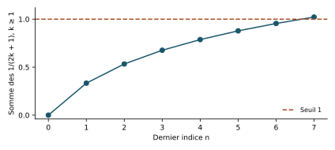

# ENS de Lyon · Second concours — Mathématiques 2021 · Corrigé guidé

*Corrigé rédigé par IA, non officiel. Signalez toute erreur.*

**Rédaction** · GPT-6.2 Astra Ultra · vitesse non renseignée

**Révision** · GPT-6.2 Astra Ultra · vitesse non renseignée · 26 novembre 2026

La composition du second concours, d’une durée de trois heures, comporte deux problèmes. Le premier mène de l’intégrale de Dirichlet aux intégrales de Borwein. Le second caractérise les sous-algèbres nilpotentes de dimension maximale. Les identifiants reprennent chaque problème et ses parties. [Sujet officiel](https://banques-ecoles.fr/cms/wp-content/uploads/2021/07/2c2021_math_v2.pdf) · [Rapport du jury](https://banques-ecoles.fr/cms/wp-content/uploads/2021/08/21_2CC_rap_eMath.pdf)

## Problème 1, partie I. Transformée de Laplace du sinus cardinal

### Question 1.I.1

> [!INDICATION]
> À x nul, intégrer par parties sur une queue et garder le terme de bord.

#### Solution

Le quotient $\sin t/t$ tend vers un en zéro, donc l’intégrande se prolonge continûment à cette extrémité. Si $x>0$, il est majoré en module par $e^{-tx}$, car $|\sin t|\le t$, d’où convergence absolue. Pour $x=0$, sur $1\le A<B$,
$$\int_A^B\frac{\sin t}{t}\,dt=\left[-\frac{\cos t}{t}\right]_A^B-\int_A^B\frac{\cos t}{t^2}\,dt.$$
Le terme de bord a une limite pour $B\to\infty$ et l’intégrale restante converge absolument. Ainsi $F$ est bien définie sur $[0,\infty[$.

### Question 1.I.2

> [!INDICATION]
> Utiliser la décroissance de l’exponentielle et la borne du sinus.

#### Solution

Pour $x>0$, $|e^{-tx}\sin t|\le e^{-tx}$ sur la demi-droite. Le majorant a une intégrale $1/x$ finie et l’intégrande est continu, donc $G(x)$ est bien définie.

### Question 1.I.3

> [!INDICATION]
> Chercher une borne de F qui tende vers zéro.

#### Solution

Pour $x>0$, $|F(x)|\le\int_0^\infty e^{-tx}dt=1/x$ puisque $|\sin t|\le t$. Par encadrement $F(x)\to0$ quand $x\to+\infty$.

### Question 1.I.4

> [!INDICATION]
> Se placer localement à distance strictement positive de zéro pour dériver.

#### Solution

Sur tout segment $[a,b]\subset]0,\infty[$, la dérivée en $x$ de l’intégrande est $-e^{-tx}\sin t$, majorée en module par $e^{-at}$ intégrable. L’intégrande initial est lui aussi dominé par $e^{-at}$. Le théorème de dérivation sous le signe intégral donne $F\in C^1(]0,\infty[)$ avec $F'(x)=-G(x)$.

### Question 1.I.5

> [!INDICATION]
> Prendre la partie imaginaire de l’intégrale exponentielle.

#### Solution

Pour $x>0$, l’intégrale absolument convergente de $e^{(-x+i)t}$ entre zéro et l’infini vaut $1/(x-i)=(x+i)/(1+x^2)$. En prenant sa partie imaginaire on obtient $G(x)=1/(1+x^2)$.

### Question 1.I.6

> [!INDICATION]
> Fixer la constante de la primitive par le comportement à l’infini.

#### Solution

Puisque $F'(x)=-1/(1+x^2)$, la fonction $F(x)+\arctan x$ est constante sur $]0,\infty[$. Par 3 sa limite à l’infini est $\pi/2$. Ainsi $F(x)=\pi/2-\arctan x$ pour $x>0$.

### Question 1.I.7

> [!INDICATION]
> Pour la queue, obtenir une estimation uniforme même en zéro.

#### Solution

Sur $[0,1]$, l’intégrande prolongé est continu en $(x,t)$ et majoré par un pour $x\ge0$. La convergence dominée donne la continuité de la première intégrale. Pour la seconde, les intégrales de $1$ à $R$ sont continues en $x\ge0$. Posons $a_x(t)=e^{-xt}/t$, positive décroissante en $t$. Une intégration par parties sur $[R,B]$, avec la primitive $-\cos t$, donne pour $B>R\ge1$
$$\left|\int_R^B a_x(t)\sin t\,dt\right|\le a_x(B)+a_x(R)+\int_R^B|a_x'(t)|\,dt=2a_x(R)\le2/R.$$
L’estimation est uniforme en $x\ge0$, y compris à $x=0$, où la convergence est conditionnelle. En faisant $B\to\infty$, les intégrales tronquées convergent uniformément vers la seconde fonction, donc elle est continue.

### Question 1.I.8

> [!INDICATION]
> Prendre la limite à droite de la formule explicite.

#### Solution

La question 7 rend $F$ continue à l’origine. Par 6, $F(0)=\lim_{x\downarrow0}(\pi/2-\arctan x)=\pi/2$. C’est exactement la valeur de l’intégrale de Dirichlet.

## Problème 1, partie II. Intégrales de Borwein

### Question 1.II.1

> [!INDICATION]
> Examiner la parité de chaque multiplicité après développement.

#### Solution

Développons $b_\varepsilon^r=(a_0+\sum_{j=1}^n\varepsilon_j a_j)^r$ par le multinôme. Dans un monôme où $\varepsilon_j$ apparaît $k_j$ fois, la multiplication par $s_\varepsilon$ lui donne l’exposant $k_j+1$. Par indépendance et symétrie des signes, son espérance est nulle sauf si chaque $k_j$ est impair. Il faut donc $r\ge n$. Si $r=n$, chacun vaut un et aucun facteur $a_0$ n’intervient. Il y a $n!$ ordres possibles, d’où $\mathbb E(s_\varepsilon b_\varepsilon^n)=n!\prod_{j=1}^n a_j$. Pour $n=r=0$ l’espérance vaut un, par produit vide.

### Question 1.II.2

> [!INDICATION]
> Former l’espérance de l’exponentielle complexe puis prendre sa partie réelle.

#### Solution

On a $\mathbb E(\varepsilon_k e^{it\varepsilon_k a_k})=i\sin(a_kt)$. Par indépendance,
$$\mathbb E(s_\varepsilon e^{ib_\varepsilon t})=e^{ia_0t}i^n\prod_{k=1}^n\sin(a_kt).$$
Multiplions par $e^{-i\pi(n+1)/2}$. Le facteur constant devient $-i$ et la partie réelle de $-ie^{ia_0t}$ vaut $\sin(a_0t)$. On obtient exactement le produit des $n+1$ sinus.

### Question 1.II.3

> [!INDICATION]
> Intégrer par parties n fois sans séparer les termes près de zéro.

#### Solution

Écrivons $H(t)=\prod_{k=0}^n\sin(a_kt)$. Pour $0\le j\le n$,
$$H^{(j)}(t)=\mathbb E\bigl(s_\varepsilon b_\varepsilon^j\cos(b_\varepsilon t-\pi(n+1-j)/2)\bigr).$$
Ceci vient de 2 et de la dérivation d’une somme finie. La fonction $H$ a un zéro d’ordre $n+1$ en zéro, donc $H^{(j)}(t)=O(t^{n+1-j})$ à cette extrémité. Toutes ces dérivées sont bornées à l’infini. Pour $j<n$, intégrer $H^{(j)}(t)/t^{n+1-j}$ par parties donne l’intégrale de $H^{(j+1)}(t)/[(n-j)t^{n-j}]$. Le bord $H^{(j)}(t)/t^{n-j}$ tend vers zéro aux deux extrémités. Les intégrales intermédiaires pour $j<n$ convergent absolument, près de zéro par l’ordre d’annulation et à l’infini par la puissance du dénominateur.

Le premier passage, pour $n\ge1$, donne bien $\int_0^\infty\mathbb E[s_\varepsilon b_\varepsilon\cos(b_\varepsilon t-\pi n/2)]/(nt^n)\,dt$. Après les $n$ passages il reste
$$\frac1{n!}\int_0^\infty\frac{\mathbb E[s_\varepsilon b_\varepsilon^n\sin(b_\varepsilon t)]}{t}\,dt.$$
Pour $b\ne0$, l’intégrale de $\sin(bt)/t$ est $\operatorname{sgn}(b)\pi/2$ par I.8 et changement d’échelle. Pour $b=0$ et $n\ge1$ le coefficient $b^n$ est nul, ce qui rend sans effet la convention $\operatorname{sgn}(0)=1$. La somme de signes étant finie, le membre final vaut $\pi\mathbb E[s_\varepsilon b_\varepsilon^n\operatorname{sgn}(b_\varepsilon)]/(2n!)$. Pour $n=0$, la formule finale est directement I.8 avec $b=a_0>0$ ; l’étape intermédiaire contenant $1/n$ ne s’applique pas.

### Question 1.II.4a

> [!INDICATION]
> Prendre le minimum de la somme signée.

#### Solution

La plus petite valeur possible est $a_0-\sum_{k=1}^n a_k\ge0$. Tous les $b_\varepsilon$ ont donc le signe $+1$ selon la convention du sujet, y compris lorsque le minimum est nul.

### Question 1.II.4b

> [!INDICATION]
> Identifier l’espérance à l’ordre n et rétablir la normalisation.

#### Solution

Par II.3 et II.4a, l’intégrale des sinus divisés par $t$ vaut $\pi\mathbb E(s_\varepsilon b_\varepsilon^n)/(2n!)=(\pi/2)\prod_{k=1}^n a_k$ par II.1. Pour passer au produit de $\sin(a_kt)/(a_kt)$, divisons par $\prod_{k=0}^n a_k$. Le résultat est $\pi/(2a_0)$.

### Question 1.II.5a

> [!INDICATION]
> Comparer tout changement de signe au défaut de la somme minimale.

#### Solution

Posons $\delta=\sum_{k=1}^na_k-a_0>0$. L’autre hypothèse donne $\delta\le a_n$. Le choix de tous les signes négatifs donne $b_\varepsilon=-\delta<0$. Inverser au moins un signe ajoute au moins $2a_k\ge a_n\ge\delta$, donc tout autre choix donne $b_\varepsilon\ge0$.

### Question 1.II.5b

> [!INDICATION]
> Retrancher deux fois la contribution de l’unique configuration négative.

#### Solution

Dans l’espérance de II.3, remplacer le signe par un introduit exactement l’erreur due à la configuration toute négative, de probabilité $2^{-n}$. Sur elle $s_\varepsilon b_\varepsilon^n=(-1)^n(-\delta)^n=\delta^n$. Ainsi l’espérance corrigée vaut $n!\prod_{k=1}^n a_k-2^{1-n}\delta^n$. En divisant à nouveau par tous les $a_k$,
$$\int_0^\infty\prod_{k=0}^n\frac{\sin(a_kt)}{a_kt}\,dt
=\frac{\pi}{2a_0}\left(1-\frac{\delta^n}{n!2^{n-1}\prod_{k=1}^n a_k}\right).$$

### Question 1.II.6

> [!INDICATION]
> Chercher le premier indice où la somme des fréquences dépasse un.

#### Solution

Prenons $a_k=1/(2k+1)$ avec $a_0=1$. La somme $S_n=\sum_{k=1}^na_k$ croît et diverge, par comparaison à la série harmonique. Le premier dépassement survient en fait à $n=7$, car
$$S_6=43024/45045<1,\qquad S_7=46027/45045>1.$$
Pour $n\le6$, II.4b donne exactement $\pi/2$. Au rang sept, $S_6\le1<S_7$ et $a_k\ge a_7$ pour $k\le7$, donc les hypothèses de II.5 sont satisfaites. Son terme correctif est strictement positif, ce qui donne une intégrale strictement inférieure à $\pi/2$. On peut prendre $N=6$.

La différence relative au septième rang est petite mais strictement positive. Ici $\delta=S_7-1=982/45045$. D’après II.5b, la perte relative à $\pi/2$ vaut $\delta^7(3\cdot5\cdot7\cdot9\cdot11\cdot13\cdot15)/(7!\,2^6)$, soit environ $1{,}47\times10^{-11}$. Un simple arrondi à dix décimales masquerait donc le franchissement.

## Problème 2. Sous-algèbres nilpotentes

### Question 2.1

> [!INDICATION]
> Tronquer les puissances à l’indice de nilpotence.

#### Solution

Pour $n=\dim E\ge1$, soit $m$ l’indice de nilpotence de $f$, avec $1\le m\le n$ par Cayley–Hamilton. L’espace engendré par les puissances positives est engendré par $f,\ldots,f^{m-1}$, donc sa dimension est au plus $m-1<n$. Un produit de deux éléments est encore une combinaison de puissances positives. Chaque élément est de la forme $fP(f)$ et sa puissance $m$ vaut $f^mP(f)^m=0$. C’est bien une sous-algèbre nilpotente, avec l’énoncé corrigé paru dans le sujet officiel. La dimension positive est implicite dans les assertions de dimension stricte et de noyau commun non nul.

### Question 2.2

> [!INDICATION]
> Choisir une contrainte triangulaire conservée par les produits.

#### Solution

Dans une base fixée, les matrices strictement triangulaires supérieures forment un sous-espace stable par multiplication. Leur puissance $n$ est nulle, car chaque application envoie le sous-espace des $j$ premiers vecteurs de base dans celui des $j-1$ premiers. Les coefficients libres sont les $n(n-1)/2$ positions strictement au-dessus de la diagonale.

### Question 2.3a

> [!INDICATION]
> Choisir une dimension minimale parmi les sous-espaces stables non nuls.

#### Solution

L’espace $E$ lui-même est stable par tous les éléments de $V$ et non nul. Les dimensions des sous-espaces communément stables non nuls forment donc une partie non vide de $\{1,\ldots,n\}$. Elle possède un minimum réalisé par l’un de ces sous-espaces $W$.

### Question 2.3b

> [!INDICATION]
> Identifier une image linéaire et exploiter la fermeture par composition.

#### Solution

Pour $w\in W\setminus\{0\}$, l’application $V\to E$, $f\mapsto f(w)$, est linéaire, donc son image $W'$ est un sous-espace. Comme $W$ est stable, $W'\subset W$. Pour $g,f\in V$, $g(f(w))=(gf)(w)\in W'$ par stabilité de l’algèbre. Enfin, si $w\in W'$, il existerait $f\in V$ avec $f(w)=w$, donc $f^j(w)=w$ pour tout $j$. La nilpotence impliquerait $w=0$, contradiction.

### Question 2.3c

> [!INDICATION]
> Appliquer la minimalité à chaque vecteur non nul de W.

#### Solution

Le sous-espace $W'$ est strictement contenu dans $W$ puisqu’il ne contient pas $w$. Stable par $V$, il doit donc être nul par minimalité de la dimension de $W$. Ainsi tout $f\in V$ annule $w$. Le raisonnement vaut pour chaque $w\in W\setminus\{0\}$, et aussi pour zéro. On a $W\subset\bigcap_{f\in V}\ker f$, d’où un noyau commun non nul.

### Question 2.4

> [!INDICATION]
> Quotienter par une droite commune du noyau et relever une base.

#### Solution

Par récurrence sur $n$, le cas d’une dimension est immédiat car tout endomorphisme nilpotent y est nul. Choisissons $e_1\ne0$ du noyau commun et posons $L=\mathbb C e_1$. Chaque $f$ induit $\bar f$ sur $E/L$. L’image de $V$ est une sous-algèbre, car le passage au quotient préserve les sommes et les produits. Chacun de ses éléments est nilpotent car $\bar f^m=\overline{f^m}$. Par récurrence, il existe une base du quotient où tous les $\bar f$ sont triangulaires supérieurs. En relevant ses vecteurs et en les faisant précéder de $e_1$, on obtient une base de $E$ où la première colonne de chaque $f$ est nulle et le bloc inférieur droit triangulaire supérieur. Toute la matrice est triangulaire supérieure.

### Question 2.5

> [!INDICATION]
> Observer la diagonale de chaque matrice puis caractériser l’égalité d’une inclusion.

#### Solution

Dans la base commune de 4, chaque diagonale est nulle, car les coefficients diagonaux d’une matrice triangulaire sont ses valeurs propres et une matrice nilpotente n’a que zéro comme valeur propre. Ainsi $V$ est contenue dans l’espace des matrices strictement triangulaires supérieures, de dimension $n(n-1)/2$ par 2. Il y a égalité exactement lorsque cette inclusion est une égalité, autrement dit lorsque, dans une certaine base, $V$ est l’algèbre entière des matrices strictement triangulaires supérieures. Réciproquement cette algèbre et ses conjuguées réalisent la borne.
