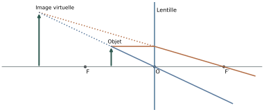
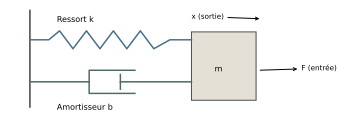
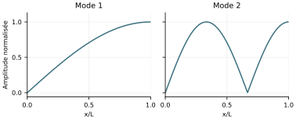
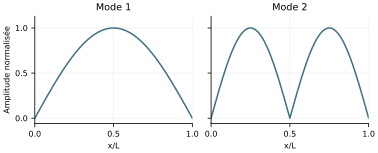
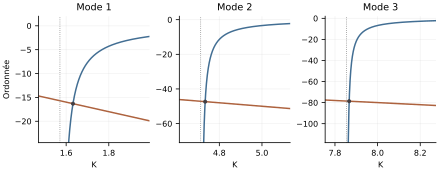

# ENS de Lyon, second concours 2021 — Physique · Corrigé brut

*Corrigé rédigé par IA, non officiel. Signalez toute erreur.*

**Rédaction** · GPT-6.2 Astra Ultra · vitesse non renseignée

## A — Questionnaire de physique

### Question A1 — Loupe

Placer l’objet entre le foyer objet $F$ et le centre $O$. Le rayon issu du sommet qui arrive parallèlement à l’axe émerge en passant par $F'$. Le rayon passant par $O$ conserve sa direction. Les prolongements en arrière des rayons émergents se coupent du côté de l’objet. L’image est virtuelle, droite et agrandie.

### Question A2 — Énergie d’un ressort

Pour un ressort de raideur $k$, de longueur $\ell$ et de longueur à vide $\ell_0$, $E_p=\tfrac12 k(\ell-\ell_0)^2$ en prenant l’origine d’énergie à la longueur à vide.

### Question A3 — Filtre mécanique

Relier une masse $m$ à un bâti par un ressort et un amortisseur visqueux en parallèle. L’entrée est la force $F$ appliquée à la masse, la sortie son déplacement $x$. La réponse harmonique est $X/F=(k-m\omega^2+i b\omega)^{-1}$. Son module part de $1/k$ et tend vers zéro en $1/(m\omega^2)$. Le choix $b^2\ge 2mk$ donne un module décroissant à toute fréquence.

### Question A4 — Référentiel galiléen

Un référentiel est galiléen si tout point matériel isolé y conserve une vitesse constante. Le repos en est un cas particulier.

### Question A5 — Théorème de Gauss

Le flux électrique à travers toute surface fermée orientée vers l’extérieur vaut la charge totale intérieure divisée par $\varepsilon_0$, soit $\displaystyle\oint_S\mathbf E\cdot\mathrm d\mathbf S=Q_{\rm int}/\varepsilon_0$.

### Question A6 — Viscosité dynamique

La contrainte de cisaillement est le produit de la viscosité dynamique par un gradient de vitesse. Ainsi $[\eta]=M L^{-1}T^{-1}$, en $\mathrm{Pa\,s}=\mathrm{kg\,m^{-1}\,s^{-1}}$.

### Question A7 — Maxwell-Ampère

Dans le vide, avec des sources éventuelles, $\nabla\times\mathbf B=\mu_0\mathbf j+\mu_0\varepsilon_0\,\partial_t\mathbf E$. Dans une région vide de courant de conduction, $\mathbf j=0$.

### Question A8 — Effet de peau

Un courant alternatif se concentre vers la surface d’un bon conducteur. Dans un conducteur homogène semi-infini, en régime de conduction, son amplitude décroît comme $\exp(-z/\delta)$ à la profondeur $z$, où $\delta=\sqrt{2/(\mu\sigma\omega)}$.

### Question A9 — Équation de la chaleur

Pour un solide immobile homogène de conductivité $\lambda$, de capacité thermique massique $c_p$ et de masse volumique $\rho$, $\rho c_p\partial_t T=\lambda\Delta T+\dot q_v$. Sans source volumique, $\partial_t T=D_{\rm th}\Delta T$ avec $D_{\rm th}=\lambda/(\rho c_p)$.

### Question A10 — Année-lumière

C’est la distance parcourue dans le vide par la lumière en une année julienne, soit environ $9{,}46\times10^{15}\ \mathrm m$.

## B — Acoustique linéaire

### Question B1 — Compressibilité isentropique

À entropie constante $PV^\gamma$ est constant pour une masse fixée de gaz parfait. Sa différentielle donne $\chi_S=-(\partial V/\partial P)_S/V=1/(\gamma P_0)$. Les molécules majoritaires de l’air sont diatomiques. À 300 K, trois degrés de translation et deux de rotation donnent $C_V=5R/2$, $C_P=7R/2$, $\gamma=1{,}4$. Avec $P_0=10^5\ \mathrm{Pa}$, $\chi_S=7{,}14\times10^{-6}\ \mathrm{Pa^{-1}}$.

### Question B2 — Linéarisation de l’accélération

Les ordres de grandeur des termes local et convectif sont respectivement $\omega v_m$ et $k v_m^2$. Le rapport est $k v_m/\omega=v_m/c$. La vitesse particulaire doit être petite devant la célérité de phase $\omega/k$.

### Question B3 — Équations mécaniques au premier ordre

L’état de repos est uniforme. Dans l’inertie, $\rho_1\partial_t\mathbf v$ est d’ordre deux, tout comme $\nabla\cdot(\rho_1\mathbf v)$ dans le bilan de masse. Il reste
$$\rho_0\partial_t\mathbf v=-\nabla p_1,\qquad \partial_t\rho_1+\rho_0\nabla\cdot\mathbf v=0.$$

### Question B4 — Bilan des inconnues

Les trois composantes de $\mathbf v$, $p_1$ et $\rho_1$ font cinq champs scalaires inconnus. Euler donne trois relations scalaires et la continuité une quatrième. Il manque une loi de comportement thermodynamique.

### Question B5 — Fermeture thermodynamique

L’évolution adiabatique sans dissipation est isentropique pour chaque parcelle. Avec $\chi_S=\rho^{-1}(\partial\rho/\partial P)_S$, le développement au premier ordre autour de l’état uniforme donne $\rho_1=\rho_0\chi_S p_1$. Pour le gaz parfait cela s’écrit aussi $p_1/P_0=\gamma\rho_1/\rho_0$.

### Question B6 — Équation d’onde et célérité

Dériver la continuité en temps, puis remplacer la divergence de $\partial_t\mathbf v$ par $-\Delta p_1/\rho_0$. On obtient $\partial_t^2\rho_1=\Delta p_1$, puis $\Delta p_1-c^{-2}\partial_t^2p_1=0$ avec $c=1/\sqrt{\rho_0\chi_S}=\sqrt{\gamma RT_0/M}$. Pour $M\simeq 29\times10^{-3}\ \mathrm{kg\,mol^{-1}}$ et $T_0=300\ \mathrm K$, $\rho_0\simeq1{,}16\ \mathrm{kg\,m^{-3}}$ et $c\simeq347\ \mathrm{m\,s^{-1}}$.

## Onde plane dans le tube

### Question B7 — Deux sens de propagation

La substitution d’une onde $\exp[i(\omega t-kx)]$ dans l’équation d’onde donne $k^2=\omega^2/c^2$. À $\omega>0$ fixé, $k_+=\omega/c$ décrit la marche vers $+x$ et $k_-=-\omega/c$ celle vers $-x$. Désormais $k=\omega/c>0$.

### Question B8 — Surpression des deux ondes

Avec $A=A_v$, $B=B_v$, l’équation d’Euler $i\omega\rho_0 v=-\partial_xp_1$ donne
$$p_1(x,t)=Z_i(Ae^{-ikx}-Be^{ikx})e^{i\omega t},\qquad Z_i=\rho_0 c.$$
Le signe opposé provient des deux dérivées spatiales de signes contraires.

### Question B9 — Impédance locale

En divisant la pression par la vitesse au même point, on trouve $Z(x)=Z_i(A-Be^{2ikx})/(A+Be^{2ikx})$. Le rapport s’entend là où la vitesse est non nulle. Une pression finie à un nœud de vitesse correspond à une impédance divergente.

### Question B10 — Impédance indépendante de la position

Hors champ nul, la dérivée spatiale du rapport de B9 s’annule identiquement seulement si $AB=0$. Si $B=0$, l’onde progresse seule vers $+x$ et $Z=+Z_i$. Si $A=0$, elle progresse seule vers $-x$ et $Z=-Z_i$. Le signe se rapporte à la vitesse algébrique comptée vers $+x$.

### Question B11 — Puissance rayonnée

En l’absence de retour du tube semi-infini, l’intensité moyenne orientée selon $+x$ vaut $\tfrac12\operatorname{Re}(p_1v^*)=Z_i|A|^2/2$. La source fournit de l’énergie réelle à de l’air situé de plus en plus loin. La conservation de l’énergie s’applique au tube entier et le flux traverse toute section fixe. Aucune conversion en chaleur n’est nécessaire pour que l’impédance vue à l’entrée soit réelle.

### Question B12 — Conditions aux deux extrémités

À l’entrée $A+B=v_0$. Au bout, $p_1(L)=Z_m v(L)$ donne $(1-Z^\star)A=e^{2ikL}(1+Z^\star)B$ avec $Z^\star=Z_m/Z_i$. Ainsi $A=Rv_0/(1+R)$ et $B=v_0/(1+R)$ pour $R=q(1+Z^\star)/(1-Z^\star)$ et $1+R\ne0$. Pour $Z^\star=1$, on retrouve directement $A=v_0$, $B=0$. Pour $R=-1$ et $v_0\ne0$, le problème sans pertes n’a pas de réponse harmonique finie.

### Question B13 — Extrémité ouverte

La pression s’annule en $L$, donc $A e^{-ikL}=B e^{ikL}$. Avec la condition d’entrée,
$$v(x,t)=v_0\frac{\cos[k(L-x)]}{\cos(kL)}e^{i\omega t}.$$
La vitesse physique est la partie réelle. C’est une onde stationnaire, somme de deux ondes progressives de même amplitude. L’ouverture est un ventre de vitesse.

### Question B14 — Résonances du tube ouvert

L’annulation de $\cos(kL)$ donne $k_n=(2n-1)\pi/(2L)$ et $\omega_n=c k_n$, $n=1,2,\ldots$. Dans le modèle idéal forcé, le dénominateur est nul. Les profils tracés sont ceux des modes propres, normalisés à leur maximum, ou ceux obtenus à la limite de la résonance. Leur amplitude est $|\sin(k_nx)|$. Le premier mode va du nœud d’entrée au ventre terminal. Le deuxième ajoute un nœud en $2L/3$ et un ventre en $L/3$.

### Question B15 — Extrémité fermée

Le bouchon impose $v(L)=0$, donc $Ae^{-ikL}=-Be^{ikL}$. La solution stationnaire vaut
$$v(x,t)=v_0\frac{\sin[k(L-x)]}{\sin(kL)}e^{i\omega t}.$$
Le bouchon est un nœud de vitesse et un ventre de pression.

### Question B16 — Résonances du tube fermé

Les pôles correspondent à $k_n=n\pi/L$, $\omega_n=n\pi c/L$ pour $n\ge1$. L’amplitude modale normalisée est $|\sin(n\pi x/L)|$. Les deux extrémités sont des nœuds. Au fondamental il y a un ventre au milieu. Pour $n=2$, le milieu est un nœud et les ventres sont en $L/4$ et $3L/4$.

### Question B17 — Fondamentales pour 5,28 mètres

Les conditions d’entrée sont celles de l’énoncé. Avec $L=5{,}28\ \mathrm m$ et $c\simeq347\ \mathrm{m\,s^{-1}}$, on obtient $f_{1O}=c/(4L)\simeq16{,}4\ \mathrm{Hz}$ et $f_{1F}=c/(2L)\simeq32{,}9\ \mathrm{Hz}$. Les qualificatifs « ouvert » et « fermé » désignent ici l’état de l’extrémité $x=L$.

### Question B18 — Condition sur la charge

En exprimant les ondes à partir de la vitesse complexe terminale $v_L$, on trouve $v(x)=v_L\{\cos[k(L-x)]+iZ^\star\sin[k(L-x)]\}$. Son amplitude à l’entrée impose $v_L=v_0/[\cos(kL)+iZ^\star\sin(kL)]$. Pour une charge finie et un $k$ réel, l’annulation du dénominateur exige $Z^\star=i\cot(kL)$. En particulier $\operatorname{Re}Z_m=0$. Une charge réactive peut stocker et rendre l’énergie. Une partie réelle positive emporte de la puissance, ce qui borne le pic de résonance.

## Couplage du tube à une cavité

### Question B19 — Pression uniforme dans la cavité

Le temps de traversée $D/c$ doit être court devant une période, soit $fD/c\ll1$. Le critère de faible variation de phase s’écrit plus précisément $kD=\omega D/c\ll1$.

### Question B20 — Compliance de la cavité

Au premier ordre, $\mathrm dm/\mathrm dt=\rho_0s v(L,t)$ et $m=(\rho_0+\rho_1)V$. Avec $\rho_1=\rho_0\chi_S p_1$ et la continuité de la pression à l’embouchure, $V\chi_S\,\partial_t p_1=s v(L,t)$. Ainsi $Z_m=p_1/v(L)=1/(i\omega G)$ avec $G=\chi_S V/s>0$. Le signe correspond à un débit entrant qui augmente la masse et la pression dans la cavité.

### Question B21 — Équation des résonances

Remplacer $Z^\star$ dans $\cos(kL)+iZ^\star\sin(kL)=0$. Il vient $\omega G Z_i\cos(kL)+\sin(kL)=0$, donc $\tan(\omega L/c)=-\omega GZ_i$ pour les résonances positives. Un pôle de la tangente ne satisfait pas l’équation initiale.

### Question B22 — Coefficient sans dimension

Comme $\chi_S\rho_0c^2=1$, $\omega G Z_i=(\omega/c)V/s$. Avec $K=kL$ il reste $\tan K=-\alpha K$, où $\alpha=V/(sL)$ est le rapport du volume de la cavité au volume d’air du tube.

### Question B23 — Résolution graphique

Pour $\alpha=10$, tracer $y=\tan K$ branche par branche et $y=-10K$. Sur chaque intervalle $((n-\tfrac12)\pi,n\pi)$, $\tan K+10K$ croît de $-\infty$ à une valeur positive. Il y a une intersection unique. Les trois premières abscisses sont $K_1\simeq1{,}6320$, $K_2\simeq4{,}7335$ et $K_3\simeq7{,}8667$. Pour $10K_n\gg1$, $K_n\simeq(n-\tfrac12)\pi+1/[10(n-\tfrac12)\pi]$. La racine formelle $K=0$ ne correspond pas à une résonance harmonique du système.

### Question B24 — Du bouchon à l’ouverture

À numéro de mode fixé, si $\alpha\to0$, $K_n\to n\pi$ par valeurs inférieures. La petite cavité est raide et ressemble à un bouchon. Si $\alpha\to\infty$, $K_n\to(n-\tfrac12)\pi$ par valeurs supérieures. La grande cavité maintient presque la pression ambiante et ressemble à une ouverture. À $\alpha$ fixé, $|Z_m|/Z_i=1/(\alpha K)$ diminue quand la fréquence augmente. Les modes élevés se rapprochent donc du cas ouvert, tant que la cavité reste petite devant la longueur d’onde.

### Question B25 — Estimation de l’inertie du gaz

Notons $v_t$ la vitesse caractéristique dans le tube. Le débit entrant vaut de l’ordre de $s v_t$. À l’échelle $D$ de la cavité, ce débit donne une vitesse moyenne d’ordre $u\sim s v_t/D^2$. Euler fournit alors une différence de pression inertielle $\Delta p_i\sim\rho_0\omega uD\sim\rho_0\omega s v_t/D$. Pendant une durée $1/\omega$, le volume injecté est d’ordre $s v_t/\omega$. La compressibilité donne $p_e\sim s v_t/(\omega\chi_S D^3)$. Le rapport vaut
$$\frac{\Delta p_i}{p_e}\sim\rho_0\chi_S\omega^2D^2=\left(\frac{\omega D}{c}\right)^2.$$
Donc $\omega D/c\ll1$ permet de représenter l’air intérieur par sa seule élasticité. Cette estimation à l’échelle de la cavité retrouve la condition d’uniformité de B19. Les détails locaux de l’écoulement près de l’orifice sont hors de ce modèle.

### Question B26 — Ligne de transmission équivalente

Choisir la surpression pour tension et le débit volumique $Q=s v$ pour courant. Les équations de B3 et B5 s’écrivent $\partial_xp_1=-(\rho_0/s)\partial_tQ$ et $\partial_xQ=-s\chi_S\partial_t p_1$. Le tube est donc une ligne sans pertes d’inductance linéique $\rho_0/s$ et de capacité linéique $s\chi_S$. La vitesse de ligne vaut $c$ et son impédance caractéristique en débit vaut $Z_i/s$. Un générateur de courant $s v_0 e^{i\omega t}$ alimente une extrémité. À l’autre, le condensateur $C_L=\chi_S V$ entre ligne et référence vérifie $Q(L)=C_L\partial_t p_1(L)$.

[Sujet officiel](https://banques-ecoles.fr/cms/wp-content/uploads/2021/06/21_2c_ephy.pdf) · [Rapport du jury](https://banques-ecoles.fr/cms/wp-content/uploads/2021/11/21_2CC_rap_ePhy.pdf)
