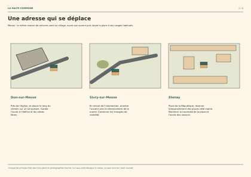
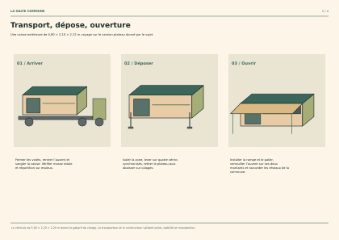
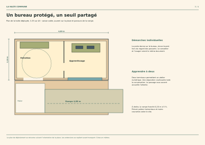
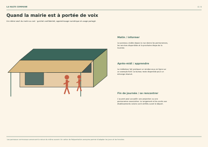

# ENS Paris-Saclay — Design d'espace 2021 · Corrigé guidé

*Corrigé rédigé par IA, non officiel.*

**Rédaction** · GPT-6.2 Astra Ultra · vitesse non renseignée

La halte commune apporte des services publics aux villages de la Meuse. Une caisse transportable se dépose sur la place, ouvre son auvent et facilite les entretiens, les démarches numériques et les rencontres. Les 4 planches numérotées et anonymes sont au format 420 × 297 mm. Les échelles indiquées valent pour une planche seule imprimée sur A3 à 100 %.

## Planche 1 — Une adresse qui se déplace

> [!INDICATION]
> Repérer l’arrivée à pied, le sol de dépose et les toilettes du bâtiment public voisin dans chacun des sites.

Le sujet place le service dans une communauté rurale de la Meuse. Les photos de Dun-sur-Meuse, Sivry-sur-Meuse et Stenay montrent trois contextes effectivement distincts. La caisse de services se pose au bord de l’espace déjà pratiqué et se repère à son auvent ocre. Avant une permanence, la commune teste la portance, le raccord électrique et Internet, vérifie le chemin accessible et indique les toilettes publiques. Une affiche de tournée à la mairie et un calendrier papier distribué à chaque halte informent aussi les personnes sans accès numérique. En cas de place occupée par le marché, le dispositif se décale vers une implantation équivalente vérifiée à l’avance.

## Planche 2 — Transport, dépose, ouverture

> [!INDICATION]
> Établir le gabarit en route avant de tracer les usages à l’arrêt. Aussitôt le camion parti, sur quoi la caisse repose-t-elle ?

Deux pistes ont été explorées. Le bus aménagé se gare vite, mais immobilise tout le véhicule et son niveau de plancher exige davantage de rampe. Une tente légère ouvre rapidement un espace de formation, mais protège mal la confidentialité d’une démarche. La caisse déposée conserve un local fermé et une façade qui s’ouvre vers le village. Elle laisse 0,20 m de marge en longueur, 0,10 m en largeur et 0,08 m en hauteur dans l’enveloppe proposée. Une ossature bois allégée et des panneaux en contreplaqué isolés portent un auvent textile repliable. Une plaque sous chaque appui répartit les charges. Le fabricant doit peser le prototype, calculer le centre de gravité et valider les vérins et le contreventement. Le personnel contrôle les verrouillages et ferme l’auvent en cas de vent fort.

## Planche 3 — Un bureau protégé, un seuil partagé

> [!INDICATION]
> Parcourir le plan de l’attente au rendez-vous, puis dessiner les vues possibles sur l’écran depuis la place.

Le conseiller accueille l’usager sous l’auvent, lui propose une place assise puis l’invite en entretien individuel. Un poste partagé facilite la lecture d’un dossier de retraite, d’une demande de droit ou d’un formulaire d’emploi. Le second espace permet une initiation au clavier, à la numérisation et à l’envoi d’un document. Une cloison coulissante et des absorbants intérieurs limitent les regards et la transmission des voix. L’équipement se verrouille en fin de permanence. Le plancher déposé à 20 cm du sol conduit à une rampe de 4 m pour une pente de 5 %. Le palier et la porte de 1 m dégagent l’entrée. En phase d’exécution, vérifier la rotation, les paliers et les largeurs utiles sur les trois places. Si le raccord Internet manque, recueillir la demande et donner une date de suivi sans conserver de mot de passe.

## Planche 4 — Quand la mairie est à portée de voix

> [!INDICATION]
> Jouer la scène avec un usager qui se déplace lentement et un second qui attend un entretien confidentiel.

La commune ne se borne pas à mettre des réseaux à disposition. Elle annonce la tournée et oriente les habitants qui se présentent en dehors des horaires. La façade ouverte garde une table d’information et l’auvent rend l’attente visible et abritée. Une formation de quelques personnes peut se dérouler en petits créneaux sans exposer les démarches individuelles. Après fermeture du bureau de dossiers, un club ou une association locale réutilise le seuil pour une rencontre. L’essai comprend un montage chronométré, un rendez-vous en situation de handicap et un exercice de confidentialité avec un observateur depuis la place. Les retours des trois villages servent à ajuster l’orientation de la caisse et le calendrier.

[Énoncé et annexes du concours](https://ens-paris-saclay.fr/sites/default/files/CONCOURS/ANNALES_1C/1C_Design/2021_Sujet_1A_Design_projet_espace.pdf) · [Rapport du jury](https://ens-paris-saclay.fr/sites/default/files/CONCOURS/ANNALES_1C/1C_Design/2021_rapport_oral_DESIGN_projet.pdf)
