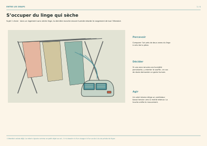
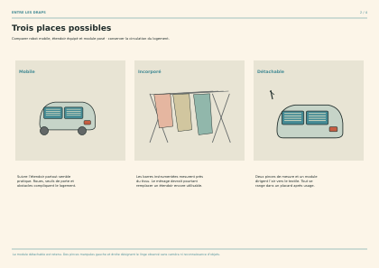
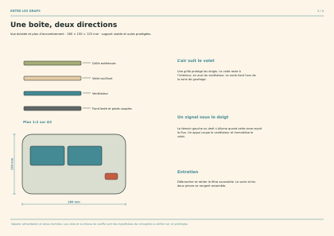
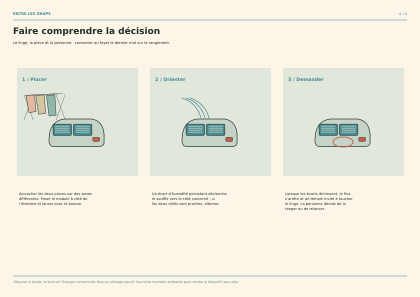

# ENS Paris-Saclay — Design de produit 2021 · Corrigé guidé

*Corrigé rédigé par IA, non officiel.*

**Rédaction** · GPT-6.2 Astra Ultra · vitesse non renseignée

Entre les draps répond au premier des quatre sujets proposés. Un petit robot d’appoint réoriente un flux d’air vers la partie humide d’un étendoir et réserve le contrôle final du linge aux habitants. Les 4 planches numérotées et anonymes sont au format 420 × 297 mm. Les échelles indiquées valent pour une planche seule imprimée sur A3 à 100 %.

## Planche 1 — S’occuper du linge qui sèche

> [!INDICATION]
> Choisir explicitement un des quatre sujets. Nommer le geste domestique avant de choisir un capteur.

Le premier sujet demande quel rôle concret un robot pourrait tenir dans une maison. Le foyer retenu étend le linge dans une pièce commune et veut récupérer l’étendoir avant le dîner. Les épaisseurs différentes sèchent à des rythmes différents. Un petit module réorientable s’emploie avec le matériel existant. Il mesure, décide et agit au sens posé par le sujet. Les deux bornes ressemblent à de petites ouïes d’aération ; le bouton est physiquement accessible. Les images comparatives de Roll-Oh et d’Asimo montrent la persistance du modèle humanoïde. Le projet choisit un autre vocabulaire domestique, celui du linge et de l’aération.

## Planche 2 — Trois places possibles

> [!INDICATION]
> Dessiner le rangement entre deux lessives. Ce temps compte autant que la courte phase de fonctionnement.

Un appareil à roues pourrait tourner autour des textiles. Il augmente le coût et les risques de gêne sur un passage encombré. Un étendoir complet permet une mesure au plus près des zones, mais impose un équipement volumineux et difficile à réparer. Le module détachable conserve le séchoir familial. Deux pinces repérées se placent près des tissus, hors des gouttes. Le module reste à l’extérieur du chemin, ses câbles cheminent le long des montants sous attaches amovibles. Le propriétaire peut reprendre l’opération à la main. La question de la place donnée à la machine est autant une question de rangement que d’automatisme.

## Planche 3 — Une boîte, deux directions

> [!INDICATION]
> Tracer l’air de l’entrée à la sortie puis dessiner séparément le passage du doigt et de la main qui nettoie.

La boîte de 260 × 150 × 125 mm porte une prise d’air avec filtre accessible, un ventilateur basse tension puis un volet d’orientation derrière une grille. Les pieds larges et souples limitent vibration et glissement. Un adaptateur conforme est tenu à distance de la zone d’égouttage. La paroi et les connecteurs doivent être vérifiés pour l’humidité réellement rencontrée. Aucun élément mobile n’est accessible par les ouvertures. Un repère tactile permet de trouver l’arrêt sans regarder. Les deux côtés du ventilo ne représentent pas des yeux. Les témoins reprennent directement les repères des pinces. Une première maquette de carton vérifie la prise et la lisibilité, une seconde teste débit, bruit, échauffement et stabilité.

## Planche 4 — Faire comprendre la décision

> [!INDICATION]
> Imaginer la pince tombée, le linge déjà rangé, puis une pièce très humide. Donner une réponse compréhensible à chaque situation.

Chaque pince mesure température et humidité locale. Le module compare les valeurs au capteur d’ambiance et attend plusieurs mesures cohérentes avant de déplacer le volet. Les seuils et délais restent des paramètres à établir avec un jeu d’essai. Si une pince est débranchée, le module s’arrête et allume le témoin de la zone. Si l’air ambiant est trop humide, il propose l’aération de la pièce. Un petit écart ne prouve pas que la couture du vêtement est sèche. La personne touche le linge et décide. Aucun historique nominatif, micro ou caméra n’est nécessaire. Comparer masse d’eau perdue, énergie électrique, niveau de bruit et durée à un étendoir témoin ; si le gain est faible, le séchage passif reste disponible. Le robot domestique se juge ici à la pertinence du service rendu et à la facilité d’interrompre ce service.

[Énoncé et annexes du concours](https://ens-paris-saclay.fr/sites/default/files/CONCOURS/ANNALES_1C/1C_Design/2021_Sujet_1A_Design_projet_produit.pdf) · [Rapport du jury](https://ens-paris-saclay.fr/sites/default/files/CONCOURS/ANNALES_1C/1C_Design/2021_rapport_oral_DESIGN_projet.pdf)
