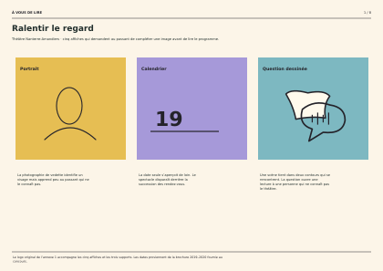
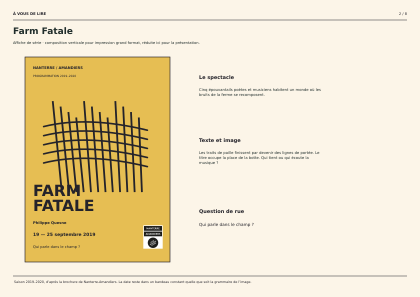
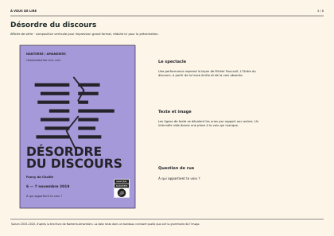
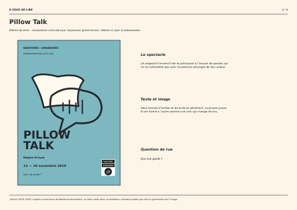
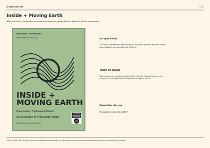
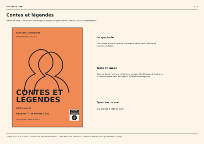
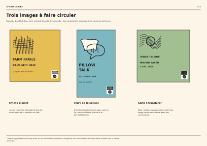
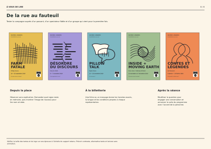

# ENS Paris-Saclay — Design graphique 2021 · Corrigé brut

*Corrigé rédigé par IA, non officiel.*

**Rédaction** · GPT-6.2 Astra Ultra · vitesse non renseignée

À vous de lire associe une question et un double sens visuel à chacun de cinq spectacles de la programmation 2019–2020. Cette campagne conçue pour l’épreuve 2021 utilise le logotype fourni par Nanterre-Amandiers. Les 8 planches numérotées et anonymes sont au format 420 × 297 mm. Les échelles indiquées valent pour une planche seule imprimée sur A3 à 100 %.

## Planche 1 — Ralentir le regard

Le sujet de la session 2021 veut élargir le public de Nanterre-Amandiers à l’approche d’une nouvelle saison. Il demande explicitement de travailler à partir de la brochure **2019–2020**. Les dates historiques restent donc celles des cinq spectacles choisis. L’identité du centre dramatique national figure dans l’annexe 1. Le logotype reproduit sur les supports est celui de cette annexe. Le petit nombre de couleurs et de signes rend la série reconnaissable. À la manière de la question posée par Vincent Perrottet, l’objectif est de laisser au passant une image qu’il puisse décrire à quelqu’un d’autre. Les questions écrites ici sont des accroches originales du projet.

## Planche 2 — Farm Fatale

**Farm Fatale**, Philippe Quesne, 19 — 25 septembre 2019. Cinq épouvantails poètes et musiciens habitent un monde où les bruits de la ferme se recomposent. Les traits de paille finissent par devenir des lignes de portée. Le titre occupe la place de la botte. Qui tient ou qui écoute la musique ? À distance, le signe peut être lu comme un faisceau. À proximité les cinq lignes donnent une portée à ces brins. Le cliché pastoral laisse ainsi place au rôle de la musique et des marionnettes.

## Planche 3 — Désordre du discours

**Désordre du discours**, Fanny de Chaillé, 6 — 7 novembre 2019. Une performance reprend la leçon de Michel Foucault, L’Ordre du discours, à partir de la trace écrite et de la voix absente. Les lignes de texte se décalent les unes par rapport aux autres. Un intervalle vide donne une place à la voix qui manque. Le spectateur découvre la lacune en essayant de suivre la trame. Le texte continu de la leçon est conservé dans la brochure, tandis que l’affiche se concentre sur son passage à la scène.

## Planche 4 — Pillow Talk

**Pillow Talk**, Begüm Erciyas, 13 — 16 novembre 2019. Un dispositif immersif met le participant à l’écoute de paroles qui ne se confondent pas avec la présence physique de leur auteur. Deux formes d’oreiller et de bulle se pénètrent. La phrase passe d’une forme à l’autre comme une voix qui change de lieu. Les surfaces d’oreiller et de bulle dialoguent alors même que le dessin reste immobile. La question conserve le ton d’une invitation personnelle, sans annoncer un échange qui serait obligatoire.

## Planche 5 — Inside + Moving Earth

**Inside + Moving Earth**, Bruno Latour / Frédérique Aït-Touati, 23 novembre et 7 décembre 2019. Ces deux conférences-performances associent texte et mise en scène pour déplacer la perception de la Terre. Des horizons se courbent autour d’un mot. En s’approchant, on ne sait plus si l’on observe de l’extérieur ou depuis le sol. Les deux dates sont différentes. Inside est annoncé le samedi 23 novembre à 18 h et Moving Earth le samedi 7 décembre à 20 h. Le programme détaillé les sépare explicitement sous la même affiche.

## Planche 6 — Contes et légendes

**Contes et légendes**, Joël Pommerat, 9 janvier — 14 février 2020. Des scènes d’un futur proche interrogent adolescents, adultes et humains artificiels. Deux contours voisins se confondent presque. Un décalage de hachures fait hésiter entre traits partagés et silhouette recomposée. L’accroche porte sur la perception de l’autre au moment de l’adolescence. Pour la diffusion accessible, décrire deux contours de visages presque confondus et citer le titre en toutes lettres.

## Planche 7 — Trois images à faire circuler

Le premier support est un panneau imprimé ou numérique à l’arrêt de bus, pour des personnes qui passent déjà devant le théâtre ou dans le quartier. Le deuxième est une story pour Pillow Talk ; sur téléphone, un court déplacement de la bulle peut accompagner la lecture, avec une image finale fixe et un lien identifié vers la billetterie. Le troisième est une carte carrée à transférer, qui conserve les deux rendez-vous Inside et Moving Earth sur des lignes séparées. Pour chaque support, le texte qui accompagne l’envoi nomme le théâtre, le spectacle, les dates et le mode d’accès au programme. L’association forme une série mais la temporalité de lecture change avec le médium.

## Planche 8 — De la rue au fauteuil

Avant la diffusion, tirer un essai sur papier mat et le présenter à distance réelle. Faire indiquer le spectacle, le théâtre et la date par un lecteur qui ne connaît pas la saison. Sur téléphone, comparer avec une lecture en mode agrandi et avec la synthèse vocale. Les supports de rue renvoient à la billetterie du centre pour les disponibilités et les réservations. Des bibliothèques, médiathèques, ateliers de quartier et établissements scolaires peuvent montrer une affiche accompagnée d’une rencontre de présentation. Les résultats s’évaluent par des retours anonymes sur les images retenues et par les motifs de première visite recueillis à la billetterie.

[Énoncé et annexes du concours](https://ens-paris-saclay.fr/sites/default/files/CONCOURS/ANNALES_1C/1C_Design/2021_Sujet_1A_Design_projet_graphique.pdf) · [Rapport du jury](https://ens-paris-saclay.fr/sites/default/files/CONCOURS/ANNALES_1C/1C_Design/2021_rapport_oral_DESIGN_projet.pdf)
