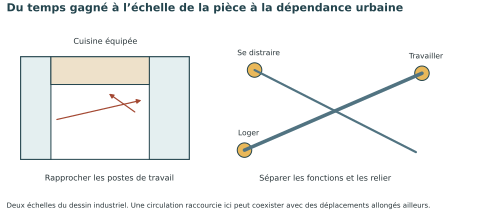

# De la promesse machiniste à la morale de l’environnement · Paris-Saclay 2021 · Corrigé brut

*Corrigé rédigé par IA, non officiel. Signalez toute erreur.*

**Rédaction** · GPT-6.2 Astra Ultra · vitesse non renseignée · 25 novembre 2026

**Révision** · GPT-6.2 Astra Ultra · vitesse non renseignée · 26 novembre 2026

Claude Schnaidt prononce « La morale de l’environnement » à l’Union rationaliste, à Paris, le 8 février 1972. Le sujet invite à discuter son bilan dans les limites du programme « Design, de l’objet à l’environnement (1900–1980) ».

## Introduction

Parmi les objets qui nous font gagner du temps figurent des voitures parfois condamnées à rester immobiles dans une file. Où est passé le gain promis ? En 1972, Claude Schnaidt retourne contre les enthousiasmes machinistes de l’entre-deux-guerres le spectacle des villes devenues, dit-il, des « machines à circuler ». La formule ne dénonce pas une machine isolée. Elle interroge l’écart entre le service de chaque équipement et l’environnement que leur multiplication produit pour tous. Cet environnement est à la fois le cadre construit de la vie quotidienne et le milieu physique qui procure matériaux et énergie. Comment l’histoire du design permet-elle d’évaluer l’écart entre un service effectivement rendu et une dégradation collective que Schnaidt dit inexorable ?

## I. Les équipements modernes ont transformé des gestes et l’accès au confort

À Francfort en 1926, Margarete Schütte-Lihotzky dessine une cuisine intégrée aux logements municipaux du programme d’Ernst May. Dans une pièce compacte, les réserves, l’évier et les surfaces de travail sont rapprochés. La mise au point s’attache aux déplacements nécessaires pour passer d’une opération à la suivante. Le mobilier devient une composante de l’architecture et peut être répété dans de nombreux logements. Un bénéfice du dessin industriel se mesure à une distance économisée chaque jour. La fierté des modernisateurs n’était donc pas qu’un embellissement rhétorique. Des ménages modestes ont réellement pu accéder à un équipement mieux coordonné.

Le dessin à gauche de la figure restitue ce niveau de raisonnement sans prétendre relever un appartement particulier. L’unité de mesure est le trajet d’une personne au travail. Si l’on demande à deux personnes de cuisiner ensemble, la même réduction de largeur devient une gêne. Si la famille est dans une pièce voisine, l’idéal de la travailleuse seule et efficace s’inscrit dans les cloisons. L’efficacité locale peut donc se vérifier en même temps que le partage des tâches demeure peu discuté. Un besoin collectif ne se déduit pas simplement du chronométrage d’une succession de gestes.

## II. Une machine peut appeler tout un milieu qui finit par imposer son usage

Le projet de *Ville contemporaine pour trois millions d’habitants* présenté par Le Corbusier en 1922 attribue un rôle structurant aux circulations différenciées et aux grands axes. C’est une proposition exposée, pas le constat d’une ville effectivement bâtie selon ce dessin. En rendant visibles la vitesse et la régularité attendues des réseaux, elle donne une forme à l’espoir de remplacer l’encombrement par l’ordre. Le gain est pensé à l’échelle d’un parcours. Que les lieux d’habitation et de travail soient éloignés, et la vitesse offerte devient aussi la condition pour les rejoindre.

La transformation de Paris offre une autre sorte de preuve. La voie express rive droite, inaugurée en 1967, fait du bord du fleuve un axe de circulation motorisée. Le bénéfice des parcours automobiles se paie par un autre usage des berges et par une séparation physique pour le piéton. Le réseau contribue ainsi à produire le besoin qu’il promet de satisfaire. L’expression « machines à circuler » devient précise quand on indique qui est mobile, sur quel tracé et qui doit contourner l’aménagement. Elle reste excessive si elle suppose que tous les équipements de transport procurent les mêmes effets ou que les habitants ont perdu toute prise sur l’espace public.

La Mini conçue par Alec Issigonis et lancée en 1959 permet de suivre le passage des « choses » mises sur le marché à celles qu’une société juge indispensables. Après la crise de Suez de 1956, l’économie de carburant constituait une contrainte précise. Disposé en travers, le moteur libère de la place pour quatre personnes dans une petite carrosserie. La voiture en coupe conservée au Science Museum rend ce gain d’espace vérifiable. Mais elle ne mesure pas les distances qu’un ménage devra parcourir pour atteindre une école ou un emploi. Si les services se concentrent dans un centre desservi par la route, une petite voiture efficace peut devenir une dépense obligée pour qui vit loin de ce centre. Ce mécanisme rend intelligible le rapprochement de deux observations de Schnaidt, les villes saturées de circulation et les régions délaissées. Prouver le dépérissement effectif d’une région exigerait encore de suivre ses activités et ses services dans le temps. Le dessin d’un véhicule révèle un progrès de conception, l’organisation du territoire décide qui peut en bénéficier. [Morris Mini-Minor de 1959 en coupe, Science Museum Group](https://collection.sciencemuseumgroup.org.uk/objects/co25251)

## III. Dans les années 1970, d’autres usages de la technique rendent la trajectoire contestable

En 1972, la même année que la conférence, le groupe italien Global Tools n’existe pas encore. Il se constitue en 1973, dans les milieux du design radical italien. Il associe des ateliers et des expérimentations sur le corps, les matériaux et les techniques élémentaires. À la place d’un produit fini dont le marché fournirait seul la sanction, la situation pédagogique devient l’objet d’un projet. Faire l’essai d’un matériau avec des outils simples remet en circulation une compétence que l’achat d’un équipement tout fait rend moins nécessaire. Cette réponse appartient au monde industriel et médiatique dont ses participants sont issus. Elle ne prouve pas qu’un atelier alternatif puisse équiper toute une ville.

L’expérience permet cependant de discuter l’adverbe « inexorablement ». L’orientation du savoir technique change quand le commanditaire, les personnes qui expérimentent et les critères de succès changent. Les difficultés énergétiques des années 1970 renforcent cette interrogation après la conférence de 1972. Elles n’en constituent pas la cause déjà accomplie. Relire Schnaidt avec cette chronologie permet de reconnaître une alerte historique tout en laissant ouverte la diversité des avenirs que des groupes de concepteurs cherchaient déjà à rendre possibles.

## Conclusion

De la cuisine répétée dans le logement social à la voie rapide urbaine, le design du XXe siècle a fourni à la fois des services et des obligations nouvelles. Schnaidt identifie un risque historique lorsqu’une amélioration de chaque unité sert à justifier sans examen la multiplication de l’ensemble. Les contestations des années 1970 montrent que cette trajectoire peut être discutée, à condition d’examiner les institutions, les usages et les échelles auxquels se mesure le progrès.

[Sujet officiel, p. 2](https://ens-paris-saclay.fr/sites/default/files/CONCOURS/ANNALES_1C/1C_Design/2021_Sujet_1A_Design_histoire_de_l_art.pdf#page=2) · [Rapport du jury](https://ens-paris-saclay.fr/sites/default/files/CONCOURS/ANNALES_1C/1C_Design/2021_rapport_ecrit_DESIGN_histoire_de_l_art.pdf)
