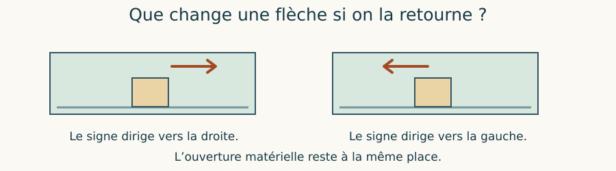

# Peut-on dire du design qu’il est un langage ? · 2021 · Corrigé guidé

*Corrigé rédigé par IA, non officiel. Signalez toute erreur.*

**Rédaction** · GPT-6.2 Astra Ultra · vitesse non renseignée · 25 novembre 2026

**Révision** · GPT-6.2 Astra Ultra · vitesse non renseignée · 26 novembre 2026

ENS Paris-Saclay · concours Design de première année · écrit de quatre heures. Le sujet invite à mettre à l’épreuve l’attribution « un langage » au design.

[Sujet officiel, p. 1](https://ens-paris-saclay.fr/sites/default/files/CONCOURS/ANNALES_1C/1C_Design/2021_Sujet_1A_Design_Philo_art.pdf) · [Rapport du jury, p. 1–2](https://ens-paris-saclay.fr/sites/default/files/CONCOURS/ANNALES_1C/1C_Design/2021_rapport_ecrit_DESIGN_philo.pdf#page=1)

## Entrer dans le sujet

Retournez la flèche du schéma et conservez l’ouverture au même endroit. Ce qui devient faux est-il l’instruction, la position du passage ou l’interprétation du passant ? Le rapport demande d’éprouver l’idée de langage sur des réalisations situées (p. 1–2). Essayez ensuite de déplacer la même distinction de la signalétique à l’architecture commerciale.

## Introduction

> [!INDICATION]
> Construire un désaccord sur le même objet entre quelqu’un qui en lit le sens et quelqu’un qui s’en sert.

Dans un couloir inconnu, je suis la flèche dessinée au-dessus d’une porte. Si elle indique une issue fermée, je comprends très bien le message et pourtant je ne peux pas sortir. Quelque chose dans cet environnement fonctionne comme un langage, autre chose résiste à la lecture la plus exacte. Le design graphique, celui des produits et celui des espaces organisent des formes perceptibles pour autrui. Cette adresse suffit-elle à en faire un langage ? L’enjeu touche à la manière de juger un projet. Si toute forme se lit comme un message, on risque de faire disparaître le travail qu’elle accomplit. Si elle est seulement utile, on ne comprend plus comment elle peut, en restant matériellement identique, changer de sens.

## I. Il existe dans le design des systèmes où les formes valent les unes par les autres

> [!INDICATION]
> Chercher une différence de sens qui tient à une convention partageable.

Pour les Jeux olympiques de Munich en 1972, l’équipe d’Otl Aicher compose une famille de pictogrammes dont les figures partagent un principe de construction. Les angles d’un corps associé à un agrès distinguent une discipline d’une autre. Le style commun aide à repérer quel type d’information est transmis. Une flèche indique ensuite une orientation qui dépend de sa position dans le panneau. L’effet résulte de la différence entre des éléments, de leur combinaison et des habitudes du lecteur. Saussure, dans le *Cours de linguistique générale*, appelle valeur ce qui permet de distinguer un signe à l’intérieur d’un système. Le panneau invite à transposer cette idée avec précision.

Dire « un langage » plutôt que « une langue » autorise une hypothèse qu’il faut pouvoir mettre à l’épreuve. Des formes peuvent composer un répertoire de distinctions utilisables par plusieurs personnes, même si elles ne permettent ni la négation ni la formulation d’un passé. Encore faut-il préciser ce qui autorise le passage d’un lecteur à l’autre. La continuité graphique de la série munichoise rend les figures comparables. Leur anatomie stylisée donne des indices à un visiteur novice, tandis qu’une connaissance minimale du sport l’aide à distinguer deux épreuves. Une convention efficace dans plusieurs langues demande elle aussi un apprentissage.

La flèche retournée du schéma fournit l’épreuve minimale. Dans ce couloir, l’ouverture se trouve à droite du point de départ. Retourner la seule flèche invite à chercher à gauche une ouverture qui s’y dérobe. On peut traduire l’une d’elles, « allez à droite », et discuter sa justesse. Mais veut-on en déduire qu’un panneau possède toutes les ressources d’une langue ? Exprimer que la sortie aurait été à droite si des travaux ne l’avaient pas condamnée réclame des conventions supplémentaires. L’efficacité d’une signalétique tient souvent au contraire à la limitation de son vocabulaire et des combinaisons qu’elle propose. Sa lisibilité dépend aussi d’un apprentissage et du chemin réellement pratiqué.

## II. Un objet peut signifier tout en agissant par d’autres moyens

> [!INDICATION]
> Isoler deux opérations qu’une porte réalise et qu’un dessin de porte ne peut accomplir.

Un siège de bureau large, haut et disposé en bout de table peut signifier une place de pouvoir. Déplacer le même siège au fond d’un débarras en modifie profondément la valeur sociale. Dans *Le Système des objets*, Baudrillard montre comment un ensemble de différences entre biens domestiques permet de signifier une position ou un style de vie. Le sens du fauteuil dépasse ce que sa garniture et ses appuis font à un corps. On ne le découvrira pourtant pas en cherchant dans une seule courbe l’équivalent fixe du mot « autorité ». L’agencement de la pièce et l’usage des places participent de l’interprétation.

Dans *Learning from Las Vegas* (1972), Robert Venturi, Denise Scott Brown et Steven Izenour distinguent deux manières pour une architecture de signifier. Le bâtiment surnommé le Big Duck adopte la silhouette du canard dont il annonçait les produits. Dans le « hangar décoré », l’enseigne et le bâtiment ordinaire qui la porte peuvent être modifiés séparément. Remplacer l’inscription peut annoncer une nouvelle activité dans le même local. Le canard, lui, continuerait de suggérer l’ancienne même si le commerce avait changé. L’exemple donne une conséquence observable à la distinction entre support, signe et usage. Une même architecture peut abriter une pratique et en parler, à des rythmes différents.

À l’inverse, un dossier soutient les épaules d’une personne qui ignore tout du protocole. Le bois peut rompre sous une charge sans rien avoir eu à « dire ». De même, une porte de secours peut s’ouvrir sous la pression alors que tous ses marquages sont effacés. La réalité de ces effets oblige à préserver une différence. Le signe supporte une interprétation et peut renvoyer à ce qui n’est pas là. L’objet soutient, freine ou ouvre en vertu de relations matérielles. L’image d’un siège admirablement intelligible ne porte personne. L’analogie avec le langage éclaire un registre d’action et fausse notre jugement lorsqu’elle devient une explication de tous les autres.

## III. Le design peut organiser les conditions d’un échange sans en écrire les phrases

> [!INDICATION]
> Rendre compte d’un effet de sens qui laisse chacun libre de formuler une réponse imprévue.

Une grande table peut disposer des interlocuteurs sans rien leur dicter de ce qu’ils se diront. Son diamètre décide pourtant si les personnes placées en vis-à-vis pourront se voir et s’entendre. Sa surface commune accueille des objets qu’on peut montrer à plusieurs et maintient un intervalle entre les corps. Dans *Condition de l’homme moderne*, Hannah Arendt prend la table comme image d’un monde commun qui relie et sépare à la fois. Revenir du concept à un meuble dessiné permet d’éprouver le propos. Un plateau étroit peut rapprocher des inconnus, un plateau trop large obliger à hausser la voix, un bord inaccessible tenir un participant à distance.

Ici le designer ne transmet guère de proposition que l’on pourrait transcrire. Il institue des conditions pour que d’autres puissent prendre la parole ou garder le silence. C’est aussi une leçon pour la signalétique. Indiquer avec précision où s’engager peut libérer le passant de la nécessité de déchiffrer des messages à chaque pas. Le meilleur fonctionnement d’un projet peut consister à cesser de solliciter la lecture lorsqu’elle a rempli son rôle. On peut alors employer la comparaison avec le langage en demandant chaque fois qui signe, ce qui est réellement articulé et à quel moment une autre action prend le relais.

## Conclusion

Certains secteurs du design composent de véritables systèmes de signes. Ailleurs, la disposition des choses signifie socialement sans posséder une grammaire déterminée. Enfin la fabrication transforme des milieux où des paroles et des gestes deviennent possibles. Dire du design qu’il est un langage vaut comme hypothèse locale et vérifiable. La généraliser ferait perdre aussi bien la précision du signe que le poids de la chose.

## Reprendre le raisonnement

Décrire une table de réunion successivement par une propriété mécanique, un sens social et un effet sur les échanges. Puis supprimer son cartel. Quelles propriétés disparaissent ? Si toutes demeurent, cela montre au moins que le sens de l’objet ne se réduit pas au texte qui l’accompagne.
