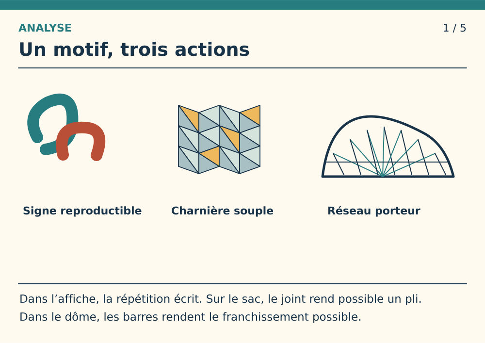
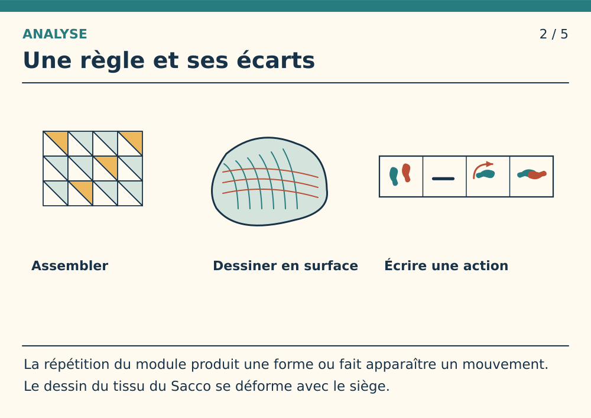
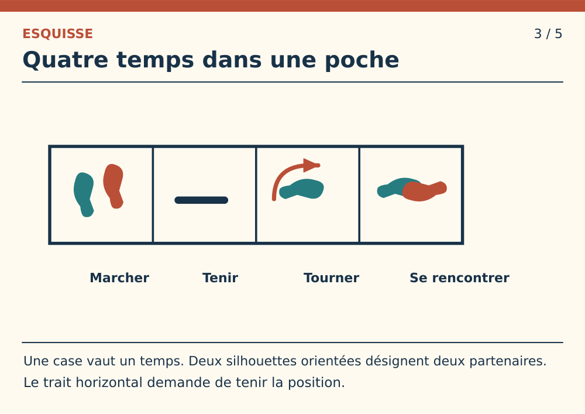
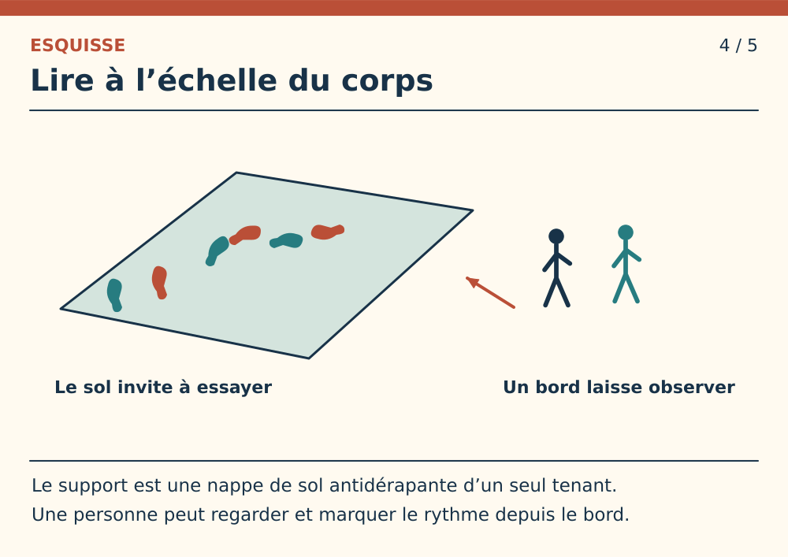
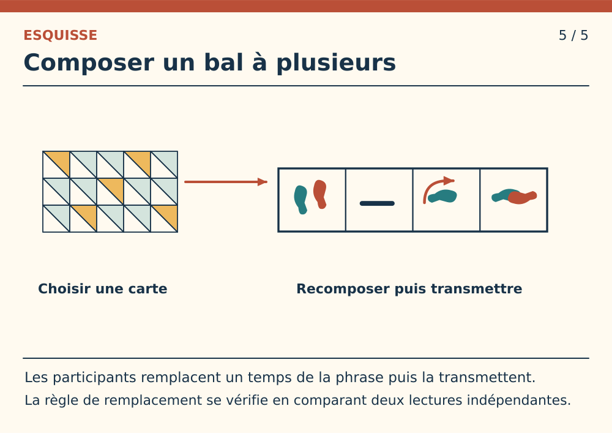

# ENS Paris-Saclay · Design 2021 · Techno-design · Corrigé brut

*Corrigé rédigé par IA, non officiel.*

**Lecture du rapport du jury** · GPT-6.2 Astra Ultra · vitesse non renseignée

**Rédaction** · GPT-6.2 Astra Ultra · vitesse non renseignée

**Révision (tour 1)** · GPT-6.2 Astra Ultra · vitesse non renseignée

## Ce qui se trame

Une grille peut écrire, articuler ou porter. Je cherche comment la rendre disponible aux personnes qui arrivent à un bal sans en connaître les pas. Les cinq A3 vont de la comparaison de trois réseaux à la mise à l’essai d’une partition collective.

### Analyse 1 · Un motif, trois actions

Pour *Les bals d’Europe*, Fanette Mellier compose les caractères par déplacements et recouvrements de signes colorés. Les 27 variantes et la version éditable permettaient en 2008 à chaque organisateur d’imprimer localement son A3. Sur les sacs Bao Bao de Miyake, la succession de facettes et de jointures souples permet au sac de changer de relief avec ce qu’on y glisse. Le corner de Moment Design (Tokyo, 2012) étend le motif à l’échelle de la boutique, où sa fonction devient aussi l’identification de la marque. À Montréal, le réseau géodésique en acier de Fuller porte le dôme de 1967. Après la perte de l’enveloppe polymère en 1976, l’ossature reste visible. Le mot trame nomme ainsi trois opérations différentes.

### Analyse 2 · Une règle et ses écarts

Le catalogue Lego Classic (2015) fait passer de briques thermoplastiques injectées à des silhouettes reconnaissables. L’assemblage repose sur un pas commun. Changer la combinaison produit un nouvel animal avec les mêmes pièces. Le motif dessiné par Pierre Charpin en 2019 à la surface du Sacco accompagne la déformation d’une assise souple. La notice distingue garniture BioFoam et enveloppe en Econyl issu notamment de filets recyclés. Les traits de couleur ne décrivent pas l’armure du tissu. Dans la cinétographie Laban, une écriture graphique peut aussi transmettre une action corporelle. J’en retiens la possibilité d’indiquer la durée et la direction pour un bal de quartier ouvert à des participants sans expérience.

### Esquisse 3 · Quatre temps dans une poche

Première piste. Une invitation pliée en quatre se déploie en une petite phrase corporelle. Les traces indiquent un pas, une tenue, un quart de tour et une rencontre. La couleur distingue les partenaires, leur orientation demeure lisible en noir et blanc. À l’accueil, une personne montre une fois la phrase. Je compare ensuite une version avec libellés et une version sans mots. Les participants doivent pouvoir identifier lequel des quatre signes leur a demandé une explication.

### Esquisse 4 · Lire à l’échelle du corps

Deuxième piste. À l’entrée du bal, une nappe basse présente seulement deux directions et le quart de tour. Un bord libre permet aux personnes assises ou debout de garder le rythme d’un geste sans traverser la piste. Pour une première répétition, je trace la proposition sur un sol continu et compare deux espacements. Je recueille les collisions de trajectoires et les endroits où l’on regarde tellement ses pieds que l’on perd le partenaire. L’essai de matériau doit aussi écarter toute rive qui se relève.

### Esquisse 5 · Composer un bal à plusieurs

Troisième piste. Sur un pupitre en bord de salle, quatre cartes épaisses forment une partition commune. Un duo remplace un geste et transmet la nouvelle séquence à un autre. Une entaille sur le bord supérieur évite la rotation accidentelle au rangement. On compare deux passages sans explication orale. Si le second duo ne peut situer le temps modifié, je renforce la séparation des cases. Si chacun refait exactement le même trajet sans variation, une carte blanche permettra au duo d’inventer son signe et d’en expliquer la règle.

## Sources

Les sept pages du fascicule contiennent les cinq ensembles iconographiques. Le rapport publié par l’ENS est également disponible.

[Fascicule officiel](https://ens-paris-saclay.fr/sites/default/files/CONCOURS/ANNALES_1C/1C_Design/2021_Sujet_1A_Design_Techno_Design.pdf) · [Rapport du jury](https://ens-paris-saclay.fr/sites/default/files/CONCOURS/ANNALES_1C/1C_Design/2021_rapport-_ecrits_DESIGN_technodesign.pdf)
