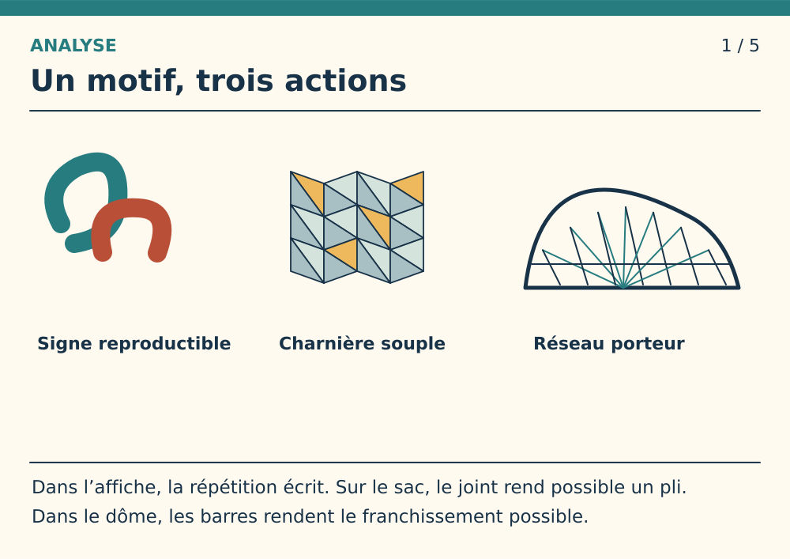
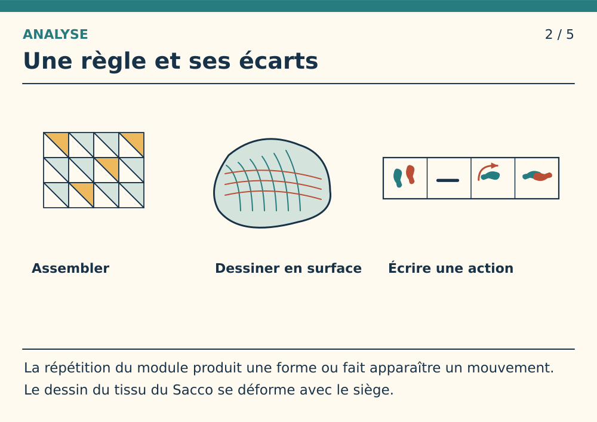
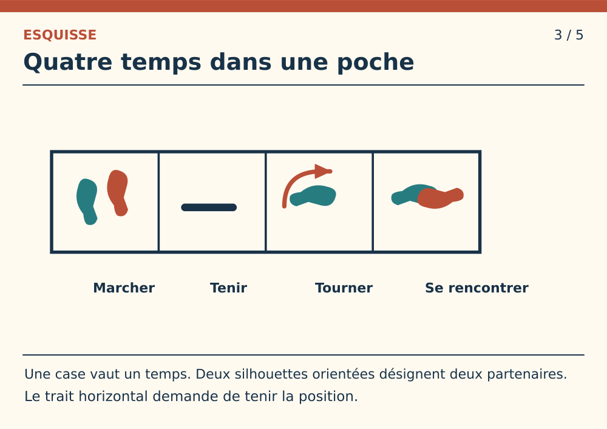
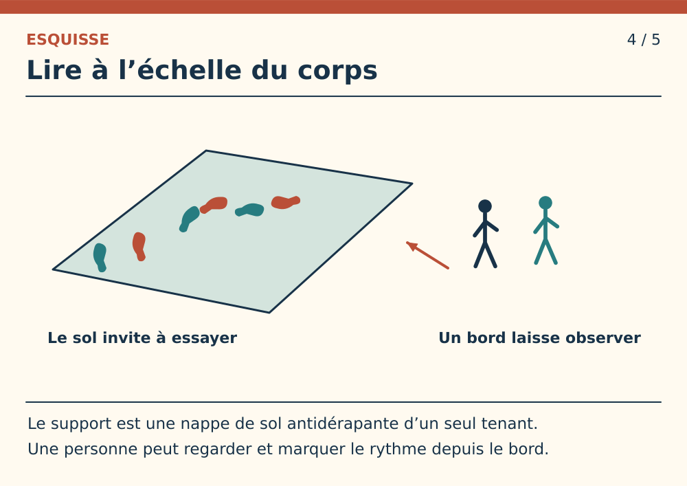
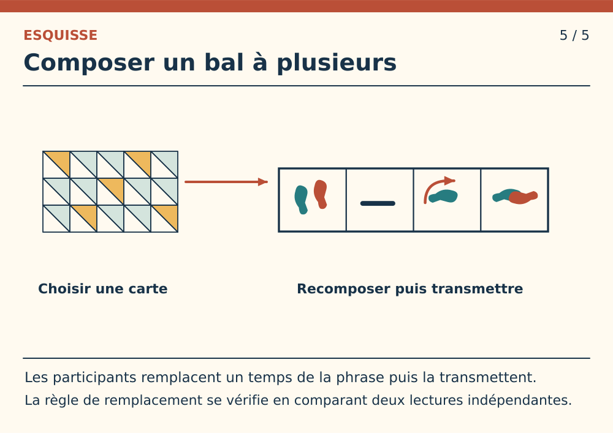

# ENS Paris-Saclay · Design 2021 · Techno-design · Corrigé guidé

*Corrigé rédigé par IA, non officiel.*

**Lecture du rapport du jury** · GPT-6.2 Astra Ultra · vitesse non renseignée

**Rédaction** · GPT-6.2 Astra Ultra · vitesse non renseignée

**Révision (tour 1)** · GPT-6.2 Astra Ultra · vitesse non renseignée

## Ce qui se trame

Le sujet autorise au maximum quatre A3 d’analyse et six d’esquisse en huit heures. Le rapport attire l’attention sur le corner Bao Bao, le revêtement disparu du dôme et le motif appliqué sur le Sacco. Les lire empêche de prendre toutes les trames du dossier pour des tissus.

### Analyse 1 · Un motif, trois actions

Choisir une opération vérifiable dans chacune des photographies. Que perd-on si l’on retire un élément ?

Dans l’affiche, l’absence d’un motif peut interrompre un caractère. Sur le sac, remplacer une jointure souple par un collage rigide réduit la capacité de pliage. Dans le pavillon, la disparition de l’enveloppe a laissé la structure identifiable. Le retrait ne porte pas sur la même composante.

### Analyse 2 · Une règle et ses écarts

Le jeu, le motif du siège et une partition donnent-ils la même liberté à l’utilisateur ?

Décrire une variation que chacun accepte. Modifier une combinaison de briques reconstruit le volume. S’asseoir transforme l’aspect du motif du Sacco. Pour un bal, le signe doit pouvoir rester compréhensible à des partenaires qui inventent une variation.

### Esquisse 3 · Quatre temps dans une poche

Quelle information reste attachée au pli lorsqu’on déplie le carton ?

Chaque pli sépare deux temps. Vérifier la continuité en faisant refaire l’enchaînement à deux, avec et sans démonstration. Une confusion entre tourner et changer de partenaire commande de reprendre le pictogramme, avant d’ajouter une nouvelle case.

### Esquisse 4 · Lire à l’échelle du corps

À quel moment la notation gêne-t-elle l’action qu’elle devait permettre ?

Comparer un trajet dense avec une version de deux signes. Observer où les partenaires se regardent et où ils se cherchent. Interrompre l’essai si le support glisse ou si les circulations se croisent à l’entrée.

### Esquisse 5 · Composer un bal à plusieurs

Comment vérifier la transmission tout en gardant une place pour l’invention ?

Photographier la partition avant et après la substitution avec l’accord du groupe, ou la noter à la main. Demander aux deux duos de désigner la case modifiée. Séparer le défaut de décodage du choix délibéré d’interprétation.

## Sources

Les sept pages du fascicule contiennent les cinq ensembles iconographiques. Le rapport publié par l’ENS est également disponible.

[Fascicule officiel](https://ens-paris-saclay.fr/sites/default/files/CONCOURS/ANNALES_1C/1C_Design/2021_Sujet_1A_Design_Techno_Design.pdf) · [Rapport du jury](https://ens-paris-saclay.fr/sites/default/files/CONCOURS/ANNALES_1C/1C_Design/2021_rapport-_ecrits_DESIGN_technodesign.pdf)
