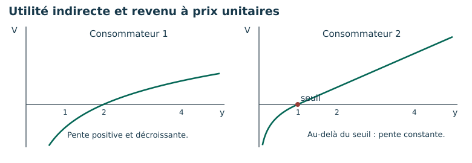
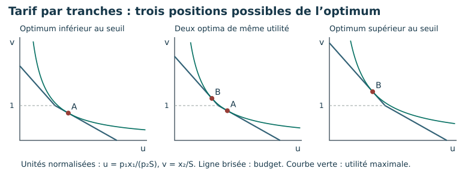

# ENS Paris-Saclay · Analyse économique générale 2021 — Corrigé guidé

*Corrigé rédigé par IA, non officiel. Signalez toute erreur.*

**Rédaction** · GPT-6.2 Astra Ultra · vitesse non renseignée

Banque ENS Paris-Saclay et ENSAI, option économique et de gestion, quatre heures. Les numéros suivent le sujet de la session. Aucun rapport distinct de cet écrit n’est identifié sur la page d’annales de la session.

Traiter les deux branches de la contrainte budgétaire séparément, puis comparer les utilités obtenues. Pour la contribution volontaire, ne pas imposer la symétrie avant la dérivation du gain privé.

## 1.1 à 1.6. Deux consommateurs

**Vérifier le coude.** Après substitution, la pente de l’objectif du second consommateur à droite de son maximum libre est négative. Si le budget s’arrête avant ce maximum, c’est toute la dépense qui va au second bien. À $y=p_1$, vérifier non seulement les niveaux d’utilité mais aussi les pentes, identiques des deux côtés. Cela évite de dessiner une cassure là où seule la courbure change.

**1.1. Programme du consommateur 1.** Maximiser $\ln x_1+\ln x_2$ sous $p_1x_1+p_2x_2\le y$, avec prix et revenu strictement positifs.

**1.1.1. Domaine.** Les deux consommations doivent être positives. Lorsque l’une tend vers zéro sur un budget fini, l’utilité tend vers moins l’infini. Un panier intérieur est toujours possible pour $y>0$.

**1.1.2 et 1.1.3. Demandes et utilité indirecte.** Les conditions $1/x_i=\lambda p_i$ et la saturation du budget donnent $x_1=y/(2p_1)$ et $x_2=y/(2p_2)$. La valeur est $V_1=2\ln y-\ln(4p_1p_2)$.

**1.2. Programme du consommateur 2.** Maximiser $x_1+\ln x_2$ sous le même budget, avec $x_1\ge0$, $x_2>0$. En remplaçant $x_1$ par $(y-p_2x_2)/p_1$, on maximise une fonction strictement concave en $0<x_2\le y/p_2$.

**1.2.1 et 1.2.2. Coin et demandes.** La dérivée vaut $1/x_2-p_2/p_1$. La demande est $x_2=\min(p_1/p_2,y/p_2)$ et $x_1=\max(0,y/p_1-1)$. Si $y\le p_1$, le premier bien a une consommation nulle. Le second demeure strictement positif.

**1.2.3. Valeur indirecte.** Si $y\le p_1$, $V_2=\ln(y/p_2)$. Si $y\ge p_1$, $V_2=y/p_1-1+\ln(p_1/p_2)$. Les deux expressions coïncident au seuil.

**1.3. Évolution avec le revenu.** $\partial V_1/\partial y=2/y$ est positive et décroissante. Pour le consommateur 2, l’utilité marginale du revenu vaut $1/y$ avant le seuil, puis $1/p_1$ au-delà. La courbe logarithmique rejoint sa tangente et se poursuit en droite. Dans ce régime, tout revenu supplémentaire achète le bien 1, d’utilité marginale constante. Les niveaux attribués aux deux personnes ne constituent pas une comparaison interpersonnelle de bonheur.

**1.4. Transformation par exponentielle.** $\sqrt{x_1}\sqrt{x_2}=\exp(u_1/2)$ sur le domaine. La transformation strictement croissante préserve les préférences.

**1.5. Somme au carré.** $Z=(x_1+x_2)^2$ ne représente pas les mêmes préférences. Par exemple $(1,4)$ et $(2,2)$ ont la même valeur de $u_1$ mais des valeurs de $Z$ égales à 25 et 16.

**1.6. Racines.** $H=\sqrt{\ln x_1}+\sqrt{x_2}$ n’est défini que pour $x_1\ge1$ sur le domaine pertinent. Même sur cette partie, $(1,e)$ et $(2,1)$ procurent $u_2=2$. Leurs valeurs de $H$, $\sqrt e$ et $1+\sqrt{\ln 2}$, diffèrent. Les préférences ne sont donc pas conservées.

## 1.7. Remise sur les unités au-delà du seuil

**Comparer les niveaux, après avoir vérifié l’admissibilité.** La discontinuité concerne le prix marginal, tandis que la dépense totale reste continue. Les deux candidats du premier consommateur peuvent donc être localement optimaux simultanément. Comparer leurs produits, plutôt que leurs conditions de tangence, tranche le choix global. Pour le second, le point où $x_1=0$ est admissible. C’est la raison du plafonnement de $v_B$ à $2t-1$ dans le calcul.

**1.7.1. Deux segments.** Pour $x_2\le S$, la dépense vaut $p_1x_1+p_2x_2$. Pour $x_2\ge S$, elle vaut $p_1x_1+p_2 S+(p_2/2)(x_2-S)$. La remise s’applique aux unités supplémentaires. Les deux expressions se rejoignent en $S$.

**1.7.2. Possibilités.** Posons $t=y/(p_2S)>1$, $v=x_2/S$ et $u=p_1x_1/(p_2S)$. Dans le plan $(u,v)$, les sommets du budget sont $(t,0)$, $(t-1,1)$ et $(0,2t-1)$. Les paniers non négatifs sous cette ligne brisée sont accessibles. La pente plus forte sur le segment supérieur donne une frontière rentrante au raccord pour l’ensemble budgétaire. Le budget ne forme pas un ensemble convexe.

**1.7.3 et 1.7.4. Choix du consommateur 1.** Maximiser les logarithmes revient à maximiser le produit $uv$. Sur le premier segment, $u=t-v$ et la tangence A donne $u=v=t/2$, admissible pour $t\le2$. Sur le second, $u=t-1/2-v/2$ et la tangence B donne $v=t-1/2$, $u=(t-1/2)/2$, admissible pour $t\ge3/2$. Un maximum contraint au raccord ne dépasse pas les deux maxima pertinents. En effet le gain marginal de franchir le seuil y augmente, puisque les unités nouvelles coûtent moins cher.

Dans la zone de recouvrement $3/2\le t\le2$, comparer $t^2/4$ et $(t-1/2)^2/2$. Il y a égalité au seuil $t_c=1+1/\sqrt2$. Pour $1<t<t_c$, le choix est A. Pour $t>t_c$, il est B. À $t_c$, les deux paniers distincts sont optimaux. Pour retrouver les quantités du cahier, multiplier $u$ par $p_2S/p_1$ et $v$ par $S$.

**1.7.5. Choix du consommateur 2.** Posons $r=p_1/(p_2S)$. Son objectif vaut $u/r+\ln v+\ln S$. La concavité sur chaque segment donne deux candidats explicites. Sur le premier, $v_A=\min(r,1)$ et $u_A=t-v_A$. Sur le second, $v_B=\min(2t-1,\max(1,2r))$ et $u_B=t-1/2-v_B/2$. Ces formules incluent le coin $x_1=0$ en $v=2t-1$. Calculer $D=(u_B-u_A)/r+\ln(v_B/v_A)$. Pour $D>0$ on choisit B, pour $D<0$ on choisit A, et pour $D=0$ les candidats procurent la même utilité. La conversion aux unités initiales est la même qu’en 1.7.4.

Cette règle se précise sans optimisation supplémentaire. Si $r\le1/2$, A l’emporte car le maximum libre du second segment se trouve au raccord ou en deçà. Si $r\ge1$, B l’emporte car l’objectif augmente immédiatement à droite du raccord. Pour $1/2<r<1$, si $2r\le2t-1$, les deux candidats sont intérieurs aux contraintes extrêmes et $D=\ln2-1/(2r)$. B l’emporte pour $r>1/(2\ln2)$, A pour l’inégalité inverse. Si $2r>2t-1$, B est le coin tout en bien 2 et $D=\ln[(2t-1)/r]+1-t/r$. Son signe donne les conditions exactes, y compris la double solution à l’égalité.

## 2. Deux types de citoyens et un bien collectif

**Dériver au bon niveau d’agrégation.** Dans le programme social, chaque unité de $X_2$ bénéficie à tout le monde, d’où le coefficient $N_1+2N_2$. Pour la meilleure réponse individuelle, les contributions des autres sont fixes. Remplacer d’emblée $z+Z_{-i}$ par $N_i z$ avant de dériver ferait varier simultanément toutes les contributions et conduirait au programme coordonné. Dans le dernier cas, tester une petite déviation individuelle dans chaque groupe permet de vérifier qui finance réellement le bien.

**2.1.1. Programme de l’État.** Posons $N=N_1+N_2$, $A=N_1+2N_2$, et $\Delta=N_1\omega_{11}+N_2\omega_{12}$. Maximiser

$$
N_1 x_{11}+N_2 x_{12}+A\ln X_2
$$

sous $N_1x_{11}+N_2x_{12}+X_1=\Delta$, $X_2=2\sqrt{X_1}$, avec consommation privée positive pour les deux types. Les allocations proposées supposent, comme dans le sujet, des ressources suffisantes pour éviter les coins de consommation.

**2.1.2. Propriétés.** Un maximum d’une somme d’utilités avec des poids strictement positifs est efficace au sens de Pareto. Les utilités privées sont linéaires dans le numéraire. La règle de Samuelson égalise la somme des dispositions marginales à payer pour le bien public, $A/X_2$, à son coût marginal en unités de bien 1, $X_2/2$ puisque $X_1=X_2^2/4$.

**2.1.3.1. Quantité.** Après substitution, l’objectif devient $\Delta-X_1+A\ln(2\sqrt{X_1})$. Sa dérivée vaut $-1+A/(2X_1)$ et sa dérivée seconde est négative. Ainsi $X_1^*=A/2$ et $X_2^*=\sqrt{2A}$.

**2.1.3.2. Unicité.** Le niveau de bien collectif est unique, de même que l’investissement total. La consommation privée totale vaut $\Delta-A/2$. Toute répartition admissible entre les deux types qui garde ce total possède la même valeur sociale. Avec des contributions non négatives, chaque type peut au plus conserver sa dotation. Ces bornes limitent la redistribution compatible sans nécessairement la rendre unique.

**2.1.3.3. Population.** Ajouter un citoyen de type 1 accroît $A$ d’une unité, un citoyen de type 2 de deux unités. $X_2^*$ augmente dans les deux cas et croît comme la racine de la population à composition constante.

**2.1.3.4. Charge moyenne.** Le coût moyen par habitant vaut $X_1^*/N=1/2+N_2/(2N)$. À composition fixe il reste constant. À effectif de type 2 fixe il diminue si l’on ajoute des citoyens de type 1, et à effectif de type 1 fixe il augmente si l’on ajoute des citoyens de type 2. Le coût moyen n’impose pas les contributions individuelles optimales.

**2.2.1.1 et 2.2.1.2. Groupes isolés.** Posons $a_1=1$, $a_2=2$. Dans le groupe $i$, un individu qui contribue $z$ et prend les contributions des autres $Z_{-i}$ pour données maximise $\omega_{1i}-z+a_i\ln(2\sqrt{z+Z_{-i}})$. Sa meilleure réponse est $z=\max(0,a_i/2-Z_{-i})$, dans les conditions de richesse du sujet. Dans la solution symétrique,

| Groupe | Contribution de chacun | Investissement total | Bien collectif du groupe |
|---|---:|---:|---:|
| Type 1 | $1/(2N_1)$ | $1/2$ | $\sqrt{2}$ |
| Type 2 | $1/N_2$ | $1$ | $2$ |

Chacun conserve $x_{1i}=\omega_{1i}-z_{1i}$. Les meilleures réponses déterminent le total du groupe et la symétrie demandée fixe sa répartition.

**2.2.1.3. Efficacité.** Pour un groupe de $N_i$ personnes, l’investissement optimal serait $a_iN_i/2$, tandis que l’initiative isolée conduit à $a_i/2$. Chaque contribution profite à tous les autres mais seul le bénéfice individuel intervient dans le choix. L’allocation est donc sous-optimale pour un groupe de plus d’une personne. Elle est optimale dans le cas d’un groupe réduit à une personne.

**2.2.1.4. Effectifs.** Ajouter des citoyens au groupe fait baisser la contribution individuelle comme $1/N_i$. Son investissement total et son niveau de bien public restent constants à l’équilibre volontaire. Dans le même temps son optimum social augmente, ce qui creuse la sous-production.

**2.2.2.1. Réunion avec croyances erronées.** Un membre de type 1 imagine $N$ citoyens de son type, donc choisit $1/(2N)$. Un membre de type 2 choisit $1/N$. Ces choix réalisés donnent $X_1=A/(2N)$ et $X_2=\sqrt{2A/N}$. Leurs consommations privées sont les dotations moins ces contributions respectives. Les montants résultent des croyances précisées dans le sujet et n’anticipent pas correctement les versements réels de l’autre type.

**2.2.2.2. Comparaison.** Avec les deux types présents, $1<A/N<2$, donc $\sqrt2<X_2<2$. Les citoyens de type 1 bénéficient d’une plus grande offre commune que dans leur groupe isolé. Ceux de type 2 en reçoivent moins. Additionner les deux anciens niveaux pour les comparer à ce niveau unique serait dépourvu de sens pour un usager qui n’avait accès qu’à son propre groupe.

**2.2.2.3. Information exacte.** Un citoyen actif du type $i$ ne contribuerait positivement que si le total obtenu vaut $a_i/2$. Comme ces deux niveaux diffèrent, les deux types ne peuvent être simultanément contributeurs actifs. Si le total valait $1/2$ et si seuls les type 1 payaient, les type 2 voudraient encore contribuer. À l’équilibre informé $X_1=1$, $X_2=2$, $z_{11}=0$ et, par symétrie, $z_{12}=1/N_2$. Le gain marginal privé d’un type 1 pour une unité d’investissement supplémentaire vaut seulement $1/2$, tandis qu’elle coûte une unité. Il préfère laisser financer le projet par les citoyens de type 2. Le niveau informé demeure inférieur au premier rang pour une population comprenant les deux types.

[Sujet officiel](https://ens-paris-saclay.fr/sites/default/files/CONCOURS/ANNALES_1C/1C_D2_1/2021_Sujet_1A_D2-1_AEG.pdf)
