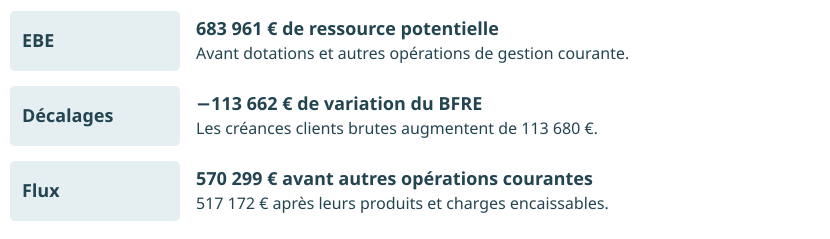

# ENS Paris-Saclay · Épreuve à option — dominante gestion 2021 — corrigé brut

*Corrigé rédigé par IA, non officiel. Signalez toute erreur.*

**Rédaction** · GPT-6.2 Astra Ultra · vitesse non renseignée · 26 novembre 2026

## Étude de cas

L’entreprise possède son usine, associe machines et savoir-faire manuel, et vend aux distributeurs de sa région. Les documents 1 à 4 donnent les états financiers 2018 et 2019 et les échéances connues de 2020. Les questions de management se placent dans le contexte de la crise sanitaire.

## Résolution des dossiers

### Partie 1 — Analyse financière

**1. Soldes intermédiaires et profitabilité.** FRESHPROX transforme des achats en produits culinaires ; la production vendue, la valeur ajoutée (VA) et l’excédent brut d’exploitation (EBE) conviennent mieux ici qu’une marge de négoce. Les ratios rapportés au CA mesurent la fraction de chaque euro vendu qui subsiste aux différentes étapes.

| Indicateur en euros | 2018 | 2019 |
|---|---:|---:|
| Production vendue = CA HT | 2 358 491 | 2 501 000 |
| Matières consommées | 382 228 − 450 = 381 778 | 399 887 − 500 = 399 387 |
| Autres achats et charges externes | 448 120 | 487 695 |
| Valeur ajoutée | 1 528 593 | 1 613 918 |
| Impôts et taxes d’exploitation | 92 121 | 95 122 |
| Salaires et charges sociales | 826 742 | 834 835 |
| EBE | 609 730 | 683 961 |
| Résultat d’exploitation | 404 115 | 432 909 |
| Résultat courant avant impôt | 392 315 | 426 744 |
| Résultat net | 287 228 | 309 444 |
| VA / CA | 64,81 % | 64,53 % |
| EBE / CA | 25,85 % | 27,35 % |
| Résultat d’exploitation / CA | 17,13 % | 17,31 % |
| Résultat net / CA | 12,18 % | 12,37 % |

En 2019, $2\,501\,000-399\,387-487\,695=1\,613\,918$, puis $1\,613\,918-95\,122-834\,835=683\,961$. Les ventes progressent de 6,04 %. Malgré la légère baisse de la part de VA, la hausse modérée des charges de personnel permet à l’EBE de croître davantage. La hausse des dotations aux amortissements (191 650 contre 154 000) absorbe une partie de ce gain dans le résultat d’exploitation. Les charges d’intérêts diminuent, mais le résultat exceptionnel passe de −500 à −15 500. Le gain net de 22 216 n’est donc pas un flux de trésorerie disponible pour la distribution.

**2. EBE et flux d’exploitation.** L’EBE retient des produits acquis et des charges encourues. Il ne tient pas compte de la date du règlement. Les distributeurs paient en principe 10 % immédiatement et 90 % à 60 jours, alors que les matières sont réglées à 30 jours, les autres fournisseurs au comptant, les salaires à la fin du mois et les charges sociales et la TVA le mois suivant. Un stock très court limite l’immobilisation dans les matières, mais ne finance pas la longue attente du règlement client.

| Variation 2019 moins 2018 | Calcul en euros | Effet sur le BFRE |
|---|---:|---:|
| Stocks bruts | 8 500 − 8 000 | +500 |
| Clients bruts | 615 000 − 501 320 | +113 680 |
| Charges constatées d’avance, supposées d’exploitation | 12 800 − 4 200 | +8 600 |
| Fournisseurs d’exploitation | 44 720 − 41 000 | −3 720 |
| Dettes fiscales et sociales d’exploitation | 60 225 − 54 827 | −5 398 |
| **Hausse du BFRE** | | **+113 662** |

L’excédent de trésorerie d’exploitation au sens $EBE-\Delta BFRE$ est **570 299 €**. Si l’on retient toutes les opérations ordinaires d’exploitation encaissables et décaissables, il faut aussi les 11 200 d’autres produits et les 64 327 d’autres charges : **$570\,299+11\,200-64\,327=517\,172$ €**. Les dotations et les reprises en sont exclues. Les placements, les intérêts, l’impôt sur les bénéfices, les dividendes et les flux d’investissement relèvent d’autres postes. L’accroissement du seul poste clients représente presque toute l’augmentation nette du BFRE. Sur 360 jours, $615\,000/(2\,501\,000\times1{,}20)\times360=73{,}8$ jours de CA TTC en créances, contre 63,8 en 2018. Le terme contractuel pondéré est de 54 jours ; la comparaison des soldes de clôture avec le CA annuel doit toutefois être vérifiée par une balance âgée et par la saisonnalité.

**3. Bilan financier au 31 décembre 2019.** On rapproche les valeurs susceptibles d’être réalisées de la date d’exigibilité des dettes, après affectation du bénéfice. Le bilan fonctionnel vise les cycles de financement ; ici la question est de savoir quels moyens couvrent les échéances à plus ou moins d’un an. Le terrain est repris à 330 000, les incorporels de VNC 3 550 sont éliminés, les constructions totalement amorties sont conservées à zéro faute d’évaluation fiable. Le prêt de 2 000 est remboursable en 2020. L’hypothèse centrale retranche le capital non appelé de 10 000 des capitaux propres et de l’actif. Aucune imposition latente sur le terrain n’est chiffrée.

| Actif financier (euros) | Montant | Passif financier (euros) | Montant |
|---|---:|---|---:|
| Terrains et immobilisations corporelles nettes | 330 000 + 339 000 + 113 000 = 782 000 | Capitaux propres ajustés après affectation | 1 355 761 |
| Immobilisations financières à plus d’un an | 21 500 | Dette bancaire à plus d’un an | 206 000 |
| **Actifs à plus d’un an** | **803 500** | **Capitaux permanents** | **1 561 761** |
| Stock net | 8 300 | Dette bancaire à moins d’un an | 84 000 |
| Clients nets et autres créances | 600 200 + 800 | Fournisseurs d’exploitation | 44 720 |
| Charges constatées d’avance et prêt à Durand | 12 800 + 2 000 | Dettes fiscales et sociales | 60 225 |
| Placements liquides | 145 000 | Dettes sur immobilisations | 10 000 |
| Disponibilités | 273 467 | Provision pour litige à régler en 2020 | 8 000 |
| | | Dividende prévu | 77 361 |
| **Actifs à moins d’un an** | **1 042 567** | **Dettes à moins d’un an** | **284 306** |
| **Total** | **1 846 067** | **Total** | **1 846 067** |

Dividende $309\,444\times25\%=77\,361$. Les capitaux propres ajustés valent $1\,336\,672-10\,000-3\,550+110\,000-77\,361=1\,355\,761$. Le renvoi « dont à moins d’un an » du poste bancaire est interprété comme la fraction totale de 84 000, incluant les 20 000 de concours et les intérêts courus de 350 : les ajouter de nouveau compterait deux fois des échéances incluses dans ce sous-total. Si le capital non appelé est maintenu comme créance à plus d’un an, ajouter 10 000 à l’actif long et aux capitaux propres ; les ratios à court terme restent identiques.

Le fonds de roulement financier vaut $1\,561\,761-803\,500=\mathbf{758\,261}$, égal à l’actif court moins les dettes courtes. Liquidité générale $1\,042\,567/284\,306=\mathbf{3{,}67}$ ; liquidité immédiate $(145\,000+273\,467)/284\,306=\mathbf{1{,}47}$. La couverture est confortable sur les valeurs de clôture. La présence simultanée de liquidités et d’un découvert momentané incite à vérifier les comptes bancaires et le calendrier des règlements. La réduction de 300 000 des anciens emprunts, les 148 000 d’investissements corporels et les 100 000 de dividendes versés en 2019 mobilisent aussi de la trésorerie. Les charges à l’avance ne sont pas encaissables comme des créances commerciales et les clients nets peuvent encore se dégrader.

### Partie 2 — Performance et décisions de management

**4. Appréhender la performance dans le contexte sanitaire.** Pour FRESHPROX, produire plus avec la même équipe mesure une efficacité productive seulement si les commandes sont honorées, les salariés protégés et les aliments vendus à temps. L’efficacité mesure l’atteinte de la cible, l’efficience les ressources qu’elle mobilise. Une livraison rapide peut satisfaire un revendeur et coûter une tournée à moitié vide. La qualité perçue et la continuité de l’approvisionnement local conditionnent la possibilité de maintenir le prix.

Les parties prenantes au sens de Freeman incluent ici le fondateur, les salariés experts, les fournisseurs locaux, la banque et les revendeurs. Chacune observe un résultat différent : heures et absences dans l’atelier, règlements aux producteurs, traçabilité des lots et délais pour les distributeurs. Pendant la crise, préparer des scénarios de demande par canal, d’indisponibilité du personnel et de tension fournisseur. Consulter les équipes qui maîtrisent le geste de finition pour déterminer quelles commandes peuvent être honorées sans compromettre les contrôles. Les bons résultats de 2019 financent une marge de manœuvre ; ils ne chiffrent pas les ventes ni les absences en 2020.

**5. Paradoxes managériaux.** Une première tension oppose fraîcheur et continuité. Un stock infime réduit pertes et immobilisations, mais une interruption d’un fournisseur peut arrêter la chaîne. Classer les matières selon durée de vie et criticité ; réserver un stock de sécurité aux intrants qui s’y prêtent et qualifier un second fournisseur régional pour les autres. Suivre ruptures et pertes ensemble.

Une deuxième tension oppose automatisation et savoir-faire manuel. Automatiser les tâches répétitives réduit la pénibilité et l’exposition aux absences. Standardiser la finition au point de perdre sa singularité peut détruire la valeur de la marque. Définir avec les salariés les étapes où leur jugement est indispensable, documenter ces gestes et organiser des binômes de remplacement. Mesurer retours clients et taux de rebut sur une série pilote avant d’étendre une automatisation.

Enfin, accorder des délais préserve la relation avec les distributeurs mais fait supporter à FRESHPROX leur besoin de trésorerie. Établir des plafonds de crédit par risque, négocier un acompte sur une commande hors norme et prévoir une relance graduée pour les retards répétés. Arbitrer en réunion commerciale et financière à partir de l’exposition et de la marge du client, avec possibilité d’exception motivée. Ces mesures protègent le compromis entre survie immédiate et confiance de longue durée.

**6. Pertinence des outils et propositions.** Le compte de résultat, les SIG et le bilan financier renseignent la création de valeur et la couverture des engagements annuels. Ils sont agrégés, rétrospectifs et sensibles aux évaluations. Ils n’indiquent ni quel distributeur retarde son paiement, ni quelle tournée détruit de la marge, ni quels produits frais seront bientôt invendables.

Mettre en place un budget de trésorerie glissant sur treize semaines, alimenté par la balance âgée, les dates réelles des encaissements, le calendrier de paie et les règlements de TVA et de cotisations. Le directeur financier simule chaque semaine la perte d’un distributeur ou quinze jours de retard supplémentaire. Coupler les commandes aux lots et aux tournées dans le système d’information pour rapprocher dates limites, quantités, coûts et heures de livraison. Les responsables peuvent suivre marge sur coûts évitables par produit et par canal, taux de perte et ponctualité par tournée.

Un tableau de bord inspiré de Kaplan et Norton relie les données financières aux clients, aux processus et aux compétences. Par exemple, la formation d’un second opérateur peut réduire les arrêts d’atelier, améliorer le taux de service puis préserver les commandes ; tester cette chaîne avec les données de production et les réclamations. Fixer pour chaque mesure une source, un responsable, une fréquence et une décision possible : relance hebdomadaire, ajustement de tournée, réaffectation d’une équipe ou recherche d’un fournisseur. Le suivi social des absences et de la sécurité complète les indicateurs financiers quand la continuité exige une organisation différente.

## Repère

## Sources

Épreuve à options ENS Paris-Saclay–ENSAI D2, 2021. Le cas FRESHPROX et les états 2018–2019 figurent aux pages 2 à 8 du PDF. Le bilan financier utilise les échéances, répartitions et valeurs du document 4.

[Sujet de la dominante, p. 2](https://ens-paris-saclay.fr/sites/default/files/CONCOURS/ANNALES_1C/1C_D2_1/2021_Sujet_1A_D2-1_Option.pdf#page=2) · [Annales institutionnelles](https://ens-paris-saclay.fr/admission/concours/concours-pre-master/annales-concours-pre-master?field_orientation_1c_target_id%5B%5D=289&field_year_target_id%5B%5D=545)
