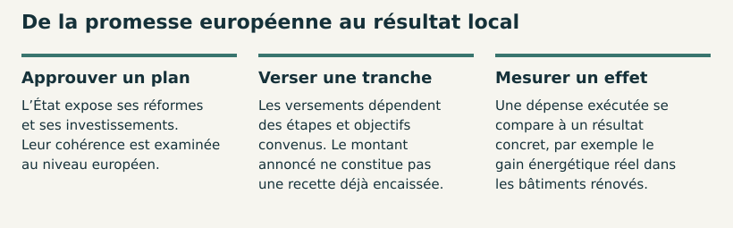

# ENS Paris-Saclay — Économie-gestion option 1 · Espagnol oral 2021 · Corrigé brut

*Corrigé rédigé par IA, non officiel. Signalez toute erreur.*

**Rédaction** · GPT-6.2 Astra Ultra · vitesse non renseignée

Le jury accordait trente minutes de préparation, recommandait environ quinze minutes de restitution et de commentaire et prévoyait un entretien de quinze minutes au plus. Les extraits duraient entre 4 min 30 et 5 min. Les sept sujets provenaient de RNE, de COPE et de Cadena SER.

Le rapport donne les titres ou mots clés et les diffuseurs pour l’ensemble de la session. Il ne publie ni fichiers d’épreuve, ni bornes, ni questions individuelles. Les commentaires et les relances répondent aux thèmes attestés. Les archives citées comme points de comparaison ont une attribution distincte de celle des extraits.

## 1. Impuestos y multinacionales

**Commentaire.** Una empresa que vende en muchos países puede declarar buena parte de sus beneficios en uno distinto de aquel donde trabajan sus empleados o viven sus compradores. El problema surge cuando la diferencia responde a la posibilidad de trasladar beneficios sobre el papel y no a la actividad real. El Estado que forma a los trabajadores y proporciona infraestructuras puede recaudar poco sobre la renta que esa actividad genera.

El acuerdo político de los ministros de Finanzas del G7 en junio de 2021 a favor de un tipo mínimo global de al menos el quince por ciento intentaba limitar esa competencia a la baja. Hay dos debates distintos. El primero es cuánto puede reducirse la tributación efectiva. El segundo es qué país tiene derecho a gravar qué parte del beneficio. Un mínimo puede estrechar las diferencias de tipos y dejar abierto el reparto entre países productores, sedes y mercados. Para saber quién gana con una reforma hay que responder a las dos preguntas y comprobar cómo se ejecuta lo acordado. [Accord du G7, juin 2021](https://www.rtve.es/noticias/20210605/acuerdo-historico-del-g7-para-fijar-impuesto-minimo-global-del-15-a-empresas/2099382.shtml)

**Relance proposée.** *¿Subir un tipo anunciado garantiza más recaudación?* Depende de qué beneficios entren en la base, de las deducciones y de la capacidad para comprobar las declaraciones de un grupo con filiales en distintos países.

## 2. Eurobarómetro 2021

**Commentaire.** ¿Cómo se interpreta que alguien se sienta europeo? En la emisión de Europa abierta del veintisiete de abril, RNE presentó datos españoles de la encuesta realizada en febrero y marzo. Según su reseña, un 84 % decía sentirse ciudadano europeo y un 76 % valoraba positivamente la gestión europea de la vacunación. No responderían a la misma pregunta ni siquiera si los dos porcentajes coincidieran. La primera expresión se refiere a una pertenencia y la segunda a una actuación concreta en una emergencia.

Un ciudadano puede criticar un retraso en la entrega de vacunas y defender que los Estados compren conjuntamente para negociar en mejores condiciones. También puede aprobar una medida sin identificarse afectivamente con quien la toma. Para interpretar una tendencia, compararía respuestas a la misma pregunta en distintos momentos y comprobaría si cambió el contexto de la entrevista. Presentar cualquier crítica como una pérdida de europeísmo impide precisamente estudiar qué esperan los ciudadanos de la Unión. [Archive comparative d’Europa abierta](https://www.rtve.es/play/audios/europa-abierta/europa-abierta-eurobarometro-confirma-europeismo-espanoles-tiempos-covid/5889598/)

**Relance proposée.** *¿Puede restarse 76 a 84 para contar a los europeístas descontentos?* No. Haría falta saber cómo contestó cada persona a ambas preguntas. Las dos proporciones por separado no muestran qué personas forman parte de cada grupo.

## 3. El sector turístico en tiempos de Covid

**Commentaire.** Para comprender el golpe que recibió el turismo español en 2020 conviene empezar por una distinción. La demanda de viajar podía seguir existiendo mientras las restricciones y la incertidumbre impedían convertirla en reservas. Un hotel vacío seguía necesitando mantenimiento y un restaurante de una localidad costera podía perder clientes aunque se le permitiera abrir. Según el balance provisional de FRONTUR publicado a principios de 2021, las llegadas de turistas internacionales cayeron más de tres cuartas partes en 2020. La caída nacional tampoco se repartió por igual entre un destino que dependía del avión y otro accesible en coche para familias españolas.

El número de visitantes mide sólo una dimensión del impacto. Para estudiar el empleo miraría los meses efectivamente trabajados por una camarera de pisos y la situación de los proveedores. Para estudiar la recuperación distinguiría entre el regreso de reservas para el verano y la reapertura de negocios que debieron cerrar durante el invierno. Una ocupación elevada en agosto puede coexistir con ingresos anuales todavía insuficientes. [Données FRONTUR de l’INE pour 2020](https://www.ine.es/daco/daco42/frontur/frontur1220.pdf)

**Relance proposée.** *¿Podía sustituir el turismo nacional al extranjero?* Parcialmente y de forma desigual. Importan el acceso al destino, el gasto por estancia y la época del viaje. Sustituir una llegada por otra no garantiza los mismos ingresos ni el mismo empleo.

## 4. Salvemos el turismo

**Commentaire.** La petición de salvar el turismo encierra una decisión distributiva. ¿Qué significa salvarlo para un hotel capaz de esperar la temporada siguiente, para un pequeño guía sin reservas y para una trabajadora temporal que aún no había empezado su contrato? El debate difundido por En clave Turismo reunió a representantes del mundo empresarial y económico. Su composición invita a preguntarse qué información aportaría también quien trabaja en temporada o quien presta un servicio público en un municipio turístico.

Distinguiría ayudas de liquidez y compensaciones por ingresos perdidos. Un préstamo puede servir a un negocio viable que cobrará dentro de tres meses. Si ha perdido dos temporadas y sus gastos fijos han seguido corriendo, otra deuda quizá sólo aplace el cierre. Condicionaría las ayudas temporales a objetivos que se puedan observar, como conservar empleo o adaptar instalaciones, y explicaría por qué pueden solicitarlas también pequeños proveedores. Así se puede defender un sector sin comprometer de antemano dinero público con cualquier empresa que lleve la etiqueta turística. [Débat homonyme sur RNE](https://www.rtve.es/play/audios/en-clave-turismo/clave-turismo-debate-online-salvemos-turismo-29-01-21/5776011/)

**Relance proposée.** *¿Por qué ayudar a una empresa privada?* Puede justificarse si su cierre destruye empleos y conocimientos que costaría mucho reconstruir tras una interrupción temporal. La ayuda debe tener reglas públicas, duración y revisión.

## 5. Elecciones chilenas

**Commentaire.** Una elección puede abrir una decisión constitucional sin resolverla. En Chile, los votantes eligieron en mayo de 2021 a quienes integrarían la Convención Constitucional, junto con autoridades territoriales en comicios simultáneos. Elegir a una persona para que redacte y negocie un proyecto no equivale a aprobar ahora cada disposición que esa persona pueda proponer. El encargo constituyente tiene sentido precisamente porque debe haber deliberación y después una decisión sobre el texto resultante.

La presencia de independientes, las reglas de paridad y los escaños reservados a pueblos originarios plantearon una pregunta concreta. ¿Quién consigue hablar cuando se define el marco de la vida pública? Incorporar experiencias hasta entonces poco representadas cambia las preguntas que cabe formular. Tampoco garantiza por sí solo que surja un acuerdo sobre el contenido de cada derecho o sobre cómo financiarlo. Juzgaría esa experiencia observando tanto el acceso a la representación como la capacidad de explicar compromisos a quienes no obtuvieron exactamente lo que querían. [Scrutins chiliens des 15 et 16 mai 2021](https://www.lamoncloa.gob.es/serviciosdeprensa/notasprensa/exteriores/Paginas/2021/170521-chile_elecciones.aspx)

**Relance proposée.** *¿Un voto por una lista constituyente obliga a apoyar el texto final?* No. El votante podrá evaluar lo que produzca la negociación y ejercer un juicio distinto sobre el conjunto del proyecto.

## 6. Crisis migratoria en Ceuta

**Commentaire.** En mayo de 2021 llegaron a Ceuta en muy poco tiempo miles de personas, entre ellas menores. La primera dificultad fue de escala y de tiempo. Hubo que prestar asistencia inmediata en una ciudad de tamaño limitado. A la vez, las relaciones tensas entre España y Marruecos condicionaban la cooperación fronteriza. Son dos planos distintos. Entender por qué había cambiado la actuación de un gobierno es importante para la diplomacia. No permite deducir qué protección necesita cada persona que acaba de llegar.

El caso de los menores muestra por qué una política únicamente centrada en la frontera resulta insuficiente. Verificar una identidad, buscar a familiares, garantizar alojamiento y escuchar al menor requieren tiempo, personal y coordinación. Medir el éxito sólo por la rapidez con la que disminuye el número de personas presentes puede ocultar errores difíciles de reparar. También sería injusto dejar toda la responsabilidad material a una ciudad por el hecho de que la llegada tuvo lugar allí. Una respuesta española y europea habrá de valorar a la vez las condiciones locales de acogida y los derechos de cada persona. [Chronologie à Ceuta, RTVE, 19 mai 2021](https://www.rtve.es/noticias/20210519/marruecos-cierre-accesos-fronterizos-ceuta/2090930.shtml)

**Relance proposée.** *¿Puede la cooperación con Marruecos resolver por sí sola la acogida?* Puede ordenar la interlocución y ayudar a localizar familiares. Las autoridades responsables de la atención en España siguen teniendo que valorar cada caso y facilitar su revisión.

## 7. La letra pequeña de las ayudas de Bruselas

**Commentaire.** Una ayuda europea anunciada en una rueda de prensa todavía no ha llegado a la escuela ni al negocio que deberá beneficiarse de ella. Entre el acuerdo sobre recursos y ese resultado hay un plan nacional, una evaluación y condiciones de ejecución. En la discusión española de 2021 sobre el plan de recuperación, la pregunta relevante era qué reformas e inversiones se iban a financiar y cómo comprobar que se realizaban. Llamar letra pequeña a esas condiciones expresa una desconfianza comprensible si los compromisos se dan a conocer tarde.

Sin embargo, una condición explícita también protege al contribuyente y al beneficiario. Si se promete mejorar la eficiencia energética de un edificio escolar, contar el número de contratos firmados sirve para seguir el proceso, pero habrá que observar el consumo posterior para juzgar el resultado. Un control mal diseñado consume tiempo y puede favorecer a entidades con más capacidad administrativa. Publicar los criterios de selección, ofrecer asistencia a pequeños municipios y explicar los retrasos ayudaría a equilibrar control y acceso. [Entretien de RNE sur l’examen du plan espagnol](https://www.rtve.es/play/audios/24-horas/plan-recuperacion-cumpliria-europa/5852883/)

**Relance proposée.** *¿Recibir todo el importe demostraría que el plan funcionó?* Demostraría que se cumplieron condiciones para los desembolsos. Para valorar su utilidad habría que medir qué cambió para las personas y comparar ese resultado con los objetivos iniciales.

[Rapport du jury](https://ens-paris-saclay.fr/sites/default/files/CONCOURS/ANNALES_1C/1C_D2_1/2021_rapport_oral_D2_lv_espagnol.pdf)
