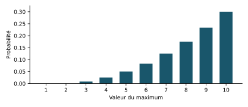
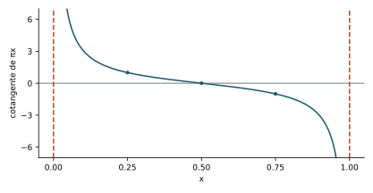

# ENS Paris-Saclay – ENSAI D2 · Mathématiques et statistiques 2021 · Corrigé brut

*Corrigé rédigé par IA, non officiel. Signalez toute erreur.*

**Rédaction** · GPT-6.2 Astra Ultra · vitesse non renseignée

La composition d’économie-gestion option 1 dure quatre heures. Ses trois problèmes indépendants portent sur un endomorphisme de dimension trois, un estimateur calculé sur des tirages sans remise et l’inégalité de Poincaré sur un intervalle. Les références 1, 2 et 3 désignent les numéros des problèmes. [Sujet officiel](https://ens-paris-saclay.fr/sites/default/files/CONCOURS/ANNALES_1C/1C_D2_1/2021_Sujet_1A_D2-1_Maths.pdf) · [Rapport du jury](https://ens-paris-saclay.fr/sites/default/files/CONCOURS/ANNALES_1C/1C_D2_1/2021_rapport_ecrit_D2_maths_statistiques.pdf)

## Problème 1. Noyau, image et puissances d’une application linéaire

### Question 1.1a

Pour tous $u,v\in\mathbb R^3$ et $a,b\in\mathbb R$, chacune des trois coordonnées de $f(au+bv)$ est la même combinaison $a,b$ des coordonnées correspondantes de $f(u),f(v)$, car les expressions $x-y+z$, $-x+y+z$ et $2z$ sont linéaires. Ainsi $f(au+bv)=af(u)+bf(v)$.

### Question 1.1b

Les images de $e_1,e_2,e_3$ sont respectivement $(1,-1,0)$, $(-1,1,0)$ et $(1,1,2)$. D’où, dans la base canonique,
$$M=\begin{pmatrix}1&-1&1\\-1&1&1\\0&0&2\end{pmatrix}.$$

### Question 1.1c

De $f(x,y,z)=0$ on tire $2z=0$, puis $x-y=0$. Réciproquement tout $(t,t,0)$ est annulé. Ainsi $\ker f=\{(t,t,0):t\in\mathbb R\}$, de base constituée du seul vecteur $u_1=(1,1,0)$. Ce noyau contient un vecteur non nul, donc $f$ n’est pas injective.

### Question 1.2a

Le théorème du rang donne $\dim\operatorname{Im} f=3-\dim\ker f=3-1=2$.

### Question 1.2b

Les vecteurs $u_2=f(e_2)$ et $u_3=f(e_3)$ appartiennent à l’image. Si $au_2+bu_3=0$, la troisième coordonnée donne $2b=0$, puis la première donne $-a=0$. Ces deux vecteurs indépendants forment une base de l’image, qui a dimension deux.

### Question 1.2c

L’image a dimension deux tandis que l’espace d’arrivée $\mathbb R^3$ a dimension trois. Elle est donc un sous-espace strict et $f$ n’est pas surjective. Concrètement, les images $(X,Y,Z)$ vérifient toutes $X+Y=Z$.

### Question 1.3a

Si $au_1+bu_2+cu_3=0$, la troisième coordonnée donne $2c=0$, puis les deux premières donnent $a-b=a+b=0$. Ainsi $a=b=c=0$. Cette famille libre de trois vecteurs est une base de $\mathbb R^3$.

### Question 1.3b

On sait $f(u_1)=0$. Par calcul direct $f(-1,1,0)=(-2,2,0)=2u_2$ et $f(1,1,2)=(2,2,4)=2u_3$. Les coordonnées dans la nouvelle base sont donc les colonnes de $D=\operatorname{diag}(0,2,2)$.

### Question 1.3c

Avec
$$P=\begin{pmatrix}1&-1&1\\1&1&1\\0&0&2\end{pmatrix},$$
les coordonnées $v$ dans la base $(u_1,u_2,u_3)$ deviennent $Pv$ dans la base canonique. La matrice est inversible, son déterminant valant $4$. La relation $MP=PD$ donnée par les colonnes entraîne $D=P^{-1}MP$.

### Question 1.4a

Pour $v=au_1+bu_2+cu_3$, $f(v)-2v=-2a u_1$. Cet écart est nul exactement lorsque $a=0$. Ainsi $\ker(f-2\mathrm{Id})=\operatorname{Vect}(u_2,u_3)=\operatorname{Im} f$.

### Question 1.4b

Pour tout $v$, $f(v)$ appartient à l’image où $f$ agit comme la multiplication par deux. Ainsi $f^2=2f$, soit $M^2=2M$. Au rang $n=1$ on a $M^1=2^0M$. Si $M^n=2^{n-1}M$, en multipliant par $M$ on trouve $M^{n+1}=2^{n-1}M^2=2^nM$. La matrice cherchée est donc $2^{n-1}M$ pour tout $n\ge1$, dans la base canonique.

## Problème 2. Identités binomiales, tirages et estimation de la taille d’une urne

### Question 2.1a

Pour choisir $k$ éléments parmi $n$ et distinguer l’un d’eux, on peut d’abord choisir le sous-ensemble, puis l’un de ses $k$ éléments. Ou bien choisir l’élément distingué de $n$ manières puis les $k-1$ autres parmi $n-1$. On obtient $k\binom nk=n\binom{n-1}{k-1}$.

### Question 2.1b

Parmi les sous-ensembles de taille $k$ d’un ensemble à $n+1$ éléments, ceux qui omettent le dernier élément sont au nombre de $\binom nk$. Ceux qui l’incluent sont au nombre de $\binom n{k-1}$. Ces deux cas disjoints donnent la formule de Pascal $\binom nk+\binom n{k-1}=\binom{n+1}k$.

### Question 2.1c

Parmi les $k+1$ éléments d’un sous-ensemble de $\{1,\ldots,N+1\}$, le maximum est un $n+1$ avec $k\le n\le N$. Les $k$ autres éléments sont choisis parmi les $n$ plus petits, soit $\binom nk$ possibilités. En sommant sur les maxima on obtient $\sum_{n=k}^N\binom nk=\binom{N+1}{k+1}$.

### Question 2.2

Avec remise, les tirages sont indépendants et chaque tirage donne la boule 1 avec probabilité $p=1/N$. Pour que le premier succès soit au tirage $j$, il faut $j-1$ échecs puis un succès. Ainsi $X$ suit la loi géométrique sur $\mathbb N^*$ de paramètre $1/N$, avec $\mathbb P(X=j)=(1-1/N)^{j-1}/N$. Lorsque $N=1$, $X=1$ sûrement.

### Question 2.3

L’ordre de sortie des $N$ boules est une permutation uniforme. Pour chacune des $N$ positions possibles de la boule 1, les autres numéros peuvent être permutés de $(N-1)!$ façons. Pour chaque $j=1,\ldots,N$, $\mathbb P(Y=j)=(N-1)!/N!=1/N$. La loi est uniforme.

### Question 2.4

Sans remise, les sous-ensembles de $r$ numéros sont équiprobables. Pour $Z=n$, on prend $n$ des $m$ numéros au plus égaux à $m$, puis $r-n$ des $N-m$ autres. Ainsi
$$\mathbb P(Z=n)=\frac{\binom mn\binom{N-m}{r-n}}{\binom Nr}.$$
La masse est non nulle précisément pour $\max(0,r-(N-m))\le n\le\min(m,r)$. En dehors, on donne aux coefficients impossibles la valeur zéro. C’est la loi hypergéométrique.

### Question 2.5

Le maximum d’un ensemble de $k$ numéros distincts vaut au moins $k$ et au plus $N$. Pour $k\le n\le N$, le sous-ensemble doit contenir $n$ et ses $k-1$ autres éléments doivent appartenir à $\{1,\ldots,n-1\}$. Il y a donc $\binom{n-1}{k-1}$ choix, parmi $\binom Nk$ sous-ensembles équiprobables. Ainsi $\mathbb P(X^{(k)}=n)=\binom{n-1}{k-1}/\binom Nk$ sur cette plage, et zéro ailleurs.

### Question 2.6

Par la loi précédente puis par 2.1a,
$$\mathbb E[X^{(k)}]=\frac{\sum_{n=k}^N n\binom{n-1}{k-1}}{\binom Nk}
=\frac{k\sum_{n=k}^N\binom nk}{\binom Nk}
=k\frac{\binom{N+1}{k+1}}{\binom Nk}=\frac{k(N+1)}{k+1}.$$
L’avant-dernière égalité utilise 2.1c. Si $k=N$, le maximum vaut effectivement $N$.

### Question 2.7

Prenons $\widehat N=((k+1)/k)X^{(k)}-1$. Cette variable est calculable à partir de la taille $k$ de l’échantillon et du maximum observé. Par linéarité et 2.6, $\mathbb E_N[\widehat N]=N$ pour tout $N\ge k$. L’estimateur est donc sans biais, même si sa valeur peut ne pas être entière.

## Problème 3. Cotangente et inégalité de Poincaré

### Question 3.1a

La cotangente de $\pi x$ est définie quand $\sin(\pi x)\ne0$, soit pour $x\in\mathbb R\setminus\mathbb Z$. Quand $x\to0^+$, $\cos(\pi x)\to1$ et $\sin(\pi x)\sim\pi x$, d’où $\cot(\pi x)\sim1/(\pi x)$.

### Question 3.1b

Puisque $\cot(\pi x)=\cot(\pi(x-1))$, le même développement, maintenant pour $x-1\to0^-$, donne $\cot(\pi x)\sim1/[\pi(x-1)]$. Le terme dominant est bien négatif lorsque $x<1$.

### Question 3.1c

La règle du quotient et $\sin^2+\cos^2=1$ donnent
$$\frac{d}{dx}\cot(\pi x)=-\frac{\pi}{\sin^2(\pi x)}=-\pi\bigl(1+\cot^2(\pi x)\bigr).$$
La dérivée est strictement négative sur $]0,1[$. Les équivalents précédents donnent les limites $+\infty$ en zéro et $-\infty$ en un. La courbe s’annule en $1/2$ et admet ce point d’abscisse $1/2$ et d’ordonnée zéro comme centre de symétrie car $\cot(\pi(1-x))=-\cot(\pi x)$.

### Question 3.2a

Comme $f(0)=0$, $f(x)/x=(f(x)-f(0))/(x-0)$. Sa limite à droite est $f'(0)$ par définition de la dérivée au bord.

### Question 3.2b

Comme $f(1)=0$, $f(x)/(x-1)=(f(x)-f(1))/(x-1)$ tend vers $f'(1)$ quand $x\to1^-$.

### Question 3.3a

Par 3.1 et 3.2, $f(x)\cot(\pi x)$ tend vers $f'(0)/\pi$ en zéro et $f'(1)/\pi$ en un. Ces conclusions utilisent des produits de limites, valables même si l’une des dérivées est nulle. Puisque $f'$ est continue, l’intégrande $ff'\cot(\pi x)$ se prolonge avec les valeurs $f'(0)^2/\pi$ et $f'(1)^2/\pi$. Son intégrale sur le segment est bien définie.

### Question 3.3b

Sur $[a,b]\subset]0,1[$, les fonctions utilisées sont continûment dérivables. Avec $(f^2/2)'=ff'$ et la dérivée de 3.1c, l’intégration par parties donne
$$\int_a^b ff'\cot(\pi x)\,dx
=\tfrac12[f(x)^2\cot(\pi x)]_a^b
+\tfrac\pi2\int_a^b f(x)^2(1+\cot^2(\pi x))\,dx.$$

### Question 3.3c

Le produit $f(x)^2\cot(\pi x)=f(x)[f(x)\cot(\pi x)]$ tend vers zéro aux deux bords, puisque le premier facteur s’annule et le second a des limites finies. De plus $f^2(1+\cot^2)=f^2+(f\cot)^2$ se prolonge continûment sur le segment. En faisant tendre $a\to0^+$ et $b\to1^-$, la question 3.3b donne $I=(\pi/2)\int_0^1 f^2(1+\cot^2(\pi x))\,dx$. Multiplier par $2\pi$ donne exactement la relation demandée.

### Question 3.4a

En chaque extrémité $j=0,1$, $f'(x)\to f'(j)$ et $\pi f(x)\cot(\pi x)\to f'(j)$ par 3.3a. La différence a donc limite zéro et son carré aussi. L’intégrande de $J$ se prolonge continûment avec la valeur zéro aux deux extrémités et $J$ est bien définie.

### Question 3.4b

Le développement du carré donne
$$J=\int_0^1(f')^2\,dx-2\pi I+\pi^2\int_0^1 f^2\cot^2(\pi x)\,dx
=\int_0^1(f')^2\,dx-\pi^2\int_0^1 f^2\,dx,$$
où la dernière égalité utilise 3.3c. Comme $J\ge0$, on obtient $\int_0^1 f^2\,dx\le\pi^{-2}\int_0^1(f')^2\,dx$. La constante est atteinte par $f(x)=\sin(\pi x)$. Plus précisément, l’égalité impose que l’intégrande continu de $J$ soit partout nul. Dans $]0,1[$ cela équivaut à $(f(x)/\sin(\pi x))'=0$, donc les fonctions réalisant l’égalité sont exactement les multiples du sinus précédent.
