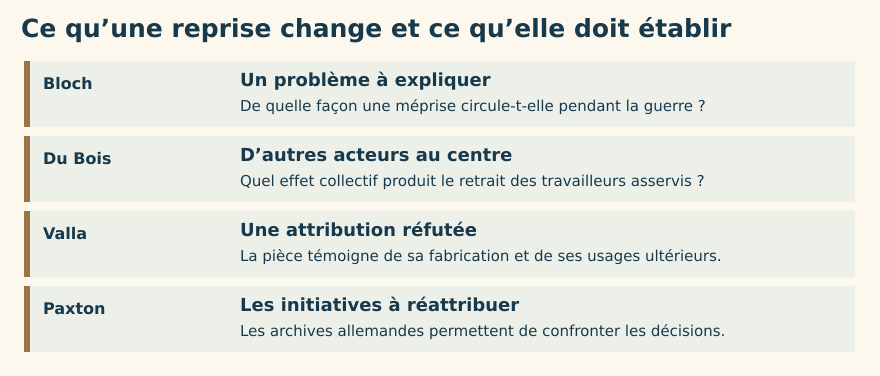

# ENS-PSL · CNEL Lettres — Histoire — Flaubert et l’écriture du passé 2021 · Corrigé guidé

*Corrigé rédigé par IA, non officiel. Signalez toute erreur.*

**Rédaction** · GPT-6.2 Astra Ultra · vitesse non renseignée

**Autocontrôle** · GPT-6.2 Astra Ultra · vitesse non renseignée

La feuille demande de commenter et discuter une phrase de Flaubert sur la liberté de regarder l’histoire, le rôle du présent et la nécessité de toujours la refaire. La citation provient de sa lettre à Edma Roger des Genettes de novembre 1864.

## Vérifier la relation entre les trois propositions

Le « puisque » justifie la liberté de regard et le « voilà pourquoi » en déduit la reprise indéfinie de l’histoire. On peut approuver la conclusion pour une raison différente de celle qu’énonce Flaubert. Une archive devenue accessible peut changer une explication sans que l’on ait simplement changé d’opinion.

**Quelle opération précise retenir chez Du Bois ?** La formule de « grève générale » met au premier plan des conduites de travailleurs asservis et l’effet collectif de leur retrait. Elle ne permet pas de leur attribuer un centre de décision ou un programme identiques. Cette distinction aide à discuter la portée d’une catégorie actuelle.

**Que prouve l’étude d’un faux ?** Écarter la valeur d’une pièce comme preuve de l’acte qu’elle prétend attester n’enlève pas sa valeur pour l’histoire de sa fabrication et de ses usages. On peut ainsi préciser ce qui est établi et ce qui demeure ouvert dans la même enquête.

**Quelle conclusion répond à la lettre ?** Indiquez quel sens de « libre » vous retenez, quelle dépendance au présent vous acceptez et en quel sens il y a vraiment lieu de recommencer. Cette réponse en trois mouvements évite de conclure par un vague éloge du doute.

## Le présent interroge, les traces répondent

La phrase de Flaubert, tirée d’une lettre de novembre 1864 à Edma Roger des Genettes, lie trois propositions. Chacun possède une liberté de regard. L’histoire serait la réflexion du présent sur le passé. Enfin, cette dépendance expliquerait pourquoi elle est toujours à refaire. Le lien paraît convaincant tant qu’on parle de questions. Une société qui change peut éprouver le besoin d’en poser de nouvelles. Il devient plus difficile à soutenir si l’on suppose qu’une réponse change de valeur pour la seule raison que le présent a changé. Quelle liberté appartient au chercheur qui reprend l’histoire, et qu’est-ce qui, dans la rencontre avec les traces d’un autre temps, empêche cette reprise de devenir un jeu de miroirs ?

## Une expérience présente rend pensables des questions nouvelles

Dans ses *Réflexions d’un historien sur les fausses nouvelles de la guerre*, publiées en 1921, Marc Bloch part d’une expérience de la Première Guerre mondiale dont il a été acteur et témoin. Une parole circule, rencontre l’attente de ceux qui la transmettent et finit par être reçue comme un fait. La distance qui sépare la déposition d’un témoin de ce qui s’est produit devient une question historique à part entière. Chercher uniquement à dresser une liste d’erreurs laisserait de côté le phénomène essentiel. Pourquoi telle méprise susceptible de s’éteindre rencontre-t-elle les conditions qui lui permettent de devenir une nouvelle collective ?

Le présent a ici une fonction plus précise que celle d’une humeur d’époque. Une expérience donne à un historien un terrain où examiner, parfois à courte distance, la diffusion de récits incertains. Elle renouvelle aussi une interrogation plus ancienne sur les témoignages et les légendes. Le mouvement n’a rien d’un privilège automatique de l’ancien combattant. Il faut encore distinguer ce que l’on a observé soi-même, ce que l’on tient d’un autre et ce que l’on induit de la circulation du bruit. L’expérience qui ouvre la question augmente du même coup le besoin de critiquer ses propres souvenirs.

*Black Reconstruction in America* de W. E. B. Du Bois, publié en 1935, permet d’observer un déplacement d’une autre ampleur. Une partie du récit alors dominant de la Reconstruction américaine traitait les populations sorties de l’esclavage comme les bénéficiaires passives d’une politique ou comme incapables de participer au gouvernement. Du Bois place le travail, la liberté et les initiatives politiques des anciens esclaves au centre du problème. Le chapitre sur la « grève générale » donne aux départs des travailleurs asservis durant la guerre de Sécession une signification collective. Une multitude de décisions qui ne procédaient pas d’un mot d’ordre unique pèse néanmoins sur le devenir du système esclavagiste. Le changement de regard demande de reconstruire l’enchaînement des actions et leurs effets. Le chercheur ne se contente pas de remplacer une appréciation hostile par une sympathie de sens inverse.

## La liberté de questionner ne rend pas toutes les réponses équivalentes

Le mot « réflexion » admet une interprétation faible et une interprétation forte. Le présent peut se réfléchir lui-même dans le passé, ne retrouvant dans l’histoire que les conflits dont il est déjà occupé. Mais réfléchir sur un objet signifie aussi accepter qu’il fasse difficulté. Les archives d’une administration esclavagiste, par exemple, nomment les personnes selon des catégories juridiques et économiques très éloignées des nôtres. Si l’on en reprend sans examen le classement, on risque d’effacer de nouveau l’initiative de ceux qu’elles enregistrent. Si l’on ignore leur vocabulaire au nom du regard présent, on perd la possibilité d’expliquer la contrainte effective que ce classement exerçait. Il faut travailler à la fois avec le document et sur les conditions qui le font parler ainsi.

La critique du texte connu sous le nom de *Donation de Constantin* fournit un cas limite. Le document prétend attester une donation de l’empereur Constantin au pape Sylvestre. Au XVe siècle, Lorenzo Valla en examine la langue et la cohérence historique et met en cause cette origine. Son intervention a un contexte polémique. Ce contexte éclaire l’intérêt de la question pour son auteur. Il ne suffit ni à démontrer ni à réfuter la critique philologique. Que le texte passe pour une fabrication médiévale et non pour un acte original du IVe siècle est une conclusion vérifiable à partir d’arguments dont d’autres chercheurs peuvent reprendre l’examen.

Surtout, changer ce verdict ne rend pas le texte inutilisable comme source. Il cesse de prouver une donation antique et devient une pièce pour étudier les prétentions et les usages politiques d’une autorité attribuée à l’Antiquité. Une nouvelle histoire est alors possible parce qu’une lecture précédente a été réfutée. Elle ne dispose pas pour autant de la liberté de présenter indifféremment le document comme charte antique ou comme faux médiéval.

## Refaire l’histoire peut préserver et déplacer à la fois

Robert Paxton, dans *Vichy France* en 1972, traduit en français en 1973, reprend les rapports du régime de Vichy avec l’occupant allemand. L’étude, qui mobilise notamment les archives allemandes saisies, permet de discuter les thèses selon lesquelles l’action de Vichy aurait principalement consisté à soustraire les Français aux exigences de l’occupant. Rechercher les initiatives des autorités françaises dans les négociations rend intelligibles des choix que la seule pression extérieure expliquait mal. La nouvelle enquête ne change pas la date de l’armistice. Elle modifie l’attribution d’initiatives et la relation entre des faits dont plusieurs étaient déjà connus. Le déplacement ne vient pas exclusivement de la sensibilité d’une autre génération. Il suppose des fonds accessibles, des comparaisons et des arguments sur leur portée.

Ces trois sens de la reprise ne sont pas interchangeables. On peut déplacer la question vers des acteurs précédemment marginalisés, corriger un verdict sur une pièce ou modifier l’explication d’une décision. Dans chaque cas des connaissances antérieures demeurent disponibles, parfois comme résultats, parfois comme erreurs identifiables. L’expression « toujours à refaire » est donc juste si elle signifie qu’aucune époque ne ferme la liste des questions pertinentes. Elle devient trompeuse si elle présente l’activité historique comme une suite de versions qui s’annuleraient à chaque génération.

Flaubert saisit ainsi une condition de liberté propre à l’histoire. Nous ne choisissons pas le point de vue de toutes les générations à venir et nous pouvons demander des comptes à celui que nous avons reçu. Mais l’objet de la réflexion a existé indépendamment de nos questions. C’est précisément parce qu’une lettre, une pratique collective ou une archive étrangère peuvent résister à ce que nous aimerions y trouver que le travail mérite d’être repris.

[Feuille de l’écrit](https://www.ens.psl.eu/sites/default/files/histoire-ecrit-cnel2021.pdf) · [Bloch, Réflexions de 1921](https://fr.wikisource.org/wiki/R%C3%A9flexions_d%E2%80%99un_historien_sur_les_fausses_nouvelles_de_la_guerre) · [Du Bois, notice du Smithsonian](https://www.si.edu/es/object/black-reconstruction-essay-toward-history-part-which-black-folk-played-attempt-reconstruct-democracy%3Asiris_sil_1063033) · [Donation de Constantin, notice BnF](https://catalogue.bnf.fr/ark:/12148/cb123807414) · [Robert Paxton, Vichy France](https://cup.columbia.edu/book/vichy-france/9780231124690/)
