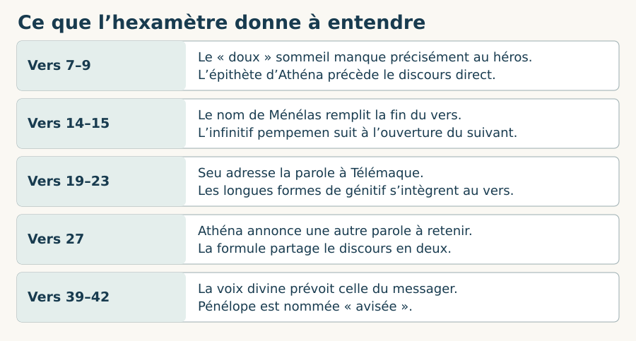

# ENS-PSL · CNEL Lettres — Homère — le songe de Télémaque 2021 · Corrigé brut

*Corrigé rédigé par IA, non officiel. Signalez toute erreur.*

**Rédaction** · GPT-6.2 Astra Ultra · vitesse non renseignée

**Autocontrôle** · GPT-6.2 Astra Ultra · vitesse non renseignée

## Comment la langue de l’épopée fait entendre une voix divine

Le sujet désigne les vers 7 à 42 du chant XV de l’*Odyssée* comme le « songe de Télémaque ». Le premier vers prend pourtant soin de retirer le jeune homme à l’emprise du doux sommeil. Inquiet pour son père, il reçoit dans la nuit la parole d’Athéna. On ne peut analyser la langue de l’épopée comme une simple collection de mots anciens. Dans cette scène, ses formes propres organisent un passage de la voix du narrateur à celle de la déesse, puis au message qui devra parvenir à Pénélope. La diction traditionnelle donne au récit la capacité d’anticiper et de transmettre d’autres paroles.

Le premier vers commence par Télémaque à l’accusatif, comme le remarquera le lecteur du grec. Le sommeil, sujet grammatical, ne le saisit pas. L’adjectif « doux » accompagne le sommeil au moment où celui-ci fait défaut au héros. L’épithète ne constitue donc pas chaque fois un diagnostic psychologique sur l’expérience présente. Elle appelle un monde d’associations traditionnelles sur lequel se détache la circonstance singulière. La « nuit immortelle », au vers 8, fournit une autre alliance typique. Au vers 9, le geste d’approche, le verbe de parole *prosephê* et le groupe *glaukôpis Athênê* conduisent jusqu’au nom de la déesse à la fin de l’hexamètre. La traduction « aux yeux clairs » propose une équivalence pour un composé dont les résonances ne se réduisent pas à une simple couleur. L’épithète compose, avec le nom et la place dans le vers, une unité disponible pour l’aède.

L’hexamètre dactylique repose sur des quantités de syllabes, dont l’alternance autorise les dactyles et leurs substitutions. On peut observer ce travail sans prétendre déduire la métrique grecque de la traduction. Le vers 14 contient *boên agathon Menelaon*, « Ménélas bon au cri de guerre ». L’association stable d’une qualité et d’un nom remplit la fin de l’unité métrique. Or, pour l’action présente, Athéna a besoin de Ménélas comme hôte capable de laisser repartir son visiteur. Une épithète héritée situe donc le personnage dans la mémoire héroïque au-delà de la seule qualité dont il fait usage dans l’instant. Le verbe *pempemen*, infinitif épique « renvoyer », est rejeté à l’ouverture du vers suivant. Le groupe traditionnel de désignation, loin de figer la syntaxe, peut coexister avec une attente verbale qui se poursuit de vers en vers.

La langue homérique réunit dans un système poétique des formes différentes de celles qui seraient ordinaires dans l’attique classique. Le datif pluriel *domoisin* au vers 11 et *stêthessi* au vers 20 illustrent des finales caractéristiques. Le génitif en *-oio* se lit au vers 22 dans *kouridioio philoio*, puis au vers 29 dans le nom de Samos. Il suffit ici de repérer la fonction dans la phrase. Une finale plus développée offre aussi au vers d’autres possibilités de combinaison. Les différentes formes pronominales ne sont pas indifférentes. Au vers 19, *seu aekêti* signifie « contre ton gré », Télémaque étant la personne à qui s’adresse Athéna. Le français imprimé propose « contre son gré ». Revenir à la deuxième personne permet de comprendre pourquoi la déesse place le jeune homme au centre d’un scénario menaçant ses biens.

La progression du discours est également audible dans les particules. *Alla* relance l’injonction ou corrige une attente, *gar* introduit une justification et les coordinations en *te* distribuent qualités et personnes. Athéna invite d’abord Télémaque à protéger sa maison. La généralisation sur les femmes appartient à son argument dans cette scène. Le même discours qualifie ensuite Pénélope de *periphrôn*, « avisée », là où la traduction donne « irréprochable ». À comparer les deux passages, on voit comment la parole divine mobilise successivement un lieu commun de persuasion et une épithète propre à la reine. La formule du vers 27, « je te dirai encore autre chose, toi, mets-le en ton esprit », partage nettement le discours en deux. Elle annonce au personnage et à l’auditeur un nouvel ensemble d’instructions.

Aux derniers vers, la syntaxe d’adresse fait place à la préfiguration d’un message. Les formes à valeur injonctive, notamment plusieurs infinitifs, organisent l’action à venir. Le porcher devra transmettre à Pénélope la nouvelle de la bonne santé et du retour de son fils. Au vers 42, la deuxième personne qui dominait la parole d’Athéna subsiste dans la formulation du contenu à rapporter. Le présent de l’entretien nocturne porte ainsi la parole future jusque dans la maison d’Ithaque. Les épithètes formulaires, la diversité morphologique et les charnières de la diction orale ne sont pas de simples signes d’ancienneté. Elles permettent à l’hexamètre de faire entendre des personnes, des temps et des actes de parole dont l’agencement constitue précisément la scène.

[Sujet officiel](https://www.ens.psl.eu/sites/default/files/dsa-5-sujet_epreuve_ecrite.pdf)
