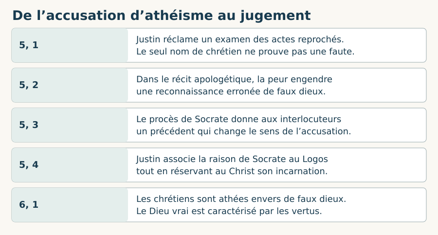

# ENS-PSL · CNEL Lettres — Justin de Néapolis — l’Apologie 2021 · Corrigé guidé

*Corrigé rédigé par IA, non officiel. Signalez toute erreur.*

**Rédaction** · GPT-6.2 Astra Ultra · vitesse non renseignée

**Autocontrôle** · GPT-6.2 Astra Ultra · vitesse non renseignée

## Respecter les deux flèches du fascicule

Le raisonnement à expliquer va de la question initiale de 5, 1 à l’expression « Dieu sans mélange de mal » de 6, 1. Le texte visible avant et après les flèches peut donner de l’orientation, mais n’allonge pas le passage imposé.

1. **Quel jugement Justin réclame-t-il ?** Une enquête sur les actes reprochés avant de condamner la personne.
2. **Qu’est-ce qui rapproche le passé religieux et le présent judiciaire ?** Dans les deux cas, la peur risque de tenir lieu d’examen.
3. **Pourquoi Socrate ?** Sa condamnation pour impiété fournit à des lecteurs hellénisés le précédent d’une accusation injuste.
4. **Que fait le mot Logos ?** Il permet de passer d’une activité de raison associée à Socrate à la personne du Christ selon la foi de Justin. Les deux médiations restent distinctes.
5. **En quel sens les chrétiens concèdent-ils le mot athées ?** Relativement à ceux que l’auteur appelle de faux dieux. Le complément transforme la portée de l’accusation.

## Socrate au service d’une défense des chrétiens

L’*Apologie* de Justin s’adresse en principe à Antonin le Pieux et à ses fils. L’extrait délimité par le sujet commence seulement à la question qui ouvre le chapitre 5 et s’arrête au premier paragraphe du chapitre 6, sur le Dieu que Justin dit sans mélange de mal. Le passage transforme progressivement les termes du procès qu’il dénonce. Ceux qui croient défendre les dieux ne sauraient pas toujours reconnaître ce qui mérite le nom de dieu, tandis que des accusés réputés athées seraient fidèles à la vérité divine. Pour opérer ce renversement devant des destinataires formés à la culture grecque, l’apologiste articule l’injustice procédurale, le précédent de Socrate et une interprétation chrétienne du *Logos*.

La question initiale porte sur le refus de juger les chrétiens en raison des actes qu’ils ont effectivement commis. La comparaison avec des « esclaves sans raison » vise ceux qui ont pourtant pouvoir de condamner. Justin suggère que les juges, s’ils agissent sous l’empire d’une passion et de récits mensongers, ne disposent plus de la liberté rationnelle dont leur autorité se réclame. Le texte oppose l’examen, *exetasis* dans la famille lexicale de l’enquête, à l’empressement de la condamnation. Il ne demande pas au destinataire d’embrasser immédiatement une doctrine. Il l’invite d’abord à examiner la personne et les griefs. Le pronom « vous » produit une interpellation embarrassante pour les représentants d’un pouvoir qui veut se croire juste.

Justin attribue ensuite la fabrication de ces mensonges aux mauvais démons. Selon l’histoire religieuse qu’il propose, ceux-ci se seraient imposés par des apparitions, des séductions et des terreurs. Les hommes effrayés auraient donné à ces êtres les noms divins que ceux-ci s’étaient attribués. Le défaut essentiel, à chaque étape, consiste à ne pas soumettre ce qui se manifeste à l’examen de la raison. Le passage dessine donc deux scènes comparables. Autrefois, des hommes ont pris pour des dieux des puissances qui les impressionnaient. Aujourd’hui, des juges risquent de prendre pour des crimes des récits qui les effraient. L’origine des cultes ainsi décrite appartient à la polémique de Justin et ne doit pas être présentée comme une description indépendante des religions antiques.

Socrate entre alors dans l’argument au titre de l’homme qui a osé examiner. La recherche du vrai par la raison détournerait, selon Justin, des puissances mauvaises. Celles-ci auraient obtenu de faire condamner l’enquêteur comme athée et impie, sous prétexte qu’il introduisait de nouveaux démons. Le rapprochement concerne un mécanisme d’accusation et la répétition d’une injustice. Il tire sa force de la réputation de Socrate auprès du lecteur cultivé, invité à se reconnaître parmi les admirateurs du philosophe avant d’examiner sa propre attitude envers les chrétiens. Justin change aussi la signification de *daimôn* dans le passage d’une culture à l’autre. Une puissance ou un signe divin de la tradition grecque ne se confond pas spontanément avec le démon malveillant de l’explication chrétienne. La proximité des mots devient précisément un moyen de relire le procès ancien.

Le quatrième paragraphe porte le raisonnement au-delà d’un parallèle moral. Chez les Grecs, les raisonnements vrais ont opéré par l’intermédiaire de Socrate. Chez ceux que le texte appelle barbares, le Logos en personne a pris forme et est devenu homme, Jésus-Christ. Le même lexique grec permet de passer de la raison humaine au Verbe personnel. Cette continuité donne au christianisme une place dans l’histoire de la recherche de la vérité. La différence des médiations en fixe toutefois la portée. Socrate exerce une recherche rationnelle, tandis que Justin attribue au Christ l’incarnation du Logos même. Justin ne dit ni que Socrate connaissait historiquement Jésus ni que toute philosophie grecque se réduit à une révélation chrétienne. Il sélectionne une conduite et un concept qui rendent son propos intelligible et défendable devant l’empereur.

Le retour au « nous » des chrétiens donne un effet concret à cette lecture. Ceux-ci refuseraient aux êtres pervers le nom de dieux, d’autant que leurs actes seraient tenus pour scandaleux même chez des hommes qui recherchent la vertu. Une évaluation morale que l’interlocuteur peut partager sert ainsi à distinguer le faux divin du Dieu véritable. Le chapitre 6 en tire une concession soigneusement limitée. Oui, les chrétiens sont « athées » relativement à ces prétendus dieux. Ils ne le sont pas à l’égard du Dieu de vérité, père de la justice, de la tempérance et des autres vertus, auquel aucun mal n’est mêlé. Le qualificatif d’athée, initialement reçu comme une accusation absolue, a désormais besoin d’un complément. En imposant cette précision, Justin récuse le principe d’une condamnation sur le seul nom.

Un projet sur la réception des procès de Socrate pourrait comparer les accusations évoquées dans l’*Apologie de Socrate* de Platon à leur reformulation dans la présente *Apologie*. Il conviendrait de distinguer l’accusation ancienne, le rôle de la parole adressée aux juges et la nouvelle interprétation démonologique. L’intérêt du parallèle tient au travail de traduction culturelle que le même épisode permet d’observer, et non à l’identité supposée des deux procédures.

[Sujet officiel](https://www.ens.psl.eu/sites/default/files/dsa-1-sujet_epreuve_ecrite.pdf)
