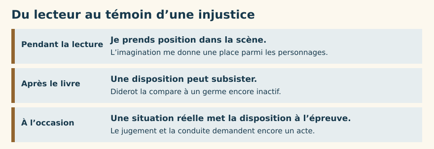

# ENS-PSL · CNEL Lettres — Littérature — Diderot et Richardson 2021 · Corrigé brut

*Corrigé rédigé par IA, non officiel. Signalez toute erreur.*

**Rédaction** · GPT-6.2 Astra Ultra · vitesse non renseignée

**Autocontrôle** · GPT-6.2 Astra Ultra · vitesse non renseignée

Épreuve écrite de trois heures. Les deux questions peuvent être traitées dans l’ordre choisi. La lecture personnelle développée dans la partie B est un exemple de copie.

## A. Commentaire de la phrase indiquée (5 points)

Diderot vient de se souvenir qu’il criait presque des avertissements aux personnages de Richardson. Comment la lecture a-t-elle pu produire un tel engagement ? La phrase proposée commence par éliminer, une à une, les explications les plus immédiatement disponibles, celles qui rapporteraient l’émotion à la surenchère dans l’extraordinaire. Après la liste, la désignation du monde où nous vivons apportera la réponse positive.

Le même sujet grammatical occupe toute la période. Richardson paraît accomplir successivement cinq actions, toutes niées. Aux quatre négations construites avec « point » succède « jamais », qui donne à la dernière exclusion valeur de principe. Les compléments dessinent pourtant un parcours spectaculaire. L’œil va des lambris d’un intérieur aux contrées lointaines, puis l’on passe par un lieu secret jusqu’aux régions imaginaires de la féerie. Les verbes du mouvement rendent presque sensible ce transport que l’auteur refuse. Le pronom « vous » installe le lecteur tantôt en voyageur, tantôt en victime possible. Avec les derniers verbes pronominaux, c’est l’écrivain lui-même qui risquerait de s’enfermer ou de se perdre. L’énumération séduit ainsi par ses images au moment même où elle en dénonce la facilité.

Ces lieux condensent des conventions de récits sanglants, de voyages aventureux, de fiction clandestine ou merveilleuse. Le terme colonial employé pour les habitants supposés des contrées lointaines appartient à un imaginaire européen de la peur, dont la phrase exploite le caractère convenu. Diderot ne donne pas une liste bibliographique de livres visés. L’opération polémique sert son projet d’éloge. Au vieux reproche qui fait du roman une lecture frivole et dangereuse, il oppose une fiction capable de placer les passions dans des circonstances que chacun peut reconnaître. *Clarisse* présente elle aussi dissimulation et cruauté. Leur effet vient de la possibilité d’identifier le jeu ordinaire de la confiance jusque dans les paroles d’un trompeur. La période négative prépare ainsi le paradoxe central du passage, une invention littéraire donne au lecteur de l’expérience.

## B. Réflexion personnelle (15 points)

À la lecture d’une injustice racontée, il m’arrive de savoir immédiatement de quel côté je me tiens. Dans « Les Animaux malades de la peste », lorsque la faute de l’âne devient soudain impardonnable, je voudrais protester pour lui. Si je reprends les voix du conseil depuis le début, je découvre ce qui a produit ce verdict. Le renard sait flatter le lion, une faute grave est ainsi redécrite, puis la même indulgence disparaît dès que le locuteur suivant n’a plus de puissance. Je ne retiens pas seulement un précepte d’équité. Je sais désormais écouter le moment où un jugement change de vocabulaire avec le rang de celui qu’on juge. Diderot a raison sur ce point, le récit exerce une attention que la règle, même juste, laisse souvent inemployée.

Toutefois, la satisfaction de s’être indigné pour l’âne ne répare aucun dommage. Diderot distingue lui-même plusieurs temps lorsqu’il compare l’effet du livre à une germination. Un lecteur a simulé une conduite, puis, peut-être, une occasion nouvelle ranimera cette disposition. La deuxième étape ne se déduit pas de la première. Il est très facile de condamner le pouvoir du lion quand on lit la dernière ligne. Il est plus coûteux de contredire un groupe auquel on appartient lorsqu’il traite injustement une personne absente. Si je veux attribuer un effet moral au livre, je dois nommer ce qu’il me permet de reconnaître dans cette situation nouvelle, et ce que je suis alors prêt à faire.

Certaines œuvres me rendent en outre plus attentif en me faisant d’abord mal juger. Dans *Orgueil et Préjugés*, Elizabeth et le lecteur reçoivent de Wickham un récit de ses torts supposés qui s’accorde avec une première impression défavorable de Darcy. La lettre de celui-ci force à remettre en ordre ce qui était connu, ce qui avait été raconté et ce qui avait été ajouté par complaisance. J’apprends moins à distribuer d’emblée les personnages entre bons et mauvais qu’à reconnaître l’alliance du plaisir et de la prévention dans mon propre jugement. Cette expérience convient mal à l’autoportrait triomphant du lecteur qui se trouve déjà juste, mais elle prolonge la confiance de Diderot dans les situations inventées.

Enfin la fiction n’a aucun privilège automatique d’humanité. Un narrateur peut réserver à son héros toutes les raisons, tout le temps et toute la parole, et faire des personnes qu’il traverse de simples obstacles. Un exercice de lecture consiste alors à reprendre une scène du point de vue de celui dont on ne nous explique presque rien, en marquant soigneusement ce que le texte laisse inconnu. Une telle question peut rendre le lecteur capable d’écouter au-delà du rôle qu’il avait spontanément adopté.

Je répondrais donc oui à la possibilité que formule la question. Une fiction me rend moralement meilleur lorsqu’une manière plus exacte d’écouter, de douter ou d’intervenir lui survit. Cette amélioration demeure une pratique à éprouver devant autrui. Le mérite propre du récit est de fournir une situation dans laquelle je peux déjà surprendre mes erreurs sans que quelqu’un ait à en payer le prix.

[Sujet et texte de l’épreuve](https://www.ens.psl.eu/sites/default/files/litteratures-ecrit-cnel_2021.pdf)
