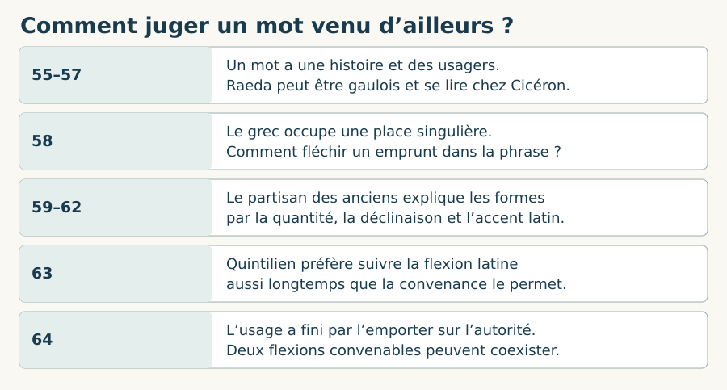

# ENS-PSL · CNEL Lettres — Quintilien — latin et langues étrangères 2021 · Corrigé guidé

*Corrigé rédigé par IA, non officiel. Signalez toute erreur.*

**Rédaction** · GPT-6.2 Astra Ultra · vitesse non renseignée

**Autocontrôle** · GPT-6.2 Astra Ultra · vitesse non renseignée

## Séparer provenance, forme et jugement

- *Raeda* vient du gaulois. Son emploi par Cicéron illustre sa place dans la littérature latine. La provenance demeure compatible avec l’intégration.
- *Patavinitas* rappelle un reproche fait à Tite-Live. Sa mention ne signifie pas que Quintilien en reprenne la conclusion.
- Aux paragraphes 59–62, un grammairien attaché aux anciens défend l’analogie latine. L’avis propre de Quintilien est introduit ensuite par *mihi autem placet*.
- Comparer *Maecenas* et *Aeneas* au seul nominatif ne permet pas de les ranger dans la même déclinaison. Il faut regarder aussi le génitif.
- *Calypsonem* est attesté par l’autorité de César, mais abandonné par l’usage retenu par Quintilien. L’ancienneté d’un exemple ne garantit pas sa convenance actuelle.

La péroraison de l’explication peut rendre compte du dernier paradoxe. Un orateur qui conserve la flexion grecque dans un cas où deux formes sont décentes peut être reconnu comme tel sans encourir de blâme.

## Peut-on parler correctement latin avec des mots qui viennent d’ailleurs ?

Dans le premier livre de l’*Institution oratoire*, Quintilien forme le jugement d’un futur orateur sur les ressources et les exigences de sa langue. Les paragraphes 55 à 64 du chapitre 5 partent d’une distinction apparemment simple entre mots latins et étrangers. Ils s’achèvent sur la possibilité d’employer une forme grecque sans mériter de reproche. Pour comprendre ce parcours, il faut distinguer plusieurs questions que la formule initiale pourrait faire confondre. D’où vient un mot ? À quelle communauté appartient-il au moment où on l’emploie ? Comment doit-on le fléchir ou le prononcer ? Une réponse à la première question n’emporte pas mécaniquement les réponses aux deux autres.

L’analogie fondatrice du paragraphe 55 associe circulation des mots, des hommes et des institutions. Le pluriel des peuples dont Rome a reçu des éléments étrangers fait de la diversité un caractère historique du latin. Une difficulté surgit dès qu’il faut tracer la frontière intérieure à l’Italie. Lucilius s’en prenait au parler de Vettius, Pollion relevait chez Tite-Live la couleur de Padoue, la *Patavinitas*. Ces autorités attestent qu’une différence locale peut s’entendre et faire l’objet d’un reproche. Quintilien se donne pourtant le droit de tenir pour romain tout ce qui est italien. C’est une décision sur le périmètre de son classement, prise en pleine connaissance d’usages qui le contestent. L’historien des langues doit en distinguer l’unification culturelle et politique de la question linguistique des parlers locaux.

Les mots de provenance plus lointaine déplacent ensuite le critère. Les noms de véhicules *raeda* et *petorritum* sont gaulois, mais Cicéron et Horace en fournissent des emplois autorisés. Les Carthaginois revendiquent *mappa*, terme familier du cirque, tandis que l’origine hispanique de *gurdus* est rapportée comme un ouï-dire. La série distingue ainsi témoignage d’écrivain, revendication d’origine et information entendue. L’emploi par le peuple de Rome peut rendre familier un terme dont l’étymologie reste incertaine. Lorsque Quintilien en vient au grec, il précise aussi la réciprocité de certains emprunts. Son affirmation selon laquelle la langue romaine serait en grande partie issue de la grecque appartient à la pensée antique de la parenté des langues. L’histoire moderne des langues indo-européennes distingue le grec et l’italique, à côté d’une longue histoire réelle d’emprunts. Reconnaître la place exceptionnelle du grec dans la formation de l’orateur ne requiert pas de reprendre telle quelle cette généalogie.

Avec le paragraphe 58, le problème change de niveau. Il ne s’agit plus principalement d’obtenir un mot lorsqu’une chose manque de nom, mais de l’insérer dans une phrase. Les mots étrangers suivront-ils les cas latins ? Un grammairien amateur des anciens prendrait le parti d’une flexion latine. L’ablatif, que le grec n’a pas comme cas distinct, lui sert d’argument pour montrer la difficulté d’une importation complète du paradigme grec. Il faut entendre ici une voix hypothétique. Le développement qui suit expose la logique des anciens avant que Quintilien ne donne son propre avis. Dans *Castorem*, ils allongeaient la syllabe médiane par analogie avec les noms latins de même silhouette. *Plato* illustre l’abandon du *n* final au nominatif. *Pelia* ou *Hermagora* évitent le *s* des noms masculins grecs en *-as*. Les exemples touchent donc quantité syllabique, terminaison du nominatif et flexion. Ils montrent jusqu’où pouvait aller l’effort pour faire entrer un emprunt dans les régularités romaines.

Le cas des noms latins qui se terminent aussi en *-as*, tel *Maecenas*, prévient une objection. L’identité d’une finale ne suffit pas à établir l’identité d’une déclinaison, puisque le génitif latin correspondant est en *-tis*. Les habitudes d’accentuation fournissent un autre critère. La prononciation d’*Olympo* ou de *tyranno* doit être comprise dans son rapport aux quantités et à la place de l’accent. Quintilien traite ainsi une question de culture générale par des exemples dont on peut contrôler la forme. Le grec se rend visible dans le latin jusque là où l’orateur s’efforce de l’adapter.

Les grammairiens plus récents préfèrent souvent les déclinaisons grecques. Quintilien prend position au paragraphe 63, *mihi autem placet*. Sa préférence va à la règle latine aussi longtemps que la convenance le permet. Il ne dirait plus *Calypsonem* sur le modèle de *Iunonem*, quoique César fournisse à cet emploi une autorité considérable. Le point décisif tient à l’adverbe « désormais ». Entre la pratique de César et celle du maître contemporain, l’usage a changé. La conclusion réserve enfin les cas où les deux formes restent convenables. Choisir alors la forme grecque peut être qualifié comme tel, sans être condamné. La norme qui se dégage de ce passage demande à l’élève de mettre en relation l’histoire des mots, les structures disponibles, l’usage présent et la situation de parole. Elle est d’autant plus exigeante que l’autorité d’un grand nom n’en dispense jamais.

[Sujet officiel](https://www.ens.psl.eu/sites/default/files/dsa-3-sujet_epreuve_ecrite.pdf)
