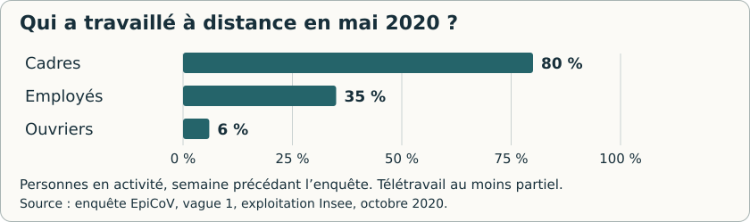
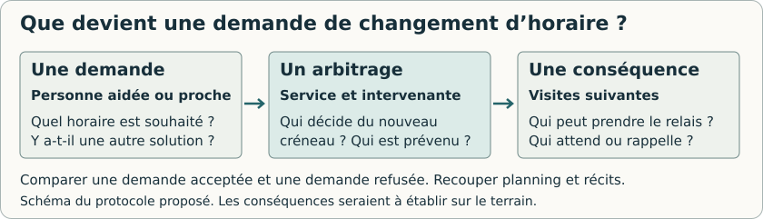

# Crise sanitaire ou interdépendances chez Elias · CNEL Lettres 2021 · Corrigé guidé

*Corrigé rédigé par IA, non officiel. Signalez toute erreur.*

**Rédaction** · GPT-6.2 Astra Ultra · vitesse non renseignée

Le candidat choisit un des deux sujets. Les deux propositions qui suivent peuvent se lire séparément. [Feuillet officiel de l’épreuve](https://www.ens.psl.eu/sites/default/files/sc.sociales-ecrit-cnel2021.pdf)

## 1. Enquêter sur la crise sanitaire depuis 2021

**Point de départ.** Comment une consigne aussi générale que celle de rester chez soi peut-elle avoir des conséquences si différentes ? Réservez dans votre brouillon une place à l’exposition à la maladie, une autre à l’organisation du travail et une troisième à la vie domestique. Puis reliez-les. Vous obtenez une problématique quand ce qu’une personne peut faire pour se protéger dépend du travail d’autres personnes. On se place pendant la crise, avec des publications accessibles à la session de 2021.

### Décrire une distribution avec un dénominateur

Prenez la figure ci-dessous. En mai 2020, sur cent cadres encore en activité interrogés sur la semaine précédente, environ quatre-vingts avaient travaillé à distance au moins en partie. Sur cent ouvriers en activité, six l’avaient fait. L’écart est de 74 points. La présence du mot *activité* est capitale. Les 94 autres ouvriers ont travaillé sans recourir au télétravail pendant cette semaine. Ceux dont l’activité était entièrement interrompue sont en dehors de ce calcul. Une comparaison pertinente avec le chômage partiel repartirait de toutes les personnes en emploi avant le confinement et préciserait la période couverte. [Givord et Silhol, *Insee Première*, 2020](https://www.insee.fr/fr/statistiques/4801313)

Changez maintenant de phénomène. La première vague d’EpiCoV estime à 4,5 % la proportion présentant des anticorps parmi les 15 ans ou plus vivant en ménage ordinaire en France métropolitaine en mai 2020. Une enquête et un prélèvement rendent visibles des expositions passées qui n’ont pas toutes été diagnostiquées. Les séries hospitalières, elles, enregistrent des admissions. Une hausse des admissions peut venir d’une épidémie plus intense ou d’une population atteinte plus âgée. Pour comparer deux départements, demandez comment ils se situent dans le calendrier épidémique et quelle est leur structure d’âge. Comparer un taux brut à un autre est un début d’enquête. [DREES et Inserm, premiers résultats d’EpiCoV, 2020](https://drees.solidarites-sante.gouv.fr/publications/etudes-et-resultats/en-mai-2020-45-de-la-population-vivant-en-france-metropolitaine)

### Comprendre un arbitrage de la vie ordinaire

Construisez une scène au conditionnel. Une personne se rend au travail conformément aux consignes de son employeur. Une voisine effectue le même trajet pour aider un parent. Leur mobilité observée est identique. Les obligations envers lesquelles elles s’estiment engagées diffèrent. Comment documenter ces significations ? On peut demander à chacune de raconter sa dernière sortie, de nommer la personne qui l’attendait, puis de dire ce qui serait arrivé si elle était restée chez elle. Ces questions donnent des prises précises à l’interprétation. Elles laissent la possibilité que l’enquêtée décrive une tout autre contrainte que celle imaginée au départ.

Reliez cette scène à un résultat publié. Dans COCONEL, l’équipe d’Anne Lambert distingue les pièces où l’on peut s’isoler de celles qu’il faut partager. Elle montre que le travail au domicile se déroule dans des conditions plus défavorables pour les femmes. Le terme *télétravail* recouvre donc des expériences qui varient avec le logement et la division du travail domestique. Pour vérifier comment la répartition s’effectue, on pourrait faire dresser par les membres d’un foyer, séparément, l’emploi du temps de la même journée. Une discordance entre les récits peut signaler une tâche qui va de soi pour celui qui en bénéficie. Elle demanderait une relance en entretien. [Lambert et al., enquête COCONEL, 2020](https://www.ined.fr/sites/default/files/imported_images/579.population.societes.juillet.2020.covid.travail.france.fr.pdf)

### Expliquer un écart en confrontant plusieurs mécanismes

Partez d’une association établie. EpiCoV trouve plus souvent des anticorps chez les professionnels du soin et dans les ménages comptant de nombreux occupants. Une hypothèse est que l’obligation de se rendre sur le lieu de travail puis la difficulté de s’isoler au domicile se cumulent. Une autre est qu’une partie des écarts résulte du lieu de résidence, certaines zones ayant été touchées plus tôt. Pour départager ces explications, rapprochez des personnes dont les professions diffèrent mais qui habitent le même territoire, puis des personnes de même métier qui habitent des logements différents. Un résultat qui subsiste justifie de poursuivre l’enquête. Un coefficient ne permet toujours pas de localiser chaque exposition individuelle. [DREES et Inserm, 2020](https://drees.solidarites-sante.gouv.fr/publications/etudes-et-resultats/en-mai-2020-45-de-la-population-vivant-en-france-metropolitaine)

Ajoutez les institutions à la comparaison. La fermeture d’un établissement et les conditions d’accès à l’activité partielle modifient les revenus, y compris chez les personnes qui n’ont pas été malades. Pour attribuer un changement à l’intervention publique, il faudrait connaître la trajectoire antérieure du secteur et la date où la demande a commencé à baisser. La comparaison de deux établissements semblables mais soumis à des calendriers différents serait plus instructive qu’un seul relevé après fermeture. Le récit d’une salariée, un tableau portant sur son groupe professionnel et la date d’une décision permettent ainsi d’expliquer pourquoi une contrainte commune se traduit en coûts inégalement répartis. Cette conclusion répond aux trois verbes du sujet tout en gardant distincts les effets de l’épidémie et ceux de sa gestion. [Givord et Silhol, 2020](https://www.insee.fr/fr/statistiques/4801313)

## 2. Lire Elias avec un projet d’enquête

**Projet de démonstration.** Retenons la distribution des horaires d’aide à domicile dans un service associatif. Le projet est construit pour montrer une démarche faisable. Choisissez dans votre propre projet une unité aussi précise qu’un horaire modifié, avec un début observable, plusieurs personnes concernées et une suite à reconstituer. Une enquête personnelle déjà menée n’est pas supposée ici.

**Lecture de la citation.** Qui agit ? Le sujet grammatical passe du collectif que nous constituons aux individus qui font quelque chose. Que veulent-ils ? Chacun poursuit une fin, et certaines décisions sont prises en commun. Quel résultat s’ensuit ? Rien ne garantit que la combinaison de ces décisions réalise le dessein de quelqu’un. Le présent du fonctionnement appelle alors une autre interrogation, sur la formation historique des relations entre les personnes. Cette dernière bascule commande le point c. La phrase entière pose une question de recherche. La copie serait incomplète si elle se bornait à définir l’interdépendance avant de décrire un terrain sans rouvrir cette question. [Elias, *La Société des individus*, p. 37, citation du sujet](https://www.ens.psl.eu/sites/default/files/sc.sociales-ecrit-cnel2021.pdf)

### a. Choisir des relations observables

Dans ma proposition, la bonne question serait de savoir qui peut faire avancer une visite et qui doit ensuite changer ses plans. Je choisirais quelques modifications dans deux semaines de plannings successifs d’un même service. Pour chacune, je comparerais l’horaire initial, l’heure proposée, l’heure finalement retenue et les personnes prévenues. Je prévoirais une dizaine d’entretiens au total avec des salariées, une personne chargée des tournées et plusieurs personnes aidées ou proches. Je chercherais également une demande refusée. Un tableau limité aux changements acceptés ferait disparaître les personnes qui ont le moins de prise sur le planning.

Demandez ensuite ce que prouve chaque matériau. Le planning donne la modification enregistrée. Un appel raconté peut révéler qu’une proche a obtenu le créneau en se rendant disponible à un autre moment. Le récit de la salariée peut montrer ce que ce service lui a coûté en trajet, ce qu’ignorait la coordinatrice. Ces possibilités deviennent des questions d’entretien. Les entretiens seraient volontaires, recueillis séparément. Les relevés seraient anonymisés, sans adresse ni dossier médical. Si l’accès aux plannings était refusé, des emplois du temps reconstitués offriraient un matériau déclaratif. Le résultat serait alors plus fragile sur l’ordre exact des événements.

### b. Distinguer la décision, la conséquence et l’épreuve de preuve

Un exemple fictif suffit pour raisonner. Une personne a besoin de quelques minutes de plus. L’intervenante décide de rester. La coordinatrice conserve la visite suivante, faute de remplaçante immédiatement disponible. Le proche qui ouvre la porte à l’étape suivante accepte de patienter. Personne n’a décidé que la dernière visite commencerait en retard. Pourtant chacun a fait quelque chose sans quoi le retard aurait pu prendre une autre forme. Il reste à savoir si cette chaîne se produit souvent et si elle explique mieux la situation que des trajets mal évalués dès le matin.

Pour départager ces hypothèses, je comparerais deux tournées également longues, dont une dispose d’un créneau libre, et deux débuts de journée avec des temps de trajet différents. Un retard qui s’accumule après chaque prolongation et disparaît lorsqu’il existe un relais appuierait la première hypothèse. Un retard déjà présent avant tout changement la fragiliserait. La coordinatrice peut modifier la répartition des marges, alors que la dernière personne visitée n’a souvent d’autre possibilité que de rappeler le service. La réciprocité de la dépendance laisse donc entière la question de l’inégalité des pouvoirs. L’intérêt d’Elias est de permettre cette distinction dans une même analyse.

### c. Comparer des états historiques du même objet

Construisez une chronologie courte, puis donnez à chaque date une question empirique. En 2002 entre en application l’allocation personnalisée d’autonomie. À partir de monographies menées en 2004, Thierry Rivard documente, dans quatre départements, une croissance de l’activité prestataire et des formes variables de coopération locale. En 2005, la création de l’Agence nationale des services à la personne s’inscrit dans une politique de structuration du secteur. Ces repères établissent comment de nouveaux financements et organismes peuvent s’interposer entre l’expression d’un besoin et la fixation de l’horaire. Ils invitent à chercher ce qui a changé concrètement dans le service étudié. [Rivard, 2006](https://drees.solidarites-sante.gouv.fr/publications/etudes-et-resultats/les-services-daide-domicile-dans-le-contexte-de-lallocation) · [DREES, enquête IAD](https://drees.solidarites-sante.gouv.fr/sources-outils-et-enquetes/03-lenquete-aupres-des-intervenants-domicile-iad)

Je demanderais des conventions et des rapports d’activité antérieurs à 2002, d’autres au milieu des années 2000 et d’autres encore à la veille de 2021. À chaque date, quels acteurs décident, quelle unité paie-t-on et quelle part de l’arrangement reste à la famille ? Si un ancien document ne dénombre que des visites et un plus récent des heures, comparer directement les chiffres créerait une évolution artificielle. Des entretiens avec d’anciennes salariées aideraient à retrouver ce qui fait défaut aux archives. On pourrait alors conclure sur des transformations documentées à deux niveaux. L’allocation et la réorganisation du secteur sont attestées. L’évolution des marges de négociation au sein de cette association demeure précisément ce que l’enquête proposée devrait établir.
