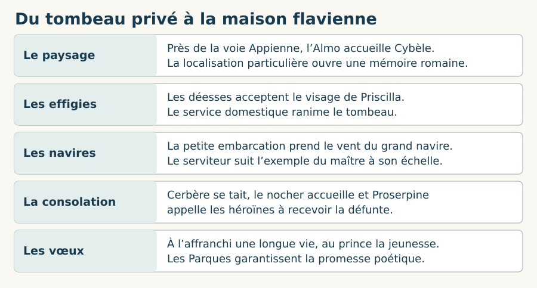

# ENS-PSL · CNEL Lettres — Stace — le tombeau de Priscilla 2021 · Corrigé guidé

*Corrigé rédigé par IA, non officiel. Signalez toute erreur.*

**Rédaction** · GPT-6.2 Astra Ultra · vitesse non renseignée

**Autocontrôle** · GPT-6.2 Astra Ultra · vitesse non renseignée

## Faire travailler ensemble une forme poétique et un document de civilisation

- **Le lieu.** La voie Appienne et l’Almo renvoient à une géographie réelle et au bain de Cybèle. Le geste d’indication au début du passage transforme cette géographie en parcours de lecteur.
- **Le corps.** Observez le verbe qui fait « respirer » le marbre. La matière du tombeau reçoit un trait de vie au moment où le poète refuse au temps la capacité de dégrader le corps.
- **Les images.** Les portraits divins et la présence des serviteurs donnent au tombeau l’allure d’une maison. La répétition de *domus* fixe la valeur accordée à cette ressemblance.
- **Les voix.** Le grand navire quitte Pharos et le petit emprunte le même vent. Le visiteur du tombeau reconnaîtrait dans la piété du serviteur l’exemple venu du maître.
- **La cour.** La prière de la morte porte sur l’époux vivant et sur le service de la maison flavienne. L’éloge domestique rencontre le culte impérial.

La consigne vise la poésie et la civilisation latines. À chaque étape, attachez une pratique ou un lieu à un procédé précis, puis formulez les limites de ce que ce poème de circonstance permet d’attester.

## Ce que le tombeau donne à voir de Rome et de son poète

Dans la première des *Silves* du livre V, Stace évoque Priscilla, épouse défunte d’Abascantus, un puissant affranchi de Domitien. Le sujet de 2021 invite à faire ressortir l’intérêt particulier de la page pour la poésie et la civilisation latines. Le tombeau de la voie Appienne offre une prise immédiate à cette double lecture. Il possède un emplacement, du marbre, des parfums, des images, mais la poésie met ces objets en présence d’une morte à laquelle on peut encore parler. Comment l’éloge donne-t-il à un monument familial une place dans la mémoire religieuse de Rome et dans la vie de cour ?

Le premier vers de l’extrait désigne un lieu avant de nommer la personne qui y repose. Aux portes de la Ville commence la voie Appienne. Le voisinage de l’Almo rappelle le bain de la Mère des dieux, Cybèle, que la note du sujet rattache à la célébration du 27 mars. La déesse y dépose ses gémissements et ne se souvient plus des fleuves de l’Ida. Le souvenir de l’Orient subsiste donc pour le lecteur, qui peut mesurer le chemin parcouru, tandis que le poème prête à la déesse elle-même un oubli susceptible d’annoncer la consolation du mari. Le passage d’un culte venu d’ailleurs au calendrier romain a laissé un repère dans la géographie de la ville. Le démonstratif de lieu puis l’apostrophe à Priscilla font de la lecture une visite. Le passant peut désormais s’adresser à celle qui repose ici.

Le corps n’a pas connu le bûcher, précise le poète, parce que le mari n’a pu en supporter les fumées et le fracas. L’étoffe teinte à la manière de Sidon et le lit de béatitude installent la morte dans un environnement dont la richesse se mesure à son pouvoir de conservation. Le marbre « respire » les trésors accumulés. Un verbe qui pourrait convenir au corps vivant passe ainsi au monument qui abrite ce corps. Les tours négatifs refusent successivement aux années et au travail du temps tout pouvoir de dégradation. Ce refus relève de l’éloge. Le texte indique que des soins ont été pris et n’en précise pas les procédés. Il éclaire surtout la valeur publique que le poème confère à une sollicitude privée.

Les démonstratifs des vers 232 et 233 font parcourir les formes que les artistes ont données à Priscilla. Voici Cérès en bronze, une brillante figure de Cnossos que l’on peut reconnaître comme Ariane, Maïa sous un dôme et Vénus dans le marbre. Le dernier portrait est celui d’une Vénus chaste, association rendue nécessaire par l’idéal conjugal célébré ici. Les divinités acceptent de recevoir les traits de Priscilla. La louange inverse le rapport attendu entre une femme et le modèle divin auquel elle pourrait chercher à ressembler. Le service des familiers prolonge l’illusion spatiale. Les lits et les tables sont toujours préparés, comme si l’hôtesse était en mesure de recevoir un visiteur. *Domus ista, domus*, « c’est une maison, une maison ! » L’exclamation vient de suspendre le mot même de tombeau. Les effigies permettent de rendre encore des devoirs à la maîtresse du lieu, sans qu’il faille conclure à une consécration officielle de cette femme à l’instar du prince.

Le regard hypothétique du passant remonte ensuite de la piété du mari à celle de son maître. On reconnaîtrait à la beauté du tombeau le serviteur du prince qui a honoré sa propre famille d’un sanctuaire. La note sur le temple de la *gens Flavia* rattache l’allusion à Domitien et à son père Vespasien divinisé. La comparaison nautique rend perceptible la différence d’échelle. Un grand navire quitte la côte de Pharos toutes voiles dehors. Une petite embarcation réclame alors sa part du même vent et suit le même chemin. L’empereur et l’affranchi demeurent de rangs très différents, mais ce que le serviteur accomplit à son échelle pour sa famille peut être interprété selon le modèle de la maison impériale. Cette hiérarchie donne sa mesure sociale à l’éloge que le poète de cour est en train d’écrire.

L’appel à la modération, adressé directement au veuf par *lectissime*, change la fonction de la description. Pourquoi entretenir des pleurs sans mesure ? Le poète prête d’abord au mari les craintes prévisibles d’un lecteur des récits de descente aux Enfers. Mais le gardien Cerbère sait se taire devant les âmes pieuses et le passeur accueille sans tarder celles qui le méritent. La barque des morts devient hospitalière, comme l’était la maison de la défunte. Proserpine convoque ensuite les héroïnes pour apporter lumière et fleurs aux âmes dont un époux fidèle a fait l’éloge. La lumière de pourpre répond à l’étoffe de Sidon dont Priscilla était enveloppée près de l’Appia. Le poète transforme les ressources de la mythologie en preuves sensibles de l’accueil favorable de son héroïne.

La prière finale oriente les regards vers les vivants. Celle que son époux entourait de soin intercède maintenant pour lui. Priscilla sollicite des puissances infernales la faveur qu’il atteigne le terme d’une longue vie, alors que son maître restera toujours jeune et occupé à pacifier le monde. Les derniers mots *ipse senex* donnent la vieillesse à l’époux humain. L’idéal de jeunesse revient au prince de la maison flavienne. Le serment des Parques confère à cette distribution des biens une autorité que le poème seul peut lui garantir. L’emplacement réel, les usages domestiques et le rang d’Abascantus ont donc fourni la matière d’une création pleinement poétique. La pointe des derniers vers rend à la fois à la morte une puissance d’agir, au mari une raison de vivre et au prince l’hommage dû à sa place dans cette société.

[Sujet officiel](https://www.ens.psl.eu/sites/default/files/dsa-7-sujet_epreuve_ecrite.pdf)
